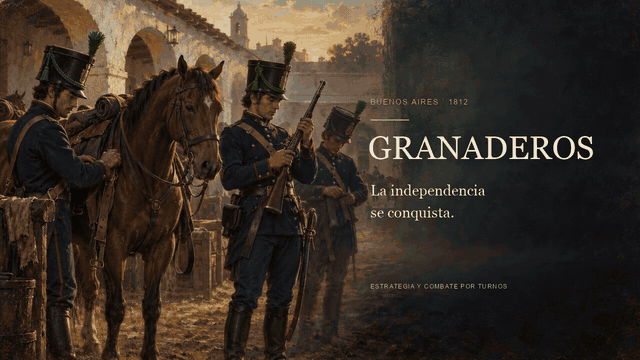

# Granaderos

**Formá un ejército. Mantenelo abastecido. Conducilo a la batalla.**

**Juego para navegador en desarrollo.** Consultá la [verificación de campañas separadas](docs/verification/campaign-engine-separation-2026-10-10.md) para el código actual. La [etiqueta 0.1](docs/verification/version-0.1.md) conserva el alcance de su punto de control anterior.

[](assets/video/intro/granaderos-intro.mp4?raw=true)

**Presentación histórica · 56 segundos · Grabación real del juego, ilustración original, textos en español y música original.** La vista previa animada muestra fragmentos del tráiler. [Descargar el video completo](assets/video/intro/granaderos-intro.mp4?raw=true) · [Leer los textos](assets/video/intro/captions.es.srt) · [Fuentes del video](assets/video/intro/README.md)

Granaderos es un juego de estrategia y combate táctico por turnos para navegador, ambientado en la Guerra de la Independencia argentina. Reclutá combatientes, administrá fondos y alianzas, y dirigí a cada soldado en el campo de batalla. El juego toma como referencia **Jagged Alliance 2 v1.13** y adapta sus sistemas a las armas y condiciones de la época.

La interfaz del juego y este README están en **español**. El código y la mayor parte de la documentación están en inglés.

La versión 0.1 permite jugar la campaña y los combates. Todavía falta verificar una campaña completa en esta versión, el equilibrio entre distintas fuerzas y estrategias, el rendimiento en equipos registrados y la presentación gráfica, sonora e histórica para una versión final. Las pruebas de rutas anteriores conservan su fecha y alcance; no certifican estos puntos en el código actual.

El motor y la campaña se guardan por separado. `campaigns/granaderos/` contiene la única campaña incluida. El menú puede mostrar varias campañas instaladas, cada una con su propio progreso. La [guía de campañas](docs/development/campaign-authoring.md) explica cómo crear, verificar e instalar una carpeta local. La publicación comunitaria y las herramientas adicionales siguen en el [plan de campañas propias](docs/plans/campaign-authoring.md).

El [Estudio de campañas](docs/authoring/campaign-studio.md) se está integrando en la ruta `/studio` para editar, probar y descargar un paquete completo desde el navegador. La guía distingue las pruebas realizadas de la verificación del sitio que todavía está pendiente.

[Jugar en el navegador](https://fsodano.github.io/granaderos/) · [Ejecutar en tu equipo](#ejecutar-en-tu-equipo) · [Cómo se juega](#cómo-se-juega) · [Desarrollo](#desarrollo) · [Documentación](docs/README.md)

## Jugar en el navegador

Abrí [Granaderos en GitHub Pages](https://fsodano.github.io/granaderos/). No requiere instalación. Elegí **Nueva campaña** para iniciar una campaña o **Combate de San Lorenzo** para jugar una batalla independiente. La etiqueta `0.1` identifica el código guardado en el repositorio. La versión disponible en GitHub Pages depende de su despliegue y puede ser distinta.

El juego guarda el progreso en el navegador. Usá **Guardar** para exportar una partida y **Importar partida** para cargarla. GitHub Pages y localhost usan espacios de almacenamiento separados. Para trasladar una campaña entre ambos, exportá la partida e importala en el otro sitio.

Para probar la versión 0.1, iniciá una campaña nueva. No se garantiza que funcionen las partidas anteriores al formato de paredes compartidas entre casillas. Las partidas con la economía anterior tampoco se convierten.

## Ejecutar en tu equipo

Instalá **Node.js 22.13.0 o posterior** y npm. Estos comandos descargan la rama predeterminada del repositorio:

```sh
git clone https://github.com/fsodano/granaderos.git
cd granaderos
npm ci --prefix web
npm run dev
```

Para probar esta implementación de campañas separadas antes de su integración en `main`, ejecutá `git checkout feature/campaigns` antes de instalar las dependencias.

Para revisar el código guardado de la versión 0.1, ejecutá `git checkout 0.1` antes de instalar las dependencias. Esa etiqueta conserva su alcance y no incluye las herramientas de campañas agregadas después.

Abrí [localhost:3000](http://localhost:3000) o la dirección que indique el servidor de desarrollo.

Seleccioná una campaña instalada. En la campaña Granaderos, elegí **Nueva campaña** para comenzar en el despacho del Retiro. Retiro es el único sector bajo tu control. Contratá combatientes o creá tu propio personaje sin costo. La primera persona que entre en servicio permite avanzar el capítulo inicial, sin un pago adicional a la academia. Las contrataciones usan el precio indicado y los combatientes deben llegar antes de incorporarse a la fuerza. **Combate de San Lorenzo** inicia una batalla independiente.

El juego guarda el progreso de la campaña en el navegador. Usá **Guardar** para exportar una partida a un archivo y **Importar partida** para cargarla.

La pantalla de inicio también permite abrir el [editor de historia](docs/development/story-editor.md) y el [editor de sectores](docs/development/sector-editor.md) para la campaña seleccionada. Sus borradores se guardan por separado para cada campaña. Una partida iniciada desde el editor usa una copia de su contenido y no reemplaza el progreso de la campaña instalada. El ejemplo **La ruta de las postas** sigue disponible como contenido experimental; no figura como segunda campaña instalada.

Para crear una campaña local, usá `npm run campaign:new -- mi-campana ./borradores/mi-campana`. Verificá su carpeta con `npm run campaign:check -- ./borradores/mi-campana`. La [guía de campañas](docs/development/campaign-authoring.md) detalla el formato, los recursos gráficos y la instalación. Estas órdenes están en el código actual de desarrollo; la etiqueta histórica `0.1` conserva su contenido original.

El juego para navegador usa JavaScript y React. No requiere el submódulo del motor ni una instalación original de JA2.

## Cómo se juega

La campaña conecta las decisiones estratégicas con los combates tácticos. Las heridas y el equipo de los soldados se conservan entre encuentros. Las bajas y la munición utilizada afectan las decisiones posteriores.

| En el mapa de campaña | En el campo de batalla |
| --- | --- |
| Contratá combatientes, formá escuadras y pagá contratos. | Explorá sectores y entrá en combate por turnos al encontrar enemigos. |
| Asegurá rutas, recuperá equipo y financiá el ejército. | Administrá puntos de acción, munición, recargas y el estado de las armas. |
| Entrená milicias, repará equipo y atendé a los heridos. | Usá el terreno, las líneas de visión, el humo y la postura. |
| Negociá alianzas y defendé los sectores capturados. | Combatí con armas de fuego, armas blancas, caballería y artillería con dotación. |

La campaña usa pesos como único recurso estratégico. Los ingresos de las poblaciones, las misiones pagadas y el dinero recuperado permiten pagar contratos, viajes y preparativos. El comercio de equipo está desactivado. Las armas y los suministros se obtienen con los combatientes reclutados o se encuentran físicamente en los sectores. La munición y las vendas son finitas: el dinero no permite comprar su reposición en esta versión.

Podés seleccionar, visitar y explorar las casillas terrestres y los distritos urbanos. Cada uno conserva su propia escena. Las casillas de aguas abiertas no permiten el desplazamiento terrestre.

La campaña comienza con Retiro bajo tu control. Sus capítulos recorren San Lorenzo, la campaña del norte y Yatasto, El Plumerillo y los preparativos del Ejército de los Andes. Los mapas y los acontecimientos son interpretaciones históricas adaptadas al juego.

Consultá el **Manual de campaña** dentro del juego para comenzar. Los [controles tácticos](docs/gameplay/tactical/TACTICAL-HOTKEYS.md) explican los comandos de teclado y mouse. El [índice de documentación](docs/README.md) reúne las guías de los sistemas y los registros de verificación.

## Rostros de la campaña

<table>
  <tr>
    <td align="center"><br><strong>Martín Miguel de Güemes</strong></td>
    <td align="center"><br><strong>Juan Bautista Cabral</strong></td>
    <td align="center"><br><strong>Juana Azurduy</strong></td>
  </tr>
</table>

Las figuras históricas sirven junto a voluntarios remunerados ficticios y un personaje personalizado. Sus atributos, equipo y condiciones de reclutamiento son diferentes.

Las imágenes anteriores son **ilustraciones del juego, no capturas de una partida**. Se conservan las instrucciones de generación y los archivos fuente de las pinturas y los retratos creados con IA. Los rasgos de los personajes y los detalles de los uniformes son interpretaciones artísticas. Consultá la [documentación gráfica](assets/README.md) y las [referencias de los retratos](assets/portrait-references.md) para conocer sus fuentes y limitaciones.

## Desarrollo

Después de instalar las dependencias de la interfaz web, ejecutá estos comandos desde la raíz del repositorio:

```sh
npm run test:quick   # Pruebas para el trabajo habitual
npm test             # Todas las pruebas, incluidas las rutas completas de campaña
npm run typecheck    # Validación de TypeScript
npm run build        # Compilación y validación de la exportación estática en dist/
```

La [guía de desarrollo](docs/development/getting-started.md#checks) explica cómo elegir pruebas específicas, rápidas o completas, y cómo registrar el alcance de una versión de desarrollo. Ejecutá todas las pruebas antes de cambiar las reglas de juego compartidas o de declarar completa la validación de una campaña.

Consultá primero la [verificación de campañas separadas](docs/verification/campaign-engine-separation-2026-10-10.md) para conocer las pruebas y los límites del código actual. El [estado de la versión 0.1](docs/verification/version-0.1.md) conserva la evidencia del punto de control anterior. El [registro de avances publicados](docs/verification/published-progress.md) y el [índice de verificación](docs/verification/README.md) conservan pruebas de entregas anteriores. Las pruebas automáticas cubren situaciones específicas. La validación completa de la campaña también requiere pruebas de juego.

| Ruta | Contenido |
| --- | --- |
| [web/](web/) | Interfaz para navegador, editores y recursos visuales compartidos |
| [game/](game/) | Motor compartido, reglas tácticas y validación de partidas guardadas |
| [campaigns/](campaigns/) | Campañas instaladas: contenido, mundo, mapas, presentación y recursos propios |
| [assets/](assets/) | Fuentes gráficas, instrucciones de generación, referencias y exportaciones |
| [tests/](tests/) | Pruebas de reglas e integración |
| [tools/](tools/) | Herramientas de compilación, recursos gráficos y verificación |
| [docs/](docs/README.md) | Guías, documentos de diseño y registros de verificación |
| `engine/`, `native/`, `patches/`, `mod/` | Código del proyecto original y trabajo previo de conversión nativa |

La [guía de desarrollo](docs/development/getting-started.md) detalla la instalación, los archivos generados y las comprobaciones. La versión para navegador es el juego principal. La conversión nativa anterior tiene requisitos de compilación y ejecución separados.

Para contribuir, revisá la [verificación actual](docs/verification/campaign-engine-separation-2026-10-10.md), los criterios de aceptación y el [índice de documentación](docs/README.md). Presentá una solicitud de cambios con un alcance definido y pruebas de verificación. Los recursos generados deben poder reproducirse a partir de sus archivos fuente. Indicá qué comportamiento comprobaste en el navegador.

[VERSION](VERSION) registra la versión del código. La etiqueta `0.1` conserva el punto de desarrollo publicado antes de la separación de campañas. La versión final requiere cerrar sus criterios de aceptación y superar la auditoría de finalización.
