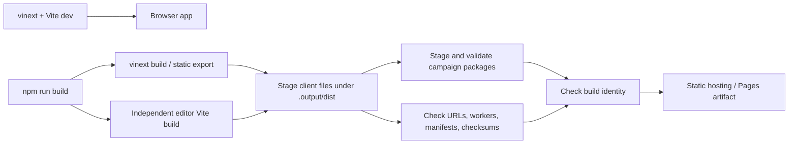
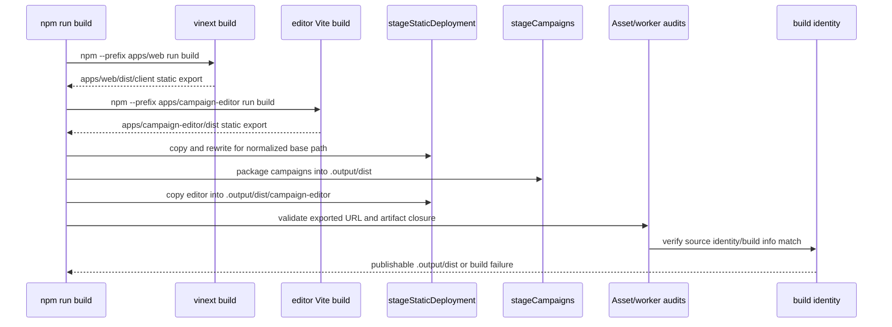

# Build and tooling

**Architecture guide:** [Overview](README.md) · [Content and campaigns](content-and-campaigns.md) · [Rendering](rendering.md)

The deployed web game is built as a static browser export; a server runtime is not required to serve the published game. The root build script adds campaign staging and deployment integrity checks around the web build. See the [architecture overview](README.md) and [content and campaigns](content-and-campaigns.md) for the campaign side of that pipeline.

## At a glance

## Web build versus root build

The web package declares `vinext dev` and `vinext build` in [`apps/web/package.json`](../../apps/web/package.json). Its [`apps/web/next.config.ts`](../../apps/web/next.config.ts) sets static export output and an asset prefix; [`apps/web/vite.config.ts`](../../apps/web/vite.config.ts) wires the vinext Vite plugin plus development/build identity and campaign-file handling. The browser app therefore uses a React/Vite toolchain while retaining the static-export shape. No Next server runtime is needed for the exported site; an optional local Wrangler `start` script exists but is not the publication requirement.

The top-level scripts are in [`package.json`](../../package.json). `npm run build` runs [`tools/build-web.mjs`](../../tools/build-web.mjs). It generates renderer fixtures, builds the game and independent editor, stages `apps/web/dist/client` into `.output/dist`, stages campaign packages, and copies `apps/campaign-editor/dist` into `.output/dist/campaign-editor`. It then checks the exported index, internal HTML/CSS/JS URLs, browser worker references, static manifest dependencies, known dynamic portrait/action URLs, artwork manifest SHA-256 checksums, tactical assets, and build identity consistency. Missing referenced assets, checksums, worker URLs, manifest dependencies, or a source/build identity race fail the build. `--stage-only` uses existing game and editor build outputs.

### Commands and artifacts

| Command | Inputs / behavior | Output / limits |
| --- | --- | --- |
| `npm run dev` (root) | Delegates to `npm --prefix apps/web run dev`; web script runs vinext dev. | Local browser app; Vite config provides identity and campaign-file dev middleware. Not a static deployment build. |
| `npm run build` (root) | Renderer fixture generation, game and independent editor builds, static staging, campaign export, URL/worker/artwork/tactical-asset verification and build identity check. Honors `GRANADEROS_BASE_PATH`. | Verified `.output/dist/` artifact with both applications; primary CI/Pages path. |
| `npm run build -- --stage-only` (root) | Skips fixture generation and both builds; requires existing `apps/web/dist/client` and `apps/campaign-editor/dist`. | Stages and verifies both existing application exports. |
| `npm --prefix apps/web run build` | Runs vinext build directly; no root campaign staging/audit wrapper. | Web package's export in `apps/web/dist/client`; not by itself the documented Pages artifact. |
| `npm run build:editor` | Checks the shared format package and builds the independent editor. | Editor application in `apps/campaign-editor/dist`; root staging places it at `/campaign-editor/`. |
| `npm --prefix apps/web run start` | Runs `wrangler dev --config dist/server/wrangler.json`. | Optional local server-oriented preview; it is not needed to serve the published static game. |
| `npm run campaign:new -- <id> <destination>` | Shared scaffold and folder verification; destination's basename must equal ID and existing target is not overwritten. | New package folder with manifest, docs, map index/maps, starter asset. |
| `npm run campaign:check -- <folder>` | Verifies package folder and compiles it against campaign contracts. | Validity/revision report or failure. |
| `npm run campaign:assets -- <folder>` | Refreshes authored asset metadata/checksums in the specified campaign folder. | Updated asset catalog; does not build the whole game. |

For current exact argument parsing, consult [`tools/campaign-authoring.mjs`](../../tools/campaign-authoring.mjs); these commands are authoring helpers and do not alter root build's validation sequence.

Deployment base paths are normalized by [`tools/deployment-path.mjs`](../../tools/deployment-path.mjs) and passed into staging and browser code. [`apps/web/lib/site-path.js`](../../apps/web/lib/site-path.js) supplies site-relative asset/page URLs, while [`tools/static-export-path.mjs`](../../tools/static-export-path.mjs) resolves and verifies exported references. This is why a site deployed below a repository/project subpath must use the configured base-path flow rather than hard-coded root assumptions. Build identity generation is in [`tools/build-identity.mjs`](../../tools/build-identity.mjs).

Development is separate from that staging path: root `npm run dev` delegates to the web package. Vite configuration includes a development middleware for build-info and a campaign-files plugin, while static export and production staging are executed by the root tool. Do not infer that development middleware is part of the deployed site.

## Validation and CI surface

Current root commands include:

| Command | Role |
| --- | --- |
| `npm test` | Run the repository's domain, application, persistence, editor, format, and gameplay test inventory through [`tools/test-runner.mjs`](../../tools/test-runner.mjs). |
| `npm run typecheck` | Type-check the game, web UI, and independent editor through their configured TypeScript projects. |
| `npm run build` | Build, stage, and verify both static applications. |
| `npm run audit:docs` | Check design/progress documentation records against the docs audit's expected baseline; it is not a semantic architecture-doc coverage test. |
| `npm run audit:baseline` | Check reference gameplay values against the source baseline; it is not an overall quality or runtime test. |

The web workflow in [`.github/workflows/web.yml`](../../.github/workflows/web.yml)
installs the game UI and editor dependencies on Node 22. It checks documentation,
the gameplay baseline, source boundaries, types, tests, and the static build.
The pull-request workflow in [`.github/workflows/tests.yml`](../../.github/workflows/tests.yml)
installs the same dependencies and checks boundaries and the complete minimum
test suite. The test runner discovers current `tests/*.test.mjs` plus tests inside
the domain, application, infrastructure, editor, and shared format. It prints the
actual file and test counts. The suite uses two test workers.

`npm run check:format` enforces source formatting for the architecture layers.
`npm run check:architecture` also enforces the editor's inward dependencies and
its declared public game/preview integration. These checks establish source and
contract evidence; browser and campaign-playthrough evidence have separate scopes.

## Legacy and native tooling boundary

The repository also contains legacy/native engine, mod, patch, and platform build material. Native compilation, mod/native/patch tooling, and platform packaging are not prerequisites of the browser static build described above. The native reference at [`docs/reference/native-build.md`](../reference/native-build.md) documents that separate toolchain. Likewise, old web-port plans and historical notes describe intended or previous work, not the current successful build path. Artwork/model generation and review utilities are also separate production workflows: root build verifies packaged browser assets and checksums; it does not invoke every generator under `tools/`. For present behavior, start with `package.json`, `tools/build-web.mjs`, web package scripts/configuration, and the active CI workflow.

## Limits

Build verification proves artifact closure for the references it scans and explicit dynamic-asset catalogs it knows about; it is not a general proof that every user journey or browser/device works. Static output and checksums do not replace browser integration testing. The CI workflow can change independently of these docs, so check the linked workflow when reporting exact release gates. For campaign-specific checks, see [content and campaigns](content-and-campaigns.md).
