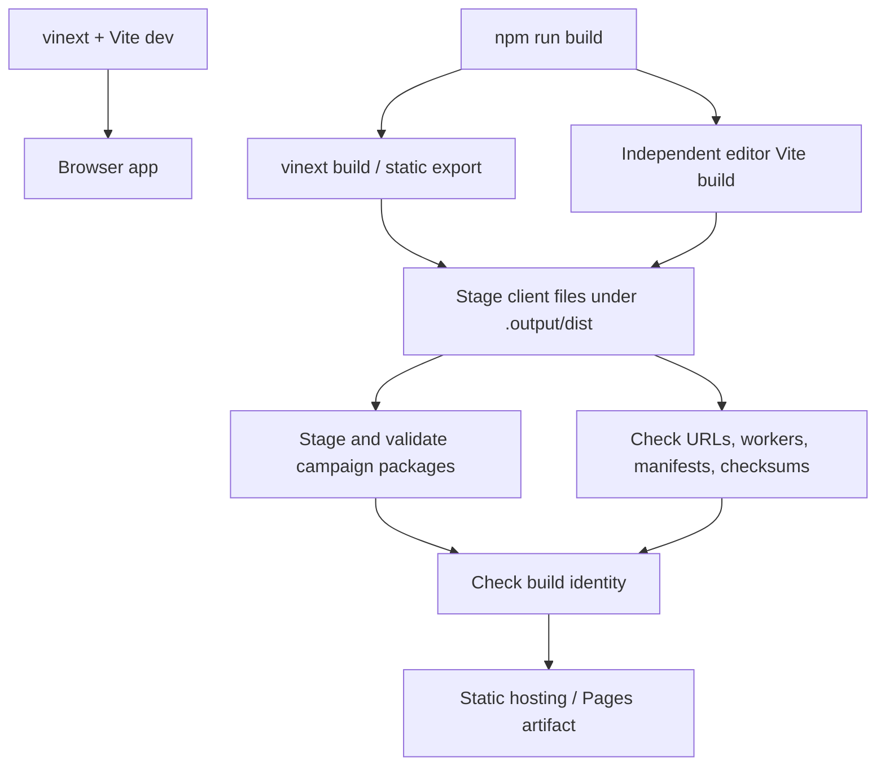
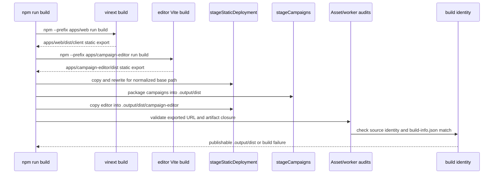

# Build and tooling

[Architecture guide](README.md) · [System map](system-map.md) · [Content and campaigns](content-and-campaigns.md) · [Rendering](rendering.md)

This page explains how Granaderos builds, stages, and checks the static browser deployment (`.output/dist/`), how root npm scripts and CI workflows enforce architectural boundaries, formatting, types, and tests, and how the browser toolchain stays separate from the native C++ reference tree. It connects the package boundaries in the [system map](system-map.md) to the campaign staging pipeline in [content and campaigns](content-and-campaigns.md) and the runtime asset manifests in [rendering](rendering.md).

## At a glance

The flowchart below shows how local development (`vinext + Vite dev`) serves the `Browser app`, and how `npm run build` runs `vinext build / static export` and `Independent editor Vite build`, combines them in `Stage client files under .output/dist`, executes `Stage and validate campaign packages` and `Check URLs, workers, manifests, checksums`, passes `Check build identity`, and produces the `Static hosting / Pages artifact`.

## Web build versus root build

[`apps/web/package.json`](../../apps/web/package.json) declares `vinext dev` and `vinext build`. [`apps/web/next.config.ts`](../../apps/web/next.config.ts) configures static export output and the deployment asset prefix, while [`apps/web/vite.config.ts`](../../apps/web/vite.config.ts) wires the vinext Vite plugin, build-identity metadata, and development campaign-file middleware. The published site is a purely static export that runs in the browser without a Node.js or Next.js server process.

At the repository root, [`package.json`](../../package.json) defines `npm run build` (`node tools/build-web.mjs`). [`tools/build-web.mjs`](../../tools/build-web.mjs) generates architecture fixtures ([`tools/generate-architecture-fixtures.mjs`](../../tools/generate-architecture-fixtures.mjs)), builds `apps/web` and `apps/campaign-editor`, stages `apps/web/dist/client` into `.output/dist`, packages and validates campaigns into `.output/dist/campaigns`, and copies `apps/campaign-editor/dist` into `.output/dist/campaign-editor`. It then verifies internal HTML/CSS/JS asset URLs, worker bundles ([`tools/verify-browser-workers.mjs`](../../tools/verify-browser-workers.mjs)), manifest dependencies, artwork SHA-256 checksums, tactical 3D assets ([`tools/verify-tactical-assets.mjs`](../../tools/verify-tactical-assets.mjs)), and build identity consistency ([`tools/build-identity.mjs`](../../tools/build-identity.mjs)). Passing `--stage-only` skips fixture generation and both application builds, staging and auditing existing `apps/web/dist/client` and `apps/campaign-editor/dist` directories.

The sequence diagram below traces the steps orchestrated by `npm run build` across `vinext build`, `editor Vite build`, `stageStaticDeployment`, `stageCampaigns`, `Asset/worker audits`, and `build identity`.

Deployment base paths (`GRANADEROS_BASE_PATH`) are normalized by [`tools/deployment-path.mjs`](../../tools/deployment-path.mjs) and applied during staging ([`tools/stage-static-deployment.mjs`](../../tools/stage-static-deployment.mjs)), runtime URL resolution ([`apps/web/lib/site-path.js`](../../apps/web/lib/site-path.js)), and export verification ([`tools/static-export-path.mjs`](../../tools/static-export-path.mjs)).

## Commands, checks, and CI workflows

The table below lists each root build, authoring, and verification `Command`, its `Inputs / behavior`, and its `Output / scope`.

| Command | Inputs / behavior | Output / scope |
| --- | --- | --- |
| `npm run dev` | Delegates to `npm --prefix apps/web run dev` (`vinext dev`). | Local development server for `apps/web` with Vite dev middleware; not a static export. |
| `npm run build` | Generates fixtures, builds `apps/web` and `apps/campaign-editor`, stages `.output/dist`, exports campaigns, and audits URLs, workers, assets, and build identity (honoring `GRANADEROS_BASE_PATH`). | Complete `.output/dist/` static deployment artifact containing both applications and installed campaigns. |
| `npm run build -- --stage-only` | Skips fixture generation and application builds; requires pre-built `apps/web/dist/client` and `apps/campaign-editor/dist`. | Restages and audits existing build outputs under `.output/dist/`. |
| `npm --prefix apps/web run build` | Runs `vinext build` in `apps/web` without root campaign staging or asset audits. | Client export in `apps/web/dist/client`. |
| `npm run build:editor` | Runs `npm --prefix packages/campaign-format run build` and `npm --prefix apps/campaign-editor run build`. | Independent editor export in `apps/campaign-editor/dist`. |
| `npm run check:architecture` | Runs [`tools/check-architecture.mjs`](../../tools/check-architecture.mjs) over `packages/game`, `apps/campaign-editor`, `packages/campaign-format`, and `apps/web`. | Enforces package and layer import boundaries and rejects browser globals and `Math.random` in `domain` and `application`. |
| `npm run check:dependencies` | Runs [`tools/check-dependencies.mjs`](../../tools/check-dependencies.mjs) with [`.dependency-cruiser.json`](../../.dependency-cruiser.json). | Enforces dependency-cruiser boundary rules, blocks production imports of `tools/` or tests, and rejects `domain`/`application` runtime cycles. |
| `npm run check:format` / `npm run lint` | Runs [`tools/code-quality.mjs`](../../tools/code-quality.mjs) for formatting and linting checks. | Enforces repository code formatting and static lint rules. |
| `npm run typecheck` | Runs TypeScript project checks across `packages/game`, `apps/web`, `apps/campaign-editor`, and `tsconfig.json` (`typecheck:tools`). | Verifies static types across packages, applications, and tools. |
| `npm test` | Runs [`tools/test-runner.mjs`](../../tools/test-runner.mjs) across `.test.ts` and `.test.tsx` files in `tests/`, `packages/`, `apps/`, and `tools/`. | Executes unit and integration test suites across two worker processes. |
| `npm run audit:dependencies` / `npm run audit:baseline` | Runs [`tools/audit-dependencies.ts`](../../tools/audit-dependencies.ts) and [`tools/audit-baseline.mjs`](../../tools/audit-baseline.mjs). | Checks dependency declarations and compares reference gameplay constants against the source baseline. |
| `npm run verify` (`verify:commit`, `verify:quick`) | Runs [`tools/verify.mjs`](../../tools/verify.mjs) with the `full`, `commit`, or `push` profile from [`tools/verification-plan.ts`](../../tools/verification-plan.ts). | Executes the ordered verification pipeline (`check:format`, `lint`, `check:architecture`, `check:dependencies`, `typecheck`, `test`, `audit:dependencies`, `audit:baseline`, and `build` in `full`). |
| `npm run campaign:new -- <id> <destination>` | Runs [`tools/campaign-authoring.mjs`](../../tools/campaign-authoring.mjs) `scaffold` and validates the created folder. | Creates a new campaign package directory with starter manifest, documents, maps, and assets. |
| `npm run campaign:check -- <folder>` | Runs [`tools/campaign-authoring.mjs`](../../tools/campaign-authoring.mjs) `check` against `compileCampaignPackage` and asset digests. | Reports campaign package validity and revision metadata. |
| `npm run campaign:assets -- <folder>` | Runs [`tools/campaign-authoring.mjs`](../../tools/campaign-authoring.mjs) `assets`. | Recomputes and updates SHA-256 asset entries in `<folder>/assets.json`. |

GitHub Actions workflows in [`.github/workflows/web.yml`](../../.github/workflows/web.yml) (push to `main` and manual dispatch, publishing `.output/dist/` to GitHub Pages) and [`.github/workflows/tests.yml`](../../.github/workflows/tests.yml) (pull requests and manual dispatch) install `apps/web`, `apps/campaign-editor`, and `tools/playgrounds/granadero-3d` dependencies using the Node version in [`.node-version`](../../.node-version) and run `npm run verify`. A separate manual workflow in [`.github/workflows/build-windows.yml`](../../.github/workflows/build-windows.yml) builds the native Windows engine and campaign overlay package.

## Native reference and asset-generation boundary

The native C++ engine and platform build files in [`reference/native/`](../../reference/native/) are separate from the browser applications and are not invoked by `npm run build`; see [`docs/reference/native-build.md`](../reference/native-build.md) for that reference toolchain. Offline art and 3D character preparation utilities under `content/assets/` and `tools/characters-3d/` generate packaged files committed to `apps/web/public` and `content/campaigns/`; the static build verifies those packaged outputs and their SHA-256 digests rather than re-running art generators during deployment.
