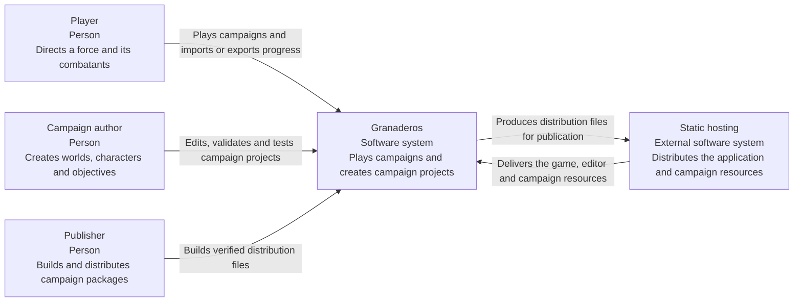
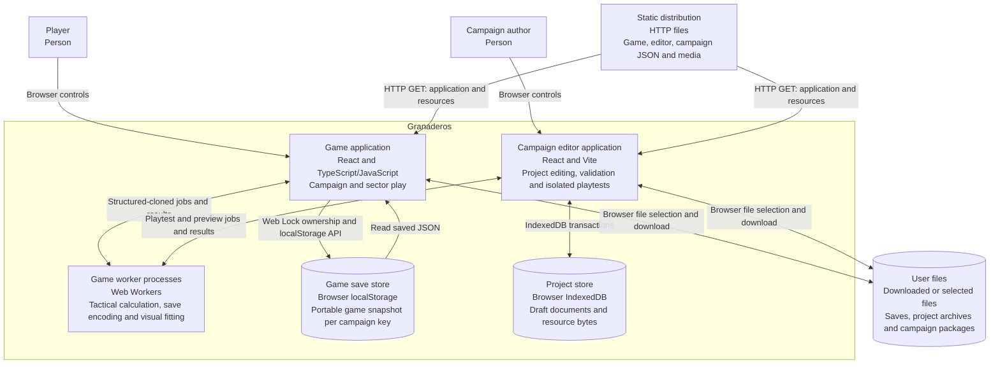
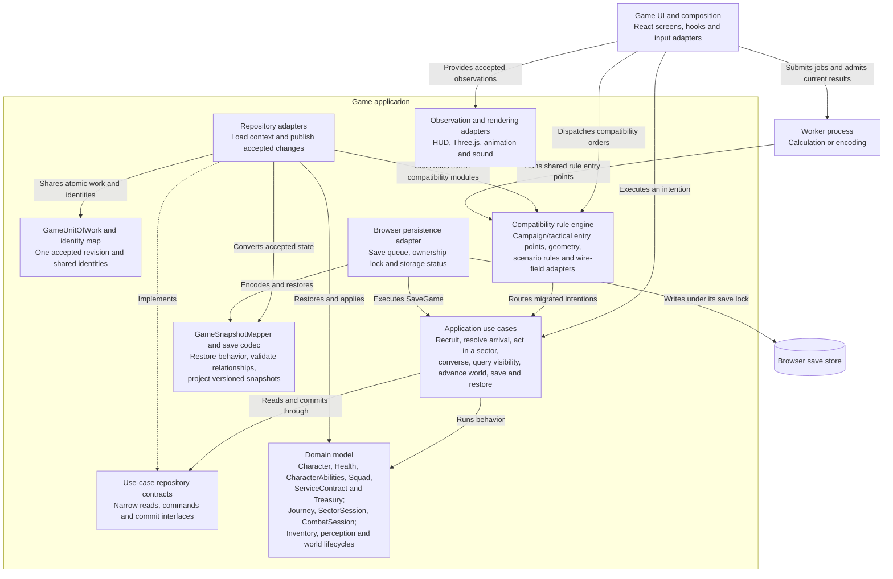
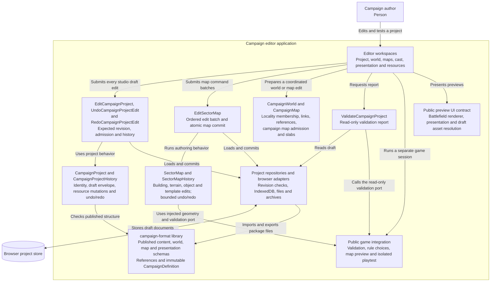

# C4 architecture views

[Architecture guide](README.md) · [Progressive explanation](overview.md) · [Accepted architecture](../plans/accepted/domain-architecture.md)

These diagrams describe the browser implementation in the working source on
28 October 2026. They separate software users, running applications, data stores,
and components. The `game`, `campaign-editor`, and `campaign-format` packages are
source boundaries. The applications are `apps/web` and `apps/campaign-editor`;
the reusable packages are `packages/game` and `packages/campaign-format`.
Each application bundles the code it uses. See the
[repository map](../development/repository-layout.md) for source navigation.

The views follow the official C4 scopes: a [system context](https://c4model.com/diagrams/system-context)
shows people and systems; a [container view](https://c4model.com/diagrams/container)
shows applications and data stores; a [component view](https://c4model.com/diagrams/component)
shows responsibilities inside one application. A C4 container does not imply
Docker or a server process.

## Level 1: people and the system

The player chooses orders. The simulation determines their consequences. The
campaign author supplies supported data. Authored data does not install arbitrary
executable rules. The exported game runs in the browser without a gameplay server.

## Level 2: applications and storage

The two applications have separate entry points and builds. The game routes
`/studio`, `/story`, and `/editor` contain links to the editor application at
`/campaign-editor/`. Editor playtests execute the game's public API inside an
isolated session in the editor application. They do not send commands to the
player's open game tab.

The shared [`campaign-format`](../../packages/campaign-format/README.md) package is a code
library used by both applications. It defines published campaign contracts,
identifiers, file schemas, cross-reference checks, resource hashes, and immutable definitions. It is not a
separate runtime service. The [`game`](../../packages/game/package.json) package supplies
rules and public integration APIs. Its runtime imports no editor implementation.

Each browser application creates its own workers as needed. Workers return data
to their caller. The save worker cannot write localStorage. The browser save
adapter holds one exclusive lock for each save key and reports accepted progress
separately from persisted progress.

Source: [`apps/web/app/page.tsx`](../../apps/web/app/page.tsx),
[`editor main`](../../apps/campaign-editor/web/main.tsx),
[`editor build`](../../apps/campaign-editor/vite.config.mjs),
[`static staging`](../../tools/build-web.mjs),
[`worker executor`](../../apps/web/lib/battle-executor.ts),
[`save writer`](../../apps/web/lib/browser-save-writer.ts), and
[`project storage`](../../apps/campaign-editor/web/lib/campaign-studio-storage.ts).

## Level 3: game application components

The repository interface belongs to its use case. Adapters share transaction,
identity, mapping, and storage mechanisms. The domain and application directories
do not depend on React or browser APIs. Public application entry modules are
composition adapters in `packages/game/public` and `apps/campaign-editor/public`. They can
construct concrete infrastructure for callers. Application modules have no
exception to the rule that they import only their own contracts and domain.

The compatibility component is material. `campaign.js`, `tactical.js`, and many
specialized rule modules still execute gameplay rules. Their names and save fields
are mapped explicitly where a migrated domain slice uses canonical terms. The
presence of a domain class does not establish that every rule of that subsystem
has moved into it.

| Intention | Application contract | Rule owner | Infrastructure and integration |
| --- | --- | --- | --- |
| Recruit a combatant | [RecruitCombatant](../../packages/game/application/personnel/recruit-combatant/recruit-combatant.use-case.ts) | [RecruitmentService](../../packages/game/domain/personnel/recruitment-service.ts), Character, ServiceContract, Treasury and ForceRoster | [Recruitment repository](../../packages/game/infrastructure/personnel/campaign-recruit-combatant.repository.js) and shared personnel mapping |
| Resolve hostile arrival | [FightOnArrival](../../packages/game/application/journeys/fight-on-arrival/fight-on-arrival.use-case.ts), [WithdrawOnArrival](../../packages/game/application/journeys/withdraw-on-arrival/withdraw-on-arrival.use-case.ts) | [Journey](../../packages/game/domain/journeys/journey.ts) and ArrivalDecision | [Journey repositories](../../packages/game/infrastructure/journeys/campaign-journey-repositories.js) |
| Act in a sector | [ExecuteSectorOrder](../../packages/game/application/sector-sessions/execute-sector-order/execute-sector-order.use-case.ts) | [SectorSession](../../packages/game/domain/sector-sessions/sector-session.ts), CombatSession and SectorParticipant | [Sector session mapping](../../packages/game/infrastructure/sector-sessions/sector-session-mapper.js), tactical engine |
| Converse with a character | [TalkToCharacter](../../packages/game/application/talk-to-character/talk-to-character.use-case.ts) | Conversation rules, recruitment rules and participant identity | [Conversation repository](../../packages/game/infrastructure/session/talk-to-character-repository.js) and participant projection |
| Inspect visible characters | [GetVisibleCharacters](../../packages/game/application/perception/get-visible-characters/README.md) | [VisionObserver](../../packages/game/domain/perception/vision-observer.ts), FieldOfView, VisibilityPolicy and KnownSectorPolicy | [Perception adapter](../../packages/game/infrastructure/perception/sector-perception.js) and visibility query repository |
| Transfer an item | [TransferItem](../../packages/game/application/inventory/transfer-item/README.md) | [Inventory](../../packages/game/domain/inventory/inventory.ts), Item and ItemTransferService | Inventory adapters preserve item quantities and custody in the physical scene |
| Save or restore progress | [SaveGame](../../packages/game/application/save-game/README.md), [RestoreGame](../../packages/game/application/restore-game/README.md) | GameSession identity and restored domain invariants | [Snapshot mapper](../../packages/game/infrastructure/persistence/game-snapshot-mapper.js), [save codec](../../packages/game/save.js) and browser writer |

## Level 3: campaign editor components

`CampaignDefinition` checks the complete published file set through neutral
schemas. `CampaignContentSchema` admits characters, equipment, dialogue, quests,
placements and configured rules. World and map schemas admit their records and
references. Presentation and physical-source schemas check their own documents.
The public game API adds supported capabilities, compiled map geometry and access,
concrete item behavior, escort feasibility and scenario compatibility. File
validation creates no mutable game progress.

Editor projects can remain incomplete. Validation controls playable packages and
installable export. Undo history stores owned snapshots. Browser resources and
object URLs remain outside published definitions.

The campaign studio sends draft changes, renames and history actions through
application use cases. Its editing repository owns one project history and checks
the expected revision. Opening another project invalidates pending callbacks.
Validation reads that same model and returns the inspected revision.

`CampaignWorld` owns linked locality, district, place and route changes, including
deletion-reference guards. `CampaignMap` owns the fixed campaign map slot and
slab access policy. The standalone and embedded sector editors use
`EditSectorMap`; `SectorMap` owns authoring transformations and transactional
command batches. The injected game API supplies shared geometry compilation and
schema validation. Renderer review scenes consume generated map documents;
the running game imports no map editing implementation.

Source: [`shared schema ownership`](../../packages/campaign-format/README.md),
[`CampaignDefinition`](../../packages/campaign-format/campaign-definition.js),
[`CampaignProject`](../../apps/campaign-editor/domain/campaign-project.ts),
[`CampaignProjectHistory`](../../apps/campaign-editor/domain/campaign-project-history.ts),
[`EditCampaignProject`](../../apps/campaign-editor/application/edit-campaign-project/edit-campaign-project.use-case.ts),
[`ValidateCampaignProject`](../../apps/campaign-editor/application/validate-campaign-project/validate-campaign-project.use-case.ts),
[`CampaignWorld`](../../apps/campaign-editor/domain/campaign-world.js),
[`SectorMap`](../../apps/campaign-editor/domain/sector-map.js),
[`EditSectorMap`](../../apps/campaign-editor/application/edit-sector-map/README.md),
[`project editing repository`](../../apps/campaign-editor/infrastructure/campaign-project-editing-repository.ts),
[`fixture generation`](../../tools/generate-architecture-fixtures.mjs),
[`public game editor API`](../../packages/game/public/campaign-editor-api.js),
[`public playtest API`](../../packages/game/public/campaign-playtest-api.js), and
[`public preview UI`](../../apps/web/game-preview.ts).

## How to verify a boundary claim

Run `npm run check:architecture` for source import restrictions. Run
`npm --prefix apps/campaign-editor run build` for the independent editor artifact.
Use domain and application tests to verify invariants and refusal behavior. Use
browser checks for visible routes, controls, rendering, and file workflows.
These diagrams describe implementation structure; they do not certify completion
of a campaign or correctness of every retained rule.
