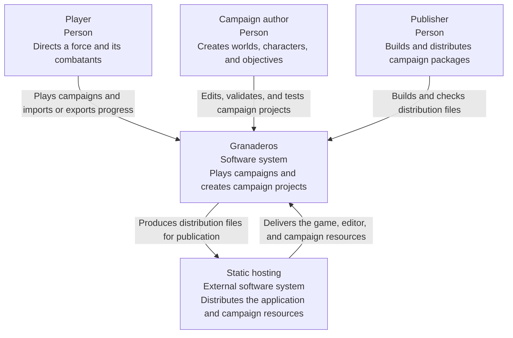
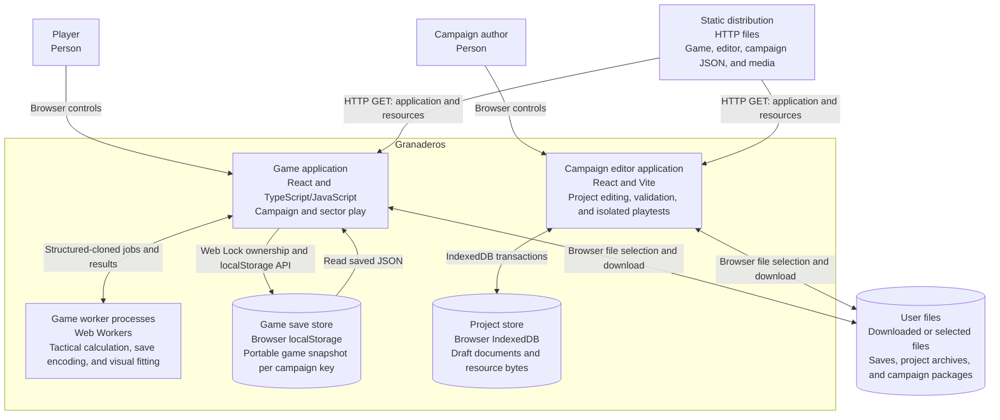
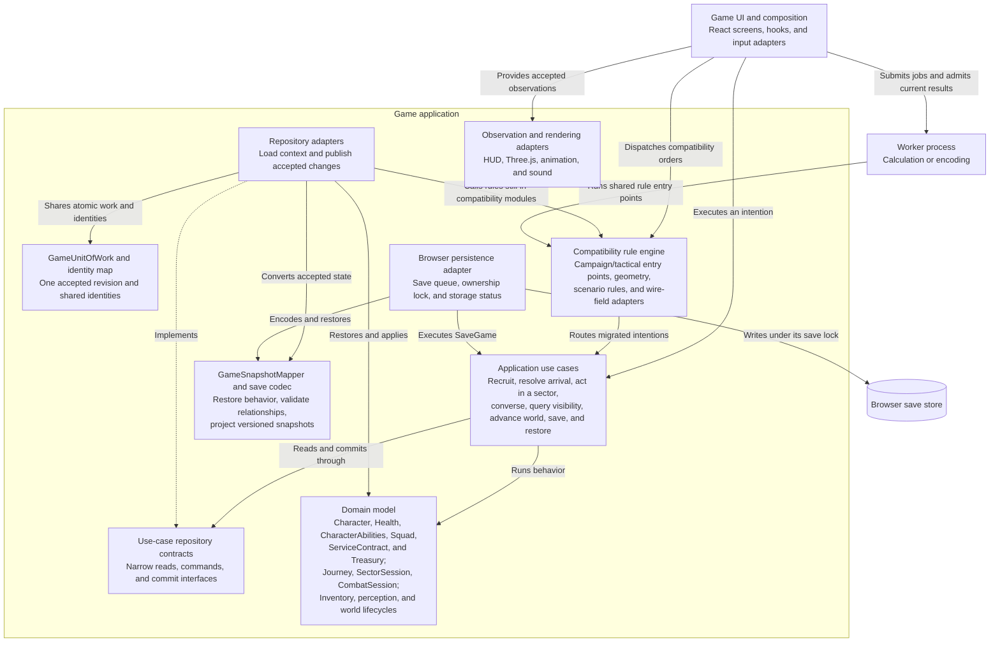
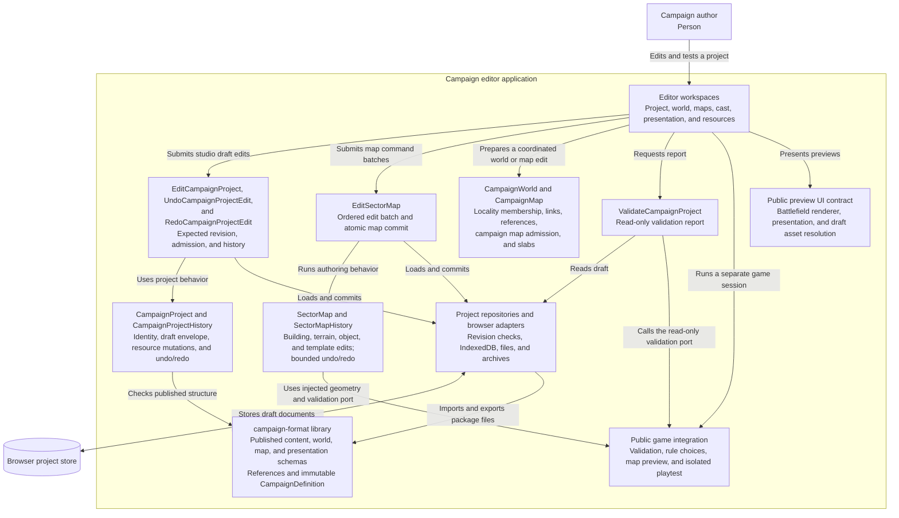

# C4 architecture views

[Architecture guide](README.md) · [Progressive explanation](overview.md) · [Accepted architecture](../plans/accepted/domain-architecture.md)

This page illustrates the system context (Level 1), browser applications and stores (Level 2), and internal component boundaries (Level 3) of Granaderos using the C4 model. It connects the high-level [overview](overview.md) to the repository directories in the [system map](system-map.md) and the sequence traces in [runtime flows](runtime-flows.md).

The runnable applications are `apps/web` and `apps/campaign-editor`; the reusable packages are `packages/game` and `packages/campaign-format`. Each application bundles the code it imports into a static browser deployment. See the [repository map](../development/repository-layout.md) for directory navigation.

The diagrams follow the official C4 scopes: a [system context](https://c4model.com/diagrams/system-context) shows people and external systems; a [container view](https://c4model.com/diagrams/container) shows independently built browser applications, workers, and data stores; and a [component view](https://c4model.com/diagrams/component) shows internal responsibilities inside each application. In C4 terminology, a container is a runtime execution or storage boundary, not a Docker image or server process.

## Level 1: people and the system

The diagram below shows how the `Player`, `Campaign author`, and `Publisher` interact with `Granaderos` and how `Static hosting` distributes the built files and campaign packages.

The `Player` issues strategic and sector orders in the browser and exports or imports save files. The `Campaign author` creates, validates, and playtests campaign drafts without writing arbitrary executable scripts. The `Publisher` runs the build pipeline to stage static files for `Static hosting`, which serves `Granaderos` over HTTP without a backend gameplay server.

## Level 2: applications and storage

The diagram below shows how the `Player` and `Campaign author` use the `Game application` and `Campaign editor application` inside `Granaderos`, and how those applications exchange data with `Static distribution`, `Game worker processes`, `Game save store`, `Project store`, and `User files`.

`Game application` (`apps/web`) and `Campaign editor application` (`apps/campaign-editor`) have separate entry points and build outputs. The game routes `/studio`, `/story`, and `/editor` link to the editor application at `/campaign-editor/`. Editor playtests and previews run through `packages/game/public` and `apps/web/game-preview.ts` inside an isolated session in `Editor` rather than mutating the `Game save store` (`localStorage`) of an open game tab. `Editor` persists mutable drafts and binary resources in `Project store` (`IndexedDB`), while both applications import and export portable files through `User files`.

Both applications bundle [`packages/campaign-format`](../../packages/campaign-format/README.md) as a shared library for published schemas, identifiers, resource hashes, and immutable `CampaignDefinition` objects. `Game application` (`apps/web`) spawns `Game worker processes` (Web Workers) for tactical step calculation, save encoding, and 3D contact fitting; workers return data to their caller and never write directly to `Saves` or `Projects`.

Source entry points: [`apps/web/app/page.tsx`](../../apps/web/app/page.tsx), [`apps/campaign-editor/web/main.tsx`](../../apps/campaign-editor/web/main.tsx), [`apps/campaign-editor/vite.config.mjs`](../../apps/campaign-editor/vite.config.mjs), [`tools/build-web.mjs`](../../tools/build-web.mjs), [`apps/web/lib/useBattleExecutor.ts`](../../apps/web/lib/useBattleExecutor.ts), [`apps/web/lib/browser-save-writer.ts`](../../apps/web/lib/browser-save-writer.ts), and [`apps/campaign-editor/web/lib/campaign-studio-storage.ts`](../../apps/campaign-editor/web/lib/campaign-studio-storage.ts).

## Level 3: game application components

The diagram below shows the components inside the `Game application` and how `Game UI and composition` coordinates `Application use cases`, `Use-case repository contracts`, `Repository adapters`, `Domain model`, `GameUnitOfWork and identity map`, `GameSnapshotMapper and save codec`, `Compatibility rule engine`, `Browser persistence adapter`, `Observation and rendering adapters`, `Worker process`, and `Browser save store`.

Each use case in `Application use cases` (`packages/game/application`) owns one narrow interface in `Use-case repository contracts`. `Repository adapters` (`packages/game/infrastructure`) implement those interfaces and share `GameUnitOfWork and identity map` and `GameSnapshotMapper and save codec` so all objects in a transaction reference one canonical owner for `Character`, `Health`, `Inventory`, `ItemCustody`, `Squad`, `Journey`, and `SectorSession`. `Compatibility rule engine` (`packages/game/campaign.js`, `packages/game/tactical.js`, and root rule modules) routes migrated intentions to `Application use cases` and executes procedural rules that have not yet moved into `Domain model`.

The table below traces representative player tasks by `Intention`, linking the `Application contract`, the `Rule owner` in the domain model, and the `Infrastructure and integration` adapters.

| Intention | Application contract | Rule owner | Infrastructure and integration |
| --- | --- | --- | --- |
| Recruit a combatant | [`RecruitCombatant`](../../packages/game/application/personnel/recruit-combatant/recruit-combatant.use-case.ts) | [`RecruitmentService`](../../packages/game/domain/personnel/recruitment-service.ts), `Character`, `ServiceContract`, `Treasury`, and `ForceRoster` | [`CampaignRecruitCombatantRepository`](../../packages/game/infrastructure/personnel/campaign-recruit-combatant.repository.js) and [`CanonicalPersonnelMapper`](../../packages/game/infrastructure/persistence/canonical-personnel-mapper.ts) |
| Resolve hostile arrival | [`FightOnArrival`](../../packages/game/application/journeys/fight-on-arrival/fight-on-arrival.use-case.ts), [`WithdrawOnArrival`](../../packages/game/application/journeys/withdraw-on-arrival/withdraw-on-arrival.use-case.ts), [`RedirectJourney`](../../packages/game/application/journeys/redirect-journey/redirect-journey.use-case.ts) | [`Journey`](../../packages/game/domain/journeys/journey.ts) and [`ArrivalDecision`](../../packages/game/domain/journeys/arrival-decision.ts) | [`campaign-journey-repositories.js`](../../packages/game/infrastructure/journeys/campaign-journey-repositories.js) and [`JourneySnapshotMapper`](../../packages/game/infrastructure/journeys/journey-snapshot-mapper.js) |
| Act in a sector | [`ExecuteSectorOrder`](../../packages/game/application/sector-sessions/execute-sector-order/execute-sector-order.use-case.ts), [`EndSectorTurn`](../../packages/game/application/sector-sessions/end-sector-turn/end-sector-turn.use-case.ts) | [`SectorSession`](../../packages/game/domain/sector-sessions/sector-session.ts), [`CombatSession`](../../packages/game/domain/combat/combat-session.ts), and [`SectorParticipant`](../../packages/game/domain/sector-sessions/sector-participant.ts) | [`sector-session-mapper.js`](../../packages/game/infrastructure/sector-sessions/sector-session-mapper.js), [`sector-operation-coordinator.js`](../../packages/game/infrastructure/sector-sessions/sector-operation-coordinator.js), and [`tactical.js`](../../packages/game/tactical.js) |
| Converse with a character | [`TalkToCharacter`](../../packages/game/application/talk-to-character/talk-to-character.use-case.ts) | Conversation rules, [`RecruitmentService`](../../packages/game/domain/personnel/recruitment-service.ts), and `Character` identity | [`talk-to-character-repository.ts`](../../packages/game/infrastructure/session/talk-to-character-repository.ts) and [`conversation-participant-projection.ts`](../../packages/game/infrastructure/session/conversation-participant-projection.ts) |
| Inspect visible characters | [`GetVisibleCharacters`](../../packages/game/application/perception/get-visible-characters/README.md) | [`VisionObserver`](../../packages/game/domain/perception/vision-observer.ts), `FieldOfView`, `VisibilityPolicy`, and `KnownSectorPolicy` | [`sector-perception.js`](../../packages/game/infrastructure/perception/sector-perception.js) and [`get-visible-characters.repository.js`](../../packages/game/infrastructure/perception/get-visible-characters.repository.js) |
| Transfer an item | [`TransferItem`](../../packages/game/application/inventory/transfer-item/README.md) | [`Inventory`](../../packages/game/domain/inventory/inventory.ts), [`Item`](../../packages/game/domain/inventory/item.ts), and [`ItemTransferService`](../../packages/game/domain/inventory/item-transfer-service.ts) | [`snapshot-transfer-item.repository.js`](../../packages/game/infrastructure/inventory/snapshot-transfer-item.repository.js) and [`tactical-inventory-mapper.js`](../../packages/game/infrastructure/inventory/tactical-inventory-mapper.js) |
| Advance world timeline | [`AdvanceWorldTime`](../../packages/game/application/world/advance-world-time/README.md), [`CollectResidentSupply`](../../packages/game/application/world/collect-resident-supply/README.md) | [`WorldTimeline`](../../packages/game/domain/world/world-timeline.ts) (`advanceTo`), [`Corpse`](../../packages/game/domain/world/corpse.ts), [`Sector`](../../packages/game/domain/world/sector.ts), and [`ResidentRoutine`](../../packages/game/domain/world/resident-routine.ts) | [`CanonicalWorldMapper`](../../packages/game/infrastructure/persistence/canonical-world-mapper.js) and [`world.js`](../../packages/game/world.js) |
| Save or restore progress | [`SaveGame`](../../packages/game/application/save-game/README.md), [`RestoreGame`](../../packages/game/application/restore-game/README.md), [`GetSaveStatus`](../../packages/game/application/get-save-status/README.md) | [`GameSession`](../../packages/game/domain/session/game-session.ts) identity and restored domain invariants | [`GameSnapshotMapper`](../../packages/game/infrastructure/persistence/game-snapshot-mapper.js), [`save.ts`](../../packages/game/save.ts), and [`browser-save-writer.ts`](../../apps/web/lib/browser-save-writer.ts) |

## Level 3: campaign editor components

The diagram below shows how the `Campaign author` interacts with the components inside the `Campaign editor application` (`Editor workspaces`, project and map editing use cases, `CampaignWorld and CampaignMap`, `SectorMap and SectorMapHistory`, `ValidateCampaignProject`, `CampaignProject and CampaignProjectHistory`, `Project repositories and browser adapters`, `campaign-format library`, `Public game integration`, and `Public preview UI contract`) and the `Browser project store`.

`CampaignProject` and `CampaignProjectHistory` own mutable project drafts, binary resource catalogs, and undo/redo snapshots. `EditCampaignProject`, `UndoCampaignProjectEdit`, and `RedoCampaignProjectEdit` mutate project state through `Project repositories and browser adapters` at an expected revision and persist drafts in `Browser project store` (`IndexedDB`). `CampaignWorld` owns strategic locality and route invariants; `CampaignMap` owns the fixed 20x16 campaign map slot; and `SectorMap` with `SectorMapHistory` owns physical map authoring batches submitted through `EditSectorMap`.

`ValidateCampaignProject` inspects the draft without mutating it, combining `campaign-format library` (`CampaignDefinition` and `CampaignContentSchema`) with `Public game integration` (`packages/game/public/campaign-editor-api.ts`). `Public game integration` (`packages/game/public/campaign-playtest-api.ts`) and `Public preview UI contract` (`apps/web/game-preview.ts` and `apps/web/game-preview-assets.js`) run isolated map previews and campaign sandboxes without importing internal game modules or touching player saves.

Source entry points: [`packages/campaign-format/README.md`](../../packages/campaign-format/README.md), [`packages/campaign-format/campaign-definition.ts`](../../packages/campaign-format/campaign-definition.ts), [`apps/campaign-editor/domain/campaign-project.ts`](../../apps/campaign-editor/domain/campaign-project.ts), [`apps/campaign-editor/domain/campaign-project-history.ts`](../../apps/campaign-editor/domain/campaign-project-history.ts), [`apps/campaign-editor/application/edit-campaign-project/edit-campaign-project.use-case.ts`](../../apps/campaign-editor/application/edit-campaign-project/edit-campaign-project.use-case.ts), [`apps/campaign-editor/application/validate-campaign-project/validate-campaign-project.use-case.ts`](../../apps/campaign-editor/application/validate-campaign-project/validate-campaign-project.use-case.ts), [`apps/campaign-editor/domain/campaign-world.js`](../../apps/campaign-editor/domain/campaign-world.js), [`apps/campaign-editor/domain/sector-map.js`](../../apps/campaign-editor/domain/sector-map.js), [`apps/campaign-editor/application/edit-sector-map/README.md`](../../apps/campaign-editor/application/edit-sector-map/README.md), [`apps/campaign-editor/infrastructure/campaign-project-editing-repository.ts`](../../apps/campaign-editor/infrastructure/campaign-project-editing-repository.ts), [`tools/generate-architecture-fixtures.mjs`](../../tools/generate-architecture-fixtures.mjs), [`packages/game/public/campaign-editor-api.ts`](../../packages/game/public/campaign-editor-api.ts), [`packages/game/public/campaign-playtest-api.ts`](../../packages/game/public/campaign-playtest-api.ts), and [`apps/web/game-preview.ts`](../../apps/web/game-preview.ts).

## How to check a boundary claim

Two automated checks enforce the import and layer rules shown above:

- `npm run check:architecture` (backed by [`tools/check-architecture.mjs`](../../tools/check-architecture.mjs)) verifies that `packages/game` never imports `apps/campaign-editor`, `domain` code imports only `domain` code (plus `packages/campaign-format` in the editor domain), `application` code imports only `application` and `domain` contracts, `apps/campaign-editor` reaches `packages/game` and `apps/web` only through their declared public entries, and `domain` and `application` files never call browser globals or ambient `Math.random`.
- `npm run check:dependencies` evaluates the rules in [`.dependency-cruiser.json`](../../.dependency-cruiser.json), enforcing the same layer boundaries, forbidding production imports from `tools/` or test files, and rejecting runtime circular dependencies within `domain` and `application`.

For the full build and verification pipeline, continue to [build and tooling](build-and-tooling.md).
