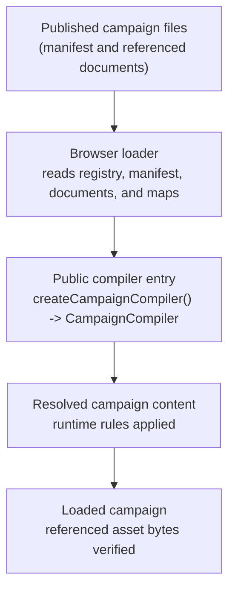
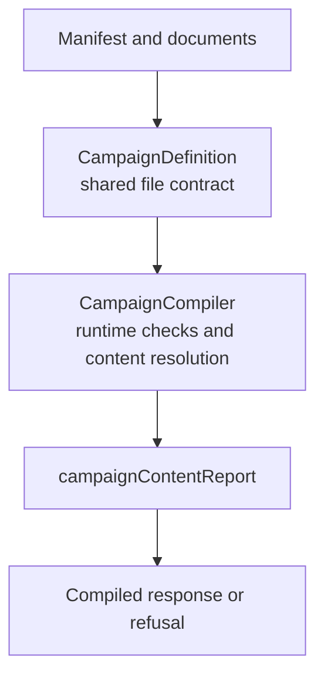
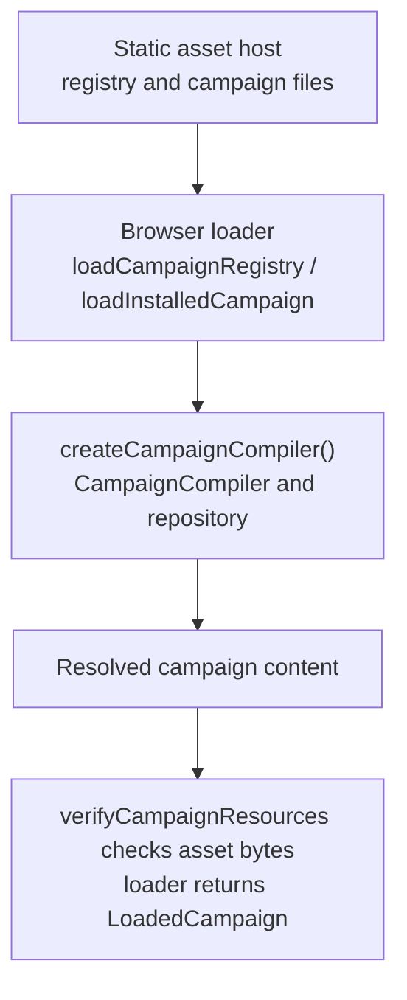
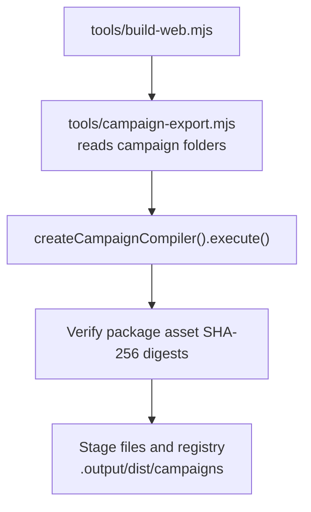

# Content and campaigns

[Architecture guide](README.md) · [Authoring use cases](use-cases/authoring.md) · [Rendering](rendering.md) · [Build and tooling](build-and-tooling.md)

This page explains how published campaign packages (`packages/campaign-format`), `CampaignCompiler` (the application service that applies runtime playability rules and resolves campaign content), trusted scenario implementations (`content/campaigns/`), and the independent campaign editor (`apps/campaign-editor`) work together. The browser game loads package files through [`apps/web/lib/campaign-library.ts`](../../apps/web/lib/campaign-library.ts); the static exporter reads campaign folders through [`tools/campaign-export.mjs`](../../tools/campaign-export.mjs). Both compose the compiler through [`createCampaignCompiler()`](../../packages/game/public/campaign-compiler-api.ts). `CampaignLibraryCompilerRepository` in [`packages/game/campaign-library.js`](../../packages/game/campaign-library.js) admits parsed documents to the compiler; it is not the browser loader. This page connects the component boundaries in [C4 views](c4.md) and the [system map](system-map.md) to the authoring intentions in [authoring use cases](use-cases/authoring.md), the save representations in [persistence](persistence.md), and the staging pipeline in [build and tooling](build-and-tooling.md).

Campaigns are authored data packages interpreted by the game rather than executable plug-ins. A campaign manifest selects one of the engine's allowlisted scenario contracts (`generic-v1` or `granaderos-historical-v1`); it never loads arbitrary JavaScript from an imported package.

## At a glance

The flowchart shows how the browser loads an installed campaign. The static exporter reads package files through a separate path but uses the same public compiler entry.



Each campaign `manifest.json` identifies the campaign and references five JSON documents: `content`, `world`, `maps` (a map index), `presentation`, and `assets`. The browser loader and static exporter read those documents and the listed map files, then pass the manifest and parsed documents to [`createCampaignCompiler()`](../../packages/game/public/campaign-compiler-api.ts). The public factory composes [`CampaignCompiler`](../../packages/game/application/campaign-compiler/) with `CampaignLibraryCompilerRepository`. That repository constructs an immutable [`CampaignDefinition`](../../packages/campaign-format/campaign-definition.ts); the compiler applies runtime playability rules and resolves the content. `packages/game/campaign-library.js` is the repository adapter, not the browser loader. After compilation, the browser loader verifies referenced resource digests, while the static exporter checks package assets before staging.

The JSON snippet below shows a minimal authored `manifest.json` structure (based on the starter scaffold in [`apps/campaign-editor/infrastructure/project-scaffold.ts`](../../apps/campaign-editor/infrastructure/project-scaffold.ts)):

```json
{
  "format": "granaderos-campaign",
  "version": 1,
  "id": "sample-campaign",
  "name": "Sample Campaign",
  "revision": "1",
  "scenario": "generic-v1",
  "content": "content.json",
  "world": "world.json",
  "maps": "maps/index.json",
  "presentation": "presentation.json",
  "assets": "assets.json"
}
```

Here `format` (`"granaderos-campaign"`) and `version` (`1`) identify the manifest schema; `id`, `name`, and `revision` define the package identity; `scenario` selects an allowlisted scenario ruleset (`"generic-v1"` or `"granaderos-historical-v1"`); `content`, `world`, `presentation`, and `assets` name relative JSON document paths; and `maps` points to a map catalog JSON file (`{ "maps": [{ "id": "camp", "path": "camp.json" }] }`) rather than a single sector map. The `assets` document lists package-relative asset paths under `assets/` with expected SHA-256 digests.

## Package layout and validation contract

A published campaign package lives under `content/campaigns/<id>/` and contains `manifest.json`, the five referenced JSON documents, individual map JSON files, and packaged media files. There is no authored `content/campaigns/index.json`. During development, [`apps/web/vite.config.ts`](../../apps/web/vite.config.ts) registers the campaign-file middleware from [`tools/campaign-export.mjs`](../../tools/campaign-export.mjs); the middleware generates the registry response by scanning campaign folders. During a static build, `stageCampaigns` writes the generated registry to `.output/dist/campaigns/index.json` after the campaign folders are staged. The registry uses format `granaderos-campaign-registry` (version `1`) and maps each campaign's `id`, `name`, and `revision` to `<id>/manifest.json`.

The flowchart shows how shared file admission leads to runtime compilation. `CampaignDefinition` admits the authored documents; `CampaignCompiler` checks runtime constraints, resolves content, and rejects blocked campaign reports.



`CampaignLibraryCompilerRepository.load()` in [`packages/game/campaign-library.js`](../../packages/game/campaign-library.js) constructs `CampaignDefinition`. `CampaignDefinition` validates the manifest, shared document schemas, and cross-references, computes content identity, then retains immutable documents. `CampaignCompiler` checks runtime data and world rules, requires 20-by-16 campaign maps, applies scenario-specific playability rules (such as an enemy spawn for `generic-v1`), validates building-architecture references and world-to-map coverage, and checks selected asset references. It then resolves defaults through `resolveContent` and runs `campaignContentReport` ([`packages/game/campaign-content.js`](../../packages/game/campaign-content.js)); blocked findings refuse compilation. The returned content includes `campaignOrigin` (`{ version: 1, id, revision }`).

## Authoring paths and persistence boundaries

The independent `apps/campaign-editor` application is served at `/campaign-editor/` (with focused `?workspace=story` and `?workspace=sector` views). The game runtime (`packages/game` and `apps/web`) never imports editor code.

Inside the editor:

- [`CampaignProject`](../../apps/campaign-editor/domain/campaign-project.ts) and [`CampaignProjectDocument`](../../apps/campaign-editor/domain/project-document.ts) own mutable draft identity, envelope invariants, document edits, and base64 resource maps.
- [`CampaignProjectHistory`](../../apps/campaign-editor/domain/campaign-project-history.ts) owns bounded in-memory undo/redo snapshots (up to 50 steps), mutated by [`EditCampaignProjectUseCase`](../../apps/campaign-editor/application/edit-campaign-project/edit-campaign-project.use-case.ts), [`UndoCampaignProjectEditUseCase`](../../apps/campaign-editor/application/undo-campaign-project-edit/undo-campaign-project-edit.use-case.ts), and [`RedoCampaignProjectEditUseCase`](../../apps/campaign-editor/application/redo-campaign-project-edit/redo-campaign-project-edit.use-case.ts) through their own narrow repository interfaces at an expected project revision.
- [`CampaignWorld`](../../apps/campaign-editor/domain/campaign-world.js) owns strategic locality, district, place, and route draft invariants; [`CampaignMap`](../../apps/campaign-editor/domain/campaign-map.js) owns the fixed 20x16 campaign map slot; and [`SectorMap`](../../apps/campaign-editor/domain/sector-map.js) with [`SectorMapHistory`](../../apps/campaign-editor/domain/sector-map-history.js) owns physical sector map command batches (`SectorMapCommand`) applied through [`EditSectorMapUseCase`](../../apps/campaign-editor/application/edit-sector-map/edit-sector-map.use-case.ts).
- [`ValidateCampaignProjectUseCase`](../../apps/campaign-editor/application/validate-campaign-project/validate-campaign-project.use-case.ts) reads the project through its read-only repository and invokes [`packages/game/public/campaign-editor-api.ts`](../../packages/game/public/campaign-editor-api.ts) to return structured diagnostics without mutating the draft.

The table below contrasts each content `Representation`, its `Shape / storage`, and its `Role` across authoring, publication, and play.

| Representation | Shape / storage | Role |
| --- | --- | --- |
| Campaign project (`CampaignProject`) | `granaderos-editor-project` (version `1`) with `documents`, `mapIndex`, and base64 `resources` ([`create-project.js`](../../apps/campaign-editor/infrastructure/create-project.js)) | Mutable authoring draft; structural envelope checks allow incomplete or invalid drafts to be edited and saved locally while validation reports outstanding issues |
| Editor browser record | IndexedDB database `granaderos.campaign-studio.v1`, object store `projects`, storing binary resources as `Blob` values ([`campaign-studio-storage.ts`](../../apps/campaign-editor/web/lib/campaign-studio-storage.ts)) | Durable local draft storage in the browser (`localStorage` in Studio only remembers the last active project ID) |
| Editor history and archive files | Bounded in-memory undo/redo snapshots (`CampaignProjectHistory` / `SectorMapHistory`); Studio downloads `${id}.project.json`, imports `.json` or `.zip`, and exports `${id}-${revision}.zip` ([`campaign-studio-files.ts`](../../apps/campaign-editor/web/lib/campaign-studio-files.ts)) | Undo/redo history and portable project or installable package file downloads |
| Installed campaign (`CampaignPackage`) | Registry entry plus `manifest.json`, five JSON documents, map files, and SHA-256-checked asset bytes | Immutable published content loaded by the browser game and staged by the static build |
| Gameplay progress (`GameSnapshot`) | Portable save envelope (`format: "granaderos"`) in `localStorage` or exported JSON ([`save.ts`](../../packages/game/save.ts)) | Player campaign and sector progress, completely separate from editor drafts and undo history |

The editor supports two isolated playtest paths that never touch player saves or mutate the authoring draft:

- **Single-map playtest:** The sector and building workspaces call `packages/game/public/campaign-editor-api.ts` (backed by [`packages/game/map-playtest.js`](../../packages/game/map-playtest.js)) and render the resulting battle state through [`apps/web/game-preview.ts`](../../apps/web/game-preview.ts).
- **Full-campaign Quest Sandbox:** [`apps/campaign-editor/web/app/studio/QuestSandbox.tsx`](../../apps/campaign-editor/web/app/studio/QuestSandbox.tsx) calls [`packages/game/public/campaign-playtest-api.ts`](../../packages/game/public/campaign-playtest-api.ts) to run a seeded campaign and tactical battles in an isolated session, with its own `granaderos-editor-sandbox` fixture export/import bound to the project's content identity hash.

## Runtime loading and build-time staging paths

The flowchart shows how the browser's installed-campaign loader reads package files, invokes the compiler, checks asset digests, and returns a `LoadedCampaign`.



At build time, static staging reads campaign folders from the repository and uses the same compiler entry before verifying assets and copying package files.



Default historical campaign data is exported by [`content/campaigns/default.js`](../../content/campaigns/default.js), and historical scenario rules live under [`content/campaigns/granaderos/scenario.js`](../../content/campaigns/granaderos/scenario.js), invoked through [`packages/game/campaign-scenario.js`](../../packages/game/campaign-scenario.js).

Source anchors: [`packages/campaign-format/campaign-definition.ts`](../../packages/campaign-format/campaign-definition.ts), [`packages/game/application/campaign-compiler/`](../../packages/game/application/campaign-compiler/), [`packages/game/public/campaign-compiler-api.ts`](../../packages/game/public/campaign-compiler-api.ts), [`packages/game/campaign-library.js`](../../packages/game/campaign-library.js), [`apps/web/lib/campaign-library.ts`](../../apps/web/lib/campaign-library.ts), [`packages/game/campaign-assets.js`](../../packages/game/campaign-assets.js), [`packages/game/campaign-content.js`](../../packages/game/campaign-content.js), [`packages/game/campaign-package-storage.js`](../../packages/game/campaign-package-storage.js), [`apps/campaign-editor/domain/campaign-project.ts`](../../apps/campaign-editor/domain/campaign-project.ts), [`apps/campaign-editor/infrastructure/project-validation.js`](../../apps/campaign-editor/infrastructure/project-validation.js), [`tools/campaign-export.mjs`](../../tools/campaign-export.mjs), and [`tools/campaign-authoring.mjs`](../../tools/campaign-authoring.mjs).
