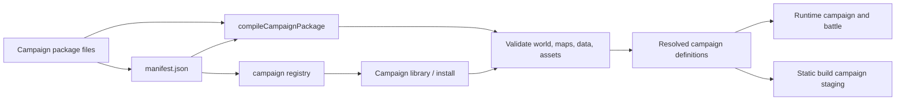
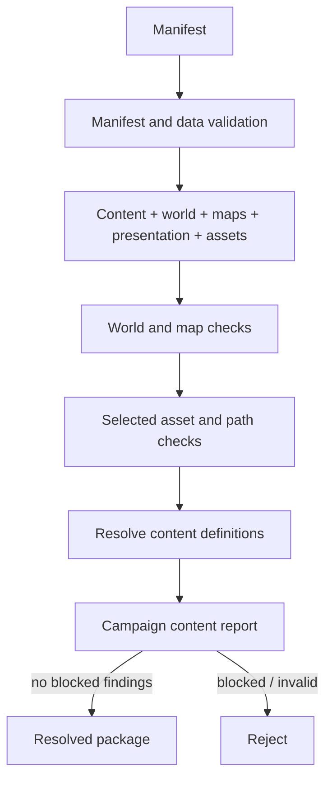
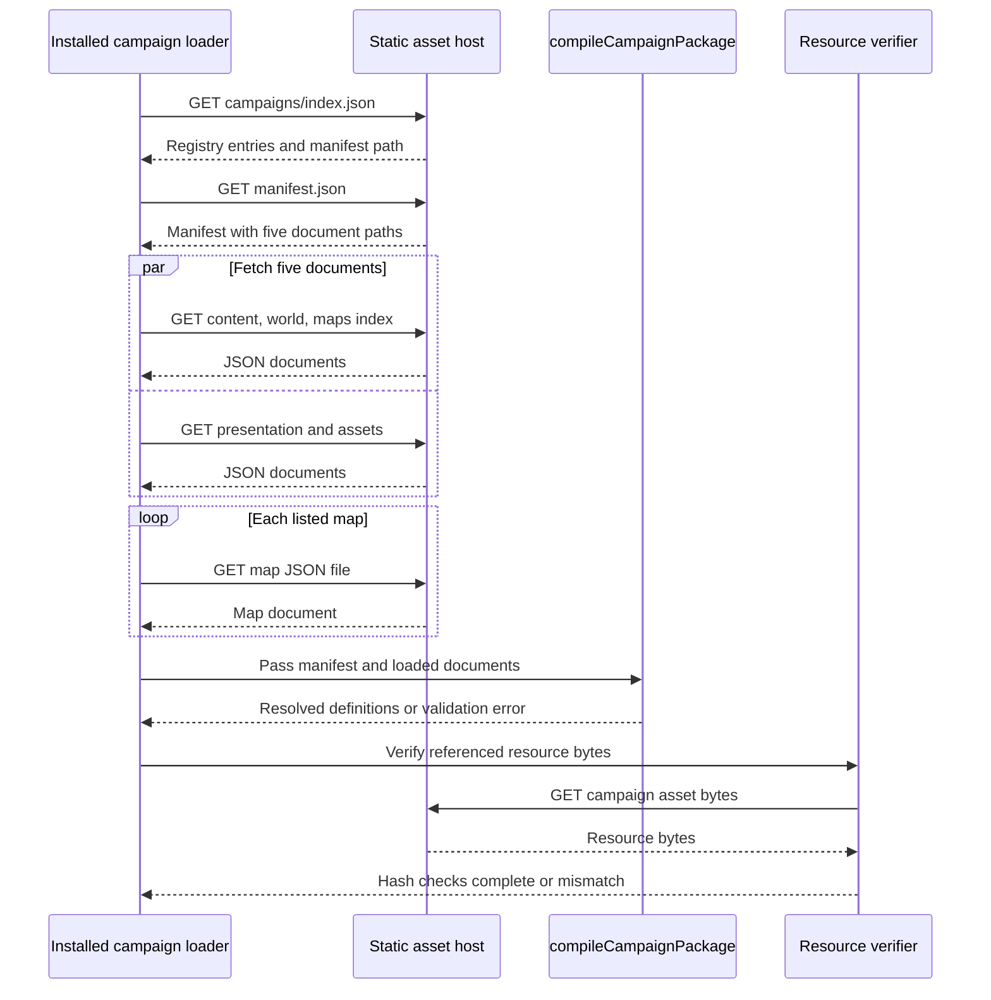
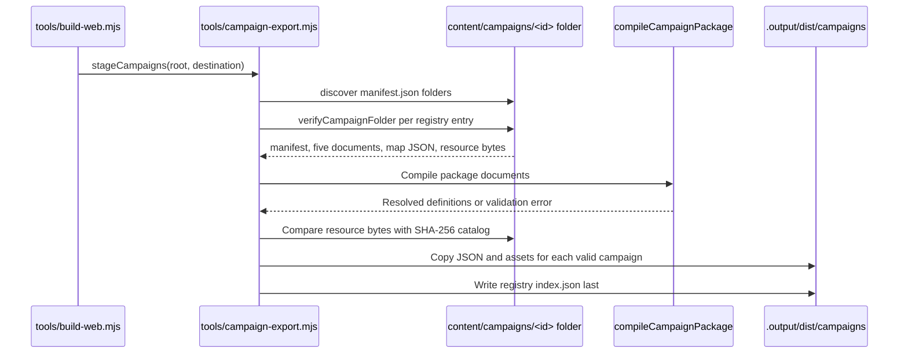

# Content and campaigns

**Architecture guide:** [Overview](README.md) · [Rendering](rendering.md) · [Build and tooling](build-and-tooling.md)

Campaigns are authored data packages interpreted by the game, not executable plug-ins. A campaign manifest selects one of the engine's supported scenario contracts; it does not name an arbitrary script to load. For the broader repository map and persistence flows, see the [architecture overview](README.md), [runtime flows](runtime-flows.md), and [persistence](persistence.md).

## At a glance



The manifest identifies a campaign and references five JSON documents: content, world, maps, presentation, and assets. The shared compiler in [`packages/game/campaign-library.js`](../../packages/game/campaign-library.js) validates and resolves them into the definitions consumed by runtime. The registry is a catalog of manifest references, not a separate validation bypass. Installed campaign loading and build staging use the same package compilation/validation contract.

The overview diagram below is a logical contract view. Runtime loading and build staging are separate callers with distinct I/O responsibilities; the detailed sequences later in this guide show those paths independently. The compiler accepts documents already loaded by its caller and does not itself fetch package files or hash resource bytes.

Minimal authored manifest shape (the scaffold adds more realistic documents and assets):

```json
{
  "format": "granaderos-campaign",
  "version": 1,
  "id": "sample-campaign",
  "name": "Sample Campaign",
  "revision": "1",
  "scenario": "generic-v1",
  "content": "content.json",
  "world": "world.json",
  "maps": "maps/index.json",
  "presentation": "presentation.json",
  "assets": "assets.json"
}
```

The `maps` reference points to an index containing `{ "maps": [{ "id": "camp", "path": "camp.json" }] }`; it is not a single tactical-map payload. The `assets` JSON contains versioned asset entries with package-relative paths and SHA-256 digests. [`apps/campaign-editor/infrastructure/project-scaffold.js`](../../apps/campaign-editor/infrastructure/project-scaffold.js) is the authoritative concrete starter example; [`tools/campaign-authoring.mjs`](../../tools/campaign-authoring.mjs) writes the folder representation and immediately verifies it.

## Package layout and contract

A campaign package is conventionally rooted at `content/campaigns/<id>/` and contains `manifest.json` plus the referenced JSON documents and packaged media. The manifest has format `granaderos-campaign`, version `1`, a constrained identifier, name and revision, scenario, and relative JSON paths for each document. The registry uses format `granaderos-campaign-registry`, version `1`; entries bind `id`, display name and revision to `<id>/manifest.json`. See [`campaign-library.js`](../../packages/game/campaign-library.js) and data-level checks in [`campaign-data-validation.js`](../../packages/game/campaign-data-validation.js).

Compilation applies several layers of checks: schema-level data validation; campaign identity matching; required content collections; world validation; nonempty maps with matching map IDs and supported dimensions; map playability rules selected by scenario; world-to-map references; presentation/assets shape and asset-path/checksum validation; and a content report that rejects blocked definitions. Assets are referenced package content, not a facility for loading executable code. The scenario allowlist currently contains `generic-v1` and `granaderos-historical-v1`.



The compiled result carries campaign identity (`version`, `id`, `revision`) in `campaignOrigin`, together with resolved content/world/maps/presentation/assets. Runtime code may receive this shape directly or through wrappers such as `contentCampaign.package` and `campaignPackage`; helpers intentionally normalize these forms. For example, campaign rules consult package definitions through [`packages/game/campaign-definition.js`](../../packages/game/campaign-definition.js), while serialization handles campaign package identity references in [`packages/game/campaign-package-storage.js`](../../packages/game/campaign-package-storage.js).

## Authoring paths and persistence boundaries

The independently built `campaign-editor` application opens at
`/campaign-editor/`. It contains a project workspace, a story editor, a sector
editor, and isolated playtests. The game links to this application; its runtime
dependency graph excludes editor implementation code.

- [`CampaignProject`](../../apps/campaign-editor/domain/campaign-project.ts) owns draft
  identity, envelope admission, document edits, and resources.
- [`CampaignProjectHistory`](../../apps/campaign-editor/domain/campaign-project-history.ts)
  owns undo and redo snapshots.
- [`EditCampaignProjectUseCase`](../../apps/campaign-editor/application/edit-campaign-project/edit-campaign-project.use-case.ts)
  admits edits through a repository at the expected project revision.
- [`ValidateCampaignProjectUseCase`](../../apps/campaign-editor/application/validate-campaign-project/validate-campaign-project.use-case.ts)
  reads the draft through its own repository and validates it without mutation.
- [`campaign-format`](../../packages/campaign-format/README.md) owns published file contracts
  and content identity. Game rules and preview behavior are accessed through
  explicit public game APIs.

These modes distinguish an in-progress project from an installable package and from gameplay progress:

| Representation | Shape / storage | Role |
| --- | --- | --- |
| Campaign project | `granaderos-editor-project`, version `1`; documents, `mapIndex`, and base64 `resources` (see `createCampaignProject` in [`create-project.js`](../../apps/campaign-editor/infrastructure/create-project.js)) | Mutable draft; structural admission allows invalid authored documents to remain drafts, while full validation reports issues. |
| Editor browser record | IndexedDB database `granaderos.campaign-studio.v1`, object store `projects`; binary resources are stored as `Blob`s and converted to/from project base64 on read/write (see [`apps/campaign-editor/web/lib/campaign-studio-storage.ts`](../../apps/campaign-editor/web/lib/campaign-studio-storage.ts)) | Durable local project storage. `localStorage` in Studio only remembers the last project ID; it is not project content storage. |
| Editor history / package file | In-memory undo/redo snapshots (bounded to 50); JSON `.granaderos` project encode/decode and supported archive/file operations in [`apps/campaign-editor/web/lib/campaign-studio-history.ts`](../../apps/campaign-editor/web/lib/campaign-studio-history.ts) and [`apps/campaign-editor/web/lib/campaign-studio-files.ts`](../../apps/campaign-editor/web/lib/campaign-studio-files.ts) | Editing history and explicit file import/export. Studio images can resolve from in-project resources for previews via [`apps/campaign-editor/web/lib/campaign-studio-assets.ts`](../../apps/campaign-editor/web/lib/campaign-studio-assets.ts). |
| Installed campaign | Registry entry plus manifest, content/world/maps/presentation/assets JSON, map files and packaged resource bytes | Portable published content, loaded and verified by runtime/build. `campaignOrigin` identifies campaign ID/revision. |
| Gameplay progress | Campaign/battle save state, potentially with campaign package pinned/restored by content identity | Player progress, not an authoring project or Studio undo log. Gameplay autosave hooks such as [`apps/web/lib/useCampaignAutosave.ts`](../../apps/web/lib/useCampaignAutosave.ts) belong to play, not Studio project persistence. |

Project envelope validation is distinct from full project validation. `assertCampaignProjectEnvelope` checks format/version and safe envelope/resource bounds; `validateCampaignProject` validates the documents and then calls the same compiler, returning sectioned issues and checks. Thus a draft can be saved before it is package-valid. Runtime saves may pin package contents or restore a package reference keyed by canonical content identity; do not treat a local draft/autosave as the same thing as a published package.

The `?workspace=story` and `?workspace=sector` routes open focused document editors within the independent application. The default workspace supplies the complete project workflow. Do not confuse [`apps/web/lib/campaign-library.ts`](../../apps/web/lib/campaign-library.ts) with Studio import/export: it loads the installed runtime registry/packages. Studio file parsing, archive reading, encoding, and export are in [`apps/campaign-editor/web/lib/campaign-studio-files.ts`](../../apps/campaign-editor/web/lib/campaign-studio-files.ts). The sector building workspace invokes [`packages/game/map-playtest.js`](../../packages/game/map-playtest.js): it validates and compiles the current map, combines it with the selected campaign package when present, creates a battle/sector request, marks its source map identity, and returns that battle state to the in-browser `Battlefield`. This map playtest is in-memory; it is not a published install or its own serialized playtest session.

The Studio also has a separate full-campaign **Quest Sandbox** in [`apps/campaign-editor/web/app/studio/QuestSandbox.tsx`](../../apps/campaign-editor/web/app/studio/QuestSandbox.tsx), backed by [`packages/game/public/campaign-playtest-api.js`](../../packages/game/public/campaign-playtest-api.js). It creates a fresh campaign from compiled project content and a test seed/setup, then dispatches strategic actions and enters tactical battles using the regular campaign/battle functions. It can adopt battle changes, keep a bounded action history, and encode/decode a `granaderos-editor-sandbox` save bound to the source content identity. This differs from the map playtest, which builds a single battle directly from one authored map. Neither path runs arbitrary authored code.

## Runtime and build paths



Build-time package staging has a separate filesystem path:



Campaign content and the default historical game are not a strict one-way dependency layer. The default content is exported by [`content/campaigns/default.js`](../../content/campaigns/default.js); legacy engine modules import those defaults, and historical-specific behavior is implemented under [`content/campaigns/granaderos/`](../../content/campaigns/granaderos/), including [`scenario.js`](../../content/campaigns/granaderos/scenario.js). Engine code also dispatches through the supported scenario contract in [`packages/game/campaign-scenario.js`](../../packages/game/campaign-scenario.js). There is campaign UI code in [`content/campaigns/granaderos/ui/`](../../content/campaigns/granaderos/ui/), so the directory structure itself reflects some feature-local engine/UI coupling. Avoid inferring strict layering from folder names.

Installed runtime sequence in detail: `loadCampaignRegistry` fetches `/campaigns/index.json` and validates registry shape; `loadInstalledCampaign` fetches the manifest and checks that its ID/name/revision agree with the registry entry; it fetches the five referenced JSON documents (one is the map index), then fetches each map JSON file listed by that index. It passes those already-loaded values to synchronous `compileCampaignPackage`, which performs structural/data/map/asset-catalog checks and resolves definitions; it does not fetch or hash resource bytes. After successful compilation, `verifyCampaignResources` fetches referenced campaign assets and checks their SHA-256 values. Resource verification is memoized per reader/content descriptor and can be explicitly refreshed. See [`apps/web/lib/campaign-library.ts`](../../apps/web/lib/campaign-library.ts). Build staging is a different filesystem caller: [`tools/campaign-export.mjs`](../../tools/campaign-export.mjs) discovers folders to form a registry, calls `verifyCampaignFolder` to read documents/maps, compile and compare asset bytes to catalog checksums, stages JSON and assets, then writes the registry index. It does not make runtime fetch calls.

The practical extension boundary is therefore data plus a supported scenario identifier and engine-owned scenario behavior. Adding new arbitrary executable scenario files from imported content is outside the package contract. Historical and generic campaigns may intentionally have different validation and gameplay rules; a package's scenario value is part of its compatibility contract, not a free-form label.

## Source trail and limits

Key implementation points: [`packages/game/campaign-library.js`](../../packages/game/campaign-library.js) (manifest, registry, shared compiler); [`campaign-project.ts`](../../apps/campaign-editor/domain/campaign-project.ts) (project mutations); [`project-validation.js`](../../apps/campaign-editor/infrastructure/project-validation.js) (runtime validation adapter); [`packages/game/campaign-assets.js`](../../packages/game/campaign-assets.js) (asset validation); [`packages/game/campaign-content.js`](../../packages/game/campaign-content.js) (blocked content report); [`packages/game/campaign-package-storage.js`](../../packages/game/campaign-package-storage.js) (runtime package persistence); [`tools/campaign-export.mjs`](../../tools/campaign-export.mjs) (build-time package staging); [`tools/campaign-authoring.mjs`](../../tools/campaign-authoring.mjs) (authoring CLI).

This describes current contracts visible in source, not a guarantee that every legacy or external campaign is importable. Validation rules can evolve; consult the compiler and its tests before relying on a particular field or compatibility behavior. Existing migration and porting notes describe historical work and are not authoritative descriptions of the current package path.
