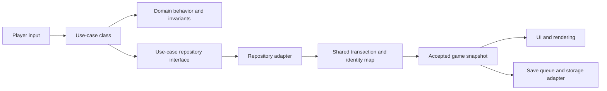

# Understand the game from the player to the source

[Architecture guide](README.md) · [C4 views](c4.md) · [Source map](system-map.md)

## 1. One force, two scales

Granaderos lets you manage a force on a campaign map and control individual
combatants inside a sector. The campaign decides where people travel, which
places they control, and how time affects contracts, wounds, money, and supplies.
A sector visit shows people, buildings, equipment, and local encounters.

A visit can be peaceful. Combat is an episode inside that visit. The same people
and equipment continue across both scales. A wound, a death, a spent cartridge,
or a recovered weapon can affect later decisions.

## 2. Follow one player intention

Start a campaign. The game loads a published campaign definition and creates a
new game session. At headquarters, recruit a combatant. Successful recruitment
adds that person to the force immediately, with a valid location and service
contract. A full or differently located active squad can place the combatant in
the reserve; the person is still under player control.

Order a journey. The journey records the squad's route and actual progress. At a
hostile arrival boundary, the game pauses campaign time and requires a choice:
fight or withdraw. Choosing withdrawal creates redirectable movement. The player
can reverse it immediately or after some travel. Completed progress and spent
supplies remain part of the journey.

Enter a sector. The game constructs a `SectorSession` from the entry request,
map definition, participants, and retained world state. Place participants when
deployment is required. Exploration can start combat. `CombatSession` owns that
combat episode's phase and outcome; participants spend action points on accepted
orders. Rendering shows the result that the simulation accepted.

Leave or resolve the visit. The game reconciles participants and physical
resources with the campaign. Retained sectors continue to evolve with game time.
Residents can move and collect eligible unattended supplies. Bodies have a
removal lifecycle; death records remain after the physical body disappears.

## 3. Name the four different kinds of data

| Concept | What it owns | Example |
| --- | --- | --- |
| `CampaignDefinition` | Validated authored facts and supported rule settings | A map, character definition, dialogue, or equipment definition |
| `CampaignProject` | An editable authoring draft and its resources | An unfinished map or a new portrait awaiting validation |
| `GameSession` and game state | Accepted player progress and open sector visits | Recruited people, journeys, contracts, wounds, ammunition and combat state |
| Presentation | Temporary visible output | A walking animation, camera position, sound, or damage indicator |

The editor changes the draft. Publication validates a campaign package. The game
uses the package to create progress. A playtest has its own progress and leaves
the authoring draft separate. An animation cannot decide a hit or spend a second
cartridge.

## 4. Read an operation through its layers

A migrated intention follows this chain:

For recruitment, `RecruitCombatantUseCase` coordinates `RecruitmentService` with
its repository. The service checks the character, contract terms, treasury,
force membership, and destination together. The repository uses the shared
transaction and mapper to publish accepted changes once. A refusal cannot leave
a payment without the corresponding recruitment.

For restoration, `RestoreGameUseCase` reads the save through its repository.
`GameSnapshotMapper` keeps format and relationship validation, restores domain
classes, and shares each person's identity. Restoration does not recruit again,
issue equipment, or advance time.

Read-only use cases inspect the same logical model. They do not advance the game
or require a separate query database.

## 5. Find the code that implements each role

| Role | Source |
| --- | --- |
| Domain entities, value objects and services | [`packages/game/domain`](../../packages/game/domain/) |
| Use cases and narrow repository contracts | [`packages/game/application`](../../packages/game/application/) |
| Repository adapters, transactions and snapshot mapping | [`packages/game/infrastructure`](../../packages/game/infrastructure/) |
| Player UI and browser composition | [`apps/web/app/page.tsx`](../../apps/web/app/page.tsx), [`apps/web/lib`](../../apps/web/lib/) |
| Independent editor application and model | [`apps/campaign-editor`](../../apps/campaign-editor/README.md) |
| Published campaign-file contract | [`packages/campaign-format`](../../packages/campaign-format/README.md) |
| Installed definitions, resources and trusted scenario implementations | [`content/campaigns`](../../content/campaigns/) |

`campaign.js`, `tactical.js`, `world.js`, `time.js`, and `save.js` remain important
compatibility entry points. Migrated paths call domain classes and use cases;
other rules still execute in specialized procedural modules. The source map and
[C4 component views](c4.md#level-3-game-application-components) identify both.

## 6. Know what saving guarantees

An accepted order changes in-memory progress. Autosave then tries to persist it.
The save includes the campaign and active sector state, with version, session,
and revision metadata. Restoring it validates their clocks, identities,
participants, equipment relationships, and campaign resources.

Only the browser tab that owns the save key's Web Lock can autosave. A storage
failure or another writer leaves the accepted game available for play and manual
download. A late worker reply cannot replace a newer session or snapshot.

The browser game and editor are static applications. HTTP supplies code and
resources; game rules execute in the browser and its workers. The C++ `reference/native/engine/`
submodule belongs to the separate native implementation.

Continue with [C4 levels 1–3](c4.md), then use the [source map](system-map.md) to
trace one concrete operation. The [use-case catalogue](use-cases/README.md)
describes player and author intentions in more detail.
