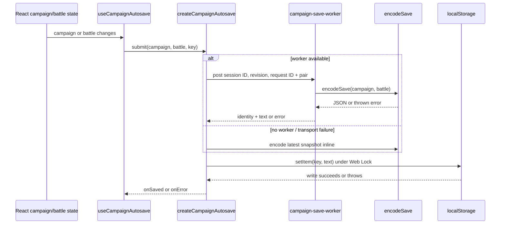
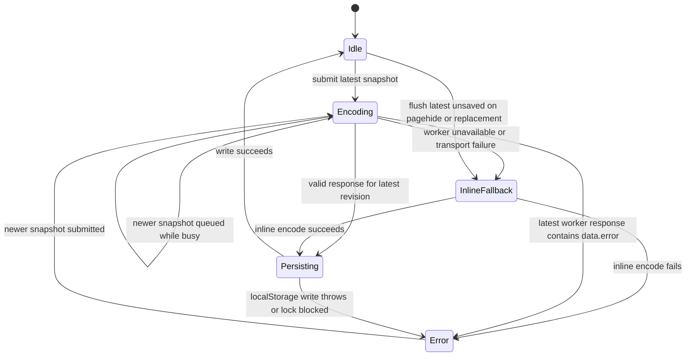
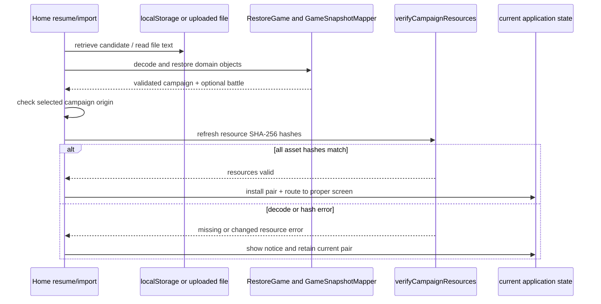

# Persistence

[Architecture guide](README.md) · [Runtime flows](runtime-flows.md) · [Strategic engine](strategic-engine.md) · [Tactical engine](tactical-engine.md)

This page explains how Granaderos maps canonical domain objects to and from versioned game snapshots (`GameSnapshotMapper`), encodes and compacts portable save files (`packages/game/save.ts`), coordinates single-writer browser autosaves under Web Locks (`apps/web/lib/browser-save-writer.ts` and `useCampaignAutosave`), and checks campaign resource hashes before restoring a session. It connects the transaction model in the [system map](system-map.md) and [runtime flows](runtime-flows.md) to the state structures in the [strategic engine](strategic-engine.md), [tactical engine](tactical-engine.md), and [content and campaigns](content-and-campaigns.md).

Persistence separates two jobs:

1. **Snapshot mapping and portable save encoding:** [`GameSnapshotMapper`](../../packages/game/infrastructure/persistence/game-snapshot-mapper.js) and [`packages/game/save.ts`](../../packages/game/save.ts) project domain state into a versioned JSON envelope, compact large terrain arrays when needed, and restore domain classes through their `restore` factories on decode.
2. **Browser autosave and file export/import:** [`SaveGameUseCase`](../../packages/game/application/save-game/save-game.use-case.ts), [`GetSaveStatusUseCase`](../../packages/game/application/get-save-status/get-save-status.use-case.ts), and [`useCampaignAutosave.ts`](../../apps/web/lib/useCampaignAutosave.ts) queue asynchronous save-worker encoding and write to campaign-specific `localStorage` keys under an exclusive Web Lock.

## Portable save envelope and byte limits

`encodeSave(campaign, battle = null)` in `packages/game/save.ts` produces a JSON string with this envelope structure:

```json
{
  "format": "granaderos",
  "schema": 1,
  "savedAt": "ISO-8601 timestamp",
  "mapping": { "version": 1, "sessionId": "unique game session", "revision": 4 },
  "campaign": "campaign snapshot",
  "sectorSession": "sector session snapshot or null"
}
```

In this envelope:

- `format` (`"granaderos"`) and `schema` (`1` for raw tiles or `2` when palette terrain compaction is applied) identify the save codec version.
- `savedAt` records the ISO-8601 encoding timestamp.
- `mapping` records the domain snapshot mapping `version` (`1`), the `GameSession` `sessionId`, and the accepted `revision`. These values must match `campaign.gameSessionId` and `campaign.gameRevision`. Legacy saves without a session ID receive a fresh ID on restoration; mismatched IDs or revisions are rejected.
- `campaign` and `sectorSession` hold the serialized strategic and active sector snapshots, encoded with custom replacers for pinned campaign packages, cell scenes, artillery definitions, and weapons.

Three distinct byte thresholds in [`packages/game/save-limits.js`](../../packages/game/save-limits.js) govern encoding and decoding:

- **1,000,000 bytes (compaction trigger):** If the initial encoded JSON is under 1 MB, it remains `schema: 1`. At or above 1 MB, eligible tile arrays across the active `sectorSession`, `campaign.sectorStates`, `campaign.sceneStates`, and `pendingBattle.resumeSnapshot` are palette-compacted (`{ encoding: "palette-v1", palette: [...], indices: [...] }`), switching `schema` to `2` if at least one map shrinks. Cell scenes use their own `cell-tiles-v1` compaction in [`packages/game/cell-scene-storage.js`](../../packages/game/cell-scene-storage.js).
- **20,000,000 UTF-8 bytes (`MAX_EXPANDED_SAVE_BYTES`):** Bounds the uncompacted or expanded JSON size before compaction or during `schema: 2` expansion to prevent decompression bombs.
- **5,000,000 bytes / characters (`assertSaveSize`):** Bounds the final persisted or imported JSON string (both UTF-8 byte length and JavaScript string length).

## Decode, migrations, and validation sequence

`decodeSave(text)` in `packages/game/save.ts` validates and restores a portable save in six steps:

1. Enforce the 5 MB input size cap, parse JSON, and require `format === "granaderos"` with `schema` `1` or `2`. Read the sector view from `sectorSession`, or from the legacy `battle` key that saves written before the rename still carry.
2. For `schema: 2`, expand `palette-v1` terrain arrays subject to the 20 MB expanded cap.
3. Clone and restore the campaign snapshot via `restoreCampaignValue` and expand any compact `cell-tiles-v1` scene data against that campaign.
4. Require `Boolean(campaign.pendingBattle)` to agree with `Boolean(battle)`, restore weapon, artillery, and character references, and verify fitting, ammunition, and exit version compatibility.
5. Validate tactical weather and the active sector snapshot (`packages/game/validate-battle.js`), requiring synchronized campaign and sector clocks (`syncedSeconds`), start times, entry identity, sector ID, deployed participants, and authored map identity to agree.
6. Validate cross-system invariants across the arsenal, scene definitions, artillery, civilians, movement, weapons, presentation, abilities, deployment, repair reserves, discovery, companion grief, service objections, quest escorts/beneficiaries, and equipment custody. Supported legacy fields (such as prepaid `hiringArrivals` claims or missing legacy corpse death timestamps) convert deterministically at the saved game timestamp.

## Application contracts and restored domain objects

Four application use cases govern session persistence, each with its own narrow repository interface:

- [`CreateGameSessionUseCase`](../../packages/game/application/create-game-session/README.md) (`CreateGameSessionRepository`): creates a new `GameSession` with a unique ID and revision `0`.
- [`RestoreGameUseCase`](../../packages/game/application/restore-game/README.md) (`RestoreGameRepository`): decodes and restores canonical domain objects through [`GameSnapshotMapper`](../../packages/game/infrastructure/persistence/game-snapshot-mapper.js) without repeating creation-only effects (such as starting equipment issuance, initial contract payments, or completed world events).
- [`SaveGameUseCase`](../../packages/game/application/save-game/README.md) (`SaveGameRepository`): verifies session ID, revision, and request ID before persisting an encoded snapshot.
- [`GetSaveStatusUseCase`](../../packages/game/application/get-save-status/README.md) (`GetSaveStatusRepository`): read-only query that returns a `SaveStatus` view record (`{ state, accepted, persisted, message }` with `state`: `'unsaved' | 'saving' | 'saved' | 'blocked' | 'failed'`) tracking accepted in-memory revisions separately from persisted storage revisions.

When `GameSnapshotMapper` builds a `RestoredGame`, its `DomainIdentityMap` ensures that every fact has a single owner across strategic and tactical state:

- [`CanonicalPersonnelMapper`](../../packages/game/infrastructure/persistence/canonical-personnel-mapper.ts) restores `Treasury`, `ForceRoster`, each `Squad`, and each serving `Character` (with its `Health`, immutable `CharacterAbilities`, and `ServiceContract`). If a combatant is currently deployed in an active or suspended sector visit, `CanonicalPersonnelMapper` initializes the single `Character` and `Health` instance from that active unit's current hit points, bleeding, and bandaged state, and projects changes back to both the campaign record and the unit on commit.
- [`ActiveSectorCharacterMapper`](../../packages/game/infrastructure/persistence/active-sector-character-mapper.js) returns that same `Character` instance from `CanonicalPersonnelMapper` for serving combatants, or restores a canonical `Character` in `DomainIdentityMap` for deployed militia outside the force roster so no participant ever has a duplicate health owner.
- [`CanonicalWorldMapper`](../../packages/game/infrastructure/persistence/canonical-world-mapper.js) and [`CanonicalSectorMapper`](../../packages/game/infrastructure/persistence/canonical-sector-mapper.js) restore `Sector`, `WorldTimeline`, `ResidentRoutine`, and `Corpse` objects across retained (`sectorStates`, `sceneStates`), suspended (`suspendedSectorSessions`), and active (`battle`) fields.
- [`RetainedSectorPresence`](../../packages/game/infrastructure/world/retained-sector-presence.js) and [`PhysicalSectorProjection`](../../packages/game/infrastructure/persistence/physical-sector-projection.js) filter archival unit rows in retained sector snapshots so only characters physically present at that location are mapped into `Sector` and `Inventory` domain objects, while preserving archival records on serialization. Only active and suspended visits restore `SectorSession` and `SectorParticipant` objects.
- [`CanonicalInventoryMapper`](../../packages/game/infrastructure/persistence/canonical-inventory-mapper.js) and [`tactical-inventory-mapper.js`](../../packages/game/infrastructure/inventory/tactical-inventory-mapper.js) restore one `Inventory` per custodian in `DomainIdentityMap` and project exact item quantities, held hands, body slots, and `PocketLayout` order back to the snapshot.

The [`browser-save-writer.ts`](../../apps/web/lib/browser-save-writer.ts) adapter holds an exclusive browser Web Lock for the active campaign storage key. A second tab on the same key cannot overwrite `localStorage` and reports `blocked` save status while keeping in-memory play and manual file export available.

## Browser autosave keys and URL identity

`campaignStorageKey(campaign, search)` in [`packages/game/content-launch.ts`](../../packages/game/content-launch.ts) selects the `localStorage` key from the campaign's origin or content identity (appending `.qa` when the URL query includes `qa=1`).

The table below lists each runtime `Situation` and the resulting `localStorage key`.

| Situation | localStorage key |
| --- | --- |
| Installed campaign with `campaignOrigin.id` | `granaderos.campaign.v2.<encoded-id>[.qa]` |
| Authored or editor content campaign with package ID and content hash | `granaderos.content-campaign.v2.<encoded-packageId>.<encoded-hash>[.qa]` |
| Editor content URL with complete `contentId` and `contentHash` before campaign load | `granaderos.content-campaign.v2.<encoded-contentId>.<encoded-contentHash>[.qa]` |
| Editor content URL without complete identity | Legacy fallback `granaderos.content-campaign.v1[.qa]` |
| Unbound or legacy stock campaign | `granaderos.campaign.v1[.qa]` |

The Story Editor's one-time launch handoff uses `sessionStorage` key `granaderos.content-launch.v1` (`CONTENT_LAUNCH_KEY`), which is removed as soon as `apps/web/app/page.tsx` consumes it. `campaignLaunchSearch` normalizes the browser URL query parameters via `history.replaceState` without writing to `localStorage`.

## Autosave queue and worker behavior

`useCampaignAutosave` ([`apps/web/lib/useCampaignAutosave.ts`](../../apps/web/lib/useCampaignAutosave.ts)) coordinates [`createCampaignAutosave`](../../apps/web/lib/campaign-autosave.ts) with [`campaign-save-worker.ts`](../../apps/web/lib/campaign-save-worker.ts), `encodeSave`, and `browser-save-writer.ts`. The queue keeps at most one worker encoding job in flight and retains only the newest pending snapshot pair.

The sequence diagram below traces how `React campaign/battle state`, `useCampaignAutosave`, `createCampaignAutosave`, `campaign-save-worker`, `encodeSave`, and `localStorage` persist a state change.



The state diagram below shows how the autosave queue transitions among `Idle`, `Encoding`, `InlineFallback`, `Persisting`, and `Error`.



If an encoding reply arrives from `campaign-save-worker` for an older revision, `createCampaignAutosave` discards it and immediately encodes the newest queued snapshot. When `pagehide`, document visibility hiding, or campaign replacement triggers `flush`, the queue synchronously encodes and writes the latest unsaved snapshot if the tab holds the Web Lock.

## Load, hash checks, and recovery paths

When resuming from `localStorage` or importing a JSON save file, `apps/web/app/page.tsx` decodes and restores the snapshot through `RestoreGameUseCase` and `GameSnapshotMapper`, checks that the campaign origin matches the selected campaign, and calls `verifyCampaignResources` with `refresh: true` to re-verify all referenced package asset SHA-256 digests before replacing the active session.

The sequence diagram below shows how `Home resume/import`, `localStorage or uploaded file`, `RestoreGame and GameSnapshotMapper`, `verifyCampaignResources`, and `current application state` complete or reject a restore request.



Manual export calls `encodeSave(campaign, battle)` and triggers a browser file download named after the campaign ID and campaign day. Manual import enforces the 5 MB file limit at the file input and again inside `decodeSave`, replacing the active session only after both snapshot validation and resource hash checks succeed.

## Source anchors

[`packages/game/save.ts`](../../packages/game/save.ts), [`packages/game/save-limits.js`](../../packages/game/save-limits.js), [`packages/game/save-terrain.js`](../../packages/game/save-terrain.js), [`packages/game/cell-scene-storage.js`](../../packages/game/cell-scene-storage.js), [`packages/game/content-launch.ts`](../../packages/game/content-launch.ts), [`packages/game/campaign-package-storage.js`](../../packages/game/campaign-package-storage.js), [`packages/game/infrastructure/persistence/game-snapshot-mapper.js`](../../packages/game/infrastructure/persistence/game-snapshot-mapper.js), [`packages/game/infrastructure/persistence/game-unit-of-work.ts`](../../packages/game/infrastructure/persistence/game-unit-of-work.ts), [`packages/game/validate-battle.js`](../../packages/game/validate-battle.js), [`apps/web/lib/browser-save-writer.ts`](../../apps/web/lib/browser-save-writer.ts), [`apps/web/lib/useCampaignAutosave.ts`](../../apps/web/lib/useCampaignAutosave.ts), [`apps/web/lib/campaign-autosave.ts`](../../apps/web/lib/campaign-autosave.ts), [`apps/web/lib/campaign-save-worker.ts`](../../apps/web/lib/campaign-save-worker.ts), [`apps/web/lib/campaign-library.ts`](../../apps/web/lib/campaign-library.ts), and [`apps/web/app/page.tsx`](../../apps/web/app/page.tsx).
