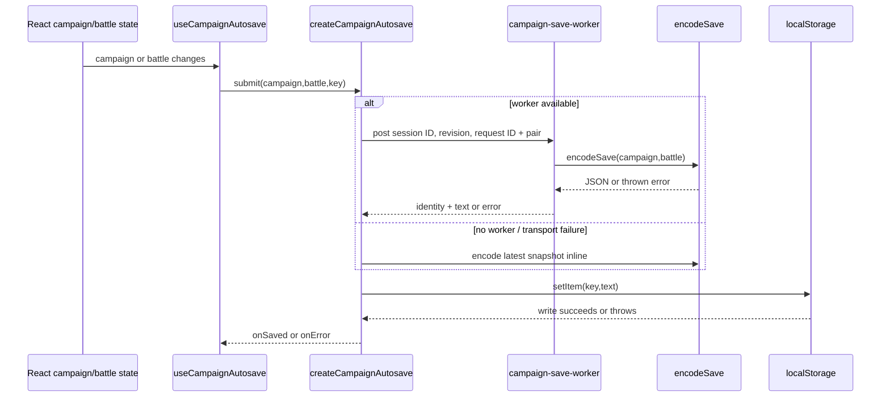
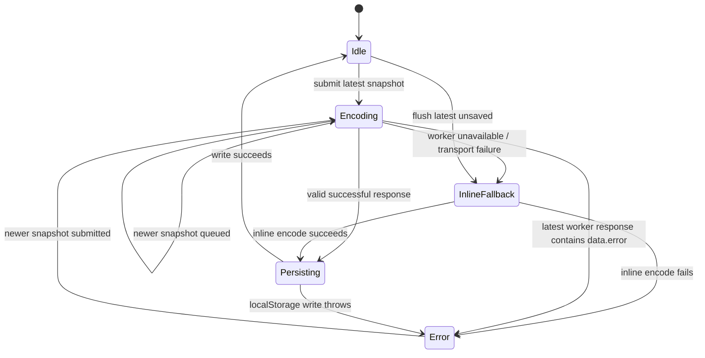
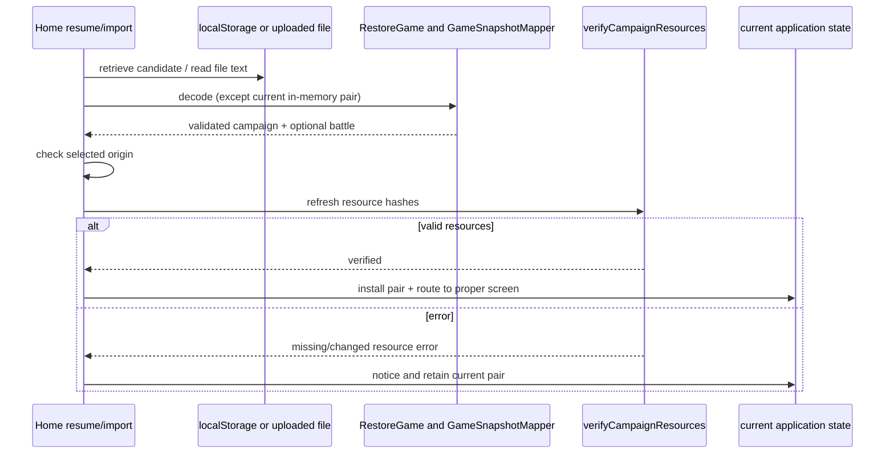

# Persistence

[Architecture guide](README.md)

Persistence has two related but distinct jobs: `game/save.js` encodes/decodes portable campaign saves, while the browser autosave queue stores the latest campaign/battle pair under a campaign-specific `localStorage` key. A portable save is not just raw JSON state: it carries format/schema metadata, applies reference-aware serialization and terrain compaction, expands/migrates on decode, then validates campaign and tactical consistency before returning the pair. Installed campaign assets are external resources verified separately from the save bytes. For screen-level resume/import behavior see [runtime flows](runtime-flows.md); for campaign and battle state semantics see [strategic engine](strategic-engine.md) and [tactical engine](tactical-engine.md).

## Portable save envelope and byte limits

`encodeSave(campaign, battle = null)` produces JSON with this envelope:

```json
{
  "format": "granaderos",
  "schema": 1,
  "savedAt": "ISO-8601 timestamp",
  "mapping": { "version": 1, "sessionId": "unique game session", "revision": 4 },
  "campaign": "campaign snapshot",
  "battle": "battle snapshot or null"
}
```

The `mapping` record identifies the domain snapshot version and accepted game
revision. It must agree with `campaign.gameSessionId` and `gameRevision`. Legacy
saves without a session identity remain readable. The restoration use case
assigns their owned restored copy a new identity. Unsupported mapping versions
and mismatched identities or revisions are refused.

The campaign and battle are serialized through composed replacers for campaign content packages, cell scenes, artillery definitions, and weapons. `savedAt` is generated at encode time. `SAVE_KEY` in `save.js` remains the legacy key `granaderos.campaign.v1`; current browser routing derives campaign-aware keys in `content-launch.js` instead.

The encode thresholds are not interchangeable:

* If the initial encoded JSON is under 1,000,000 bytes, it is checked against the final save limit and returned unchanged (schema 1).
* If it is at or above 1,000,000 bytes, inputs exceeding `MAX_EXPANDED_SAVE_BYTES` (20,000,000 UTF-8 bytes) are rejected before compaction. Otherwise eligible full tile arrays are palette-compacted; schema becomes 2 only when compaction changed at least one terrain map. If nothing can be compacted, it may remain schema 1 despite exceeding that compaction threshold.
* The final JSON must pass `assertSaveSize`: both JavaScript string length and UTF-8 byte length must be no more than 5,000,000. This 5 MB value is the actual persisted/imported save cap; 1 MB is only the compaction trigger, and 20 MB bounds expanded size.

Compaction examines battle, campaign sector/scene states, and pending-battle resume snapshots. Regular eligible tile arrays use `{encoding:"palette-v1", palette:[tile-shapes], indices:[palette-index...]}` while `width`/`height` stay alongside. Repeated tile shapes are stored once; compaction is used only when its JSON representation is shorter. Expansion validates encoding, dimensions, palette, index count/range and computed expanded size before rebuilding tiles. Cell-scene storage has its own compact representation (`cell-tiles-v1`) expanded via the cell-scene storage helper.

## Decode, migrations, and validation sequence

`decodeSave(text)` proceeds in an order that matters:

1. Reject oversize input using 5 MB limit, parse JSON (parse failures become “file does not contain a valid save”), then require `format === "granaderos"` and schema 1 or 2.
2. For schema 2, expand compact terrain subject to the 20 MB expanded cap.
3. Clone and restore campaign via `restoreCampaignValue`; expand a compact cell scene for battle against that campaign.
4. Require campaign pending-battle presence to agree with whether a battle snapshot exists. Restore weapon/artillery/generic-character references and enforce fitting/ammunition/exit version compatibility.
5. Validate tactical-weather context and battle snapshot. Defaults for legacy battle clock fields are assigned, then require tactical and campaign synchronized clocks, start time, battle identity, sector, deployed participants, and authored cell/map identity to agree.
6. Validate arsenal, scene definitions, artillery/patrol, civilians/presence, movement, weapons, presentation, abilities, deployment, repair reserves, discovery, companion grief, service objections, quest escorts/beneficiaries and equipment ownership. Certain legacy missing fields are migrated; active battles are validated and retained, not reconstructed from deployment.

The result is `{campaign, battle}` where `battle` may be null. Decode can throw specific errors for unsupported format/schema, malformed compact terrain, oversized expanded data, mismatched battle/campaign clocks or participants, incompatible versions, stale authored maps, and invalid ownership/context. `restoreCampaignValue` itself validates campaign content and state, builds a base campaign for comparison/migration, and checks multiple state families; it is not a blind JSON cast.

## Application contracts and restored objects

[`CreateGameSession`](../../game/application/create-game-session/README.md)
assigns a new identity to a fresh campaign.
[`RestoreGame`](../../game/application/restore-game/README.md) validates serialized
state and restores canonical domain behavior through
[`GameSnapshotMapper`](../../game/infrastructure/persistence/game-snapshot-mapper.js).
Its identity map shares each character between personnel and active sector
participation. The mapper retains restored objects and projects their accepted
changes back into the same logical snapshot. It does not issue starting equipment,
repeat payments, or advance the campaign clock.

`CanonicalPersonnelMapper` restores every `Squad` once and supplies the active
instance to `ForceRoster`. They share membership ownership. Character health
projects to its campaign record and active physical participation together.
`ActiveSectorCharacterMapper` restores the same character identity for serving
combatants and a canonical character for deployed militia outside the force
roster. During an open visit, the active participant owns the militia's current
condition; the return transaction settles it into the garrison record.
`CanonicalWorldMapper` retains `Sector`, world timeline, corpse and routine
objects. Sector references can move an existing resident while preserving the
physical actor and inventory. A corpse removal requires the world adapter's
existing death receipt and materialized recovered objects before serialization.
`CanonicalInventoryMapper` restores tactical unit inventories and projects exact
remaining quantities, held equipment, metadata and pocket order. Resident supply
records keep their separate civilian mapping. These mappers add no parallel
persisted entity tables.

Retained sector snapshots also contain archival participant rows, such as prior
movement-practice records. These rows do not own a second physical character or
inventory. `RetainedSectorPresence` uses current location, journeys, and open
visits to select physical participants. `PhysicalSectorProjection` keeps archival
records during persistence while mapping only current presence into the domain.
Only open visits restore `SectorSession` objects.

[`SaveGame`](../../game/application/save-game/README.md) checks session, revision,
and request identity before persistence. [`GetSaveStatus`](../../game/application/get-save-status/README.md)
reports accepted and persisted progress separately. Its states are `unsaved`,
`saving`, `saved`, `blocked`, and `failed`. The game header displays the status
beside the export button. It shows `Guardado` only for the current game identity
and revision; a failed or blocked save remains visible.

The [`browser writer`](../../web/lib/browser-save-writer.ts) uses an exclusive Web
Lock per save key. A second tab cannot write that key. A browser without Web Locks
cannot autosave. Both cases keep accepted in-memory progress and manual download
available. Focus, a new snapshot, or an explicit flush retries ownership. The
worker only encodes; it never owns the lock or writes browser storage.

## Browser autosave keys and URL identity

`campaignStorageKey(campaign, search)` selects the browser key based on campaign origin/content identity, with `.qa` appended when query `qa=1`:

| Situation | localStorage key |
|---|---|
| Installed campaign with origin ID | `granaderos.campaign.v2.<encoded-id>[.qa]` |
| Authored/editor content campaign with identity | `granaderos.content-campaign.v2.<encoded-packageId>.<encoded-hash>[.qa]` |
| Editor content URL with complete `contentId` + `contentHash` but no campaign object | same content-campaign v2 form |
| Editor content URL without complete identity | legacy fallback `granaderos.content-campaign.v1[.qa]` |
| Other unbound/legacy campaign | `granaderos.campaign.v1[.qa]` |

`campaignStorageCandidates` returns the current key and, only for applicable old stock/editor saves, a legacy candidate. Installed campaigns do not silently autosave to a legacy key. The content launch handoff uses `sessionStorage` key `granaderos.content-launch.v1` (`CONTENT_LAUNCH_KEY`), a one-time transfer separate from all persistent autosave keys. The editor content save constant is `granaderos.content-campaign.v1`; it is a compatibility fallback, not the installed-campaign v2 format.

`campaignLaunchSearch` removes prior `campaign`, `content`, `contentId`, `contentHash`, and `launch` query parameters, then adds installed origin campaign ID or content ID/hash from the campaign. This is only a query-string function. `page.tsx` writes the normalized URL with `history.replaceState`; URL normalization itself does not write localStorage.

## Autosave queue and worker behavior

`useCampaignAutosave` constructs one `createCampaignAutosave` queue with a save worker when worker construction succeeds, `encodeSave` as encoder, and `localStorage.setItem` as writer. Campaign and battle are submitted as an atomic snapshot pair; key derives from the submitted campaign. The queue allows at most one serialization in flight and retains only the newest pending snapshot. Sequence IDs prevent an old response from overwriting a newer campaign/import.



Operational details:

* `submit` replaces `latest` and starts `pump` unless closed, already saving, or that snapshot ID was saved.
* A worker encode response for an outdated snapshot does not persist over newer data; queue starts the latest snapshot next. Successful persist checks session ID, revision, and request ID against the latest accepted snapshot before writing.
* Worker construction failure makes `worker` null and uses inline encoding. A worker `error` or `messageerror` terminates worker, drops in-flight state, and falls back to inline encoding of the latest snapshot.
* A worker response with `data.error` calls `onError` only if that failed snapshot is still latest; it does not automatically inline-retry that encode. If newer state exists, it proceeds to pump that latest state.
* A `localStorage.setItem` failure calls `onError`; the UI callback shows a notice suggesting export. Save encode/export errors likewise surface through caller handling.
* `flush` synchronously encodes and persists the latest unsaved pair when this tab owns its save key. It is called on `pagehide`, when document becomes hidden, hook cleanup/navigation, and explicit caller flush before replacement/import. Cleanup then closes/terminates the worker.



The diagram is conceptual: stale successful results can be discarded and `pump` can immediately process a newer snapshot; worker `data.error` and worker transport failure have deliberately different behavior.

## Load, hash verification, and recovery paths

Installed campaign boot first loads `/campaigns/index.json`, validates the registry, and loads a chosen manifest plus its content/world/map index/presentation/assets and maps. It validates registry/manifest ID/name/revision consistency and compiles the package. `verifyCampaignResources` fetches listed asset bytes in batches of four, checks safe `assets/`-relative paths and SHA-256 hashes, caching successful/in-flight checks per reader/descriptor unless `refresh` is requested. `loadInstalledCampaign` does this verification before returning the installed package, so boot does not treat an unverified package as loaded.

Save resume/import sequencing differs: `page.tsx` first obtains an in-memory pair or decodes save text/file, then checks selected campaign origin as applicable, then verifies referenced campaign resources with `refresh:true` before applying the restored pair. If decode or resource verification fails, page keeps current session and reports an error. Resume can use the current in-memory campaign/battle without decoding a saved string, though it still refresh-verifies its resources. Autosave can fail independently and is not a migration/validation step; users are offered export when local persistence fails.



## Export and import interface

Export calls `encodeSave(campaign,battle)`, downloads JSON with filename based on campaign origin/content ID plus campaign day, and reports success/failure. Import enforces the 5 MB file-size check before calling `restoreGameSnapshot`, then hash-verifies resources and replaces state only after success. `decodeSave` repeats its own byte limit check, so direct callers cannot bypass the maximum by skipping the UI check. A save with no battle is legal when the campaign has no pending battle; a pending battle without matching tactical snapshot is rejected, and vice versa.

## Source anchors

[`save.js`](../../game/save.js), [`save-limits.js`](../../game/save-limits.js), [`save-terrain.js`](../../game/save-terrain.js), [`cell-scene-storage.js`](../../game/cell-scene-storage.js), [`content-launch.js`](../../game/content-launch.js), [`campaign-package-storage.js`](../../game/campaign-package-storage.js), [`campaign.js`](../../game/campaign.js), [`validate-battle.js`](../../game/validate-battle.js), [`useCampaignAutosave.ts`](../../web/lib/useCampaignAutosave.ts), [`campaign-autosave.js`](../../web/lib/campaign-autosave.js), [`campaign-save-worker.ts`](../../web/lib/campaign-save-worker.ts), [`campaign-library.ts`](../../web/lib/campaign-library.ts), [`page.tsx`](../../web/app/page.tsx), [`ContentEditor.tsx`](../../campaign-editor/web/app/story/ContentEditor.tsx).
