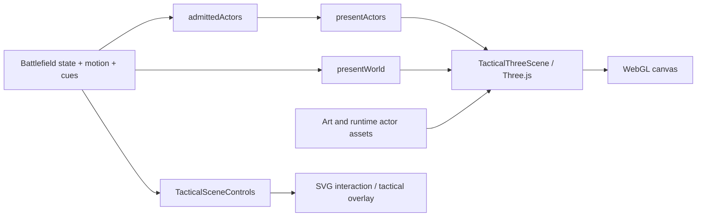
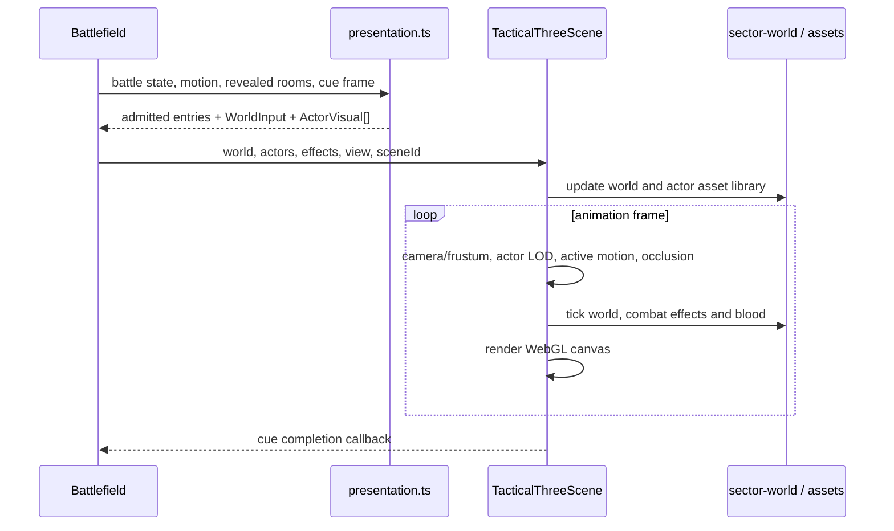
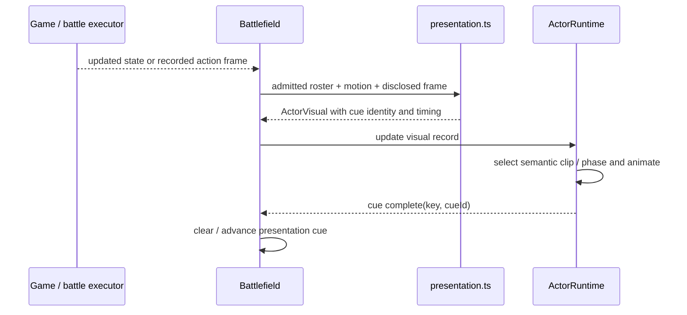
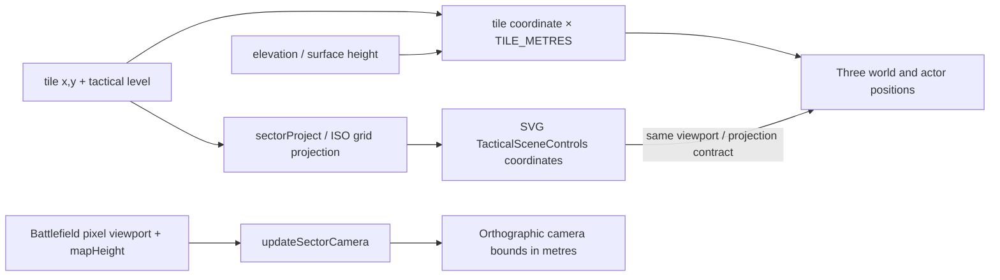

# Tactical rendering

**Architecture guide:** [Overview](README.md) · [Content and campaigns](content-and-campaigns.md) · [Build and tooling](build-and-tooling.md)

The active battle view is a Three.js world/actor canvas paired with an SVG controls overlay. The similarly named `TacticalScene` is not the active game renderer. See the [architecture overview](README.md), [tactical engine](tactical-engine.md), and [runtime flows](runtime-flows.md) for adjacent system context.

## At a glance

[`web/app/Battlefield.tsx`](../../web/app/Battlefield.tsx) composes [`TacticalThreeScene.tsx`](../../web/app/TacticalThreeScene.tsx) and [`TacticalSceneControls.tsx`](../../web/app/TacticalSceneControls.tsx). The former renders world and actors to a canvas; the latter remains the SVG-based interaction and tactical-graphics layer. The canvas is marked `aria-hidden`, so it is not the source of tactical input semantics.

## Data contracts and disclosure boundary

Rendering begins with `admittedActors(state, players, revealedRooms)`, which excludes departed/fled actors and applies visibility/interior readability policy before model presentation. `presentActors` converts only admitted entries into visual records: appearance, outfit/equipment, position/elevation, orientation, posture, action, motion and cue/contact data. `presentWorld` builds a `WorldInput` from terrain plus disclosed dynamic records. These functions are in [`web/lib/three/presentation.ts`](../../web/lib/three/presentation.ts); Battlefield owns their call site and feeds their results to the 3D scene.

The admission stage is a confidentiality boundary, not just a render optimization. World records such as loot, artillery, smoke, lights, props, surfaces and actor points are filtered by interior visibility and/or player sight as appropriate. Contact fitting uses currently admitted and readable bodies/support; it does not allow a cue target coordinate to introduce an unseen body. Keep rendering inputs derived through these boundaries instead of handing raw battle state to arbitrary asset/model code.

The SVG overlay uses tactical projection and interaction data for cursor, tile selection, movement routes, sight, target selection and other controls. It is layered with the 3D view, not a parallel full-world renderer. The older SVG [`TacticalScene.tsx`](../../web/app/TacticalScene.tsx), sprite helpers, and lightweight preview components remain in the source tree for particular paths; their presence does not mean they are the live battlefield renderer. Studio character previews can reuse `TacticalThreeScene` directly (see [`campaign-editor/web/app/studio/CharacterPreview.tsx`](../../campaign-editor/web/app/studio/CharacterPreview.tsx)).

### Render input fields

| Contract | Important fields | What consumes them |
| --- | --- | --- |
| `WorldInput` | `terrain` (dimensions, tiles, upper surfaces, buildings, props, lights, climb links, night/landscape identity); `revealedRooms`; `cursorLevel`; `admittedActorPoints`; `loot`, `cannons`, `smoke`, `illumination`; optional `timeSeconds` / `reducedMotion` | Sector world geometry and dynamic world objects. The typed contract explicitly carries presentation records, not simulation rosters: [`world-types.ts`](../../web/lib/three/world-types.ts). |
| `ActorVisual` | stable `key` / `id` / `kind`; appearance, skin, side; world `position`, `yaw`, posture, mounted/action/equipment/items/garments; optional cue, motion, selection, body-height values | Actor asset selection and `ActorRuntime`; no order-issuing API is included. Defined in [`presentation.ts`](../../web/lib/three/presentation.ts). |
| `ActorCue` | unique cue ID, semantic `action`, start/duration and optional phase timing, work, posture transition, contact target/support, care target | Runtime action clock and animation/contact fitting. Cue completion returns to Battlefield using `onCueComplete`. |

`presentActors` composes actor state into `ActorVisual`; `presentWorld` composes the world contract. The data contracts deliberately differ from full battle state. Some world terrain is shared from the sector/map input; dynamic records are filtered individually, not by a blanket “everything is concealed” rule. Specific filters are visible in [`presentation.ts`](../../web/lib/three/presentation.ts): visible room/surface predicates, sight-based observed records, admitted actor points, and visible loot/cannons/smoke/lights.

## Frame processing

The scene creates an orthographic camera and Three renderer, updates the camera from the view rectangle, derives a frustum, and bounds shadow coverage around the viewed cells. It updates world geometry when inputs change, requests actor assets by appearance/LOD/mounted state, advances actors with cues and motion, applies selected-actor occlusion, then ticks world ambience and combat effects before rendering. See [`TacticalThreeScene.tsx`](../../web/app/TacticalThreeScene.tsx), [`web/lib/three/projection.ts`](../../web/lib/three/projection.ts), [`web/lib/three/scene-actors.ts`](../../web/lib/three/scene-actors.ts), and [`web/lib/three/actor-runtime.ts`](../../web/lib/three/actor-runtime.ts).

Actor cues carry action identity and timing/phase data. The runtime and presentation modules map semantic actions into animation work, including movement, posture changes, firing, melee/contact, healing and mounted transitions. This is presentation timing, not an alternate authority for tactical outcomes: orders and game-state mutations remain in the game simulation and Battlefield executor; `ActorRuntime` explicitly consumes presentation records and cannot issue orders. Cue IDs prevent duplicate completion and let callbacks finish presentation work while battle events/state determine what happened. Contact-target model resolution and effect anchors connect animated actors/world equipment to effects.

The browser presentation stack also includes specialized workers for selected fits. For example, `NativeMeleeContactFit` is built around [`melee-fit-worker.ts`](../../web/lib/three/melee-fit-worker.ts), and patient fit has worker/ready-fit counterparts. Do not generalize their fallback, caching, or failure semantics from filenames; check the specific worker and owning fit class before depending on those details. Relevant action modules include [`web/lib/three/action-timing.ts`](../../web/lib/three/action-timing.ts), [`web/lib/three/action-pace.ts`](../../web/lib/three/action-pace.ts), and [`web/lib/three/actor-effect-anchors.ts`](../../web/lib/three/actor-effect-anchors.ts).

LOD selection depends on projected actor pixel height; frustum culling limits active actor advancement but does not replace admission. Reduced-motion preference affects world/effects/animation presentation. Visibility and interior room readability are computed earlier in the presentation path, before runtime asset loading.

## Geometry, assets, and lifecycle

The world representation is assembled by [`web/lib/three/sector-world.ts`](../../web/lib/three/sector-world.ts), with typed inputs in [`world-types.ts`](../../web/lib/three/world-types.ts) and focused geometry/material modules under [`web/lib/three/`](../../web/lib/three/). Its current division of work includes terrain chunks/upper surfaces in [`world-terrain.ts`](../../web/lib/three/world-terrain.ts), building shells/rooms/walls in [`world-buildings.ts`](../../web/lib/three/world-buildings.ts), independent wall records in [`world-wall-records.ts`](../../web/lib/three/world-wall-records.ts), props in [`world-props.ts`](../../web/lib/three/world-props.ts), vegetation in [`world-vegetation.ts`](../../web/lib/three/world-vegetation.ts), dynamic lights/climb links/smoke in [`world-lights.ts`](../../web/lib/three/world-lights.ts), loot in [`world-items.ts`](../../web/lib/three/world-items.ts), artillery in [`world-artillery.ts`](../../web/lib/three/world-artillery.ts), and shared material/illumination helpers in [`world-materials.ts`](../../web/lib/three/world-materials.ts). `sector-world.ts` retains/rebuilds world nodes by semantic IDs/signatures and exposes anchors for effects. Tile/world projection uses tactical levels, elevations, surfaces, walls, buildings, props, climb openings, terrain, lighting and visibility. Occlusion and effects are separate concerns: [`actor-occlusion.ts`](../../web/lib/three/actor-occlusion.ts) and [`combat-effects.ts`](../../web/lib/three/combat-effects.ts).

### Shared coordinate frame

[`projection.ts`](../../web/lib/three/projection.ts) defines one metric frame for models, terrain, overlays, and recorded effects: `ISO_HALF_WIDTH=26`, `ISO_HALF_HEIGHT=14`, pitch derived from their ratio, `PIXELS_PER_METRE` derived from tactical elevation, and `TILE_METRES` derived from projected half-width. The grid point projection is `x = mapHeight*26 + 28 + (tileX-tileY)*26`, `y = 65 + (tileX+tileY)*14`. Three world inputs use tile x/y converted to metres (`x*TILE_METRES`, `z=y*TILE_METRES`) and `renderedSurfaceHeight` as world Y; `sectorProject` supplies screen-space mapping to `TacticalSceneControls` through its required `project(x,y)` prop. `updateSectorCamera` converts the Battlefield pixel viewport rectangle into orthographic camera bounds using `PIXELS_PER_METRE`. This is the bridge keeping cursor, tactical geometry, model placement, and camera view aligned.

Actor runtime's contract is a JSON character manifest (`/models/characters/manifest.json`) with appearance records and LOD URL lists, animation-library URLs and clip metadata, equipment model URL/catalog, optional gendered garments, sockets and optional horse assets. URLs resolve to glTF (`GLTFLoader`); `ActorAssetLibrary` shares each manifest promise and each GLTF load once per scene by URL, selects requested/fallback LOD, loads related libraries/equipment/garments/mount concurrently, and disposes shared geometries/materials/textures when the scene library is released. See [`actor-assets.ts`](../../web/lib/three/actor-assets.ts). `TacticalThreeScene` computes projected body pixel height and calls `characterLOD`; the thresholds are currently 120 and 65 pixels (levels 0/1/2), and the asset library falls back to the last declared LOD if an exact level is absent.

Actor source assets and generated/runtime artifacts are distinct. Model authoring/build/registration utilities live under [`tools/characters-3d/`](../../tools/characters-3d/); runtime loads the resulting packaged browser assets. World assets additionally include authored art, maps and asset manifests. Do not conflate source scene files, generated glTF/atlas outputs, and runtime URLs. Build-time checksums and artifact closure are documented in [build and tooling](build-and-tooling.md).

When the scene unmounts or its `sceneId` changes, the effect cancels the animation frame, removes context listeners, disposes actor runtimes, occlusion, blood/effects, world, asset library and renderer. Actor entries absent from the current presented list are disposed and removed. Context loss reports an error; restore triggers scene recreation. These lifecycle behaviors are in [`TacticalThreeScene.tsx`](../../web/app/TacticalThreeScene.tsx), not implied by the renderer API alone.

## Limits and source trail

This is a browser-side visual/presentation subsystem, not the authority for tactical simulation. Battle state, visibility, motion and combat outcomes are produced elsewhere; presentation turns them into render inputs. Exact mesh composition and available actions vary with loaded assets and runtime contracts. Do not use old screenshots, sprite previews, catalog tools, or porting plans as evidence that a path is active. Verify a claim against the current `Battlefield` composition, `presentation.ts`, and `TacticalThreeScene.tsx` call chain.
