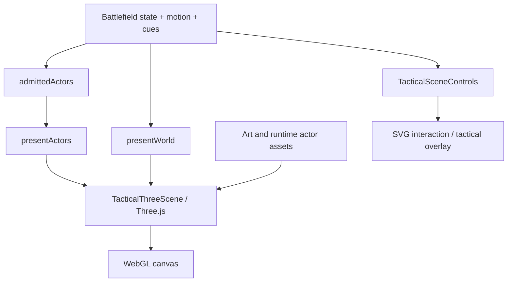
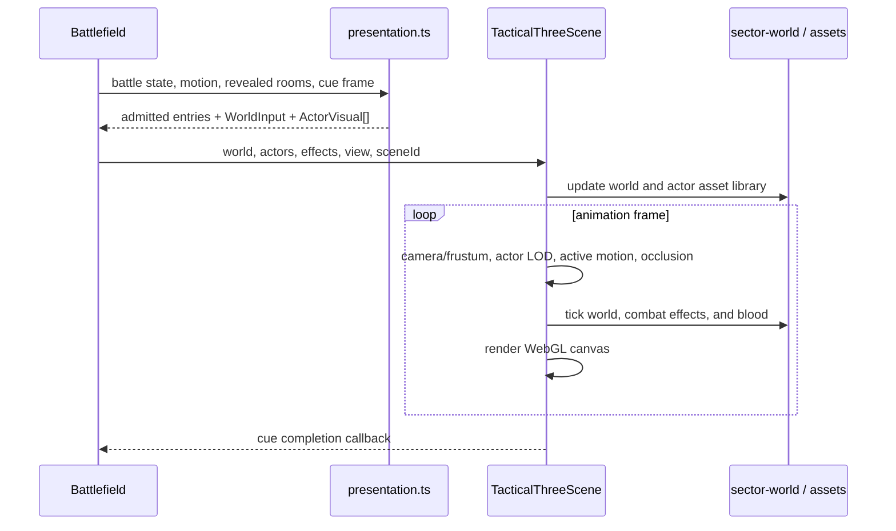
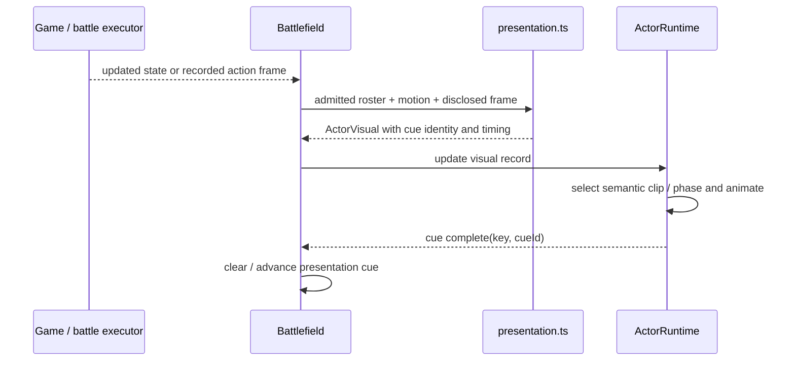
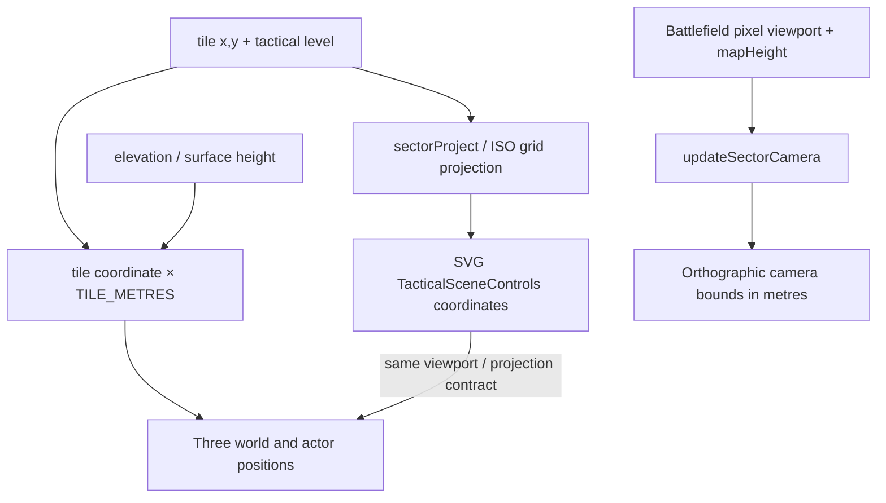

# Tactical rendering

[Architecture guide](README.md) · [Tactical engine](tactical-engine.md) · [Content and campaigns](content-and-campaigns.md) · [Build and tooling](build-and-tooling.md)

This page explains how the browser projects accepted sector state into a Three.js WebGL scene (`TacticalThreeScene.tsx`) paired with an interactive SVG overlay (`TacticalSceneControls.tsx`), how visibility filtering prevents rendering from leaking hidden actors or items, how animation cues and contact-fitting workers run without becoming game-rule owners, and how isometric grid coordinates align with 3D world metres. It connects the simulation model in the [tactical engine](tactical-engine.md) and the sequence traces in [runtime flows](runtime-flows.md) to the asset pipelines in [content and campaigns](content-and-campaigns.md) and [build and tooling](build-and-tooling.md).

## At a glance

The flowchart below shows how `Battlefield state + motion + cues` passes through `admittedActors`, `presentActors`, and `presentWorld` into `TacticalThreeScene / Three.js` (alongside `Art and runtime actor assets`) to render the `WebGL canvas`, while `TacticalSceneControls` renders the `SVG interaction / tactical overlay`.

[`apps/web/app/Battlefield.tsx`](../../apps/web/app/Battlefield.tsx) composes [`TacticalThreeScene.tsx`](../../apps/web/app/TacticalThreeScene.tsx) and [`TacticalSceneControls.tsx`](../../apps/web/app/TacticalSceneControls.tsx). `TacticalThreeScene` renders terrain, buildings, props, lighting, combat effects, and 3D glTF character models onto an `aria-hidden` `WebGL canvas`, while `TacticalSceneControls` draws the interactive `SVG interaction / tactical overlay` for tile selection, movement paths, sight lines, and targeting cursors. (The older 2D [`TacticalScene.tsx`](../../apps/web/app/TacticalScene.tsx) remains in the tree only for legacy or lightweight preview paths, and [`CharacterPreview.tsx`](../../apps/campaign-editor/web/app/studio/CharacterPreview.tsx) reuses `TacticalThreeScene` in the campaign editor.)

## Data contracts and disclosure boundary

Presentation is a read-only projection layer and an information-disclosure boundary. In [`apps/web/lib/three/presentation.ts`](../../apps/web/lib/three/presentation.ts):

- `admittedActors(state, players, revealedRooms)` filters out departed or fled units and applies player sight and interior room-readability rules before any 3D model is requested.
- `presentActors` converts only admitted actors into `ActorVisual` view records carrying appearance, outfit, equipment, position, elevation, orientation, posture, and animation cues.
- `presentWorld` builds a `WorldInput` record from static sector terrain plus disclosed dynamic objects (ground loot, artillery, smoke, lights, props, and upper surfaces).

Neither `TacticalThreeScene` nor `ActorRuntime` receives the raw sector snapshot or owns character health, inventory, or combat authority. Contact-fitting helpers only fit against admitted, visible bodies so an animation cue never reveals an unseen target.

The table below lists each presentation `Contract`, its `Important fields`, and `What consumes them`.

| Contract | Important fields | What consumes them |
| --- | --- | --- |
| `WorldInput` | `terrain` (dimensions, tiles, upper surfaces, buildings, props, lights, climb links, night/landscape identity); `revealedRooms`; `cursorLevel`; `admittedActorPoints`; `loot`, `cannons`, `smoke`, `illumination`; optional `timeSeconds` / `reducedMotion` | [`sector-world.ts`](../../apps/web/lib/three/sector-world.ts) and [`world-types.ts`](../../apps/web/lib/three/world-types.ts) for building sector geometry and visible dynamic objects |
| `ActorVisual` | Stable `key`, `id`, and `kind`; appearance, skin, and side; world `position`, `yaw`, posture, mounted state, action, equipment, items, and garments; optional `cue`, `motion`, selection, and body-height values | [`actor-assets.ts`](../../apps/web/lib/three/actor-assets.ts) and [`actor-runtime.ts`](../../apps/web/lib/three/actor-runtime.ts) for model selection and skeletal animation |
| `ActorCue` | Unique cue ID, semantic `action`, start/duration and phase timing, work progress, posture transition, and contact or medical care target | [`actor-runtime.ts`](../../apps/web/lib/three/actor-runtime.ts), [`action-timing.ts`](../../apps/web/lib/three/action-timing.ts), and `onCueComplete` callbacks in `Battlefield` |

## Frame processing and animation cues

The sequence diagram below shows how `Battlefield`, `presentation.ts`, `TacticalThreeScene`, and `sector-world / assets` prepare and render each animation frame.

`TacticalThreeScene` maintains an orthographic Three.js camera and WebGL renderer, derives a view frustum and shadow bounds from the viewed cells, selects character level of detail (`characterLOD` with pixel-height thresholds at 120 and 65 pixels for LOD 0/1/2), advances active actor skeletal animations, applies selected-actor wall occlusion ([`actor-occlusion.ts`](../../apps/web/lib/three/actor-occlusion.ts)), and ticks ambient world and combat effects ([`combat-effects.ts`](../../apps/web/lib/three/combat-effects.ts)).

The sequence diagram below traces how an action's animation cue flows from `Game / battle executor` through `Battlefield` and `presentation.ts` to `ActorRuntime` and back on completion.

`ActorCue` playback is visual timing over an already resolved simulation step. Specialized Web Workers such as [`melee-fit-worker.ts`](../../apps/web/lib/three/melee-fit-worker.ts) (`NativeMeleeContactFit`) and [`heal-patient-fit-worker.ts`](../../apps/web/lib/three/heal-patient-fit-worker.ts) compute skeletal contact poses asynchronously for melee and medical animations without modifying tactical state.

## World geometry, shared coordinate frame, and lifecycle

[`apps/web/lib/three/sector-world.ts`](../../apps/web/lib/three/sector-world.ts) assembles the 3D sector from focused builders under `apps/web/lib/three/`: terrain chunks and upper surfaces ([`world-terrain.ts`](../../apps/web/lib/three/world-terrain.ts)), buildings and interior rooms ([`world-buildings.ts`](../../apps/web/lib/three/world-buildings.ts)), standalone walls ([`world-wall-records.ts`](../../apps/web/lib/three/world-wall-records.ts)), props ([`world-props.ts`](../../apps/web/lib/three/world-props.ts)), vegetation ([`world-vegetation.ts`](../../apps/web/lib/three/world-vegetation.ts)), dynamic lights, climb openings, and smoke ([`world-lights.ts`](../../apps/web/lib/three/world-lights.ts)), ground loot ([`world-items.ts`](../../apps/web/lib/three/world-items.ts)), artillery ([`world-artillery.ts`](../../apps/web/lib/three/world-artillery.ts)), and shared materials ([`world-materials.ts`](../../apps/web/lib/three/world-materials.ts)).

### Shared coordinate frame

[`apps/web/lib/three/projection.ts`](../../apps/web/lib/three/projection.ts) defines one metric coordinate frame (`ISO_HALF_WIDTH = 26`, `ISO_HALF_HEIGHT = 14`, `PIXELS_PER_METRE`, and `TILE_METRES`) so the 3D WebGL scene and the 2D SVG overlay stay aligned.

The flowchart below shows how `tile x,y + tactical level`, `elevation / surface height`, and `Battlefield pixel viewport + mapHeight` project through `sectorProject / ISO grid projection`, `tile coordinate × TILE_METRES`, and `updateSectorCamera` into `SVG TacticalSceneControls coordinates`, `Three world and actor positions`, and `Orthographic camera bounds in metres`.

In this projection:

- `sectorProject` maps `tile x,y + tactical level` to 2D isometric screen coordinates (`x = mapHeight * 26 + 28 + (tileX - tileY) * 26`, `y = 65 + (tileX + tileY) * 14` adjusted for elevation) for `SVG TacticalSceneControls coordinates`.
- 3D placement converts tile coordinates to metres (`x * TILE_METRES`, `z = y * TILE_METRES`) and uses `renderedSurfaceHeight` from `elevation / surface height` as world `Y` for `Three world and actor positions`.
- `updateSectorCamera` converts the `Battlefield pixel viewport + mapHeight` rectangle into `Orthographic camera bounds in metres` using `PIXELS_PER_METRE`.

### Assets and cleanup

[`apps/web/lib/three/actor-assets.ts`](../../apps/web/lib/three/actor-assets.ts) (`ActorAssetLibrary`) loads `/models/characters/manifest.json` and caches glTF character meshes, LOD levels, animation clips, weapons, garments, and mounts per scene. Source 3D authoring scripts live in [`tools/characters-3d/`](../../tools/characters-3d/), whereas the browser loads packaged runtime glTF assets from `apps/web/public/models/`. When `TacticalThreeScene` unmounts or `sceneId` changes, it cancels the animation frame, removes WebGL context listeners, and disposes actor runtimes, occlusion helpers, combat effects, world meshes, cached glTF geometries/materials/textures, and the WebGL renderer.
