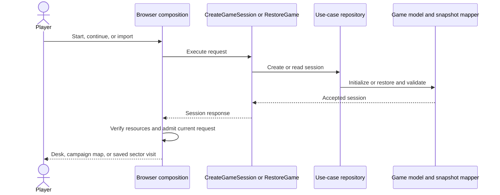
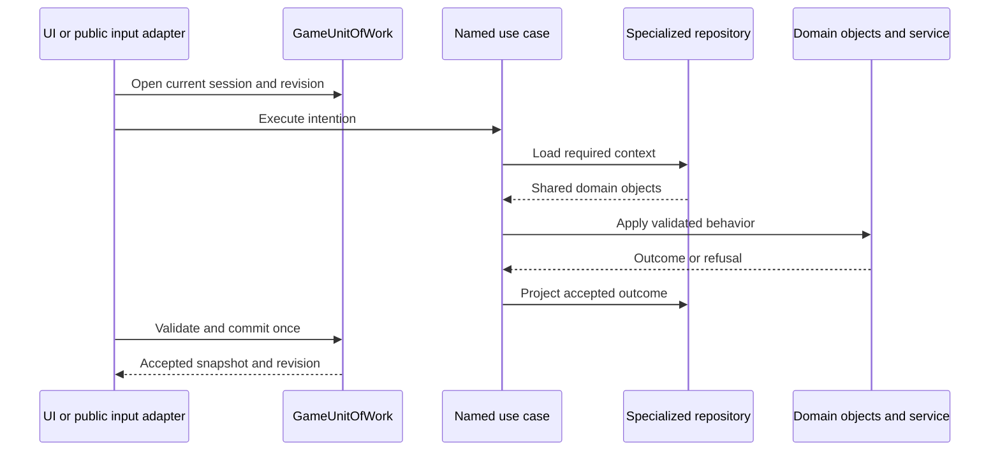
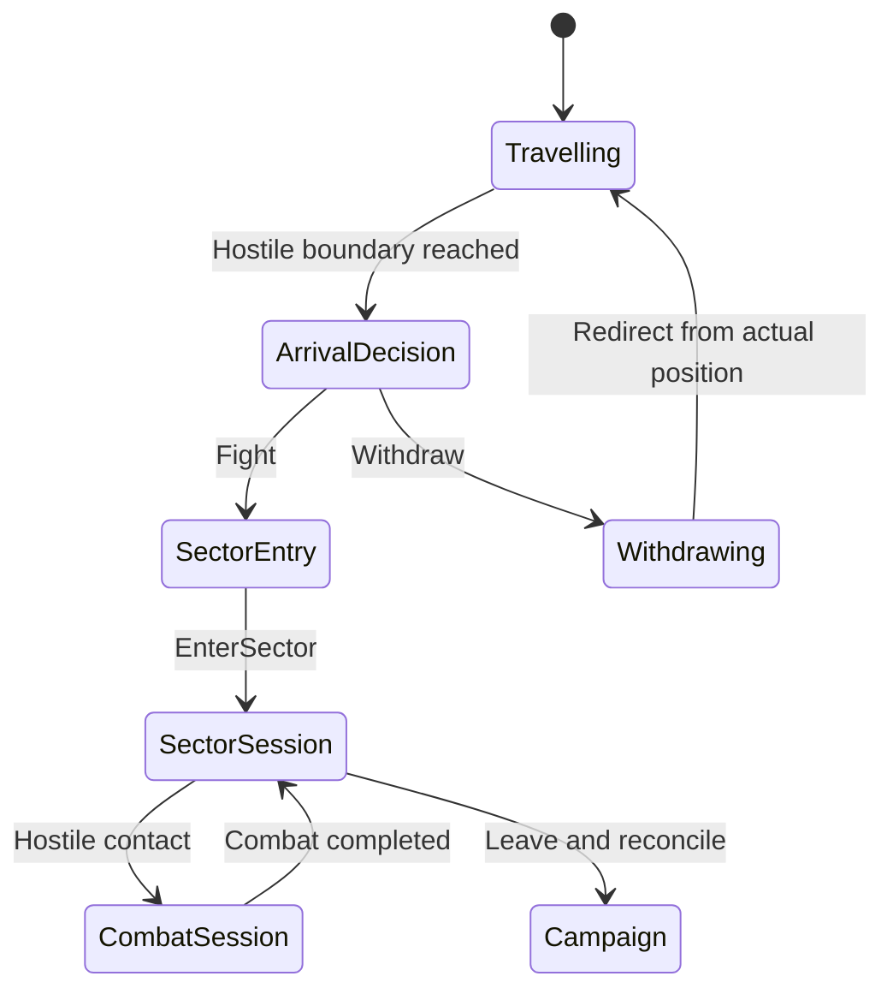
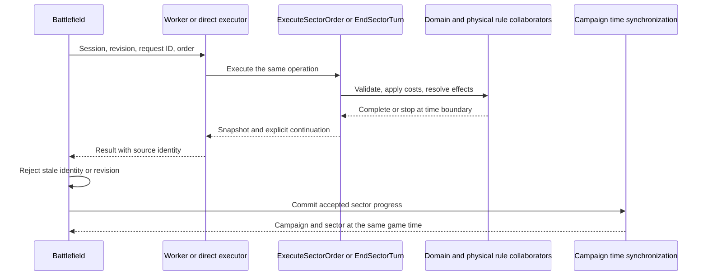

# Runtime flows

[Architecture guide](README.md) · [Application contracts](use-cases/application-contracts.md)

The game accepts a campaign and sector snapshot together. `apps/web/app/page.tsx`
connects the browser to the use cases and compatibility entry points. Domain
objects decide game rules. The UI selects screens and shows accepted results.

## Create or restore a game

`CreateGameSessionUseCase` creates initial campaign progress with a new session
identity. A new game enters the headquarters desk after its optional introduction.
`RestoreGameUseCase` decodes saved progress through `GameSnapshotMapper`, restores
classes and shared identities, and validates relationships. The browser verifies
campaign resources before it installs the restored session.

The browser keeps a request generation while resources load. A response for an
older selection cannot replace the current game. Restoration does not charge
service payments, issue equipment, or advance time. A supported prepaid legacy
recruit is admitted at the saved time through the explicit save conversion.

## Accept a campaign intention

`dispatchCampaign` is the compatibility input adapter. It creates one
`GameUnitOfWork`, applies global campaign guards, and routes migrated intentions
to application use cases. For example, recruitment calls `RecruitCombatant`,
renewal calls `RenewServiceContract`, and squad organization calls `FormSquad`.

Each use case has its own repository interface. The repository loads the required
objects and projects accepted changes into the transaction. The transaction
validates and publishes one new revision. A refusal returns the prior gameplay
state with a translated reason.

`GetRecruitmentCandidates` and `GetVisibleCharacters` are read-only use cases.
Their repository interfaces have no commit operation. A query does not advance
time or create a second data store.

## Journey, arrival, and sector entry

A journey owns physical route progress. The strategic clock advances to the first
required decision. At a hostile boundary, `ArrivalDecision` pauses campaign time.
`FightOnArrival` authorizes entry; `WithdrawOnArrival` starts a withdrawal journey
without advancing time. `RedirectJourney` can reverse that journey from its
actual position, including at zero elapsed time.

`SectorEntryRequest` identifies the authorized sector and participants.
`EnterSector` restores the retained world and creates the `SectorSession` for the
visit. Deployment places the admitted participants. A `CombatSession` starts when
combat begins and can end while the sector visit remains open.

A fight at another sector can suspend the current visit. The saved visit retains
its participants, AP, turn, equipment, and unfinished order. World conditions
continue. `ResumeSectorSession` activates an open visit. Reinforcements to a sector
that already has an open visit join that visit; they do not create a duplicate
sector or a second copy of a person.

## Execute a sector order

`actBattle` and `endTurn` retain their public compatibility names. They route
accepted operations through `ExecuteSectorOrder` and `EndSectorTurn`. The sector
operation coordinator owns checkpoints and continuation. Domain objects own
sector phases, combat turns, AP, reactions, firearm work, injuries, visibility,
and item transfer.

Movement can commit one accepted step at a time. Group movement retains its
remaining participants and paths. A long rest or reload can stop at a campaign
arrival timestamp. The result records the unexecuted work. `runBattleJob` with a
resume request continues it without charging completed work again.

Worker messages carry game-session, sector-session, revision, and request
identity. The browser admits only a result for its current source. Direct
fallback executes the same rules. Workers return data; they cannot independently
save progress.

Presentation captures observations from the resolved operation. It can animate
those observations before the UI accepts the final result. Presentation does not
resolve another attack or disclose an unseen actor. Camera and animation time
are separate from game time.

## Advance the common clock

`SectorTimeBudget` prevents an operation from passing the next unresolved
campaign arrival. Each accepted sector state passes through `syncBattleTime`.
The synchronizer validates the entry identity and related conditions, then
executes `syncTacticalTime` through the campaign transaction. It reconciles world
conditions and returns a campaign/sector pair at one accepted time.

Resident conditions, movement, and collection use a common event order in
visible, retained, and suspended sectors. Corpse removal happens after 72 game
hours. Recoverable equipment transfers to the ground once; death history remains.
Reopening a sector does not repeat completed world events.

## Leave the sector

The finish callback supplies the issued entry ID, full sector snapshot, and
issued player participants, including historical casualties whose bodies have
already disappeared. Campaign settlement validates the report before it returns
health, equipment, ammunition, ownership, and scenario consequences. A rejected
report leaves the visit open.

## Persist accepted progress

Autosave follows accepted commits. `SaveGame` serializes a versioned snapshot
through its repository. The browser adapter holds an exclusive Web Lock for the
save key. It tracks accepted and persisted revisions separately. A storage or
writer conflict leaves the in-memory game available and reports unsaved progress.
The player can export a save file. `GetSaveStatus` exposes the current status.

The save includes active and suspended sector visits. Validation checks clocks,
participant uniqueness, inventory custody, and retained relationships. Each
suspended visit passes the same admission checks as an active visit.

## Editor operations and playtests

`campaign-editor` has its own entry point, project model, repositories, and build.
Browser editing invokes editor use cases. Undo and redo act on admitted project
history. Export produces a `campaign-format` package. A playtest invokes the
public game API with an isolated game session. Project state and playtest progress
remain separate.

Source entry points: [browser composition](../../apps/web/app/page.tsx),
[campaign adapter](../../packages/game/campaign.js), [sector adapter](../../packages/game/tactical.js),
[time synchronization](../../packages/game/time.js), [worker jobs](../../packages/game/battle-job.js),
[snapshot mapping](../../packages/game/infrastructure/persistence/game-snapshot-mapper.js),
and [editor package](../../apps/campaign-editor/README.md).
