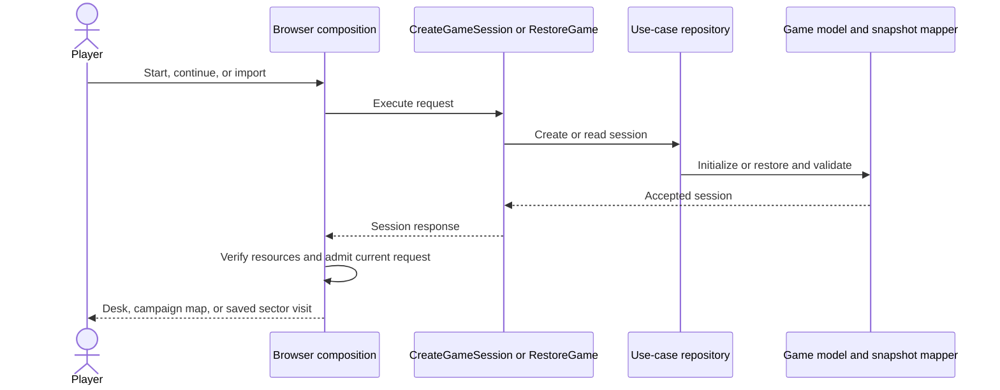
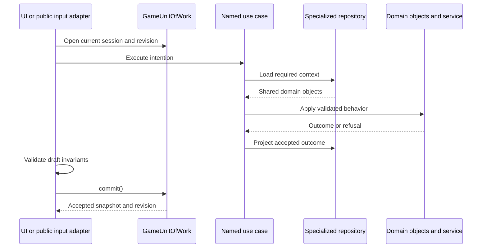
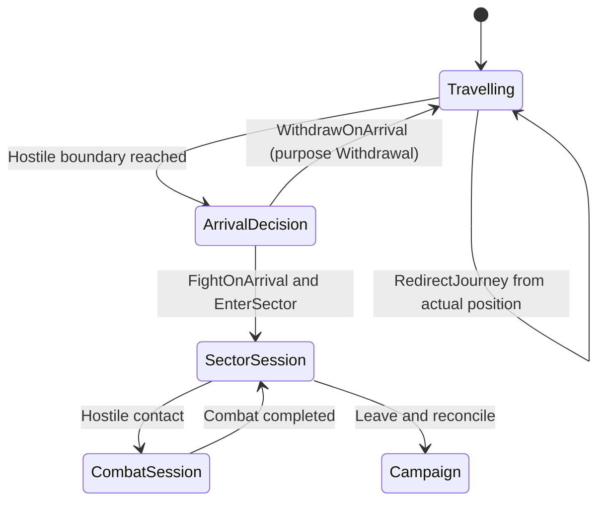
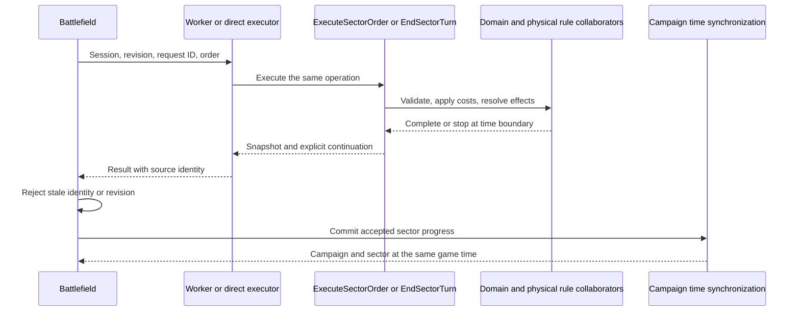

# Runtime flows

[Architecture guide](README.md) · [Application contracts](use-cases/application-contracts.md)

This page traces the concrete runtime sequences behind creating or restoring a game session, executing strategic and sector commands, advancing the shared world timeline, reconciling sector visits, persisting progress, and running editor playtests. It connects the component boundaries in [C4 views](c4.md) and the [system map](system-map.md) to the detailed rule descriptions in the [strategic engine](strategic-engine.md), [tactical engine](tactical-engine.md), [persistence](persistence.md), and [application contracts](use-cases/application-contracts.md).

The root browser component (`apps/web/app/page.tsx`) holds the committed campaign and active sector snapshot pair at one `gameRevision`. Domain objects and services own game rules; application use cases coordinate transactions through narrow per-use-case repository interfaces; and React screens render the accepted result.

## Create or restore a game

`CreateGameSessionUseCase` creates initial campaign state with a new `GameSession` identity and revision `0`, opening the headquarters desk after any configured campaign introduction. `RestoreGameUseCase` decodes saved text through `GameSnapshotMapper`, rebuilds domain classes via their `restore` factories, shares canonical identities through `DomainIdentityMap`, and validates cross-system relationships. The browser then checks campaign resource SHA-256 digests (`verifyCampaignResources`) before installing the session.

The sequence diagram below shows how the `Player`, `Browser composition` (`apps/web/app/page.tsx`), `CreateGameSession or RestoreGame` use case, `Use-case repository`, and `Game model and snapshot mapper` collaborate to initialize or restore a session.

`Browser composition` tracks a request-generation counter while campaign assets verify asynchronously so an older load cannot overwrite a newer selection. Restoration via `GameSnapshotMapper` never repeats recruitment payments, starting equipment issuance, or completed world events. Supported legacy prepaid recruitment claims (`hiringArrivals`) convert to immediate service at a legal safe site at the saved timestamp (or remain a refundable claim if no site is safe).

## Accept a campaign intention

`dispatchCampaign` in `packages/game/campaign.js` is the strategic compatibility input adapter. It opens a `GameUnitOfWork` at the current revision, enforces global campaign guards, and routes the listed intentions to their application use cases: recruitment invokes `RecruitCombatantUseCase`, contract renewal invokes `RenewServiceContractUseCase`, squad formation invokes `FormSquadUseCase`, arrival resolution invokes `FightOnArrivalUseCase` or `WithdrawOnArrivalUseCase`, journey redirection invokes `RedirectJourneyUseCase`, conversation invokes `TalkToCharacterUseCase`, and sector resumption invokes `ResumeSectorSessionUseCase`.

Each use case depends on its own narrow repository interface (such as `RecruitCombatantRepository`). The repository adapter loads canonical domain objects from the shared `DomainIdentityMap` and `GameSnapshotMapper`, runs domain behavior, and projects mutations back into the `GameUnitOfWork` draft. `dispatchCampaign` validates the draft itself, then `GameUnitOfWork.commit()` stores the snapshot and advances `gameRevision` by one. A refusal aborts the unit of work and returns the prior state with a localized `lastError`.

The sequence diagram below shows how `UI or public input adapter`, `GameUnitOfWork`, `Named use case`, `Specialized repository`, and `Domain objects and service` execute one atomic strategic transaction.

Read-only use cases (`GetRecruitmentCandidatesUseCase`, `GetVisibleCharactersUseCase`, and `GetSaveStatusUseCase`) have read-only repository interfaces without a commit method. They return narrow view types (such as `{ characterIds }` or `SaveStatus`), never expose mutable domain objects, and never advance game time.

## Journey, arrival, and sector entry

`Journey` owns physical route progress for a `Squad`. When a squad reaches a hostile sector boundary, `ArrivalDecision` pauses campaign time and blocks any mutating command that would advance time or bypass the decision. `FightOnArrivalUseCase` resolves the decision by committing to sector entry; `WithdrawOnArrivalUseCase` resolves it by starting a withdrawal journey (`JourneyPurpose.Withdrawal`) at zero elapsed time. `RedirectJourneyUseCase` can redirect a journey from its actual physical segment position—either immediately at zero elapsed time (re-creating a fresh `ArrivalDecision` if redirected back into the hostile boundary) or after travel has progressed, preserving elapsed time, paid segment fares, and fatigue.

The campaign snapshot stores the sector-entry request under `sectorEntryRequest` as [`CampaignSectorEntryRequest`](../../packages/game/public/campaign-types.ts), a saved projection with campaign context. `EnterSectorUseCase` receives the narrower application [`SectorEntryRequest`](../../packages/game/application/sector-sessions/enter-sector/sector-entry.request.ts), restores retained `Sector` state, and opens a `SectorSession` for the visit. `SectorDeployment` places participants in authorized entry cells when deployment is required. A `CombatSession` starts when hostile contact occurs and can end while the `SectorSession` remains open.

The state diagram below traces the transitions across `Travelling`, `ArrivalDecision`, `SectorSession`, `CombatSession`, and `Campaign`.

Choosing `FightOnArrival` for another squad at a different sector suspends the current `SectorSession` in `GameSession` (`suspendedSectorSessionIds`) while retaining its combat round, `ActionPoints`, equipment custody, and unfinished orders. `ResumeSectorSessionUseCase` switches active authority back to a suspended visit once all pending arrival decisions are resolved. If a second squad fights at a sector that already has an open `SectorSession`, `AdmitSectorReinforcementsUseCase` admits the arriving combatants into that same visit on legal unoccupied entry cells without duplicating the sector or refreshing existing participants' turn budgets.

## Execute a sector order

`actBattle` and `endTurn` in `packages/game/tactical.js` retain their compatibility names and route sector operations through `ExecuteSectorOrderUseCase`, `EndSectorTurnUseCase`, and `ResumeSectorOperationUseCase`. `SectorOperation` and `SectorOperationContext` bind each operation to the `GameSession` ID, `SectorSession` ID, both revisions, and request ID. Domain classes own visit modes (`SectorSession`), combat episodes (`CombatSession`), turn queues (`CombatTurn`), action points (`SectorParticipant` and `ActionPoints`), reaction interrupts (`ReactionPolicy`, `ReactionWindow`, and `ReactionStack`), firearm loading and accuracy (`Firearm`, `ReloadWork`, `ReprimeWork`, `FirearmAccuracy`, `BodyRegion`, and `CombatInjury`), visibility (`VisionObserver`, `FieldOfView`, `VisibilityPolicy`, `IlluminationPolicy`, and `KnownSectorPolicy`), and inventory custody (`Inventory`, `Item`, `PocketLayout`, and `ItemTransferService`).

Long operations commit bounded checkpoints. Single-unit and group movement can advance one step at a time, and rest or reload work stops if `SectorTimeBudget` reaches the next campaign arrival timestamp. The response records the accepted partial progress and the unexecuted continuation so `ResumeSectorOperationUseCase` can resume from that checkpoint without recharging spent `ActionPoints` or repeating prior random draws.

The sequence diagram below shows how `Battlefield`, `Worker or direct executor`, `ExecuteSectorOrder or EndSectorTurn`, `Domain and physical rule collaborators`, and `Campaign time synchronization` process one sector order.

Whether a job runs in a Web Worker (`useBattleExecutor`) or inline fallback, it executes the same rules and returns a result tagged with the source `SectorOperationContext`. `Battlefield` rejects any reply whose session ID, revision, or request ID no longer matches the active snapshot. Workers never write to browser storage.

Presentation adapters (`presentedActBattle`, `presentedEndTurn`, and `apps/web/lib/three/presentation.ts`) capture player-visible observations from the accepted transition and play animation cues before the UI settles the next interactive state. Presentation never resolves combat rules or discloses hidden actors; see [rendering](rendering.md).

## Advance the common clock

`WorldTimeline.advanceTo(targetSecond, applyEvent)` is the single domain operation that advances game time. It processes scheduled events in chronological order (`atSecond`) with a deterministic identifier tie-break (`id`), moves each completed event to `completedEventIds` so it never runs twice, and stops at the timestamp of any event that returns `'pause'` (such as a hostile `ArrivalDecision`).

During a sector visit, `SectorTimeBudget` bounds each operation by the next campaign boundary, and every accepted sector snapshot passes through `syncBattleTime` (`packages/game/time.js`), which dispatches `syncTacticalTime` inside the campaign transaction to keep campaign and sector clocks at the same accepted second.

Resident movement (`ResidentRoutine`), unattended supply collection (`CollectResidentSupplyUseCase` and `ScavengingPolicy`), and corpse removal (`AdvanceWorldTimeUseCase` and `Corpse`) follow the same rules in visible, retained, and suspended sectors. A `Corpse` is removed 72 game hours after death, releasing any remaining recoverable equipment to `ground:<sectorId>` custody once while preserving the character's death record.

## Leave the sector

When a sector visit finishes or the squad leaves, the `finish` callback in `apps/web/app/page.tsx` dispatches `battleResult`, `leaveSector`, or `finishMission` with the pending request ID, the full sector snapshot, and the participant report (including historical casualties whose physical corpses were already removed). Campaign settlement validates the identity and clocks, reconciles `Character` health, `Inventory` custody, ammunition, sector ownership, and quest consequences, and closes the `SectorSession` in `GameSession`. If validation fails, the transaction rolls back and the sector visit remains open.

## Persist accepted progress

After an accepted commit updates in-memory state, `useCampaignAutosave` submits the campaign and sector snapshot pair to the autosave queue (`SaveGameUseCase`). The browser writer (`apps/web/lib/browser-save-writer.ts`) acquires an exclusive Web Lock per campaign storage key and tracks accepted in-memory revisions separately from persisted `localStorage` revisions via `GetSaveStatusUseCase`. For save envelope schemas, terrain compaction, and restoration checks, see [persistence](persistence.md).

## Editor operations and playtests

`apps/campaign-editor` runs as an independent application with its own domain (`CampaignProject`, `CampaignProjectHistory`, `CampaignWorld`, `CampaignMap`, `SectorMap`, `SectorMapHistory`), use cases (`EditCampaignProject`, `UndoCampaignProjectEdit`, `RedoCampaignProjectEdit`, `ValidateCampaignProject`, `EditSectorMap`), and IndexedDB storage. Editor playtests invoke `packages/game/public/campaign-playtest-api.ts` to run an isolated game session without touching the authoring project draft or the player's `localStorage` saves; see [content and campaigns](content-and-campaigns.md).

Source entry points: [`apps/web/app/page.tsx`](../../apps/web/app/page.tsx), [`packages/game/campaign.js`](../../packages/game/campaign.js), [`packages/game/tactical.js`](../../packages/game/tactical.js), [`packages/game/time.js`](../../packages/game/time.js), [`packages/game/battle-job.ts`](../../packages/game/battle-job.ts), [`packages/game/infrastructure/persistence/game-snapshot-mapper.js`](../../packages/game/infrastructure/persistence/game-snapshot-mapper.js), and [`apps/campaign-editor/README.md`](../../apps/campaign-editor/README.md).
