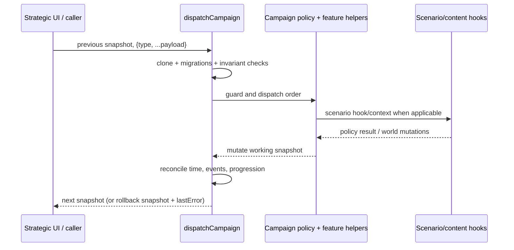
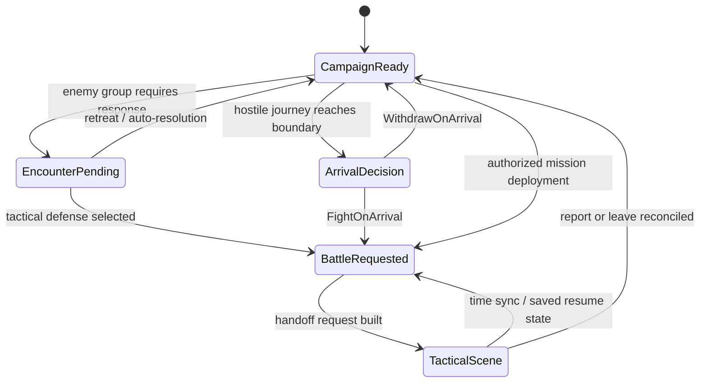

# Strategic engine

[Architecture guide](README.md)

The strategic engine is a transactional campaign-state machine: authored scenario/content supplies the initial world and policy hooks, while `dispatchCampaign` applies one validated order to a cloned campaign snapshot. The resulting state coordinates travel, people, resources, contracts, care, finite equipment custody, events, and battle requests; it is not a separate simulation service per feature. Tactical play is handed off through a pending-battle request, and its clock and report are reconciled back through campaign actions. For the overall runtime and save boundaries, see [runtime flows](runtime-flows.md) and [persistence](persistence.md); this page focuses on strategic decisions and state contracts.

## Domain owners and application contracts

`RecruitCombatant` coordinates `Character`, `Health`, `ServiceContract`, `Treasury`,
`ForceRoster`, and `Squad` through `RecruitmentService`. The combatant is available
immediately at a legal site. Local recruitment preserves the resident's condition
and equipment. `RenewServiceContract` extends exact service deadlines and charges
once. `FormSquad` validates all selected members before changing membership.

`Journey` owns route progress. `ArrivalDecision` owns one fight-or-withdraw choice.
`RedirectJourney` preserves the exact route position, elapsed time, and spent
costs, including a reversal at zero elapsed time. Time remains paused until every
pending arrival decision has a resolution.

`GameSession` identifies active and suspended sector visits. `Sector` references
physical residents, participants, objects, and corpses. `WorldTimeline` schedules
corpse removal with stable event identity. The world adapters coordinate condition
changes, resident routines, item collection, and removal through shared time
boundaries for visible, retained, and suspended sectors.

The serialized names `pendingBattle`, `recruited`, and `operativeState` remain at
the compatibility boundary. New domain and application code uses the canonical
[glossary](../../plans/accepted/ubiquitous-language.md).

## Ownership and state boundary

`initialCampaign(seed, content)` resolves optional authored content, asks the selected scenario for `initialState`, applies authored starting time/content attachment (or default errand/discovery definitions), initializes/migrates campaign subsystems, then initializes campaign events and progresses the scenario when needed. Initialization is therefore scenario-aware, not simply a static catalog copy. `initializeCampaignSystems` visibly brings together roster-dependent migrations for skill learning, cartridges, equipment returns, medical care, assignments, morale, ammunition custody, artillery, enemy groups, deployment returns, attention state and town income (`../../game/campaign.js`).

The campaign state is a serializable snapshot projected from domain behavior, with fields added by migrations and features. Commonly used top-level shapes include:

| Field | Role |
|---|---|
| `seed`, `hour`, optional `secondOfHour` | deterministic campaign RNG and strategic clock |
| `location`, `sectors`, `sectorStates` | current place, regional ownership/conditions, local finite stocks and units |
| `recruited`, `operativeState`, `squads`, `activeSquadId` | personnel, individual mutable records and strategic squad organization |
| `resources`, `reputation`, `log` | treasury and other campaign resource balances, faction standing and bounded activity history |
| `contracts`, `quests`, `missions`, `sceneStates` | timed obligations and authored interaction/progression state |
| `pendingEncounter`, `pendingBattle` | mutually exclusive strategic interruption / tactical handoff |
| `lastError` | rejected order explanation; successful dispatch clears it |

These are representative state families, not a closed schema. Scenario content and migrations can extend the state. Definitions may be pinned under `contentCampaign.package`; campaign cloning deliberately reuses that frozen package while cloning mutable state.

## Order transaction contract

`dispatchCampaign(previous, action)` accepts an action object with a string `type` and returns the next campaign snapshot. It clones/migrates before application, clears the prior error, initializes compatibility defaults, validates campaign/event/service/quest contexts, checks global guards, then routes through a large action switch. After applying an action it performs campaign reconciliation/progression and final consistency work. On a thrown validation or action error it returns a clone of the prior snapshot with `lastError` set; this is rollback of the attempted order, not a promise that all returned snapshots are object-identical to inputs. Some valid operations intentionally make no broad state change, and guards depend on state/action context.

Global order guards are significant: pending encounters accept only encounter response and squad selection; open sector visits accept their report, conversation, synchronization, and explicit arrival/resumption pathways; unresolved arrival decisions restrict mutation to fight or withdraw; travel and deployment orders require an eligible, awake, active squad with no journey. Defeated/completed campaigns have different permitted action sets. These are contextual gates, not blanket rules that every invalid order leaves every external object unchanged.

## Action families and strategic semantics

Actions use `type` discriminants rather than one worker per action. The dispatcher and imported subsystem helpers implement families including:

* **World movement and deployment:** `travel`, `cancelTravel`, `resumeTravel`, `visitSector`, `beginAssault`, mission visits, and encounter response. Travel follows strategic route/ownership and squad state; attack preparation captures origin, target, time, deployed squad, allocated ammunition, artillery, opposition and scenario attack definition into `pendingBattle`.
* **Squad and personnel:** create/select/reorganize squads, recruitment, dismissal, assignment/work/sleep/care, training and contract renewal. Availability can depend on alive/captured status, local encounter requirements, service-equipment returns and scenario recruitment gates (`recruitmentStatus`).
* **Economy, logistics and custody:** finite ammunition store/issue/unload/load selection, equipment transfer and sector inventory, horses, militia, and artillery transport/configuration. Goods have location/ownership/custody and serviceability implications; they are not abstract unlimited loadout choices. The dispatcher explicitly disables purchase/trade orders (including ammunition buys) with a trade-unavailable error; do not present those switch cases/compatibility paths as currently available purchasing.
* **Events, contracts and authored progression:** quest/NPC interactions, timed events, mission completion, faction standing, sector ownership and event settlement. Scenario hooks are provided through `scenarioContext` (for example `pay`, `add`, `standing`, `note`, supply/readiness checks, deployment exits, arrival/loyalty recording, quest updates and sector lookup).
* **Clock and reconciliation:** waiting/strategic-time advancement and `syncTacticalTime`; see the clock and handoff sections below.

`availableActions` exposes a useful projection (recruits with availability reasons, destinations, active chapter), but callers should still dispatch and handle `lastError`: this projection is not a replacement for authoritative validation.

## Travel, timed work, and finite custody

Strategic travel changes more than `location`: arrivals are recorded; operative location, assignment, recovery, energy, fatigue and morale can change; squad journeys and locations are updated; assigned horses travel with their rider. Enemy groups can halt, wait, resolve or create a pending encounter as travel/time advances. Scenario-defined routes and sector relationships supply policy; this is not a universal unrestricted graph traversal.

Finite inventory actions update ownership across operative, sector, and campaign records. Battle preparation calls campaign ammunition allocation with origin and supply status and commits the allocation before it emits the tactical request. The request records issued rounds and each deployed operative's allocated load, while strategic stocks/custody are reconciled from battle outcomes. Equipment and artillery have additional service/transport rules. See [content and campaigns](content-and-campaigns.md) for authoring and [persistence](persistence.md) for save representations rather than treating this page as a catalog.

## Battle handoff and shared time

`prepareAttack` in `campaign.js` constructs `pendingBattle` from the scenario attack definition and current campaign state, including battle identity, origin/sector, campaign hour/seconds, seed, squad, opposition, regional conditions, ammunition, artillery and relevant detained/encounter characters. It then allows scenario preparation and builds garrison/report context. This request is the strategic-to-tactical boundary, not itself the tactical engine.

`syncBattleTime(campaign, battle)` in `time.js` validates the pending battle identity and cross-system contexts (repair reserves, service objections, companion loss, quest beneficiaries and ability references). It dispatches `syncTacticalTime` through the campaign transaction. It returns `{campaign,battle,error}` and applies escort orders and synchronized clock metadata on success. Tactical elapsed time is monotonic against `pendingBattle.syncedSeconds`, bounded per sync, and a supplied tactical snapshot must report the same elapsed time. Combat rounds are six seconds (`COMBAT_ROUND_SECONDS`). `REST_SECONDS` is used for tactical exploration rest actions, not strategic rest.

The battle request-to-scene path also uses `battle-handoff.js` and `world.js`; settlement is performed by campaign dispatch/report handling, not solely by the `battle-outcome.js` helper. See [runtime flows](runtime-flows.md) for broader scene/runtime lifecycle.

## Failure modes, invariants, extension

Orders can fail because an actor is absent, dead, captured, in transit, assigned incompatibly, asleep, on a journey, insufficiently supplied, short of resources, or blocked by a pending encounter/battle or completed/defeated state. Helpers generally surface localized `lastError` strings; battle-time sync instead returns an `error` field. Pending request identity and report context are validated to prevent stale/mismatched settlement. Resource payment checks affordability before subtracting; finite stocks are allocated and reconciled explicitly. Avoid assuming strict global DAG routing, a universal catalog, or that every order is processed by a worker.

Extension points are scenario definitions and hooks (`initialState`, progression, raid/attack definition, attack preparation, occupation, recruitment gates), plus focused subsystem modules imported by the dispatcher. Add or change a strategic order by preserving clone/validation/rollback semantics and accounting for interaction with clock, pending handoffs, finite custody, and state migrations. Source anchors: [`campaign.js`](../../game/campaign.js), [`time.js`](../../game/time.js), [`battle-handoff.js`](../../game/battle-handoff.js), [`world.js`](../../game/world.js), [`battle-outcome.js`](../../game/battle-outcome.js), [`campaign-scenario.js`](../../game/campaign-scenario.js).
