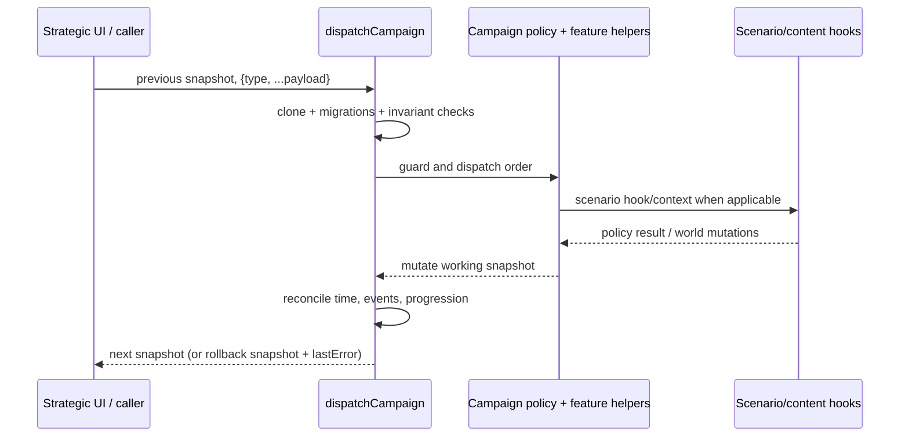
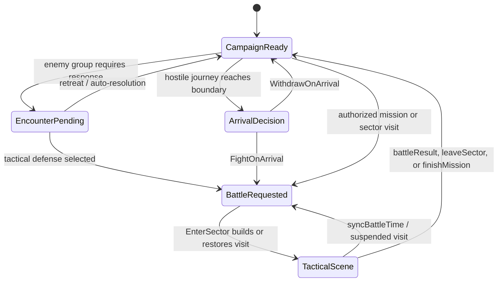

# Strategic engine

[Architecture guide](README.md) · [Runtime flows](runtime-flows.md) · [Strategic use cases](use-cases/strategic.md) · [Persistence](persistence.md)

This page explains how the strategic engine (`packages/game/campaign.js` and its domain, application, and scenario collaborators) initializes campaigns, processes player commands inside a transactional unit of work, advances game time and journeys, manages personnel and finite equipment custody, and coordinates sector entry and settlement with the [tactical engine](tactical-engine.md). It connects the call sequences in [runtime flows](runtime-flows.md) and the player intentions in [strategic use cases](use-cases/strategic.md) to the storage contracts in [persistence](persistence.md) and the package schemas in [content and campaigns](content-and-campaigns.md).

## Domain owners and application contracts

Strategic operations combine domain classes in `packages/game/domain`, use cases in `packages/game/application`, and compatibility rules in `packages/game/campaign.js`. Every domain fact has one authoritative owner:

- **Personnel, health, abilities, and finances:** `Character` owns persistent identity, `Health` (hit points, bleeding, and bandaged wounds), immutable `CharacterAbilities` (0–100 ratings, traits, and rule capabilities), `ServiceContract`, and strategic `locationId`. `Treasury` owns force funds in integer pesos (`Money`). `ForceRoster` and `Squad` own player force membership, reserve status, and squad composition (up to six combatants per squad at one location).
  - `RecruitCombatantUseCase` coordinates `RecruitmentService` through `RecruitCombatantRepository` to charge `Treasury` once, start a `ServiceContract`, admit the character into `ForceRoster`, and place the combatant immediately at a legal recruitment site (either in a local `Squad` with a free slot or in the controllable reserve). Local recruitment via `TalkToCharacterUseCase` uses the same `RecruitmentService` within the conversation transaction and preserves the character's current condition and equipment.
  - `RenewServiceContractUseCase` coordinates `ServiceRenewalService` and `ServicePricingPolicy` through `RenewServiceContractRepository` to extend paid service from the later of the existing expiry or current `GameTime` and charge once.
  - `FormSquadUseCase` coordinates `SquadFormationService` through `FormSquadRepository` to reorganize available combatants at the same location in one transaction.
  - `GetRecruitmentCandidatesUseCase` queries `RecruitmentCatalogue` through `GetRecruitmentCandidatesRepository` and returns a view type (`{ characterIds }`) without mutating time, funds, or service.
- **Journeys and hostile arrivals:** `Journey` owns strategic route progress, transport mode, physical segment position, and movement purpose (`JourneyPurpose`). `ArrivalDecision` owns the mutually exclusive fight-or-withdraw choice when a journey reaches a hostile sector boundary, pausing campaign time until resolved by `FightOnArrivalUseCase` or `WithdrawOnArrivalUseCase`. `RedirectJourneyUseCase` replaces a journey's route from its actual segment position while preserving elapsed time, paid segment fares, and fatigue, including immediate reversal at zero elapsed time.
- **World evolution, sessions, and item custody:** `GameSession` owns session identity, `revision`, and active or suspended `SectorSession` registrations (`ResumeSectorSessionUseCase` switches active authority to a suspended visit). `Sector` owns environment bounds and references to current residents, participants, objects, and corpses without duplicating `Character` health or `Inventory` custody. `ResidentPositionReference` (`residentPositions`) is a read-only projection of a non-participating serving character's saved local post. `WorldTimeline` owns monotonic game time (`WorldTimeline.advanceTo` is the only domain clock mutation), ordering `Corpse` removal (72 game hours after death via `AdvanceWorldTimeUseCase`) and `ResidentRoutine` supply collection (`CollectResidentSupplyUseCase` and `ScavengingPolicy`).

The [`GameSnapshot`](../../packages/game/public/game-snapshot-types.ts) envelope
stores `campaign` and the active sector view under `sectorSession`.
[`CampaignSnapshot`](../../packages/game/public/campaign-types.ts) stores the entry request under
`sectorEntryRequest`, force membership under `forceRoster`, per-character
records under `characters`, and retained maps under `sectorSnapshots` and
`sceneSnapshots`. The saved request uses
[`CampaignSectorEntryRequest`](../../packages/game/public/campaign-types.ts); the
application use case accepts the narrower
[`SectorEntryRequest`](../../packages/game/application/sector-sessions/enter-sector/sector-entry.request.ts).
The envelope writes the active view under `sectorSession`, and campaign orders
that carry the view use the same property. The decoded in-memory pair still
calls its sector field `battle`. The
`sectorSession` property is not a campaign snapshot field, and the retired
`sectorState` property is not part of the campaign-order contract.

[`CampaignSectorSessionCoordinator`](../../packages/game/infrastructure/session/campaign-sector-session-coordinator.js)
saves each `suspendedSectorSessions` record as `request`, `snapshot`,
`activeSquadId`, `location`, and `suspendedAtSeconds`. The public
[`CampaignSuspendedSectorSession`](../../packages/game/public/campaign-types.ts)
type declares those five fields.
[`GameSnapshotMapper`](../../packages/game/infrastructure/persistence/game-snapshot-mapper.js)
restores a domain `SectorSession` from the saved request and snapshot rather
than writing the domain object as the record.

[`decodeSave`](../../packages/game/save.ts) accepts top-level legacy `battle`
only when `sectorSession` is `undefined`. It also maps `pendingBattle` to
`sectorEntryRequest`, `recruited` to
`forceRoster`, `operativeState` to `characters`, `sectorStates` to
`sectorSnapshots`, and `sceneStates` to `sceneSnapshots` only when the
corresponding current field is `undefined`; the current field wins and the legacy
key is removed. These serialized projections map to canonical domain objects
through `GameSnapshotMapper`, `CanonicalPersonnelMapper`,
`JourneySnapshotMapper`, and `CanonicalWorldMapper`. During restoration, valid
entries in the legacy `hiringArrivals` array start service at a legal site at
the saved campaign time; if no site is legal, they become
`RefundableRecruitmentClaim` records. Restoration removes that legacy array,
and the optional `refundableRecruitmentClaims` field stores unresolved claims.
New domain and application modules use the canonical
[ubiquitous language](../plans/accepted/ubiquitous-language.md).

## Ownership and state boundary

`initialCampaign(seed, content)` in `packages/game/campaign.js` resolves optional authored content, obtains initial scenario state from the allowlisted scenario module (`packages/game/campaign-scenario.js`), applies authored starting time and content definitions, and runs `initializeCampaignSystems` to initialize or migrate roster-dependent structures for skill learning, physical cartridges, equipment returns, medical care, assignments, morale, ammunition custody, artillery, enemy groups, deployment returns, attention notices, and town income.

The table below lists representative top-level `Field` groups on the serialized campaign snapshot and their `Role` at the compatibility boundary.

| Field | Role |
| --- | --- |
| `gameSessionId`, `gameRevision` | Session identity and monotonic transaction revision managed by `GameSession` and `GameUnitOfWork` |
| `seed`, `hour`, optional `secondOfHour` | Deterministic campaign RNG seed and accepted strategic clock (`GameTime`) |
| `location`, `sectors`, `sectorSnapshots`, `sceneSnapshots` | Active strategic location, regional sector ownership/conditions, and retained physical sector snapshots (`Sector`, `WorldTimeline`, `ResidentRoutine`, `Corpse`) |
| `forceRoster`, `characters`, `squad`, `squads`, `activeSquadId` | `ForceRoster` membership, per-character `Character` / `Health` / location / assignment records, and `Squad` / `Journey` state |
| `resources`, `reputation`, `log` | `Treasury` and campaign resource balances, faction standing, and bounded activity log |
| `contracts`, `quests`, `missions` | Compatibility projection of `ServiceContract` terms, authored quest state, and mission progression |
| `pendingEncounter`, `sectorEntryRequest`, `suspendedSectorSessions` | Active strategic enemy-group encounter, the saved `CampaignSectorEntryRequest`, and suspended `CampaignSuspendedSectorSession` records carrying a saved request, sector snapshot, active squad, location, and suspended second |
| `lastError` | Localized Spanish explanation of the most recent refused command; cleared on the next accepted dispatch |

When authored content is active, its frozen package definition is pinned under `contentCampaign.package`; campaign cloning reuses that immutable package reference while deep-cloning mutable gameplay state.

## Order transaction contract

`dispatchCampaign(previous, action)` in `packages/game/campaign.js` accepts an action object with a string `type` discriminant and returns the next campaign snapshot. It opens a `GameUnitOfWork`, clones and normalizes the snapshot, clears `lastError`, checks global campaign guards, and routes the command either to a migrated application use case or to a procedural subsystem helper. `dispatchCampaign` validates the draft itself, then `GameUnitOfWork.commit()` stores the snapshot and advances `gameRevision` by one. If a domain refusal or validation error occurs, `dispatchCampaign` aborts the unit of work and returns a clone of the prior snapshot with `lastError` populated.

The sequence diagram below shows how `Strategic UI / caller`, `dispatchCampaign`, `Campaign policy + feature helpers`, and `Scenario/content hooks` process one strategic action.

Global order guards enforce lifecycle precedence before individual action handlers run:

- When an `ArrivalDecision` is pending on any squad's `Journey`, campaign time is paused and mutating commands that would advance time or bypass the decision are refused. Each `fightOnArrival` or `withdrawOnArrival` order resolves one squad's decision; a caller resolving several arrivals sends one order for each squad. Permitted inspection and active-visit selection remain available.
- When `pendingEncounter` is present, only `respondToEncounter` and squad selection are admitted.
- When a sector visit (`sectorEntryRequest`) is open, strategic mutations are restricted to battle reporting (`battleResult`, `leaveSector`, `finishMission`), local conversation (`talkNPC`), tactical clock synchronization (`syncTacticalTime`), per-squad arrival resolution, and visit-resumption (`ResumeSectorSession`).
- Completed or defeated campaigns reject further gameplay mutations.

## Action families and strategic semantics

Commands use `action.type` discriminants grouped into five functional families (see [strategic use cases](use-cases/strategic.md) for the complete `dispatchCampaign` switch crosswalk):

- **World movement and sector entry:** `travel`, `cancelTravel`, `resumeTravel`, `visitSector`, `fightOnArrival`, `attack`, `visitMission`, and `respondToEncounter`, backed by `Journey`, `ArrivalDecision`, `FightOnArrivalUseCase`, `WithdrawOnArrivalUseCase`, `RedirectJourneyUseCase`, `strategic-route.js`, and `battle-handoff.js`.
- **Squads and personnel:** `createOfficer`, `recruitCombatant`, `renewContract`, `dismiss`, `createSquad`, `squad`, `assignToSquad`, `selectSquad`, `redirectHire`, `cancelHireArrival`, `assignCare`, `setSleep`, and `assignWork`, backed by `RecruitCombatantUseCase`, `RenewServiceContractUseCase`, `FormSquadUseCase`, `medical-care.js`, `sleep.js`, `skill-training.js`, and `study-training.js`.
- **Economy, logistics, and item custody:** `equip`, `sectorInventory`, `ammunition`, `selectAmmunitionLoad`, `unloadAmmunition`, `storeArtillery`, `transportArtillery`, `supplyArtillery`, `configureArtillery`, and `horseAction` (rider assignment and unassignment only). Every item and cartridge stack has finite custody across character inventories and sector stores. The preflight trade guard in `dispatchCampaign` explicitly refuses merchant purchase/sale/repair commands (`purchaseEquipment`, `sellEquipment`, `purchaseAmmunition`, `repairWeapon`, and related trade actions) and horse acquisition/hiring/feeding/breeding with a trade-unavailable refusal.
- **Events, conversations, and scenario progression:** `talkNPC` (backed by `TalkToCharacterUseCase`), `policy`, `diplomacy`, `academy`, `transport`, `fundArmy`, `foundry`, `militia`, `cancelMilitia`, `transferMilitia`, `distributeMilitia`, and `fortify`. Scenario hooks receive a `scenarioContext` adapter providing controlled operations (`pay`, `add`, `standing`, `note`, readiness checks, quest updates, and sector lookup).
- **Clock advancement and tactical reconciliation:** `wait`, `advanceStrategicTime`, and `syncTacticalTime`, backed by `WorldTimeline`, `AdvanceWorldTimeUseCase`, `CollectResidentSupplyUseCase`, and `packages/game/time.js`.

Read-only query helpers (`GetRecruitmentCandidatesUseCase`, `availableActions`, and `campaignObjectives`) project player-visible options without mutating state; `dispatchCampaign` remains the sole authority for command validation.

## Battle handoff and shared time

`prepareAttack` and `visitSector` in `packages/game/campaign.js` construct the `SectorEntryRequest` stored as `sectorEntryRequest`, capturing the entry ID, origin and target sector, campaign timestamp (`hour` and `secondOfHour`), deterministic seed, participating squad members, committed ammunition allocation, artillery, regional weather/terrain conditions, and opposing forces. `EnterSectorUseCase` and `packages/game/battle-handoff.js` use that request to open or restore the `SectorSession`.

While a `SectorSession` is open, `syncBattleTime(campaign, battle)` in `packages/game/time.js` validates the entry ID, participant identities, and cross-system contexts (repair reserves, service objections, companion loss, quest beneficiaries, and ability references), then dispatches `syncTacticalTime` through `dispatchCampaign`. Tactical elapsed time must be monotonic against `sectorEntryRequest.syncedSeconds` and bounded by `SectorTimeBudget` so sector play never advances past an unresolved campaign `ArrivalDecision`. Each combat round consumes six seconds (`COMBAT_ROUND_SECONDS`); tactical exploration rest consumes `REST_SECONDS`.

The state diagram below shows how the strategic campaign transitions among `CampaignReady`, `EncounterPending`, `ArrivalDecision`, `BattleRequested`, and `TacticalScene`.

When the visit finishes, `battleResult`, `leaveSector`, or `finishMission` validates the returned sector snapshot against the issued `sectorEntryRequest` identity and settles `Character` health, `Inventory` and sector item custody, spent ammunition, corpse and death history, sector ownership, and scenario hooks in one campaign transaction.

Source anchors: [`packages/game/campaign.js`](../../packages/game/campaign.js), [`packages/game/time.js`](../../packages/game/time.js), [`packages/game/battle-handoff.js`](../../packages/game/battle-handoff.js), [`packages/game/world.js`](../../packages/game/world.js), [`packages/game/battle-outcome.js`](../../packages/game/battle-outcome.js), and [`packages/game/campaign-scenario.js`](../../packages/game/campaign-scenario.js).
