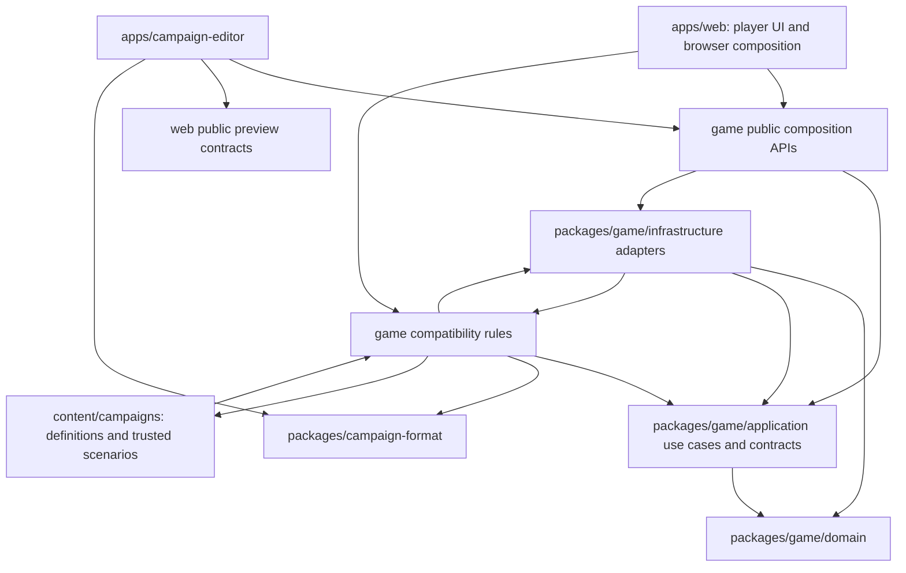

# Source map and boundaries

[Architecture guide](README.md) · [Progressive explanation](overview.md) · [C4 views](c4.md) · [Runtime flows](runtime-flows.md)

The browser game and campaign editor are separate applications. They share a
published campaign-file contract and explicit game integration APIs. The game
package contains domain, application, and infrastructure directories. Existing
simulation entry points connect migrated domain behavior with retained rules.

The [repository map](../development/repository-layout.md) gives a compact folder
tree and a reading path for one player intention. Runnable applications live in
`apps`; reusable rule and file-contract packages live in `packages`; authored
campaigns and art sources live in `content`.

## Repository responsibilities

| Path | Responsibility |
| --- | --- |
| [`packages/game/domain`](../../packages/game/domain/) | Behavior and invariants for people, service, money, journeys, sector/combat sessions and world lifecycles |
| [`packages/game/public`](../../packages/game/public/) | Declared entry points that compose application contracts with infrastructure |
| [`packages/game/application`](../../packages/game/application/) | Use-case classes and their repository/port contracts |
| [`packages/game/infrastructure`](../../packages/game/infrastructure/) | Repository adapters, identity maps, transactions, restoration and compatibility-field projection |
| [`packages/game/`](../../packages/game/) root modules | Compatibility simulation entry points, specialized rules, geometry, validation and presentation queries |
| [`apps/web/app`](../../apps/web/app/) | Game screens, root state composition, tactical renderer and navigation links to the editor |
| [`apps/web/lib`](../../apps/web/lib/) | Browser loading, save ownership, worker coordination, input, audio and rendering adapters |
| [`apps/campaign-editor`](../../apps/campaign-editor/README.md) | Independent editor application, draft model, history, project repositories, browser storage, files and playtests |
| [`packages/campaign-format`](../../packages/campaign-format/README.md) | Pure published package contracts, IDs, hashes, structural validation and immutable definitions |
| [`content/campaigns`](../../content/campaigns/) | Campaign documents and media, an example content file, installed defaults and trusted scenario/UI implementations |
| [`content/assets`](../../content/assets/README.md) | Art sources, prompts, rigs and production recipes; prepared browser copies live in the public and campaign asset directories |
| [`tools`](../../tools/) | Builds, static staging, content packaging, architecture checks and verification tools |
| [`tools/playgrounds`](../../tools/playgrounds/) | Independent visual review applications that can consume game code and prepared media |
| [`docs/plans/accepted`](../plans/accepted/) | Accepted architecture and canonical domain language |
| `.output/` | Ignored local builds, caches and new diagnostic output |
| [`tests`](../../tests/) | Integration checks and fixtures; domain and package tests also live beside their owners |
| [`apps/web/public`](../../apps/web/public/) | Shared public media distributed to both applications |
| [`reference/native`](../../reference/native/) | Separate native implementation and reference path |

## Source dependencies

The domain imports domain code. Application use cases import application contracts
and domain types. Infrastructure implements contracts and restores domain objects.
The public modules construct these collaborations for external callers.

The editor's game access is restricted to the declared editor and playtest APIs.
Its shared UI access is restricted to `apps/web/game-preview.ts` and
`apps/web/game-preview-assets.js`. Its independent fetch/file/storage adapters use
those contracts and the shared campaign format. The runtime game imports no
editor implementation. `npm run check:architecture` enforces these source rules.

The retained simulation modules still have dependencies in both directions with
trusted campaign defaults and scenarios. Domain/application restrictions do not
make the entire existing simulation graph acyclic. Imported campaign JSON can
select supported scenario IDs; it cannot add executable scenario code.

## Ownership and admission

| Data | Owner and admission path |
| --- | --- |
| Published campaign definition | `CampaignDefinition` uses shared file schemas and cross-reference checks; the game compiler adds supported capabilities and playability checks |
| Authoring draft | `CampaignProject` admits envelope-preserving edits; browser project storage can retain incomplete drafts |
| Transaction identities | `DomainIdentityMap` supplies the same domain object for a kind and identity within the transaction |
| Accepted campaign progress | Use-case repositories share `GameUnitOfWork`; acceptance increments one revision |
| Sector and combat lifecycle | `GameSession`, `SectorSession`, and `CombatSession`, with compatibility field projection |
| Active presentation frame | Rendering/playback adapters; it is not a save checkpoint |
| Stored game bytes | The browser writer owns an exclusive save-key lock; `SaveGame` checks the current request identity |
| Restored domain behavior | `GameSnapshotMapper` validates relationships, restores classes and projects their changes into one snapshot |

The root React component still holds the accepted serializable campaign and active
sector pair. Domain objects own migrated rules inside application operations.
Some tactical actions can accept partial progress before an interruption. Their
response must preserve paid time, resources, and any remaining continuation.

## Trace one intention

| Question | Start here | Follow next |
| --- | --- | --- |
| How does a new game get its identity? | [Public persistence API](../../packages/game/public/game-persistence-api.js) | CreateGameSession repository, GameSession, campaign factory |
| Why was recruitment refused? | [RecruitCombatant use case](../../packages/game/application/personnel/recruit-combatant/recruit-combatant.use-case.ts) | RecruitmentService and CampaignRecruitCombatantRepository |
| What can a squad do at hostile arrival? | [Journey](../../packages/game/domain/journeys/journey.ts) | FightOnArrival, WithdrawOnArrival, RedirectJourney and their repositories |
| How does an order spend action points? | [SectorParticipant](../../packages/game/domain/sector-sessions/sector-participant.ts) | ExecuteSectorOrder, sector operation runner, tactical rules |
| Why did local recruitment change the field? | [TalkToCharacter](../../packages/game/application/talk-to-character/talk-to-character.use-case.ts) | Conversation repository and participant projection |
| Why did a save fail? | [SaveGame contract](../../packages/game/application/save-game/README.md) | Save status, browser writer, worker envelope, codec |
| Why will a save not restore? | [RestoreGame contract](../../packages/game/application/restore-game/README.md) | GameSnapshotMapper, save validators and resource verification |
| Why is an editor asset missing? | [Project asset adapter](../../apps/campaign-editor/web/lib/campaign-studio-assets.ts) | Public preview asset scope, package resource record, staged output |
| Why is a deployed route missing? | [Static build](../../tools/build-web.mjs) | Game output staging, editor output, deployment base path and asset checks |

The [C4 diagrams](c4.md) show how these components fit into running applications.
The [runtime sequences](runtime-flows.md) give detail for the compatibility paths.
Use the accepted glossary when adding a new rule or replacing one of those paths.
