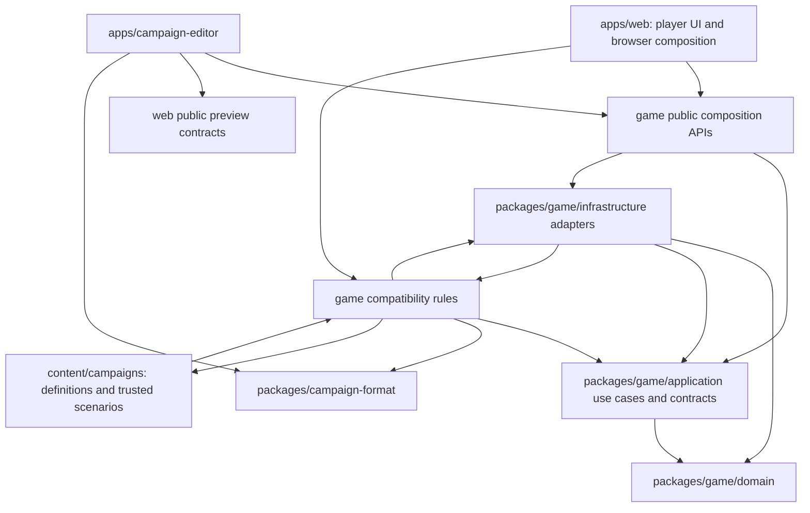

# Source map and boundaries

[Architecture guide](README.md) · [Progressive explanation](overview.md) · [C4 views](c4.md) · [Runtime flows](runtime-flows.md)

This page maps repository directories to their architectural roles, defines the allowed import directions enforced by `npm run check:architecture` and `.dependency-cruiser.json`, lists the single authoritative owner for each category of runtime data, and shows where to start in the code for common questions. It connects the component diagrams in [C4 views](c4.md) to the execution traces in [runtime flows](runtime-flows.md) and the subsystem deep dives ([strategic engine](strategic-engine.md), [tactical engine](tactical-engine.md), [content and campaigns](content-and-campaigns.md), [rendering](rendering.md), [persistence](persistence.md), and [build and tooling](build-and-tooling.md)).

The [repository map](../development/repository-layout.md) gives a compact folder tree for IDE navigation. Runnable applications live in `apps/`, reusable rule and file-contract packages live in `packages/`, and authored campaigns and art sources live in `content/`.

## Repository responsibilities

The table below lists each repository `Path` and its `Responsibility`.

| Path | Responsibility |
| --- | --- |
| [`packages/game/domain`](../../packages/game/domain/) | Entities, value objects, state machines, pure policies, and domain services for characters, service, money, journeys, sector and combat sessions, perception, inventory, and world lifecycles |
| [`packages/game/application`](../../packages/game/application/) | Use-case classes, request/response types, and narrow per-use-case repository interfaces |
| [`packages/game/infrastructure`](../../packages/game/infrastructure/) | Repository adapters, `DomainIdentityMap`, `GameUnitOfWork`, `GameSnapshotMapper`, and compatibility-field projections |
| [`packages/game/public`](../../packages/game/public/) | Declared composition entry points (`campaign-editor-api.ts`, `campaign-playtest-api.ts`, `game-persistence-api.ts`) and shared public types |
| [`packages/game/`](../../packages/game/) root modules | Compatibility simulation entry points (`campaign.js`, `tactical.js`, `world.js`, `time.js`, `save.ts`), geometry, package compilation, and presentation queries |
| [`apps/web/app`](../../apps/web/app/) | Player React screens, root session composition (`page.tsx`), Three.js/SVG tactical views, and links to the campaign editor |
| [`apps/web/lib`](../../apps/web/lib/) | Browser campaign loader, Web Lock save writer, worker executors, Three.js scene adapters, and audio/input helpers |
| [`apps/campaign-editor`](../../apps/campaign-editor/README.md) | Independent editor application (`domain/`, `application/`, `infrastructure/`, `public/`, `web/`) for project drafts, map editing, validation, storage, and isolated playtests |
| [`packages/campaign-format`](../../packages/campaign-format/README.md) | Shared published campaign file schemas, content IDs, SHA-256 asset checks, and immutable `CampaignDefinition` |
| [`content/campaigns`](../../content/campaigns/) | Authored campaign packages, default definitions, and trusted scenario implementations (`content/campaigns/granaderos/scenario.js`) |
| [`content/assets`](../../content/assets/README.md) | Art sources, prompts, 3D rigs, and production scripts; prepared browser media lives in `apps/web/public` and campaign asset folders |
| [`tools`](../../tools/) | Static build and staging scripts, campaign CLI, architecture and dependency checks, and test runners |
| [`tools/playgrounds`](../../tools/playgrounds/) | Independent visual review applications that consume game code and prepared media outside production bundles |
| [`docs/plans/accepted`](../plans/accepted/) | Target domain architecture plan and canonical ubiquitous-language glossary |
| `.output/` | Ignored local build outputs, staging directories (`.output/dist`), caches, and diagnostic output |
| [`tests`](../../tests/) | Cross-cutting integration tests and fixtures; domain and package unit tests also sit beside their modules |
| [`apps/web/public`](../../apps/web/public/) | Shared static browser media distributed to both applications |
| [`reference/native`](../../reference/native/) | Separate native C++ engine reference and conversion build |

## Source dependencies

The dependency diagram below shows the permitted import directions among `apps/web: player UI and browser composition`, `apps/campaign-editor`, `web public preview contracts`, `game public composition APIs`, `packages/game/application use cases and contracts`, `packages/game/infrastructure adapters`, `packages/game/domain`, `game compatibility rules`, `packages/campaign-format`, and `content/campaigns: definitions and trusted scenarios`.

Two automated checks enforce these boundaries:

- `npm run check:architecture` ([`tools/check-architecture.mjs`](../../tools/check-architecture.mjs)) verifies that `packages/game/domain` imports only `packages/game/domain`; `packages/game/application` imports only `packages/game/application` and `packages/game/domain`; `apps/campaign-editor/domain` imports only its own domain and `packages/campaign-format`; `apps/campaign-editor/application` imports only its own application, domain, and `packages/campaign-format`; `packages/campaign-format` imports none of its consumers (`packages/game`, `apps/web`, `apps/campaign-editor`); `packages/game` never imports `apps/campaign-editor`; `apps/campaign-editor` imports `packages/game` only through `packages/game/public/{campaign-editor-api,campaign-playtest-api,game-persistence-api}.ts` and `apps/web` only through `apps/web/game-preview.ts` and `apps/web/game-preview-assets.js`; and `domain` and `application` files in both packages never reference browser globals (`window`, `document`, `localStorage`, `sessionStorage`, `navigator`, `Worker`) or `Math.random`.
- `npm run check:dependencies` ([`.dependency-cruiser.json`](../../.dependency-cruiser.json)) enforces the same directory rules, forbids production imports from `tools/` or test files, and rejects runtime circular dependencies inside `domain` and `application`.

Within `packages/game/domain`, policies (such as `ActionPointPolicy`, `ReactionPolicy`, `VisibilityPolicy`, `IlluminationPolicy`, `KnownSectorPolicy`, `ServicePricingPolicy`, and `CombatOutcomePolicy`) are pure functions of explicit inputs that do not mutate state or call other policies, while state transitions belong to the domain state machines (`Journey`, `ArrivalDecision`, `SectorSession`, `CombatSession`, `CombatTurn`, and `ReactionStack`).

The compatibility root modules (`packages/game/*.js`) still share bidirectional imports with `content/campaigns/` for default campaign data and trusted scenario hooks. Imported campaign JSON selects an allowlisted scenario ID (`generic-v1` or `granaderos-historical-v1`) and cannot supply arbitrary executable code.

## Ownership and admission

Every domain fact has one authoritative owner. Read models, retained sector caches, and compatibility projections reference canonical identities rather than creating parallel owners. The table below lists each `Fact or data category` and its single `Authoritative owner and admission path`.

| Fact or data category | Authoritative owner and admission path |
| --- | --- |
| Published campaign definition | `CampaignDefinition` in `packages/campaign-format` owns immutable manifest and document schemas, content identity, and cross-reference validation. In current source, `compileCampaignPackage` in `packages/game/campaign-library.js` compiles a `CampaignDefinition` into runtime definitions (the [accepted plan](../plans/accepted/domain-architecture.md) places `CampaignCompiler` in `packages/game/application`). |
| Authoring project draft and map draft | `CampaignProject` and `CampaignProjectHistory` own project documents, resources, and undo history; `CampaignWorld` owns strategic locality and route draft invariants; `CampaignMap` owns the fixed 20x16 campaign map slot; `SectorMap` and `SectorMapHistory` own physical map edits admitted by `EditSectorMap`. |
| Session consistency, clock, and randomness | `GameSession` owns session identity, `revision`, and active or suspended `SectorSession` registrations. `WorldTimeline` owns monotonic game time (`WorldTimeline.advanceTo` is the only domain clock mutation). Under the [accepted plan](../plans/accepted/domain-architecture.md), `RandomSource` is the single seeded sequence owned by the session; in current source, deterministic 32-bit seeds live on the campaign and sector snapshots while `npm run check:architecture` rejects `Math.random` in `domain` and `application`. |
| Character identity, health, abilities, and service | `Character` owns persistent character identity, `Health` (hit points, bleeding, bandaged wounds), immutable `CharacterAbilities` (ratings, traits, capabilities), `ServiceContract`, and strategic `locationId`. `CanonicalPersonnelMapper` and `ActiveSectorCharacterMapper` share the same `Character` instance across campaign records and open sector visits via `DomainIdentityMap`. |
| Strategic position vs. local sector position | `ForceRoster` and `Squad` own force and squad membership (up to six combatants per squad) and strategic location; `Journey` owns physical progress along a route and `ArrivalDecision` owns a pending hostile-boundary choice. During an open `SectorSession`, participant grid coordinates belong to the sector visit and synchronize on entry and exit. `ResidentPositionReference` (`residentPositions`) is a read-only projection of a non-participating serving character's saved local post and never owns character state. |
| Sector visit and combat episode | `SectorSession` owns the active or suspended sector visit (`deployment`, `exploration`, or `combat` mode) and participant list; `CombatSession` owns a bounded combat episode (`CombatTurn`, `ReactionWindow`, `ReactionStack`, and outcome). `SectorParticipant` references `characterId` and owns only visit-local `ActionPoints`. |
| Item quantities and custody | `Item`, `Inventory`, `PocketLayout`, and `ItemCustody` own item quantities, pocket placement, and the single custodian (`character`, `container`, `ground`, or `corpse`) for every item, coordinated atomically by `ItemTransferService`. `Corpse` owns physical body removal scheduling (72 game hours after death) and releases remaining equipment to sector ground custody once while preserving the character's death record. |
| Transaction and snapshot persistence | Each use case owns one narrow repository interface; adapters share `GameUnitOfWork`, `DomainIdentityMap`, and `GameSnapshotMapper`. `GameUnitOfWork` copies the snapshot, validates changes, and advances `gameRevision` once. `browser-save-writer.ts` coordinates single-tab `localStorage` writes under an exclusive Web Lock. |
| Queries and presentation frames | Read-only use cases (`GetRecruitmentCandidates`, `GetVisibleCharacters`, `GetSaveStatus`) return narrow view records (`{ characterIds }`, `SaveStatus`) rather than domain objects. Rendering adapters (`presentation.ts`, `TacticalThreeScene.tsx`) project disclosed visual frames and never own game state. |

## Trace one intention

The table below gives a starting file (`Start here`) and the downstream collaborators (`Follow next`) for common debugging and extension questions.

| Question | Start here | Follow next |
| --- | --- | --- |
| How does a new game get its identity? | [`packages/game/public/game-persistence-api.ts`](../../packages/game/public/game-persistence-api.ts) | [`CreateGameSessionUseCase`](../../packages/game/application/create-game-session/create-game-session.use-case.ts), [`create-game-session.repository.js`](../../packages/game/infrastructure/persistence/create-game-session.repository.js), [`GameSession`](../../packages/game/domain/session/game-session.ts), [`campaign.js`](../../packages/game/campaign.js) (`initialCampaign`) |
| Why was recruitment refused? | [`RecruitCombatantUseCase`](../../packages/game/application/personnel/recruit-combatant/recruit-combatant.use-case.ts) | [`RecruitmentService`](../../packages/game/domain/personnel/recruitment-service.ts) and [`CampaignRecruitCombatantRepository`](../../packages/game/infrastructure/personnel/campaign-recruit-combatant.repository.js) |
| What can a squad do at hostile arrival? | [`Journey`](../../packages/game/domain/journeys/journey.ts) | [`FightOnArrivalUseCase`](../../packages/game/application/journeys/fight-on-arrival/fight-on-arrival.use-case.ts), [`WithdrawOnArrivalUseCase`](../../packages/game/application/journeys/withdraw-on-arrival/withdraw-on-arrival.use-case.ts), [`RedirectJourneyUseCase`](../../packages/game/application/journeys/redirect-journey/redirect-journey.use-case.ts), and [`campaign-journey-repositories.js`](../../packages/game/infrastructure/journeys/campaign-journey-repositories.js) |
| How does an order spend action points? | [`SectorParticipant`](../../packages/game/domain/sector-sessions/sector-participant.ts) | [`ExecuteSectorOrderUseCase`](../../packages/game/application/sector-sessions/execute-sector-order/execute-sector-order.use-case.ts), [`sector-operation-runner.ts`](../../packages/game/application/sector-sessions/sector-operation-runner.ts), and [`tactical.js`](../../packages/game/tactical.js) |
| Why did local recruitment change the field? | [`TalkToCharacterUseCase`](../../packages/game/application/talk-to-character/talk-to-character.use-case.ts) | [`talk-to-character-repository.ts`](../../packages/game/infrastructure/session/talk-to-character-repository.ts) and [`conversation-participant-projection.ts`](../../packages/game/infrastructure/session/conversation-participant-projection.ts) |
| Why did a save fail? | [`SaveGame` contract](../../packages/game/application/save-game/README.md) | [`GetSaveStatus`](../../packages/game/application/get-save-status/README.md), [`browser-save-writer.ts`](../../apps/web/lib/browser-save-writer.ts), [`campaign-save-worker.ts`](../../apps/web/lib/campaign-save-worker.ts), and [`save.ts`](../../packages/game/save.ts) |
| Why will a save not restore? | [`RestoreGame` contract](../../packages/game/application/restore-game/README.md) | [`GameSnapshotMapper`](../../packages/game/infrastructure/persistence/game-snapshot-mapper.js), [`validate-battle.js`](../../packages/game/validate-battle.js), and [`campaign-library.ts`](../../apps/web/lib/campaign-library.ts) (`verifyCampaignResources`) |
| Why is an editor asset missing? | [`campaign-studio-assets.ts`](../../apps/campaign-editor/web/lib/campaign-studio-assets.ts) | [`game-preview-assets.js`](../../apps/web/game-preview-assets.js), [`campaign-assets.js`](../../packages/campaign-format/campaign-assets.js), and [`campaign-export.mjs`](../../tools/campaign-export.mjs) |
| Why is a deployed route missing? | [`tools/build-web.mjs`](../../tools/build-web.mjs) | [`stage-static-deployment.mjs`](../../tools/stage-static-deployment.mjs), [`deployment-path.mjs`](../../tools/deployment-path.mjs), and [`static-export-path.mjs`](../../tools/static-export-path.mjs) |

Continue to [runtime flows](runtime-flows.md) to trace the runtime call sequences across these boundaries, or consult the [ubiquitous language](../plans/accepted/ubiquitous-language.md) when introducing or migrating a domain concept.
