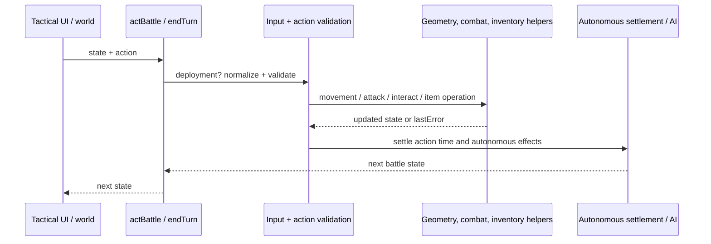
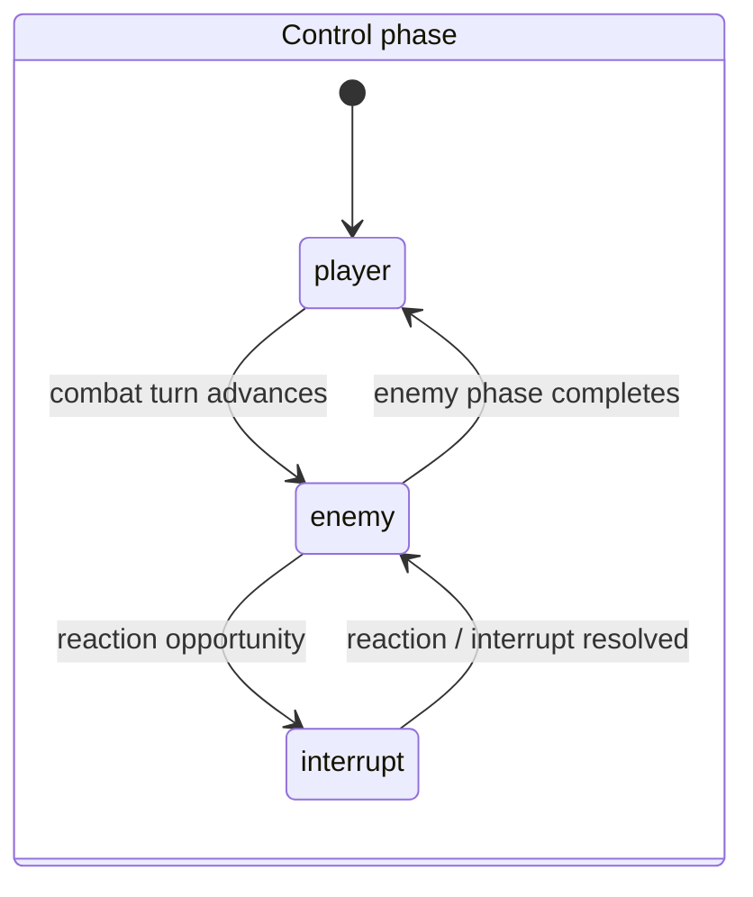
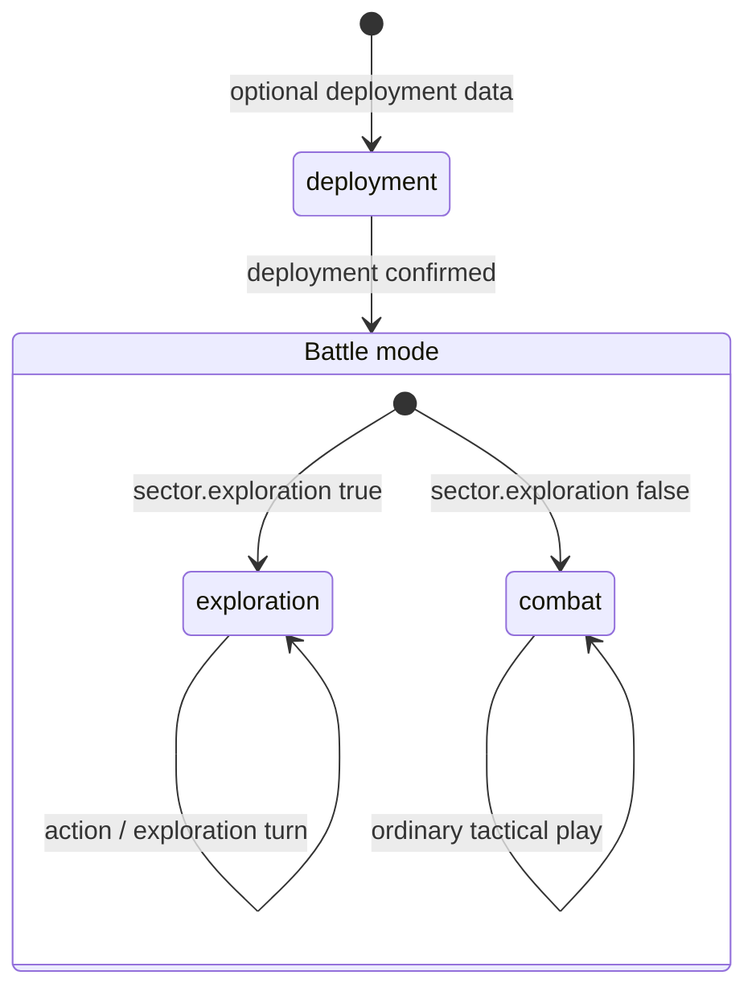

# Tactical engine

[Architecture guide](README.md)

The tactical engine is a deterministic, clone-and-return simulation over a serialized battle state. `createBattle` turns a strategic deployment description into a grid, units, clocks, objectives and environmental state; `actBattle` applies a typed player order and settles autonomous consequences; `endTurn` advances turn/phase flow, including enemy and allied behavior. The same state contains combat geometry, perception, inventory, physical ammunition, mission actors and presentation-relevant facts, while rendering/HUD code projects that state rather than owning combat rules. For runtime scene ownership and persistence mechanics, see [runtime flows](runtime-flows.md) and [persistence](persistence.md).

## Domain owners and application contracts

A `SectorSession` owns the complete visit. `EnterSector` admits an authorized
`SectorEntryRequest`. `CombatSession` owns a combat episode, and `CombatTurn`
controls the eligible phase queue and budget issue. `SectorParticipant` keeps
local participation with `ActionPoints`; persistent health uses `Health`.

`Firearm`, `ReloadWork`, and `ReprimeWork` protect ammunition, weapon condition,
and paid partial work. `FirearmAccuracy`, `BodyRegion`, and `CombatInjury` own the
corresponding combat rules. `ReactionPolicy`, `ReactionWindow`, and `ReactionStack`
control interruption eligibility and resumption. Geometry and trajectory
algorithms remain focused collaborators in the compatibility engine.

`VisionObserver`, `FieldOfView`, `VisibilityPolicy`, and `IlluminationPolicy`
determine perception. `GetVisibleCharacters` is the read-only application
contract. `KnownSectorPolicy` keeps hidden people and objects out of forecasts.
`Inventory`, `PocketLayout`, and `ItemTransferService` protect capacity and custody.

`ExecuteSectorOrder`, `EndSectorTurn`, and `ResumeSectorOperation` use separate
repository contracts over the sector operation transaction. `SectorTimeBudget`
and checkpoints stop at a campaign arrival decision. Accepted partial progress
and unexecuted continuation are explicit snapshot fields.

## State and deterministic boundary

`createBattle(squad = [], sector = {})` returns a battle-state object. It records version markers; optional authored map/source identifiers and definitions; exits; battle/sector identity; start, elapsed and synchronized seconds; turn/phase/mode/status; a 32-bit unsigned seed; weather/time-of-day; map geometry and actors. The complete shape is intentionally extensible. Core fields include:

| Field | Meaning |
|---|---|
| `width`, `height`, `tiles`, `wallEdges`, `buildings`, `props`, optional `upperSurfaces`/`climbLinks` | spatial model and traversal/cover geometry |
| `units`, `npcs`, `objective`, `exits` | military actors, civilian/interactable actors, objective and departure routes |
| `turn`, `phase`, `mode`, `status`, `deployment` | control-flow state; mode begins as combat or exploration |
| `seed` | deterministic random stream state, initialized from sector seed/default |
| `startSeconds`, `elapsedSeconds`, `syncedSeconds`, `night`, `weather`, `lights` | tactical clock and changing environmental conditions |
| per-unit `x/y`, `side`, `hp`, `ap`, `weapon`, `loaded`, `ammo`, `inventory`, `stance`, `morale`, condition/medical state | mutable actor/combat/inventory model |
| `lastError`, optional `combatJournal` / observation data | rejection feedback and recorded/derived battle information |

Unit initialization (`makeUnit`) normalizes authored raw people into tactical fields and weapon/ammunition state. Position, AP, health, weapon state and inventory are state, not merely display metadata. The battle constructor also imports authored tiles/exits/weather, initializes local structures and NPC health, and performs migrations/derived setup.

Simulation calls are functional at the public boundary: they return a resulting state (often cloned), rather than requiring callers to mutate the input. Random choices use the battle's seed-based stream, so the state carries the source of deterministic variation. Determinism still depends on equivalent input state and action ordering.

## Browser worker transport

The browser compatibility adapter uses
[`BattleWorkerJob`, `BattleWorkerRequest`, and `BattleWorkerResponse`](../../apps/web/lib/battle-worker-transport.ts)
for worker messages. These names describe the existing browser transport. The
domain and application continue to use `SectorSession` and `SectorOperation`.

Each request has a positive integer message ID, an operation context, and a job.
The context identifies the game session, sector visit, both revisions, and
request identity. The worker checks the context against the supplied snapshot
before it runs the job. The executor checks the returned context before it
accepts a result. A reply contains either a result or a string error. Malformed
replies for a pending message reject that request. Messages without a pending
ID are ignored. Worker failure or closure rejects all pending requests.

Message data enters as `unknown`. Envelope and context validation protect this
transport boundary. Legacy simulation snapshots, orders, continuations, and
result payloads remain opaque to the transport; their reducers own the gameplay
rules. The adapter passes both route arrays and group progress objects through
the continuation field.

## Control flow and API contracts

* `createBattle(squad, sector) -> BattleState`: creates a deployment from strategic/authored data. Width/height default to 16x12; mode is `exploration` when `sector.exploration` is truthy, otherwise `combat`; seed defaults to `18130203` and is normalized unsigned.
* `actBattle(state, action, movementPath = null) -> BattleState`: wraps action resolution with near-miss feedback capture. Deployment orders route to the deployment handler. Otherwise input resolution normalizes certain legacy target/item forms, executes the selected action, synchronizes ammunition on successful changed states, then usually settles autonomous consequences and action-time effects. Cursor-only orders can return before autonomous settlement. Rejections commonly return a clone with `lastError` and public feedback.
* `endTurn(state) -> BattleState`: resolves equipment cursor constraints, then runs turn progression and autonomous settlement. Interrupt phase resumes the suspended enemy/reaction sequence; exploration and combat have distinct phase logic.
* `presentedActBattle` / `presentedEndTurn` capture presentation/observation information around the public calls, while the underlying state transition remains the same tactical authority.

## Action taxonomy

Actions are objects selected by `action.type`, frequently naming `unitId` and, for group movement, `unitIds`; targets can include explicit `targetKind` to distinguish units from NPCs. The exact accepted payload is action-specific. Implemented families include:

* **Movement and facing:** move/path, stance and directional/positioning operations; geometry/path helpers account for occupied/blocked cells, terrain, elevations, walls and traversal links.
* **Firearms and targeted combat:** fire, aim/targeted fire, melee and `meleePoint`, reload/ammunition selection, weapon mode, blade/hand actions. Resolution depends on AP, range, line/visibility, weapon condition and physical loaded/ammo counts; hit and damage outcomes can affect cover, morale, bleeding, shock and other state.
* **Thrown/area and physical interactions:** grenade throw, item flight, blast/structure effects, environmental interactions, doors/objects and exits. These cross geometry and physical-world helpers rather than being only UI events.
* **Care and recovery:** supported treatment actions such as `heal` and item-based bandaging, plus exploration `rest`; each is constrained by actor, AP and carried supplies.
* **Inventory and custody:** equip, drop, transfer, loot, use item, prisoner escort and equipment cursor flows. Cursor-held equipment must be placed or returned before ending a turn; not every rejection has the same side effects.
* **Civilians, mission actors and objectives:** NPC-targeted actions, quest/mission interactions, deployment, departures and objective progress.
* **Turn/AI control:** `endTurn`, interrupt responses and allied-turn behavior. Militia are autonomous rather than directly orderable; allied turns also restrict ordinary player orders except in interrupt handling.

This is an action-family map, not an exhaustive promise that every label is legal in every mode or phase. The tactical dispatcher and specialized modules are authoritative.

## Geometry, perception and attack resolution

The grid is a tactical model with more than a blocked-cell matrix. Tile cover, wall segments/geometry, buildings, surfaces, climb links, props, weather, lighting, stance and actor state feed movement, line tests, visibility and attack previews/resolution. Projectiles and thrown objects have flight/impact behavior; blast propagation can change structures and the battlefield. Visibility/perception and observation helpers determine what the player can know or what AI can share, not simply what is present in the state.

AP is an explicit per-unit resource. Action-specific helpers validate and charge action costs; movement can resolve a path in steps and combat/interrupt rules can create additional phases. Firearms use loaded rounds and carried ammunition with reload progress, condition, jam/serviceability and weapon mode. Combat can leave persistent wounds, bleeding, bandaging, shock, unconsciousness, morale and equipment changes. Read [rendering](rendering.md) for presentation/HUD projections; tactical simulation should not be conflated with visual cursor or sprite state.

## Turn phases and autonomous actors

The main phase examples include `player`, `enemy`, and `interrupt`; the exact state may include reaction/ally coordination fields. In an interrupt, `endTurnState` verifies that an enemy turn/reaction is available and resumes it, rather than blindly incrementing a round. `endTurn` returns any equipment cursor object first, rejects if that is impossible, then advances through autonomous settlement. Exploration has quiet-turn/contact behavior and a different turn path from combat. Allied and militia actors may execute their own turns; they are not universally controlled by the player's action API.

AI modules cover perception/sharing, movement/combat decisions, and specialist behaviors such as grenades. Their decisions are constrained by state and perception, and can consume the same tactical clock/resources as player actions. No claim is made that every action is delegated to an AI worker.

Mode and phase are separate state dimensions: `mode` is combat/exploration, while `phase` controls who or what may act. Deployment is an optional deployment substate rather than a third phase. These diagrams show the principal transitions, not every intermediate reaction/recovery state.

Allied control is an additional orthogonal gate: `alliedTurn` restricts player actions except interrupt handling, while militia actors are autonomous and rejected as order targets. It is not another phase label.

## End-to-end example

At strategic assault time, campaign code builds a pending request containing a seeded encounter, deployed operative data, committed ammunition allocation, opposition and regional conditions. `battle-handoff.js` / `world.js` create or restore tactical scene state from that request. The tactical caller constructs the battle, supplies player actions, and passes returned state to presentation. An invalid shot or movement can yield a new state with `lastError`; a valid movement/action updates actor position/AP and may trigger autonomous resolution. Tactical elapsed seconds are synchronized to the campaign through `syncBattleTime`, not by directly editing strategic time. On completion, the finish callback in `apps/web/app/page.tsx` dispatches the battle report into the campaign transaction; campaign code validates and settles personnel, stocks, ownership, quests and battle closure. `battle-outcome.js` contains helpers in this lifecycle but is not the sole settlement owner.

## Errors, invariants and extension points

Important invariants include: actor IDs are normalized to strings in tactical units; physical loaded/carry ammunition must remain synchronized; AP/action legality is checked at execution; deployment and phase govern accepted orders; melee/target resolution distinguishes military units from NPCs where relevant; cursor-held equipment blocks turn end until returned/placed; battle identity and elapsed time must match the campaign pending handoff. Typical errors include no legal player actor, invalid target/path, unavailable AP/ammunition/item, incompatible phase, militia/allied control, and incomplete cursor placement. Errors are exposed through `lastError` and sometimes public messages, but action rejection behavior is not a universal unchanged-input guarantee.

Extension points are dedicated rule modules: [`action-points.js`](../../packages/game/action-points.js), [`tactical-space.js`](../../packages/game/tactical-space.js), [`wall-geometry.js`](../../packages/game/wall-geometry.js), [`targeted-combat.js`](../../packages/game/targeted-combat.js), [`movement-step.js`](../../packages/game/movement-step.js), [`item-flight.js`](../../packages/game/item-flight.js), [`physical-ammunition.js`](../../packages/game/physical-ammunition.js), [`npc-ai.js`](../../packages/game/npc-ai.js), and tactical AI/perception modules. Prefer focused helpers for new rules and preserve state serialization/version/migration expectations. Source anchors: [`tactical.js`](../../packages/game/tactical.js), [`time.js`](../../packages/game/time.js), [`battle-handoff.js`](../../packages/game/battle-handoff.js), [`world.js`](../../packages/game/world.js), [`battle-outcome.js`](../../packages/game/battle-outcome.js).
