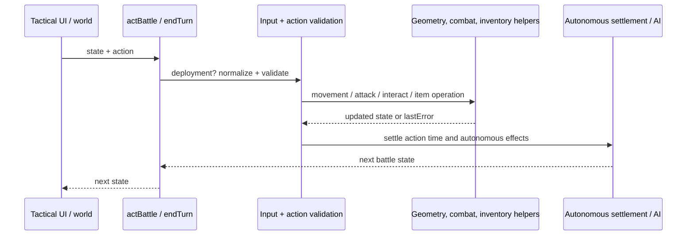
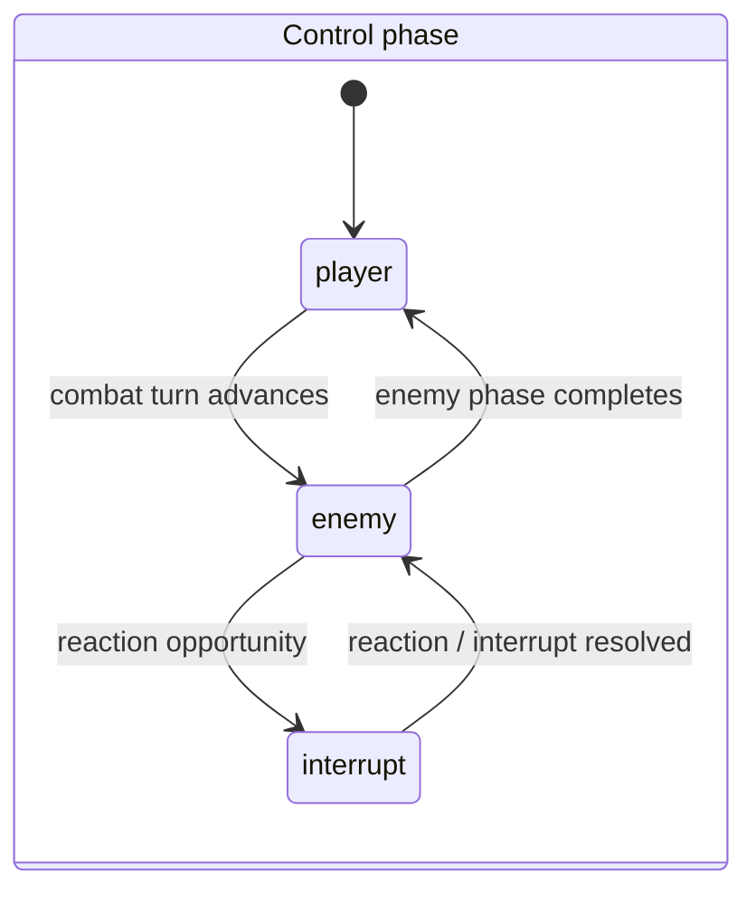
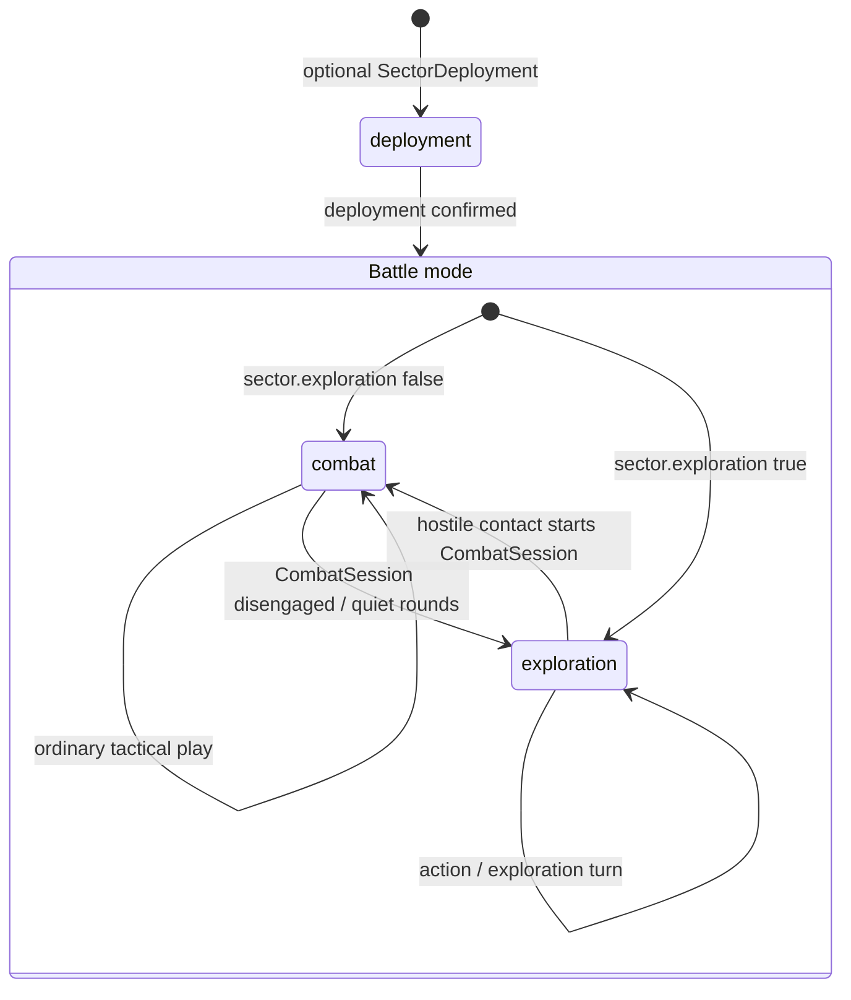

# Tactical engine

[Architecture guide](README.md) · [Runtime flows](runtime-flows.md) · [Tactical use cases](use-cases/tactical.md) · [Rendering](rendering.md) · [Persistence](persistence.md)

This page explains how the tactical engine (`packages/game/tactical.js` and its domain, application, and geometry collaborators) opens and runs a `SectorSession`, resolves exploration and `CombatSession` turns, enforces action-point budgets, perception, firearm loading, and inventory custody, and coordinates worker calculations with the browser UI. It connects the call sequences in [runtime flows](runtime-flows.md) and the player intentions in [tactical use cases](use-cases/tactical.md) to the 3D/SVG presentation layer in [rendering](rendering.md) and the save mappers in [persistence](persistence.md).

## Domain owners and application contracts

Sector visits combine domain classes in `packages/game/domain`, use cases in `packages/game/application`, and physical geometry and AI modules in `packages/game/`. Each fact has a single authoritative owner:

- **Visit, deployment, and combat lifecycles:** `EnterSectorUseCase` admits a `SectorEntryRequest` through `EnterSectorRepository` and opens a `SectorSession`. `SectorDeployment` owns authorized entry cells and exclusive participant placement until confirmed. `SectorSession` owns the visit mode (`deployment`, `exploration`, or `combat`), participant list, and completed combat history. `CombatSession` owns a single combat episode within that visit (`round`, `phase`, `quietRounds`, and `CombatOutcome`), while `CombatTurn` sequences automatic participant order and one-time action-point issuance inside a phase. `AdmitSectorReinforcementsUseCase` admits newly arriving combatants into an already open `SectorSession` on unoccupied entry cells.
- **Participant budgets vs. persistent character state:** `SectorParticipant` references a `Character` by `characterId` and owns only visit-local action points (`ActionPoints`, derived by pure `ActionPointPolicy`). Persistent hit points, bleeding, and bandaged wounds belong exclusively to `Character` and `Health` (`ActiveSectorCharacterMapper` shares the same `Character` instance across campaign personnel and active sector participation via `DomainIdentityMap`).
- **Combat, reactions, and injuries:** `Firearm` owns loaded charges, weapon condition, and jam state; `IgnitionPolicy` calculates ignition failure chance as a pure function; `ReloadWork` preserves fractional reload progress and consumes reserve ammunition only when a charge completes; and `ReprimeWork` admits pan repriming only when current `ActionPoints` can pay it. `FirearmAccuracy` and `BodyRegion` compute shot accuracy and regional injury modifiers, `CombatInjury` applies physical impact to `Health`, `MeleeExchange` owns parry and counterattack modifiers, and `CombatOutcomePolicy` evaluates whether either side can remain on the field. `ReactionPolicy`, `ReactionWindow`, and `ReactionStack` govern interrupt eligibility and restore the exact parent `CombatTurn` authority when a nested reaction finishes.
- **Perception and information limits:** `VisionObserver`, `FieldOfView`, `VisibilityPolicy`, and `IlluminationPolicy` compute visual detection as pure functions of posture, facing, range, cover, and light. `GetVisibleCharactersUseCase` queries `GetVisibleCharactersRepository` and returns a view type (`{ characterIds }`) without exposing domain objects or advancing time. `KnownSectorPolicy` filters forecasts and previews so hidden characters and objects are never disclosed.
- **Inventory and item custody:** `Inventory`, `Item`, `PocketLayout`, and `ItemCustody` own item quantities, pocket placement, and the single custodian (`character`, `container`, `ground`, or `corpse`) for every item. `TransferItemUseCase` coordinates atomic custody changes through `ItemTransferService` and `TransferItemRepository`.
- **Bounded operations and checkpoints:** `ExecuteSectorOrderUseCase`, `EndSectorTurnUseCase`, and `ResumeSectorOperationUseCase` coordinate sector commands through their respective repository contracts (`ExecuteSectorOrderRepository`, `EndSectorTurnRepository`, and `ResumeSectorOperationRepository`). `SectorTimeBudget` stops any operation before it exceeds the next campaign `ArrivalDecision` timestamp, and `SectorOperation` with `SectorOperationContext` records the accepted checkpoint and unexecuted continuation on the snapshot.

## State and deterministic boundary

`createBattle(squad = [], sector = {})` in `packages/game/tactical.js` initializes the compatibility sector snapshot (`BattleState`) from a strategic `SectorEntryRequest` and authored map definition.

The table below lists the core `Field` groups on the compatibility sector snapshot and their `Meaning`.

| Field | Meaning |
| --- | --- |
| `width`, `height`, `tiles`, `wallEdges`, `buildings`, `props`, optional `upperSurfaces` / `climbLinks` | Spatial grid (default 16x12, or 20x16 for authored campaign maps), elevation levels, cover, and traversal geometry |
| `units`, `npcs`, `objective`, `exits`, `residentPositions` | Participating combatants, civilian/mission actors, sector objectives, departure zones, and read-only `ResidentPositionReference` projections |
| `sectorSession`, `turn`, `phase`, `mode`, `status`, `deployment`, `reactionStack` | Serialized `SectorSession`, `CombatSession`, `SectorDeployment`, and `ReactionStack` state |
| `seed` | Unsigned 32-bit deterministic random stream state (default `18130203`); under the [accepted plan](../plans/accepted/domain-architecture.md), `RandomSource` is the single session-owned seeded sequence |
| `startSeconds`, `elapsedSeconds`, `syncedSeconds`, `night`, `weather`, `lights`, `worldTimeline`, `residentRoutine` | Sector clock, environmental lighting/weather, and serialized `WorldTimeline` and `ResidentRoutine` schedules |
| Per-unit `x`, `y`, `tacticalLevel`, `side`, `hp`, `maxHp`, `ap`, `maxAP`, `carriedAP`, `weapon`, `loaded`, `ammo`, `inventory`, `pocketOrder`, `stance`, `morale`, `corpse` | Compatibility projection of participant position, `Health`, `SectorParticipant` (`ActionPoints`), `Firearm`, `Inventory` (`PocketLayout`), posture, and `Corpse` records |
| `lastError`, optional `combatJournal` / observation records | Refusal feedback and player-visible observation history |

Public tactical entry points are functional: `createBattle`, `actBattle`, and `endTurn` clone and return the next sector snapshot rather than mutating caller state in place.

## Browser worker transport and previews

The browser executes tactical orders and movement steps through [`apps/web/lib/useBattleExecutor.ts`](../../apps/web/lib/useBattleExecutor.ts) and [`apps/web/lib/battle-worker-transport.ts`](../../apps/web/lib/battle-worker-transport.ts) (`BattleWorkerJob`, `BattleWorkerRequest`, and `BattleWorkerResponse`). Each request carries a positive integer message ID, a `SectorOperationContext` (binding `gameSessionId`, `sectorSessionId`, `gameRevision`, `sectorRevision`, and `requestId`), and the job payload. The worker validates the context against the snapshot before running [`packages/game/battle-job.ts`](../../packages/game/battle-job.ts), and the main thread verifies that the returned context still matches the active session and revision before committing. If worker construction or transport fails, `useBattleExecutor` runs the same job inline.

For hover and path previews, [`apps/web/lib/useBattlePreview.ts`](../../apps/web/lib/useBattlePreview.ts) and [`apps/web/lib/latest-preview.ts`](../../apps/web/lib/latest-preview.ts) maintain at most one active worker calculation and one queued replacement. [`apps/web/lib/battle-preview.ts`](../../apps/web/lib/battle-preview.ts) validates returned coordinates, tactical levels, path costs, and member destinations under `KnownSectorPolicy`. A preview never mutates state or authorizes movement; `ExecuteSectorOrderUseCase` re-validates the order when executed.

## Control flow and API contracts

- `createBattle(squad, sector) -> BattleState`: constructs a sector snapshot in `exploration` mode when `sector.exploration` is truthy or `combat` mode otherwise, with optional `deployment` placement state.
- `actBattle(state, action, movementPath = null) -> BattleState` (routed via `ExecuteSectorOrderUseCase`): normalizes and validates the order, delegates deployment commands to `SectorDeployment`, executes movement, combat, interaction, or inventory rules, synchronizes physical ammunition (`syncUnitAmmunition`), and settles action duration and autonomous reactions within `SectorTimeBudget`. Cursor-only inventory manipulation returns before autonomous settlement. Refusals return a snapshot clone with `lastError`.
- `endTurn(state) -> BattleState` (routed via `EndSectorTurnUseCase`): verifies that no item remains on `equipmentCursor`, then either yields the current `CombatTurn` / resumes a suspended `ReactionStack` frame in combat or advances a bounded rest/quiet interval in exploration.
- `presentedActBattle` and `presentedEndTurn`: wrap `actBattle` and `endTurn` to record player-known observation frames for animation playback while keeping the underlying simulation result authoritative.

The sequence diagram below shows how `Tactical UI / world`, `actBattle / endTurn`, `Input + action validation`, `Geometry, combat, inventory helpers`, and `Autonomous settlement / AI` resolve one sector action.

For the full taxonomy of player-facing `action.type` values—covering deployment, movement, posture, firearms, melee, thrown weapons, artillery, reactions, medical care, inventory, doors/environment, conversations, exits, and turn control—see [tactical use cases](use-cases/tactical.md).

## Turn phases, visit modes, and autonomous actors

`SectorSession` mode (`deployment`, `exploration`, or `combat`) and `CombatSession` phase (`player`, `enemy`, or `interrupt`) are distinct dimensions:

- **Visit mode:** A visit starts in `deployment` (when entry placement is required) or `exploration` / `combat`. Confirming deployment transitions the visit to `exploration` or `combat`. Hostile contact in `exploration` starts a new `CombatSession` (`combat` mode). When hostile contact ceases for `QuietRoundsBeforeExploration` rounds (or enemies are defeated/disengaged), `SectorSession.resumeExploration` records the `CompletedCombatSession` receipt and returns the visit to `exploration` without recreating participants or items.
- **Combat phase:** Inside `CombatSession`, control alternates between `player` and `enemy` phases. When a moving or acting unit triggers an opponent's `ReactionPolicy`, `ReactionStack` pushes the active `CombatTurn` and opens a `ReactionWindow` (`interrupt` phase) without granting new `ActionPoints`. Resolving the interrupt pops `ReactionStack` and restores the interrupted turn.
- **Allied and militia actors:** During `alliedTurn`, ordinary player commands are restricted outside interrupt reactions. Militia units act autonomously through AI modules (`packages/game/tactical-ai.js` and `packages/game/npc-ai.js`) and cannot be ordered directly by the player.

The first state diagram below shows transitions among the `player`, `enemy`, and `interrupt` control phases inside `Control phase` (`CombatSession`).

The second state diagram below shows how a `SectorSession` moves from optional `deployment` into `Battle mode` (`combat` or `exploration`) and transitions between `exploration` and `combat` as contact begins or ends.

## Extension points and source anchors

Focused rule collaborators live in [`packages/game/action-points.js`](../../packages/game/action-points.js), [`packages/game/tactical-space.js`](../../packages/game/tactical-space.js), [`packages/game/wall-geometry.js`](../../packages/game/wall-geometry.js), [`packages/game/targeted-combat.js`](../../packages/game/targeted-combat.js), [`packages/game/movement-step.ts`](../../packages/game/movement-step.ts), [`packages/game/group-movement.ts`](../../packages/game/group-movement.ts), [`packages/game/item-flight.js`](../../packages/game/item-flight.js), [`packages/game/physical-ammunition.js`](../../packages/game/physical-ammunition.js), [`packages/game/npc-ai.js`](../../packages/game/npc-ai.js), and [`packages/game/tactical-ai.js`](../../packages/game/tactical-ai.js). Core entry points: [`packages/game/tactical.js`](../../packages/game/tactical.js), [`packages/game/time.js`](../../packages/game/time.js), [`packages/game/battle-handoff.js`](../../packages/game/battle-handoff.js), [`packages/game/world.js`](../../packages/game/world.js), and [`packages/game/battle-outcome.js`](../../packages/game/battle-outcome.js).
