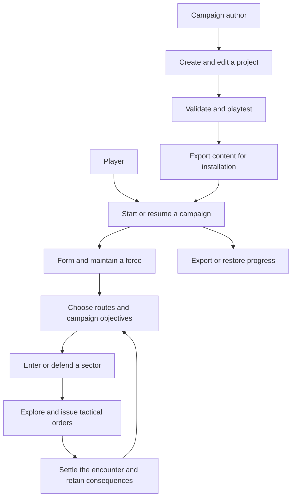

# What can you do in Granaderos?

[Architecture guide](../README.md) · [System overview](../overview.md)

This index introduces the Granaderos use-case catalogue, defines the shared six-value exposure vocabulary (`Command`, `Gated`, `Query`, `Supporting`, `No interface route`, and `Refused`) used across every catalogue page, and connects player and author intentions to the domain, application, and engine guides. It bridges the high-level [system overview](../overview.md) and [system map](../system-map.md) to the four domain catalogues ([session](session.md), [strategic](strategic.md), [tactical](tactical.md), and [authoring](authoring.md)), the worked [application contracts](application-contracts.md), and the call traces in [runtime flows](../runtime-flows.md).

A **use case** describes one meaningful intention for an actor—such as starting a campaign, recruiting a combatant, marching a squad, entering a sector, treating a wound, or validating a campaign project—and the domain invariants that must hold when it executes.

## First pass: the capability map

The table below maps what `You want to…` understand to the corresponding catalogue document to `Read`.

| You want to… | Read |
| --- | --- |
| Choose a campaign, begin or continue play, and preserve progress | [Session and progress](session.md) |
| Form and maintain a force, travel, respond to enemies, and pursue campaign objectives | [Strategic play](strategic.md) |
| Deploy, explore, move, fight, interact, manage equipment, and leave the field | [Tactical play](tactical.md) |
| Create, edit, validate, test, and export playable content | [Authoring](authoring.md) |
| Understand how use-case classes, domain objects, and narrow repositories enforce these boundaries | [Application contracts](application-contracts.md) |

The flowchart below shows how the `Player` moves through `Start or resume a campaign`, `Form and maintain a force`, `Choose routes and campaign objectives`, `Enter or defend a sector`, `Explore and issue tactical orders`, `Settle the encounter and retain consequences`, and `Export or restore progress`, and how the `Campaign author` moves through `Create and edit a project`, `Validate and playtest`, and `Export content for installation`.

These flows represent goals rather than a rigid linear sequence: a configured sample skirmish enters tactical play directly from the title screen, and editor playtests run in isolated sessions without overwriting player saves.

## Second pass: read a use case

Each domain page groups capabilities by intention, assigns a stable documentation identifier (`SES-`, `STR-`, `TAC-`, or `AUT-`), and links the browser surface to the application use cases in `packages/game/application` or `apps/campaign-editor/application` and the supporting rules in the compatibility engine.

Every use-case contract specifies six elements:

1. **Actor and intention:** who requests what outcome.
2. **Trigger and request:** what input identifies the operation.
3. **Preconditions:** what domain state must already hold.
4. **Result and consequences:** which authoritative domain owner changes, what response or view record is returned, and what persists.
5. **Refusals and interruptions:** what causes a typed refusal (leaving prior state unchanged) or stops a bounded operation at a checkpoint (`SectorTimeBudget` or contact interruption) while preserving paid partial progress.
6. **Authority and dependencies:** which domain objects and pure policies decide, which narrow repository interface loads and commits the transaction, and which source modules implement the boundary.

For example, `RecruitCombatant` is a single use case: charging `Treasury`, creating a `ServiceContract`, admitting the character into `ForceRoster`, and placing the combatant at a valid location happen atomically inside one transaction rather than as separate UI commands.

## Exposure vocabulary

Every use-case table and command crosswalk in [session.md](session.md), [strategic.md](strategic.md), [tactical.md](tactical.md), [authoring.md](authoring.md), and [application-contracts.md](application-contracts.md) classifies operations using one canonical six-value exposure vocabulary:

- **`Command`:** an order or action that the user interface exposes whenever its ordinary session or phase preconditions hold.
- **`Gated`:** an order or action that the user interface exposes only when a specific scenario, authored content record, location, carried item, deployment state, or browser integration is present.
- **`Query`:** a read-only inspection that returns player-known or author-visible view data without advancing `WorldTimeline` or mutating state.
- **`Supporting`:** an internal or background coordination step (such as autosave queuing, tactical clock synchronization, AI turn phases, or cursor placement plumbing) that serves a broader intention rather than standing alone as a user goal.
- **`No interface route`:** an operation or ambition that either has no control in the browser user interface (even if a low-level function or CLI helper exists) or is not supported by the browser application.
- **`Refused`:** a recognized command or action discriminant that a preflight or domain guard explicitly rejects (such as disabled merchant purchase/trade commands or horse acquisition/feeding/breeding).

## Third pass: connect intentions to architecture

The table below shows how each architectural `View` complements this catalogue (`What it explains`).

| View | What it explains |
| --- | --- |
| This catalogue (`use-cases/*.md`) | What players and authors can request, how each operation is exposed, and what rules govern it |
| [Application contracts](application-contracts.md) | How use-case classes, domain objects, and per-use-case repository interfaces enforce those contracts |
| [Runtime flows](../runtime-flows.md) | How browser callbacks, workers, `GameUnitOfWork`, and storage collaborate step by step |
| [Strategic engine](../strategic-engine.md) / [tactical engine](../tactical-engine.md) | Compatibility dispatcher entry points, domain state machines, and invariants |
| [Persistence](../persistence.md) | How accepted snapshots are mapped, compacted, locked, and restored |
| [Rendering](../rendering.md) | How player-known sector state projects into Three.js and SVG visuals |

The low-level command crosswalks in [strategic.md](strategic.md) and [tactical.md](tactical.md) account for every action `type` recognized by `dispatchCampaign` and `actBattle` / `endTurn`, mapping each discriminant to its use case or marking it `Supporting`, `No interface route`, or `Refused`.
