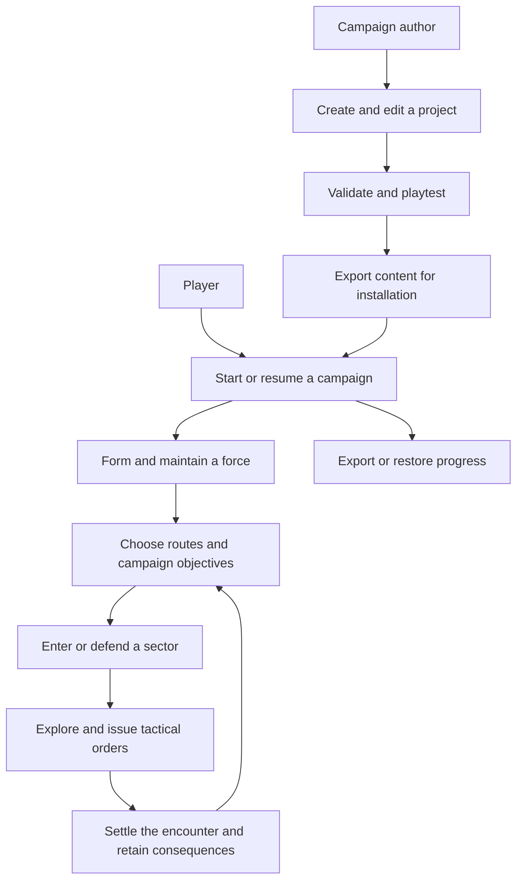

# What can you do in Granaderos?

[Architecture guide](../README.md) · [System overview](../overview.md)

Read the application as a collection of intentions, not a collection of files:
start a campaign, recruit a combatant, march a squad, enter a sector, treat a wound,
or create a campaign. A **use case** describes one meaningful outcome for an
actor and the rules that must hold while achieving it.

This catalogue groups player and author intentions. Implemented application
contracts have source links. Some scenario and geometry rules remain in the
compatibility engine. Availability means that a runtime path exists; playtest
evidence is recorded separately.

## First pass: the capability map

| You want to… | Read |
| --- | --- |
| Choose a campaign, begin or continue play, and preserve progress | [Session and progress](session.md) |
| Form and maintain a force, travel, respond to enemies, and pursue campaign objectives | [Strategic play](strategic.md) |
| Deploy, explore, move, fight, interact, manage equipment, and leave the field | [Tactical play](tactical.md) |
| Create, edit, validate, test, and export playable content | [Authoring](authoring.md) |
| Understand the implemented application boundaries | [Application contracts](application-contracts.md) |

These are goals and journeys, not a required sequence. A standalone skirmish
bypasses the strategic journey; editor playtests have their own state and launch
paths. Available choices also depend on scenario, content, location, phase,
equipment, and the person's condition.

## Second pass: read a use case

Each domain page groups capabilities and connects them to their current UI and
rule implementation. Stable identifiers make the catalogue navigable even when
source files move. Canonical names describe domain intentions. The application-contract links
identify implemented classes; capability descriptions also cover supporting
scenario paths in the compatibility engine.

A useful contract answers:

1. **Actor and intention:** who wants what outcome?
2. **Trigger and request:** what information identifies the desired operation?
3. **Preconditions:** what must already be true?
4. **Result and consequences:** what changes, what is returned, and what persists?
5. **Refusals and interruptions:** what can prevent completion, including work
   already paid for before a movement or contact interruption?
6. **Authority and dependencies:** which rules decide, which adapters perform
   external work, and where does the current code implement that boundary?

For example, **recruit a combatant** is a meaningful intention. “Subtract money”,
“create a contract”, and “place the combatant” are normally steps of that intention,
not three unrelated commands a player must coordinate. Likewise, **move to a
destination** can involve many worker jobs and animation frames without becoming
one use case per frame.

## Availability is part of the contract

The domain pages distinguish current, conditional, read-only, supporting,
unexposed, disabled, and future behavior. Wording varies with the domain, but
these distinctions must remain visible:

- **Player/author capability:** an actual interaction has a corresponding
  accepted runtime path, subject to its ordinary preconditions.
- **Conditional capability:** depends on scenario/content or a specific item,
  location, battle state, or authored objective; not universally available.
- **Query:** exposes permitted information without itself issuing a game order.
- **Supporting process:** clock reconciliation, AI phases, serialization,
  animation fitting, and similar machinery support a goal; they are not all
  independent player choices.
- **Implemented but unexposed/compatibility path:** code exists, but that alone
  does not establish an ordinary route in the current UI.
- **Disabled/future:** a guard rejects it or the application does not implement
  it. A retained source file or handler does not make it a playable feature.

In particular, historical equipment purchases and horse acquisition/feeding/
breeding must not appear as current capabilities merely because their old
handlers remain in the dispatcher.

## Third pass: connect intentions to architecture

| View | What it explains |
| --- | --- |
| This catalogue | What players/authors can request and what the result means |
| [Runtime sequences](../runtime-flows.md) | How present-day callbacks, workers, commits, and storage collaborate |
| [Strategic engine](../strategic-engine.md) / [tactical engine](../tactical-engine.md) | Rule entry points, state models, and invariants |
| [Persistence](../persistence.md) | How progress is encoded, admitted, and restored |
| [Rendering](../rendering.md) | How accepted/observable consequences become visuals |
| [Application contracts](application-contracts.md) | How use cases, rich objects, and narrow repositories enforce those contracts |

The command crosswalks in the gameplay pages connect low-level action names to
player intentions, supporting operations, or disabled paths. They are an audit
trail, not a recommendation to create one use-case class for every action type.

## Scope and evidence

This source inventory uses the same revision/date as the
[architecture guide](../README.md). Availability is inferred by tracing current
UI controls and rule admission, not by treating old design notes as acceptance.
Some capabilities are campaign-specific. Editor, developer-installation, and
presentation controls are identified separately from ordinary game rules.

The catalogue aims to cover the principal player/author surfaces and account for
recognized strategic/tactical commands. It does not list every possible authored
dialogue choice, every input combination, or every internal helper as a separate
use case. A source inventory is not proof of complete campaign acceptance.
