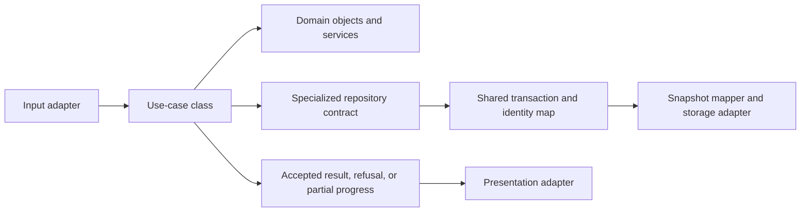

# Use-case contracts for the accepted architecture

[Use-case catalogue](README.md) · [Architecture guide](../README.md)

The [accepted architecture plan](../../../plans/accepted/domain-architecture.md)
and [ubiquitous language](../../../plans/accepted/ubiquitous-language.md) define the naming and ownership rules. The contracts below explain the implemented
application boundary through representative operations. The [runtime flows](../runtime-flows.md) trace their integration.

## Responsibilities

A use-case class owns its intention, request/result contract, orchestration,
and specialized repository interface. Rich domain objects and focused domain
services own game decisions and protect invariants. UI, browser tools, and
editor playtests invoke the same application contracts.

Each use case receives dependencies through its constructor and exposes an
`execute()` method. Its folder under `game/application` contains its class,
request and result contracts, repository interface, and README. Small contracts
can be declared in the use-case module. Domain tests sit beside their objects;
integration tests live in `tests/`. Names follow the canonical stem or an
explicit naming pair in the glossary.

Repository adapters share a `GameUnitOfWork`, identity map, snapshot mapper,
and storage adapter. Each use case owns its narrow interface. The interfaces
operate on the same logical game model and do not create separate copies of
characters or items. An in-memory session can supply repository data; browser
persistence remains an infrastructure concern.

The diagram shows collaboration. Source dependencies point inward:
infrastructure implements application contracts, and application depends on the
domain. Browser composition supplies concrete dependencies.

## Scope of a use case

An independently meaningful intention defines a use case. `RecruitCombatant`
coordinates eligibility, payment, service terms, force membership, placement,
and immediate control in one transaction. `RecruitmentService` owns the rules
that span those objects. A refusal publishes no gameplay changes.

Input routes share the same contract when they express the same intention.
Clicking a known enemy, using a shortcut, and invoking a browser tool can all
request the same attack. Target forms must still preserve their different
information and eligibility rules.

Long operations return progress explicitly. Movement can stop after paid steps
because contact occurs. The result must distinguish completion, refusal before
progress, and interruption after progress. Continuation preserves resources,
elapsed time, and random draws already consumed.

Path search, AP calculation, animation fitting, and save encoding are named
collaborators. Their technical boundaries do not each require a player use case.

## Example: RecruitCombatant

| Contract part | Responsibility |
| --- | --- |
| Request | Identify the candidate, supported service term, and recruitment context |
| Preconditions | Candidate eligibility, availability, session authority, funds, and valid placement permit recruitment |
| Domain behavior | Determine actual terms and costs from authoritative state; coordinate character, contract, treasury, membership, and placement |
| Result | Immediate player control, valid placement, force membership, and service terms |
| Refusal | Typed reason with prior accepted funds, membership, and service unchanged |
| Repository | `RecruitCombatantRepository` loads the required domain context and commits accepted changes through shared transaction infrastructure |
| Persistence | Autosave follows the accepted commit and reports storage failure separately |

A dialogue workflow can invoke `RecruitmentService` inside its own transaction.
It must not make a second independent commit for the same recruitment.

The live browser routes recruitment through
[`RecruitCombatantUseCase`](../../../game/application/personnel/recruit-combatant/recruit-combatant.use-case.ts).
Local conversations use `RecruitmentService` within `TalkToCharacter`.
The compatibility input `recruitCivic` maps to the same recruitment use case.
New input code uses `recruitCombatant`.

`Character` owns `Health` and an immutable `CharacterAbilities` value. Abilities
contain 0–100 ratings, named traits, and rule capabilities. The shared personnel
mapper restores authored and legacy definitions, applies earned training once,
and uses current participant ratings during an open visit. Recruitment filtering
references that character's ability value. Save projection preserves the pinned
definition and existing progress fields; restoration does not grant training or
write capabilities into mutable personnel records.

## Example: restore saved progress

This [session operation](session.md) owns a specialized repository for obtaining
and admitting saved progress. Resource verification uses a separate port.

| Step | Responsibility |
| --- | --- |
| Obtain progress | Read the selected save through the use-case repository |
| Decode and restore | Restore domain classes, stable identities, and relationships from the versioned snapshot |
| Validate | Check invariants, campaign identity, and referenced resources |
| Admit | Replace the active session only if the asynchronous request is still current |
| Return | Supply the accepted session response or a typed refusal |

Restoration must not repeat recruitment payments, initial equipment, or
completed world events. A resource failure leaves the accepted session intact.
Snapshot mappers distinguish restoration from new-object creation.

[`RestoreGameUseCase`](../../../game/application/restore-game/restore-game.use-case.ts)
loads through a specialized repository and `GameSnapshotMapper`. Browser
composition verifies resources before it installs the restored result.

## Example: a sector action

A sector-action request identifies the actor, permitted target form, and
supported options. Domain objects determine costs, consequences, and visibility.
Claimed damage, free AP, or hidden-target knowledge cannot become authoritative
input.

Inline and worker execution use the same domain rules. A worker job carries
session ID, source revision, and request ID. It reconstructs domain objects from
transport data and returns a result for the shared admission boundary. Workers
do not independently persist the game.

Requests that modify one game session remain serialized. A stale result cannot
overwrite accepted progress. All time-advancing actions stop at the first
unresolved arrival decision and preserve any unexecuted continuation.

Presentation timing is part of acceptance. Presented actions
can play transient frames before the final commit, while some movement commits
incrementally. The [runtime flows](../runtime-flows.md) document these paths.
Checkpoints preserve paid partial progress. Animation does not decide game outcomes.

## Read-only use cases and automatic consequences

`GetRecruitmentCandidates`, `GetVisibleCharacters`, and `GetSaveStatus` are
read-only use cases. Each has its own repository contract over the same logical
model. Reading does not advance world time. Visibility results apply the player's
information limits; access to internal state does not grant permission to expose
hidden actors. Route and equipment previews also retain dedicated query helpers
in the compatibility engine.

The shared game clock coordinates contract deadlines, movement, and world
conditions. `WorldTimeline` orders scheduled corpse-removal events and records
completion receipts. Resident routines and supply collection use that same
accepted game time. The initiating application operation admits their effects
together. Autosave follows accepted commits through an infrastructure adapter.

Camera controls, opening panels, audio settings, and animation playback remain
presentation responsibilities.

## Verification

Follow the stages and completion gates in the
[accepted implementation plan](../../../plans/accepted/domain-architecture.md#implementation-sequence).
Recruitment is the reference slice for domain behavior, transaction boundaries,
persistence mapping, and test tooling. Journey, world, sector, and editor slices
use the same separation of responsibilities.

For retained behavior, compare deterministic outcomes for the same source state
and request. For accepted behavior changes, test the target contract directly.
Check refusals, interrupted progress, save restoration, information limits, and
stale results. Retain compatibility adapters until their callers are migrated.
