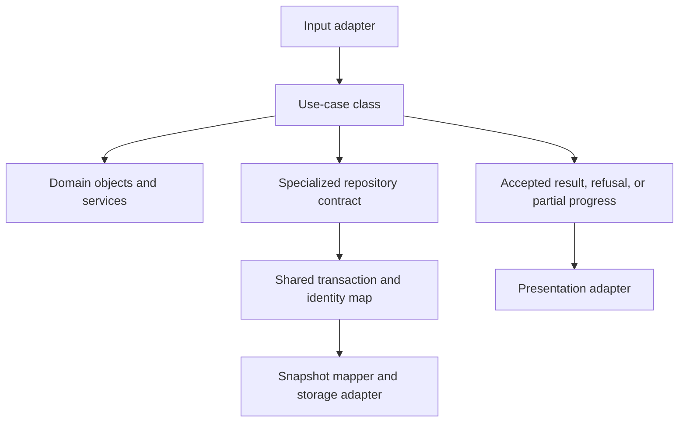

# Use-case contracts for the accepted architecture

[Use-case catalogue](README.md) · [Architecture guide](../README.md)

This page explains how application use-case classes in `packages/game/application` and `apps/campaign-editor/application` enforce the contracts defined in the [accepted architecture plan](../../plans/accepted/domain-architecture.md) and [ubiquitous language](../../plans/accepted/ubiquitous-language.md), how each use case owns one narrow repository interface over shared transaction and identity infrastructure, and how worked examples (`RecruitCombatant`, `RestoreGame`, `ExecuteSectorOrder`, and read-only queries) protect single-owner domain invariants. It connects the capability catalogues ([session.md](session.md), [strategic.md](strategic.md), [tactical.md](tactical.md), and [authoring.md](authoring.md)) to the execution sequences in [runtime flows](../runtime-flows.md) and the boundary rules in the [system map](../system-map.md).

## Responsibilities and repository boundary

A use-case class owns one domain intention, its request and response contracts, its orchestration sequence, and its specialized repository interface. Domain entities, value objects, state machines (`Journey`, `ArrivalDecision`, `SectorSession`, `CombatSession`, `CombatTurn`, `ReactionStack`), pure policies (`ActionPointPolicy`, `ReactionPolicy`, `VisibilityPolicy`, `IlluminationPolicy`, `KnownSectorPolicy`, `ServicePricingPolicy`, `CombatOutcomePolicy`), and focused domain services (`RecruitmentService`, `ServiceRenewalService`, `SquadFormationService`, `ItemTransferService`) own all game decisions and invariants.

Each use case receives its narrow repository interface through its constructor and exposes an `execute()` method. Its directory under `packages/game/application` or `apps/campaign-editor/application` contains its class, request and response types, repository interface, unit tests, and README, using a matching stem (for example, `RecruitCombatantUseCase`, `RecruitCombatantRequest`, `RecruitCombatantResponse`, and `RecruitCombatantRepository` in `recruit-combatant/`, with the explicit glossary exception `EnterSectorUseCase` and `SectorEntryRequest` in `enter-sector/`).

Two use cases never share a repository interface, even when their reads overlap. Beneath those separate interfaces, repository adapters in `packages/game/infrastructure` share `GameUnitOfWork`, `DomainIdentityMap`, `GameSnapshotMapper`, and the storage adapter so every object loaded in a transaction refers to the single authoritative owner of each character, health record, squad, journey, sector visit, and inventory.

The flowchart below shows how an `Input adapter` calls a `Use-case class`, which coordinates `Domain objects and services` and its `Specialized repository contract` over the `Shared transaction and identity map` and `Snapshot mapper and storage adapter` to return an `Accepted result, refusal, or partial progress` to the `Presentation adapter`.

## Exposure classification and scope of a use case

Every operation in the [use-case catalogue](README.md#exposure-vocabulary) falls into one of six exposure categories:

- **`Command`:** an intention exposed directly by the UI under its normal preconditions (such as `CreateGameSession`, `RestoreGame`, `SaveGame`, `FormSquad`, `RedirectJourney`, `TransferItem`, `ExecuteSectorOrder`, `EndSectorTurn`, `EditCampaignProject`, `UndoCampaignProjectEdit`, `RedoCampaignProjectEdit`, and `EditSectorMap`).
- **`Gated`:** an intention exposed only when specific content, arrival state, sector presence, or equipment conditions hold (such as `RecruitCombatant`, `RenewServiceContract`, `FightOnArrival`, `WithdrawOnArrival`, `EnterSector`, `ResumeSectorSession`, `AdmitSectorReinforcements`, and `TalkToCharacter`).
- **`Query`:** a read-only use case whose repository interface has no commit method and whose `execute()` returns a narrow view type rather than a mutable domain object, without advancing `WorldTimeline` (such as `GetRecruitmentCandidates`, `GetVisibleCharacters`, `GetSaveStatus`, and `ValidateCampaignProject`).
- **`Supporting`:** an operation that advances or coordinates state on behalf of another intention rather than standing alone as a player menu command (such as `AdvanceWorldTime`, `CollectResidentSupply`, `ResumeSectorOperation`, background autosave, and `syncTacticalTime`).
- **`No interface route`:** an operation reachable only outside the browser UI (such as CLI package scaffolding) or an unsupported platform ambition.
- **`Refused`:** a legacy or compatibility action discriminant rejected by preflight or domain guards (such as disabled merchant trade actions or horse acquisition/feeding/breeding).

Multiple input routes that express the same intention (such as clicking a target, pressing a hotkey, or calling an allowlisted Model Context tool) invoke the same application contract and domain rules.

## Example: RecruitCombatant

The table below breaks down each `Contract part` and its `Responsibility` for [`RecruitCombatantUseCase`](../../../packages/game/application/personnel/recruit-combatant/recruit-combatant.use-case.ts).

| Contract part | Responsibility |
| --- | --- |
| Request (`RecruitCombatantRequest`) | Identify the candidate `characterId`, requested service `term`, and recruitment site context |
| Preconditions | Candidate is alive, uncaptured, not already serving, and eligible at a safe recruitment site; `Treasury` holds sufficient pesos (`Money`) |
| Domain behavior (`RecruitmentService`) | Derive cost via pure `ServicePricingPolicy`, charge `Treasury` once, create `ServiceContract` on `Character`, admit into `ForceRoster`, and place into a local `Squad` with a free slot or the controllable reserve at that location |
| Result (`RecruitCombatantResponse`) | Immediate player control, valid strategic `locationId`, `ForceRoster` and `Squad`/reserve placement, and active `ServiceContract` terms |
| Refusal (`DomainRefusal`) | Typed refusal code translated into Spanish at the adapter boundary; leaves `Treasury`, `ForceRoster`, `Squad`, and `Character` unchanged |
| Repository (`RecruitCombatantRepository`) | [`CampaignRecruitCombatantRepository`](../../../packages/game/infrastructure/personnel/campaign-recruit-combatant.repository.js) loads and commits over `GameUnitOfWork` and `CanonicalPersonnelMapper` |
| Persistence | Accepted commit advances `gameRevision` once; `useCampaignAutosave` queues `SaveGame` and tracks storage status separately via `GetSaveStatus` |

When recruitment happens inside a local conversation, [`TalkToCharacterUseCase`](../../../packages/game/application/talk-to-character/talk-to-character.use-case.ts) invokes the same `RecruitmentService` inside its own transaction (`TalkToCharacterRepository`), preserving the resident's existing `Health` and `Inventory` at the current sector without running a second independent commit. The compatibility command alias `recruitCivic` routes to `RecruitCombatantUseCase`.

`Character` is the sole owner of `Health` and immutable `CharacterAbilities` (0–100 `CharacterRating` values, `CharacterTrait` specialties, and `CharacterCapability` rule identifiers). `CampaignCharacterAbilitiesMapper` derives `CharacterAbilities` from the pinned character definition and earned training progress without duplicating ownership in read models or recruitment candidate projections.

## Example: restore saved progress (`RestoreGame`)

The table below lists each `Step` and its `Responsibility` in [`RestoreGameUseCase`](../../../packages/game/application/restore-game/restore-game.use-case.ts) (see [session.md](session.md)).

| Step | Responsibility |
| --- | --- |
| Obtain progress | Read the selected save payload through `RestoreGameRepository` |
| Decode and restore | `GameSnapshotMapper` decodes the portable save and rebuilds `GameSession`, `Character`, `Health`, `ServiceContract`, `Squad`, `Journey`, `ArrivalDecision`, `SectorSession`, `CombatSession`, `Inventory`, `ItemCustody`, `Corpse`, and `WorldTimeline` via their static `restore` paths, sharing identities through `DomainIdentityMap` |
| Validate | Verify schema version, session/revision consistency, synchronized campaign and sector clocks, participant uniqueness, and single item custody |
| Verify resources and admit | Browser composition checks referenced campaign asset SHA-256 digests (`verifyCampaignResources`) and installs the restored session only if the request generation is still current |
| Return | Supply the restored session response or a typed refusal that leaves the prior active session untouched |

Because restoration uses each domain class's static `restore` path rather than creation constructors, restoring a game never repeats initial equipment issuance, contract charges, or completed `WorldTimeline` events.

## Example: a bounded sector operation (`ExecuteSectorOrder`, `EndSectorTurn`, `ResumeSectorOperation`)

A sector command (`ExecuteSectorOrderUseCase` or `EndSectorTurnUseCase`) identifies the acting participant, target form, and options inside an active `SectorSession`:

- **Single owner per fact:** `SectorParticipant` spends visit-local `ActionPoints`, while any physical wound updates the canonical `Health` owned by the shared `Character` instance, and any item pickup or drop updates `Inventory` and `ItemCustody` through `ItemTransferService`.
- **Worker and direct parity:** Inline execution and Web Worker jobs (`packages/game/battle-job.ts`) carry `SectorOperationContext` (`gameSessionId`, `sectorSessionId`, `gameRevision`, `sectorRevision`, and `requestId`), reconstruct domain state, run the same domain rules, and pass results through the main thread's revision-checked admission gate. Workers never persist state directly.
- **Checkpoints and time boundaries:** `SectorTimeBudget` bounds every operation by the next campaign boundary. If a multi-step movement, rest interval, or `ReloadWork` reaches a hostile campaign `ArrivalDecision` or triggers a `ReactionWindow` on `ReactionStack`, `WorldTimeline.advanceTo` stops at that exact second. The committed snapshot records the accepted partial progress and the unexecuted `SectorOperation` continuation so `ResumeSectorOperationUseCase` can resume later without recharging spent `ActionPoints` or repeating prior random draws.
- **Presentation separation:** Transient animation frames (`presentedActBattle` / `presentedEndTurn` and `ActorCue` playback) animate already accepted outcomes and never alter combat rules or disclose unseen actors.

## Read-only queries and world timeline coordination

Read-only use cases (`GetRecruitmentCandidatesUseCase`, `GetVisibleCharactersUseCase`, `GetSaveStatusUseCase`, and `ValidateCampaignProjectUseCase`) depend on read-only repository interfaces over the same logical model:

- Each query returns its own narrow view type (`{ characterIds }`, `SaveStatus`, or a validation diagnostic report) and never returns a domain object, ensuring that uninspected or hidden domain state (`KnownSectorPolicy`) cannot leak to the UI by reference.
- Queries never call `WorldTimeline.advanceTo` or mutate revision numbers.

When a mutating command advances time (`AdvanceWorldTimeUseCase`, strategic travel/wait, or `syncBattleTime`), `WorldTimeline.advanceTo(targetSecond, applyEvent)` is the single domain operation that moves the clock. It executes due events in chronological and stable-ID order, records completed event IDs so they never replay, and pauses before any event returning `'pause'` (such as an `ArrivalDecision`).
