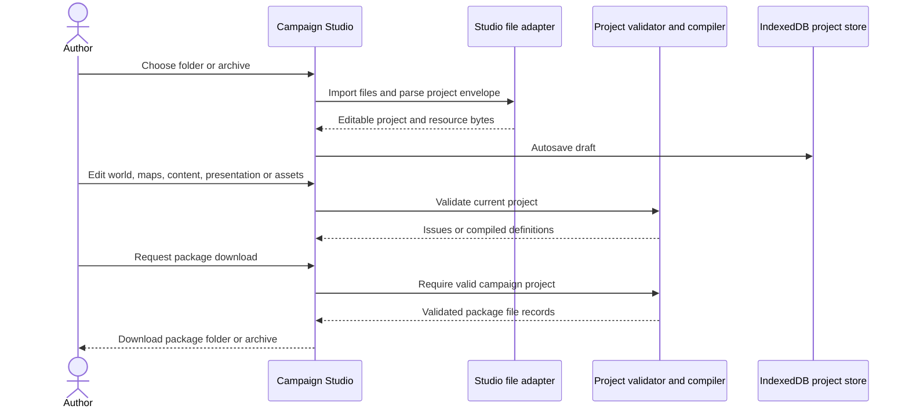
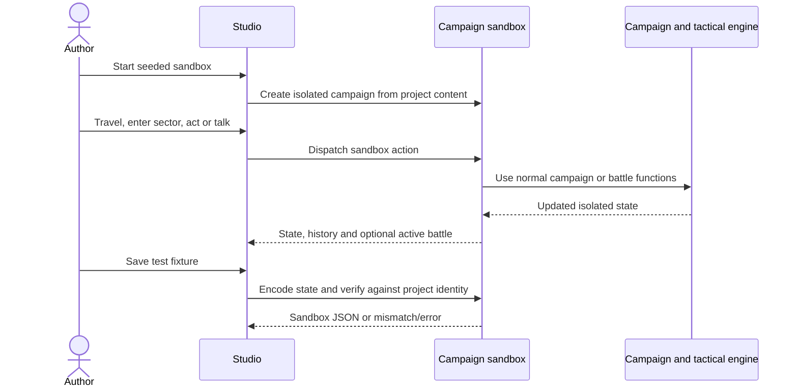

# Campaign authoring use cases

**Architecture:** [Overview](../README.md) · [Content and campaigns](../content-and-campaigns.md) · [Build and tooling](../build-and-tooling.md) · [Session/player use cases](session.md)

This inventory describes the independent `campaign-editor` application and
supporting package tools. `CampaignProject` owns document mutations and envelope
invariants. `CampaignProjectHistory` owns undo and redo. Editing and validation
use cases access narrow repositories. Browser adapters own file access and
IndexedDB. Playtests use the declared game application API.

## Summary by authoring journey

| Family | IDs | Main intent | Availability |
| --- | --- | --- | --- |
| Project lifecycle | AUT-001–AUT-006 | Create, reopen, duplicate, import, export, and remove drafts | Current authoring |
| Edit/review lifecycle | AUT-007–AUT-010 | Change identity, undo/redo, save locally, validate before delivery | Current authoring; local storage required for durable draft |
| World and maps | AUT-011–AUT-015 | Shape strategic world, locality connections, tactical maps and buildings | Current authoring |
| Campaign content | AUT-016–AUT-020 | Author cast, equipment, rules, narrative, dialogue, quests and placements | Current authoring; runtime behavior constrained by engine-supported fields |
| Presentation/resources | AUT-021–AUT-023 | Customize campaign presentation, manage packaged resources, use advanced document editing | Current authoring |
| Test and handoff | AUT-024–AUT-027 | Run map/campaign tests, save test fixture, launch Story content, export package | Current authoring with validation/content guards |
| Standalone editors / CLI | AUT-028–AUT-030 | Edit focused story or map documents; scaffold/check/refresh package resources | Current developer/author tools, not player-menu operations |
| Unsupported ambitions | AUT-031–AUT-032 | Publish/install to arbitrary user-hosted catalog; run imported custom scripts | Not available |

## Current authoring catalogue

Contract shorthand in each entry: **Actor** is the author/tool operator; **Input → result** captures the meaningful request/response; **Guards** summarize current refusals; **Surface/source** names the current route and implementation. A project may be autosaved while invalid as a package: saving a draft is not equivalent to passing full package validation.

### Project lifecycle

#### AUT-001 — create-campaign-project

* **Actor:** Campaign author. **Input → result:** unique lower-case campaign ID and display name → scaffolded `granaderos-editor-project` with starter manifest, content/world/maps/presentation/assets, map index, and guide resource; project opens in Studio.
* **Guards:** ID format/reserved name and duplicate local identity rejected. Starter scaffold is data; no custom executable code is generated.
* **Surface/source:** Studio **Crear una campaña**; [`campaign-editor/web/app/studio/page.tsx`](../../../campaign-editor/web/app/studio/page.tsx), [`campaign-editor/domain/campaign-project.ts`](../../../campaign-editor/domain/campaign-project.ts), [`campaign-editor/infrastructure/project-scaffold.js`](../../../campaign-editor/infrastructure/project-scaffold.js).
* **Availability:** Current authoring.

#### AUT-002 — reopen-local-draft

* **Actor:** Author returning to a draft. **Input → result:** choose a locally saved project or previously active project → documents and resource bytes restored into an editable project and selected in Studio.
* **Guards:** IndexedDB unavailable/read failure surfaces a notice; selecting installed content as a basis is distinct from opening a local draft.
* **Surface/source:** Studio project manager; [`campaign-editor/web/app/studio/page.tsx`](../../../campaign-editor/web/app/studio/page.tsx), [`campaign-editor/web/lib/campaign-studio-storage.ts`](../../../campaign-editor/web/lib/campaign-studio-storage.ts).
* **Availability:** Current authoring; durable local drafts require browser IndexedDB.

#### AUT-003 — fork-project-from-draft-or-installed-campaign

* **Actor:** Author creating a derivative. **Input → result:** source draft or installed package plus new identity/name → cloned editable draft with updated IDs/references and clean project history.
* **Guards:** identity must be unique and cannot use reserved `granaderos`; copying the historical scenario intentionally converts it to generic and requires author review/reconfiguration.
* **Surface/source:** Studio **Duplicar proyecto** or import installed campaign; [`campaign-editor/web/app/studio/page.tsx`](../../../campaign-editor/web/app/studio/page.tsx), [`campaign-editor/domain/campaign-project.ts`](../../../campaign-editor/domain/campaign-project.ts), [`web/lib/campaign-library.ts`](../../../web/lib/campaign-library.ts) (installed package loader).
* **Availability:** Current authoring.

#### AUT-004 — import-project-or-package-files

* **Actor:** Author bringing in a project/package folder. **Input → result:** `.project.json`/project JSON, supported ZIP archive, or directory selection → parsed Studio project with document groups and in-memory resources.
* **Guards:** Path safety, allowed file types/limits, archive safety, a single manifest, all referenced documents and map files required. Invalid campaign data may remain editable as a draft and show validation issues. Duplicate identity asks author to fork rather than overwrite.
* **Surface/source:** Studio **Importar archivo/carpeta**; [`campaign-editor/web/app/studio/page.tsx`](../../../campaign-editor/web/app/studio/page.tsx), [`campaign-editor/web/lib/campaign-studio-files.ts`](../../../campaign-editor/web/lib/campaign-studio-files.ts), [`campaign-editor/domain/campaign-project.ts`](../../../campaign-editor/domain/campaign-project.ts).
* **Availability:** Current authoring.

#### AUT-005 — export-project-or-installable-folder

* **Actor:** Author retaining or sharing work. **Input → result:** current project → JSON project download for continued editing, or validated campaign ZIP for installation/transfer.
* **Guards:** Project JSON can represent an invalid draft; installable package export requires full validation and emits manifest/documents/map index/maps/resource bytes, without editor-only metadata or runtime package origin.
* **Surface/source:** Studio project/download controls; [`campaign-editor/web/app/studio/page.tsx`](../../../campaign-editor/web/app/studio/page.tsx), [`campaign-editor/web/lib/campaign-studio-files.ts`](../../../campaign-editor/web/lib/campaign-studio-files.ts) (`encodeCampaignProject`, `exportCampaignArchive`, `campaignProjectFiles`).
* **Availability:** Current authoring; package export conditional on valid project.

#### AUT-006 — delete-local-draft

* **Actor:** Author cleaning local project list. **Input → result:** choose draft and confirm removal → project record removed from local Studio storage/list.
* **Guards:** Confirmation protects against accidental deletion; this does not delete a published server campaign or browser gameplay save.
* **Surface/source:** Studio project manager and [`campaign-editor/web/lib/campaign-studio-storage.ts`](../../../campaign-editor/web/lib/campaign-studio-storage.ts); inspect delete control in [`campaign-editor/web/app/studio/page.tsx`](../../../campaign-editor/web/app/studio/page.tsx).
* **Availability:** Current authoring.

### Edit and review lifecycle

#### AUT-007 — rename-project-identity

* **Actor:** Author. **Input → result:** new campaign ID/name → project identity and supported internal campaign asset references updated as one editor operation.
* **Guards:** ID/name bounds, reserved identity, or duplicate draft ID refused; existing project remains available if rename fails.
* **Surface/source:** Studio **Aplicar identidad y nombre**; [`campaign-editor/web/app/studio/page.tsx`](../../../campaign-editor/web/app/studio/page.tsx), [`campaign-editor/domain/campaign-project.ts`](../../../campaign-editor/domain/campaign-project.ts).
* **Availability:** Current authoring.

#### AUT-008 — undo-or-redo-document-edit

* **Actor:** Author. **Input → result:** undo/redo control or Ctrl/Cmd+Z and Ctrl/Cmd+Shift+Z → restore prior immutable project snapshot and resources.
* **Guards:** History is in-memory and bounded to 50 past/future snapshots; changing projects resets the active history. It is not a version-control system.
* **Surface/source:** Studio toolbar/keyboard; [`campaign-editor/web/app/studio/page.tsx`](../../../campaign-editor/web/app/studio/page.tsx), [`campaign-editor/web/lib/campaign-studio-history.ts`](../../../campaign-editor/web/lib/campaign-studio-history.ts).
* **Availability:** Current authoring.

#### AUT-009 — autosave-local-project

* **Actor:** Author. **Input → result:** accepted document change → debounced IndexedDB save of project, including binary asset bytes; last project ID in localStorage supports reopen.
* **Guards:** Invalid draft content can be saved if its envelope/resource constraints pass; browser storage error is shown. This is not player campaign autosave.
* **Surface/source:** Studio status **Guardado en este navegador**; [`campaign-editor/web/app/studio/page.tsx`](../../../campaign-editor/web/app/studio/page.tsx), [`campaign-editor/web/lib/campaign-studio-storage.ts`](../../../campaign-editor/web/lib/campaign-studio-storage.ts).
* **Availability:** Supporting current authoring process; durable save conditional on IndexedDB.

#### AUT-010 — validate-campaign-project

* **Actor:** Author checking readiness. **Input → result:** current project → sectioned issues and counts, plus compiled definitions on success.
* **Guards:** Validation is scheduled after edits; stale reports are not considered current if tied to a different project object. It checks content/world/presentation/maps/asset manifest and package compiler constraints. Draft remains editable on failure.
* **Surface/source:** Studio **Validación y descarga**; [`campaign-editor/web/app/studio/page.tsx`](../../../campaign-editor/web/app/studio/page.tsx), [`project-validation.js`](../../../campaign-editor/infrastructure/project-validation.js) (`validateCampaignProject`).
* **Availability:** Current authoring.

### World and tactical-map authoring

#### AUT-011 — define-strategic-world

* **Actor:** Author. **Input → result:** world document → edit map's 36×33 cells, terrain/biome, theater, locality/district assignment, locality identity/name/income, headquarters and campaign geography/configuration.
* **Guards:** Localities require valid identity and usable land/anchor; referenced sectors and neighbors must pass world validation. Full document fields are available for supported schema data.
* **Surface/source:** Studio **Mundo**; [`campaign-editor/web/app/studio/WorldWorkspace.tsx`](../../../campaign-editor/web/app/studio/WorldWorkspace.tsx), [`campaign-editor/infrastructure/world-editing.js`](../../../campaign-editor/infrastructure/world-editing.js), [`game/campaign-definition.js`](../../../game/campaign-definition.js).
* **Availability:** Current authoring.

#### AUT-012 — connect-strategic-localities

* **Actor:** Author. **Input → result:** choose neighboring locality links, move locality headquarter anchor, edit routes/travel data → strategic connections represented in world document.
* **Guards:** Link changes require passable terrestrial route/correct reciprocal project updates; invalid world references are reported before export.
* **Surface/source:** Studio World locality panel and travel groups; [`campaign-editor/web/app/studio/WorldWorkspace.tsx`](../../../campaign-editor/web/app/studio/WorldWorkspace.tsx), [`campaign-editor/infrastructure/world-editing.js`](../../../campaign-editor/infrastructure/world-editing.js).
* **Availability:** Current authoring.

#### AUT-013 — author-tactical-sector-map

* **Actor:** Author. **Input → result:** select locality map (20×16) → change metadata, terrain, buildings, props/objects, walls, openings, spawn points, floors/upper surfaces and climb links; import/export map JSON in the standalone editor.
* **Guards:** Map schema and playability checks surface errors/warnings; playable map constraints and campaign package references must be satisfied before package validation/export.
* **Surface/source:** Studio **Mapas tácticos** and standalone **Constructor de sectores**; [`campaign-editor/web/app/studio/MapWorkspace.tsx`](../../../campaign-editor/web/app/studio/MapWorkspace.tsx), [`campaign-editor/web/app/editor/SectorEditor.tsx`](../../../campaign-editor/web/app/editor/SectorEditor.tsx), [`game/map-schema.js`](../../../game/map-schema.js).
* **Availability:** Current authoring.

#### AUT-014 — construct-and-template-building

* **Actor:** Author. **Input → result:** select building geometry/styles/openings/levels and furniture, optionally save it as project template → reusable building template and updated map/world structure.
* **Guards:** Geometry operations are validated; templates are editor project metadata, not campaign-executable behavior. A preview is not proof of map package validity.
* **Surface/source:** Studio **Edificios** and embedded sector builder; [`campaign-editor/web/app/studio/BuildingWorkspace.tsx`](../../../campaign-editor/web/app/studio/BuildingWorkspace.tsx), [`campaign-editor/web/app/editor/SectorEditor.tsx`](../../../campaign-editor/web/app/editor/SectorEditor.tsx), map editing commands in [`campaign-editor/web/app/editor/SectorEditor.tsx`](../../../campaign-editor/web/app/editor/SectorEditor.tsx) and project operations in [`campaign-editor/domain/campaign-project.ts`](../../../campaign-editor/domain/campaign-project.ts).
* **Availability:** Current authoring.

#### AUT-015 — inspect-map-validation-and-preview

* **Actor:** Author. **Input → result:** request preview/validation → map report plus in-memory 3D sector preview or battle playtest.
* **Guards:** Invalid map disables playable test or reports reason; scene-expanded preview and actual playtest are separate modes. Neither publishes content.
* **Surface/source:** Sector Editor validation panel and Studio map/building workspace; [`campaign-editor/web/app/editor/SectorEditor.tsx`](../../../campaign-editor/web/app/editor/SectorEditor.tsx), [`campaign-editor/web/app/studio/BuildingWorkspace.tsx`](../../../campaign-editor/web/app/studio/BuildingWorkspace.tsx), [`game/map-playtest.js`](../../../game/map-playtest.js).
* **Availability:** Current authoring, gated by map validity where required.

### Cast, rules, story, and presentation

#### AUT-016 — author-campaign-cast-and-encounters

* **Actor:** Author. **Input → result:** campaign content documents → create/edit character records, their attributes, appearance, encounter details, recruitment and deployment/presence placement data.
* **Guards:** IDs, campaign references and supported types validate; existing generic/historical IDs obey scenario-specific semantics. Custom UI data does not create new engine capabilities by itself.
* **Surface/source:** Studio **Historia y personajes** reuses Content Editor; [`campaign-editor/web/app/studio/ContentWorkspace.tsx`](../../../campaign-editor/web/app/studio/ContentWorkspace.tsx), [`campaign-editor/web/app/story/ContentEditor.tsx`](../../../campaign-editor/web/app/story/ContentEditor.tsx), [`campaign-editor/domain/campaign-project.ts`](../../../campaign-editor/domain/campaign-project.ts).
* **Availability:** Current authoring.

#### AUT-017 — define-equipment-and-force

* **Actor:** Author. **Input → result:** content data → author supported portable/artillery weapon records, equipment assignments and force equipment/load rules, plus starting supplies where available in editor.
* **Guards:** Templates/definitions and cross-references are constrained by engine schemas; authored labels or images do not create new combat mechanics.
* **Surface/source:** Story Editor weapon tabs, force equipment and related content sections; [`campaign-editor/web/app/story/ContentEditor.tsx`](../../../campaign-editor/web/app/story/ContentEditor.tsx), [`campaign-editor/web/app/story/ForceEquipment.tsx`](../../../campaign-editor/web/app/story/ForceEquipment.tsx), [`game/campaign-data-validation.js`](../../../game/campaign-data-validation.js).
* **Availability:** Current authoring within supported definitions.

#### AUT-018 — author-campaign-rules-and-roles

* **Actor:** Author. **Input → result:** campaign content/world → edit supported starting territory, campaign rules, hiring/contracts, care, militia, logistics/foundry, roles and other visible rule sections.
* **Guards:** Bounded values, valid references and engine-defined rule types; invalid values remain reportable in a draft but block valid package output when compiler rejects them.
* **Surface/source:** Story Editor rule components; [`campaign-editor/web/app/story/CampaignRules.tsx`](../../../campaign-editor/web/app/story/CampaignRules.tsx), [`campaign-editor/web/app/story/StartingTerritory.tsx`](../../../campaign-editor/web/app/story/StartingTerritory.tsx), [`campaign-editor/web/app/story/ContractRules.tsx`](../../../campaign-editor/web/app/story/ContractRules.tsx), [`campaign-editor/web/app/story/CareRules.tsx`](../../../campaign-editor/web/app/story/CareRules.tsx), [`campaign-editor/web/app/story/MilitiaRules.tsx`](../../../campaign-editor/web/app/story/MilitiaRules.tsx).
* **Availability:** Current authoring for implemented schema fields.

#### AUT-019 — author-dialogue-quests-and-story

* **Actor:** Author. **Input → result:** narrative content → edit campaign chapters/conditions, quests/errands, character dialogue nodes/choices/conditions/effects and supported placement records.
* **Guards:** Conditions/effects must be supported by the runtime interpreters and valid IDs/references; no arbitrary code callback is loaded from imported campaign data.
* **Surface/source:** Story Editor and Studio content section; [`campaign-editor/web/app/story/CampaignStory.tsx`](../../../campaign-editor/web/app/story/CampaignStory.tsx), [`campaign-editor/web/app/story/DialogueEditor.tsx`](../../../campaign-editor/web/app/story/DialogueEditor.tsx), [`campaign-editor/web/app/story/DialogueConditions.tsx`](../../../campaign-editor/web/app/story/DialogueConditions.tsx), [`campaign-editor/web/app/story/DialogueEffects.tsx`](../../../campaign-editor/web/app/story/DialogueEffects.tsx), [`campaign-editor/web/app/story/QuestEditor.tsx`](../../../campaign-editor/web/app/story/QuestEditor.tsx), [`game/content-dialogue.js`](../../../game/content-dialogue.js).
* **Availability:** Current authoring within engine-supported narrative vocabulary.

#### AUT-020 — author-placements-and-arrival

* **Actor:** Author. **Input → result:** content/world document → set supported character placements, arrival sites and related scene/campaign anchors.
* **Guards:** Placement location, character identity, scene and package references must validate; these are data placements, not new maps unless paired with a valid map record.
* **Surface/source:** Story editor placement map and arrival-site components; [`campaign-editor/web/app/story/PlacementMap.tsx`](../../../campaign-editor/web/app/story/PlacementMap.tsx), [`campaign-editor/web/app/story/ArrivalSites.tsx`](../../../campaign-editor/web/app/story/ArrivalSites.tsx), [`game/campaign-content.js`](../../../game/campaign-content.js).
* **Availability:** Current authoring.

#### AUT-021 — customize-campaign-presentation

* **Actor:** Author. **Input → result:** presentation document → customize title/menu text and art references, intro scenes, calendar/manual, portraits, atlas/character creation choices and optional sample skirmish.
* **Guards:** Referenced images must be declared resources; enum/data fields follow presentation validator. Sample skirmish is omitted unless configured and a valid roster/config is available.
* **Surface/source:** Studio **Presentación**; [`campaign-editor/web/app/studio/PresentationWorkspace.tsx`](../../../campaign-editor/web/app/studio/PresentationWorkspace.tsx), [`game/campaign-presentation-validation.js`](../../../game/campaign-presentation-validation.js).
* **Availability:** Current authoring.

#### AUT-022 — manage-campaign-resources

* **Actor:** Author. **Input → result:** supported image or JSON resource bytes → add/replace, preview, inspect or rename resource; update project catalog path/type/SHA-256 and dependent references as implemented.
* **Guards:** Paths confined to assets, allowed resource type/size and unique asset ID; package validation checks catalog bytes and references. A missing resource can remain an editable draft issue.
* **Surface/source:** Studio **Recursos**; [`campaign-editor/web/app/studio/AssetsWorkspace.tsx`](../../../campaign-editor/web/app/studio/AssetsWorkspace.tsx), [`campaign-editor/web/lib/campaign-studio-assets.ts`](../../../campaign-editor/web/lib/campaign-studio-assets.ts), [`campaign-editor/domain/campaign-project.ts`](../../../campaign-editor/domain/campaign-project.ts).
* **Availability:** Current authoring.

#### AUT-023 — edit-advanced-document-fields

* **Actor:** Advanced author. **Input → result:** a project document field or full JSON-shaped document → edit supported fields outside the guided form and receive validation feedback.
* **Guards:** Envelope checks preserve required top-level groups and identity. Arbitrary code is not evaluated; invalid values do not become playable merely because raw document editing accepts a draft.
* **Surface/source:** Studio **Todos los documentos**, full world/map/content/presentation fields and optional JSON editing in [`campaign-editor/web/app/studio/FieldEditor.tsx`](../../../campaign-editor/web/app/studio/FieldEditor.tsx), [`campaign-editor/web/app/studio/page.tsx`](../../../campaign-editor/web/app/studio/page.tsx), [`campaign-editor/domain/campaign-project.ts`](../../../campaign-editor/domain/campaign-project.ts).
* **Availability:** Current authoring; advanced data edits remain schema/compiler constrained.

### Test and handoff

#### AUT-024 — playtest-one-authored-map

* **Actor:** Map author. **Input → result:** valid map and optional campaign content → a battle/sector state mounted in Studio's embedded Battlefield. Map edits remain independent from battle actions.
* **Guards:** Map validation required; campaign package selected where applicable; changing the map closes stale preview.
* **Surface/source:** Studio **Edificios** preview and embedded sector editor; [`campaign-editor/web/app/studio/BuildingWorkspace.tsx`](../../../campaign-editor/web/app/studio/BuildingWorkspace.tsx), [`campaign-editor/web/app/editor/SectorEditor.tsx`](../../../campaign-editor/web/app/editor/SectorEditor.tsx), [`game/map-playtest.js`](../../../game/map-playtest.js).
* **Availability:** Current authoring.

#### AUT-025 — exercise-full-campaign-sandbox

* **Actor:** Campaign author. **Input → result:** compiled project content, seed and optional supported setup → isolated strategic sandbox with campaign state, action history, sector entry, tactical battles and conversations/quests as exercised by controls.
* **Guards:** Seed/setup bounded; invalid campaign content cannot initialize. Sandbox actions use real game campaign/tactical rules, but operate on sandbox state rather than project documents or player campaign save.
* **Surface/source:** Studio **Pruebas → campaign**; [`campaign-editor/web/app/studio/QuestSandbox.tsx`](../../../campaign-editor/web/app/studio/QuestSandbox.tsx), [`game/public/campaign-playtest-api.js`](../../../game/public/campaign-playtest-api.js).
* **Availability:** Current authoring; requires content that compiles/initializes.

#### AUT-026 — persist-or-reopen-campaign-sandbox

* **Actor:** Author saving a reproducible test state. **Input → result:** serialize the sandbox to `granaderos-editor-sandbox` JSON, validate by decoding against current project content, download or re-import it → recover isolated campaign/battle and recorded action history.
* **Guards:** Content identity hash and sandbox format/version must match; history bounded to 2,000 entries; imported sandbox from changed content is refused and author must reset/replay.
* **Surface/source:** QuestSandbox “Guardar prueba y comprobar” / “Recuperar prueba”; [`campaign-editor/web/app/studio/QuestSandbox.tsx`](../../../campaign-editor/web/app/studio/QuestSandbox.tsx), [`game/public/campaign-playtest-api.js`](../../../game/public/campaign-playtest-api.js).
* **Availability:** Current authoring.

#### AUT-027 — launch-story-draft-in-player-app

* **Actor:** Author checking authored cast/story within normal player UI. **Input → result:** selected content draft → sessionStorage one-time save handoff and game route `content=1&launch=1`; player app loads handoff and shows its desk.
* **Guards:** Requires content to initialize and resource hashes to verify; isolated session is not the installed registry campaign and its gameplay save is separate from Studio draft storage.
* **Surface/source:** Story Editor campaign launch in [`campaign-editor/web/app/story/ContentEditor.tsx`](../../../campaign-editor/web/app/story/ContentEditor.tsx), handoff [`game/content-launch.js`](../../../game/content-launch.js), consumer [`web/app/page.tsx`](../../../web/app/page.tsx).
* **Availability:** Current authoring integration.

### Standalone and developer tools

#### AUT-028 — edit-story-document-standalone

* **Actor:** Author focused on narrative/content rather than the whole Studio project workflow. **Input → result:** selected installed campaign as a base, editable local browser draft → edit story/content and use editor-specific tests/export or player handoff.
* **Guards:** Base campaign must load; local draft does not become installed campaign until separately packaged/deployed. Tests/handoff may require valid campaign data.
* **Surface/source:** `/campaign-editor/?workspace=story`; [`campaign-editor/web/app/story/page.tsx`](../../../campaign-editor/web/app/story/page.tsx), [`campaign-editor/web/app/story/ContentEditor.tsx`](../../../campaign-editor/web/app/story/ContentEditor.tsx).
* **Availability:** Current authoring.

#### AUT-029 — edit-map-json-standalone

* **Actor:** Author focused on one tactical sector. **Input → result:** new/open map or JSON file → edit canvas/tools, validate, import/export map JSON, run supported map test.
* **Guards:** Map drafts/autosaves are editor-local and not a complete installable campaign package; campaign references/sector context are needed for broader campaign validation.
* **Surface/source:** `/campaign-editor/?workspace=sector`; [`campaign-editor/web/app/editor/page.tsx`](../../../campaign-editor/web/app/editor/page.tsx), [`campaign-editor/web/app/editor/SectorEditor.tsx`](../../../campaign-editor/web/app/editor/SectorEditor.tsx), [`game/map-schema.js`](../../../game/map-schema.js).
* **Availability:** Current authoring.

#### AUT-030 — scaffold-check-or-refresh-package-from-cli

* **Actor:** Developer/content operator with repository access. **Input → result:** `npm run campaign:new -- <id> <destination>`, `npm run campaign:check -- <folder>`, or `npm run campaign:assets -- <folder>` → create verified scaffold, validate package folder, or refresh declared asset metadata/checksums.
* **Guards:** Folder ID/manifest/path and package compiler/resource checks; existing scaffold destination is not overwritten. This CLI works on repository files, not a remote player's browser installation.
* **Surface/source:** [`tools/campaign-authoring.mjs`](../../../tools/campaign-authoring.mjs), [`tools/campaign-export.mjs`](../../../tools/campaign-export.mjs).
* **Availability:** Supporting author/developer process, current.

### Explicitly unavailable

#### AUT-031 — publish-arbitrary-user-campaign-to-live-catalog

* **Actor / desired result:** Author would like a general in-app upload/publish service that installs a package for all players.
* **Current behavior:** Studio exports package files; installed runtime registry and files are supplied by the deployed campaign catalog/build. There is no player-facing upload endpoint, user account, hosted campaign database, or shared live publication transaction in the inspected code.
* **Availability:** Not available. Distribution requires operating/build tooling outside the browser authoring flow.

#### AUT-032 — execute-imported-campaign-script

* **Actor / desired result:** Author supplies arbitrary JavaScript/custom scenario code inside a package.
* **Current behavior:** Campaign package schema accepts data and allowlisted scenario identifiers; runtime interprets supported data through engine-owned rules. Imported arbitrary scripts are not executed.
* **Availability:** Not available by design of current package contract.

## Worked use case: import, edit, validate, and export a package

**Actor:** Author adapting an existing package. **Preconditions:** Browser supports the required file APIs and Studio project storage; source package has a single safe manifest. **Request:** Import a folder/archive, edit the project, then download an installable package.

**Success result:** Package contains the manifest-referenced campaign documents, map index/maps and resource bytes. **Refusal result:** Package export is blocked while validation has errors; project remains an editable draft. **Invariant:** local autosave is a project recovery mechanism, not evidence of installability.

## Worked use case: test change without altering the authored draft

**Actor:** Author checking a new campaign flow. **Precondition:** Current project compiles into supported campaign content. **Request:** Start Quest Sandbox with a seed, exercise strategic actions/sector battle, save and reopen test state.

**Success result:** Test state and history can be saved separately and reopened against the same content identity. **Refusal:** changed project content invalidates the saved sandbox's source identity; it must be reset/replayed. **Invariant:** sandbox play does not mutate authoring document state or the player's ordinary campaign save.

## Scope and completeness notes

* The catalogue groups related field operations into author intents; it is not a list of every widget, click, individual schema field, or game-system rule.
* Guided editing and “Todos los documentos” are alternate surfaces over supported project documents, not separate publication capabilities.
* Availability is source/UI-backed as of repository state on 2026-10-27. A button can be present but disabled by missing data/validation; conditional cases say so.
* The Story Editor's embedded tests, Quest Sandbox, map battle playtest, and player launch handoff are distinct paths. Passing one does not certify all scenarios or all deployed assets.
* Strategic and tactical gameplay intentions are intentionally delegated to [the engine use-case guides](../strategic-engine.md) and [tactical engine](../tactical-engine.md), not enumerated a second time here.
