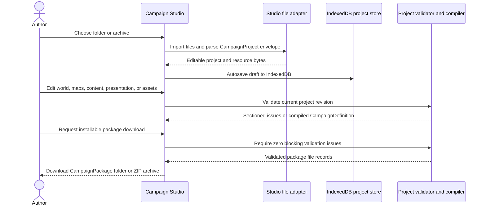
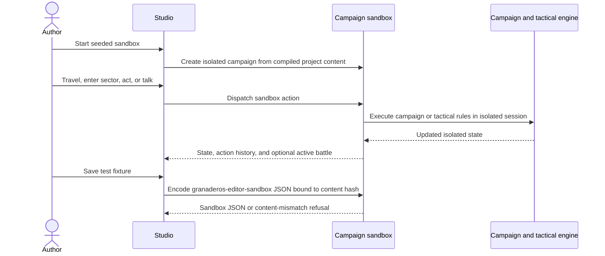

# Campaign authoring use cases

[Architecture guide](../README.md) · [Use-case index](README.md) · [Content and campaigns](../content-and-campaigns.md) · [Build and tooling](../build-and-tooling.md) · [Session/player use cases](session.md) · [Application contracts](application-contracts.md)

This page catalogues the campaign author's intentions in the independent `apps/campaign-editor` application (`/campaign-editor/`) and the repository CLI (`tools/campaign-authoring.mjs`): creating, reopening, duplicating, importing, and exporting project drafts (`CampaignProject`), editing strategic worlds (`CampaignWorld`) and physical sector maps (`CampaignMap` and `SectorMap`), authoring cast, equipment, rules, dialogue, and presentation, running isolated map and campaign playtests, and validating projects before export. It connects the [use-case index](README.md) and [application contracts](application-contracts.md) to the package schemas in [content and campaigns](../content-and-campaigns.md) and the build scripts in [build and tooling](../build-and-tooling.md).

## Ownership and exposure

Every authoring fact has one owner inside `apps/campaign-editor`:

- `CampaignProject` and `CampaignProjectDocument` own project identity, draft envelope invariants, document groups, and base64 resource maps.
- `CampaignProjectHistory` owns bounded undo/redo project snapshots, mutated through `EditCampaignProjectUseCase`, `UndoCampaignProjectEditUseCase`, and `RedoCampaignProjectEditUseCase`.
- `CampaignWorld` owns strategic locality, district, place, route, and deletion-reference draft invariants.
- `CampaignMap` owns the fixed 20x16 campaign map slot and slab admission rules, while `SectorMap` and `SectorMapHistory` own physical map authoring batches (`SectorMapCommand`) applied through `EditSectorMapUseCase`.
- `ValidateCampaignProjectUseCase` inspects a draft through its read-only repository and `packages/game/public/campaign-editor-api.ts` without mutating project state.
- Browser adapters (`campaign-studio-storage.ts` and `campaign-studio-files.ts`) own IndexedDB draft persistence and ZIP/JSON file I/O, while playtests run in isolated sessions via `packages/game/public/campaign-playtest-api.ts`. Neither editor drafts nor editor undo history ever touch live `GameSession` progress.

Every `Exposure` column below uses the canonical six-value vocabulary defined in the [use-case index](README.md#exposure-vocabulary): `Command`, `Gated`, `Query`, `Supporting`, `No interface route`, and `Refused`.

## Summary by authoring journey

The first table below groups authoring intentions by `Family`, lists their `IDs`, summarizes the `Main intent`, and names the primary `Surface`.

| Family | IDs | Main intent | Surface |
| --- | --- | --- | --- |
| Project lifecycle | AUT-001–AUT-006 | Create, reopen, duplicate, import, export, and delete local project drafts | Studio project workspace |
| Edit and review lifecycle | AUT-007–AUT-010 | Rename project identity, undo/redo edits, autosave to IndexedDB, and validate projects | Studio toolbar, persistence, and validation panel |
| World and maps | AUT-011–AUT-015 | Shape the 36x33 strategic world, locality links, 20x16 sector maps, and building templates | Studio World, Maps, and Buildings workspaces; Sector Editor |
| Campaign content | AUT-016–AUT-020 | Author cast, equipment, rules, dialogue, quests, and placements | Studio Content workspace and Story Editor |
| Presentation and resources | AUT-021–AUT-023 | Customize presentation and skirmishes, manage SHA-256 asset bytes, and edit raw fields | Studio Presentation, Resources, and All Documents views |
| Playtest and handoff | AUT-024–AUT-027 | Run single-map or full-campaign sandbox tests, save sandbox fixtures, and launch into the player app | Studio Building preview, Quest Sandbox, and Story Editor launch |
| Standalone editors and CLI | AUT-028–AUT-030 | Edit standalone story or sector documents in the browser, or scaffold/check packages from the CLI | `?workspace=story`, `?workspace=sector`, and `npm run campaign:*` |
| Unsupported ambitions | AUT-031–AUT-032 | Publish to a live multi-user server catalog or execute arbitrary scripts from an imported package | None (`No interface route` / `Refused`) |

The second table below lists every authoring use case (`AUT-001` through `AUT-032`), its canonical `Exposure` value, and its `Intent`.

| ID / intention | Exposure | Intent |
| --- | --- | --- |
| AUT-001 `create-campaign-project` | `Command` | Scaffold a new `CampaignProject` (`granaderos-editor-project`) with starter documents, map index, and guide asset |
| AUT-002 `reopen-local-draft` | `Command` | Restore a saved `CampaignProject` and binary resource blobs from local IndexedDB storage |
| AUT-003 `fork-project-from-draft-or-installed-campaign` | `Command` | Duplicate an existing draft or installed campaign under a new unique campaign ID |
| AUT-004 `import-project-or-package-files` | `Command` | Import a `.project.json` draft, ZIP archive, or package folder into an editable `CampaignProject` |
| AUT-005 `export-project-or-installable-folder` | `Command` | Download the raw `CampaignProject` JSON draft (`Command`) or a validated installable `CampaignPackage` ZIP (`Gated` on passing validation) |
| AUT-006 `delete-local-draft` | `Command` | Delete a saved draft record from the browser's IndexedDB `projects` object store |
| AUT-007 `rename-project-identity` (`EditCampaignProject`) | `Command` | Update the project's campaign ID, display name, and internal asset path references in one revision |
| AUT-008 `undo-or-redo-document-edit` (`UndoCampaignProjectEdit` / `RedoCampaignProjectEdit`) | `Command` | Step backward or forward through `CampaignProjectHistory` or `SectorMapHistory` snapshots |
| AUT-009 `autosave-local-project` | `Supporting` | Debounced background persistence of accepted `CampaignProject` revisions to browser IndexedDB |
| AUT-010 `validate-campaign-project` (`ValidateCampaignProject`) | `Query` | Read-only inspection returning structural, cross-reference, and game-playability diagnostics for the current revision |
| AUT-011 `define-strategic-world` (`EditCampaignProject` / `CampaignWorld`) | `Command` | Edit the 36x33 world grid, biomes, districts, localities, income, and headquarters in `CampaignWorld` |
| AUT-012 `connect-strategic-localities` (`EditCampaignProject` / `CampaignWorld`) | `Command` | Add, move, or remove reciprocal terrestrial and river connections between localities |
| AUT-013 `author-tactical-sector-map` (`EditSectorMap` / `SectorMap`) | `Command` | Apply atomic `SectorMapCommand` batches to terrain, walls, buildings, openings, props, spawns, and climb links |
| AUT-014 `construct-and-template-building` (`EditSectorMap` / `EditCampaignProject`) | `Command` | Build multi-level structures and save or apply reusable building templates |
| AUT-015 `inspect-map-validation-and-preview` | `Query` | Inspect map schema/playability diagnostics and view the 3D sector geometry preview |
| AUT-016 `author-campaign-cast-and-encounters` (`EditCampaignProject`) | `Command` | Create and edit character definitions, ratings, traits, capabilities, appearances, and recruitment rules |
| AUT-017 `define-equipment-and-force` (`EditCampaignProject`) | `Command` | Configure portable weapons, artillery profiles, outfits, and starting force equipment |
| AUT-018 `author-campaign-rules-and-roles` (`EditCampaignProject`) | `Command` | Configure starting territory, contract pricing, medical care, militia, logistics, foundry, and campaign roles |
| AUT-019 `author-dialogue-quests-and-story` (`EditCampaignProject`) | `Command` | Edit chapters, quests, errands, and dialogue trees using allowlisted condition and effect types |
| AUT-020 `author-placements-and-arrival` (`EditCampaignProject`) | `Command` | Configure character placements, arrival sites, and scene anchor references |
| AUT-021 `customize-campaign-presentation` (`EditCampaignProject`) | `Command` | Configure title/menu text, artwork references, introduction scenes, manual copy, and optional sample skirmish |
| AUT-022 `manage-campaign-resources` (`EditCampaignProject`) | `Command` | Add, replace, rename, or remove packaged image/JSON resources and update `assets.json` SHA-256 digests |
| AUT-023 `edit-advanced-document-fields` (`EditCampaignProject`) | `Command` | Edit raw schema fields across project documents through the ”Todos los documentos” inspector |
| AUT-024 `playtest-one-authored-map` | `Gated` | Mount an in-memory tactical battle on the current authored map when map validation passes |
| AUT-025 `exercise-full-campaign-sandbox` | `Gated` | Run an isolated strategic and tactical campaign playtest in Quest Sandbox when the project compiles |
| AUT-026 `persist-or-reopen-campaign-sandbox` | `Gated` | Export or re-import a `granaderos-editor-sandbox` test fixture bound to the project's content identity hash |
| AUT-027 `launch-story-draft-in-player-app` | `Gated` | Hand off a compiled initial campaign save via `sessionStorage` to open `/apps/web` at `?content=1&launch=1` |
| AUT-028 `edit-story-document-standalone` | `Command` | Edit narrative and content definitions in the focused `/campaign-editor/?workspace=story` view |
| AUT-029 `edit-map-json-standalone` (`EditSectorMap`) | `Command` | Edit, import, or export a standalone sector map JSON document in `/campaign-editor/?workspace=sector` |
| AUT-030 `scaffold-check-or-refresh-package-from-cli` | `No interface route` | Run `npm run campaign:new`, `campaign:check`, or `campaign:assets` from the terminal (CLI-only, no browser control) |
| AUT-031 `publish-arbitrary-user-campaign-to-live-catalog` | `No interface route` | Live server upload/catalog publishing is absent; the browser application is a static export |
| AUT-032 `execute-imported-campaign-script` | `Refused` | Schema and compiler validation reject unallowlisted scenario identifiers and never execute imported scripts |

## Authoring catalogue details

### Project lifecycle (AUT-001 to AUT-006)

- **AUT-001 (`create-campaign-project`):** Takes a unique lowercase campaign ID and display name, builds a `granaderos-editor-project` via [`project-scaffold.ts`](../../../apps/campaign-editor/infrastructure/project-scaffold.ts) and [`CampaignProject`](../../../apps/campaign-editor/domain/campaign-project.ts), and opens it in Studio ([`apps/campaign-editor/web/app/studio/page.tsx`](../../../apps/campaign-editor/web/app/studio/page.tsx)). Refuses reserved IDs (such as `granaderos`) or duplicate local IDs with a `CampaignEditorRefusal`.
- **AUT-002 (`reopen-local-draft`):** Loads a saved project envelope and binary `Blob` resources from IndexedDB (`granaderos.campaign-studio.v1`) via [`campaign-studio-storage.ts`](../../../apps/campaign-editor/web/lib/campaign-studio-storage.ts).
- **AUT-003 (`fork-project-from-draft-or-installed-campaign`):** Clones a local draft or an installed campaign loaded via [`apps/campaign-editor/web/lib/campaign-library.ts`](../../../apps/campaign-editor/web/lib/campaign-library.ts) under a new campaign ID and resets `CampaignProjectHistory`. Duplicating the historical campaign converts its scenario to `generic-v1`.
- **AUT-004 (`import-project-or-package-files`):** Parses a `.project.json` file, ZIP archive, or folder selection through [`campaign-studio-files.ts`](../../../apps/campaign-editor/web/lib/campaign-studio-files.ts), enforcing path safety, file-size limits, and single-manifest presence. Incomplete or rule-invalid packages remain editable as drafts while `ValidateCampaignProject` reports their issues.
- **AUT-005 (`export-project-or-installable-folder`):** Exports either a `.project.json` draft file (`encodeCampaignProject`) at any time or a validated installable `CampaignPackage` ZIP archive (`exportCampaignArchive`), which is gated on zero blocking errors from `ValidateCampaignProjectUseCase`.
- **AUT-006 (`delete-local-draft`):** After confirmation, removes the selected draft from IndexedDB in [`campaign-studio-storage.ts`](../../../apps/campaign-editor/web/lib/campaign-studio-storage.ts) without affecting installed campaigns or player `localStorage` saves.

### Edit and review lifecycle (AUT-007 to AUT-010)

- **AUT-007 (`rename-project-identity`):** Applies a new campaign ID and name across the manifest, content documents, and internal asset paths through `EditCampaignProjectUseCase` and `CampaignProject`.
- **AUT-008 (`undo-or-redo-document-edit`):** Invokes [`UndoCampaignProjectEditUseCase`](../../../apps/campaign-editor/application/undo-campaign-project-edit/undo-campaign-project-edit.use-case.ts) or [`RedoCampaignProjectEditUseCase`](../../../apps/campaign-editor/application/redo-campaign-project-edit/redo-campaign-project-edit.use-case.ts) (or `SectorMapHistory` in the map editor) to restore the previous or next admitted snapshot (up to 50 retained steps) without advancing game time.
- **AUT-009 (`autosave-local-project`):** Supporting persistence hook in Studio that writes accepted `CampaignProject` revisions to IndexedDB and stores the active project ID in `localStorage`.
- **AUT-010 (`validate-campaign-project`):** Read-only query [`ValidateCampaignProjectUseCase`](../../../apps/campaign-editor/application/validate-campaign-project/validate-campaign-project.use-case.ts) backed by [`project-validation.js`](../../../apps/campaign-editor/infrastructure/project-validation.js) and [`packages/game/public/campaign-editor-api.ts`](../../../packages/game/public/campaign-editor-api.ts). It checks `CampaignDefinition` schemas, `CampaignContentSchema`, map dimensions and playability, and asset SHA-256 catalogs, returning diagnostics tagged with the inspected project revision.

### World and tactical-map authoring (AUT-011 to AUT-015)

- **AUT-011 (`define-strategic-world`) and AUT-012 (`connect-strategic-localities`):** [`WorldWorkspace.tsx`](../../../apps/campaign-editor/web/app/studio/WorldWorkspace.tsx) and [`CampaignWorld`](../../../apps/campaign-editor/domain/campaign-world.js) (with [`world-editing.js`](../../../apps/campaign-editor/infrastructure/world-editing.js)) edit the 36x33 world grid, terrain biomes, districts, localities, headquarters, reciprocal road/river links, and deletion-reference guards, committing changes through `EditCampaignProjectUseCase`.
- **AUT-013 (`author-tactical-sector-map`) and AUT-014 (`construct-and-template-building`):** [`MapWorkspace.tsx`](../../../apps/campaign-editor/web/app/studio/MapWorkspace.tsx), [`BuildingWorkspace.tsx`](../../../apps/campaign-editor/web/app/studio/BuildingWorkspace.tsx), and [`SectorEditor.tsx`](../../../apps/campaign-editor/web/app/editor/SectorEditor.tsx) submit atomic `SectorMapCommand` batches to [`EditSectorMapUseCase`](../../../apps/campaign-editor/application/edit-sector-map/edit-sector-map.use-case.ts), which validates the expected map revision and mutates [`SectorMap`](../../../apps/campaign-editor/domain/sector-map.js) and [`SectorMapHistory`](../../../apps/campaign-editor/domain/sector-map-history.js). When editing inside a campaign project, [`CampaignMap`](../../../apps/campaign-editor/domain/campaign-map.js) enforces the slot's campaign ID and 20x16 dimensions.
- **AUT-015 (`inspect-map-validation-and-preview`):** Read-only query that compiles map geometry via `packages/game/public/campaign-editor-api.ts` and renders the 3D scene through [`apps/web/game-preview.ts`](../../../apps/web/game-preview.ts).

### Cast, rules, story, presentation, and resources (AUT-016 to AUT-023)

- **AUT-016 (`author-campaign-cast-and-encounters`):** [`ContentWorkspace.tsx`](../../../apps/campaign-editor/web/app/studio/ContentWorkspace.tsx) and [`ContentEditor.tsx`](../../../apps/campaign-editor/web/app/story/ContentEditor.tsx) edit character definitions, 0–100 ratings, traits, capabilities, portraits, and recruitment terms.
- **AUT-017 (`define-equipment-and-force`):** [`ForceEquipment.tsx`](../../../apps/campaign-editor/web/app/story/ForceEquipment.tsx) and [`ArtilleryProfiles.tsx`](../../../apps/campaign-editor/web/app/story/ArtilleryProfiles.tsx) edit weapon definitions, ammunition families, artillery profiles, and starting force loadouts.
- **AUT-018 (`author-campaign-rules-and-roles`):** [`CampaignRules.tsx`](../../../apps/campaign-editor/web/app/story/CampaignRules.tsx), [`StartingTerritory.tsx`](../../../apps/campaign-editor/web/app/story/StartingTerritory.tsx), [`ContractRules.tsx`](../../../apps/campaign-editor/web/app/story/ContractRules.tsx), [`CareRules.tsx`](../../../apps/campaign-editor/web/app/story/CareRules.tsx), [`MilitiaRules.tsx`](../../../apps/campaign-editor/web/app/story/MilitiaRules.tsx), [`FoundryRules.tsx`](../../../apps/campaign-editor/web/app/story/FoundryRules.tsx), and [`CampaignRoles.tsx`](../../../apps/campaign-editor/web/app/story/CampaignRoles.tsx) edit scenario-supported rule parameters.
- **AUT-019 (`author-dialogue-quests-and-story`) and AUT-020 (`author-placements-and-arrival`):** [`CampaignStory.tsx`](../../../apps/campaign-editor/web/app/story/CampaignStory.tsx), [`DialogueEditor.tsx`](../../../apps/campaign-editor/web/app/story/DialogueEditor.tsx), [`QuestEditor.tsx`](../../../apps/campaign-editor/web/app/story/QuestEditor.tsx), [`PlacementMap.tsx`](../../../apps/campaign-editor/web/app/story/PlacementMap.tsx), and [`ArrivalSites.tsx`](../../../apps/campaign-editor/web/app/story/ArrivalSites.tsx) author chapters, dialogue trees, quests, character placements, and arrival anchors.
- **AUT-021 (`customize-campaign-presentation`), AUT-022 (`manage-campaign-resources`), and AUT-023 (`edit-advanced-document-fields`):** [`PresentationWorkspace.tsx`](../../../apps/campaign-editor/web/app/studio/PresentationWorkspace.tsx), [`AssetsWorkspace.tsx`](../../../apps/campaign-editor/web/app/studio/AssetsWorkspace.tsx), and [`FieldEditor.tsx`](../../../apps/campaign-editor/web/app/studio/FieldEditor.tsx) edit presentation settings, binary asset catalogs with SHA-256 digests, and full document JSON trees through `EditCampaignProjectUseCase`.

### Playtest, handoff, standalone tools, and limits (AUT-024 to AUT-032)

- **AUT-024 (`playtest-one-authored-map`):** Gated on valid map compilation; runs an in-memory tactical battle in `SectorEditor.tsx` / `BuildingWorkspace.tsx` via `packages/game/public/campaign-editor-api.ts` and `apps/web/game-preview.ts`.
- **AUT-025 (`exercise-full-campaign-sandbox`) and AUT-026 (`persist-or-reopen-campaign-sandbox`):** Gated on project compilation; [`QuestSandbox.tsx`](../../../apps/campaign-editor/web/app/studio/QuestSandbox.tsx) calls [`packages/game/public/campaign-playtest-api.ts`](../../../packages/game/public/campaign-playtest-api.ts) to run an isolated strategic and tactical session and export or re-import a `granaderos-editor-sandbox` JSON fixture (bounded to 2,000 action history entries and verified against the project's content identity hash).
- **AUT-027 (`launch-story-draft-in-player-app`):** Gated on valid content and asset hashes; writes a one-time initial campaign save to `sessionStorage` (`granaderos.content-launch.v1`) and navigates to the player app with `?content=1&launch=1` (consumed by SES-008).
- **AUT-028 (`edit-story-document-standalone`) and AUT-029 (`edit-map-json-standalone`):** Focused browser routes `/campaign-editor/?workspace=story` ([`apps/campaign-editor/web/app/story/page.tsx`](../../../apps/campaign-editor/web/app/story/page.tsx)) and `/campaign-editor/?workspace=sector` ([`apps/campaign-editor/web/app/editor/page.tsx`](../../../apps/campaign-editor/web/app/editor/page.tsx)).
- **AUT-030 (`scaffold-check-or-refresh-package-from-cli`):** `No interface route` in the browser; developer CLI commands `npm run campaign:new`, `npm run campaign:check`, and `npm run campaign:assets` in [`tools/campaign-authoring.mjs`](../../../tools/campaign-authoring.mjs).
- **AUT-031 (`publish-arbitrary-user-campaign-to-live-catalog`):** `No interface route`; static deployment has no backend upload server or shared live database.
- **AUT-032 (`execute-imported-campaign-script`):** `Refused`; a campaign package contains structured data and must select an allowlisted scenario (`generic-v1` or `granaderos-historical-v1`). [`CampaignDefinition`](../../../packages/campaign-format/campaign-definition.ts) admits the file contract and [`CampaignCompiler`](../../../packages/game/application/campaign-compiler/README.md) validates and resolves it; imported scripts are not executed.

## Worked use case: import, edit, validate, and export a package

**Actor:** Campaign author adapting a package (AUT-004, AUT-009, AUT-010, AUT-005). **Preconditions:** Source archive or folder contains a valid `manifest.json` and referenced documents. **Request:** Import the folder or archive, edit project documents, run validation, and export an installable package archive.

The sequence diagram below traces how the `Author`, `Campaign Studio`, `Studio file adapter`, `IndexedDB project store`, and `Project validator and compiler` (`ValidateCampaignProjectUseCase`) import, autosave, validate, and export a campaign package.

**Success result:** The exported archive contains `manifest.json`, the five JSON documents, all referenced map JSON files, and SHA-256-verified resource bytes. **Refusal:** If `ValidateCampaignProjectUseCase` reports any blocking error, installable package export is refused while raw `.project.json` draft export and IndexedDB autosave remain available.

## Worked use case: test a change without altering the authored draft

**Actor:** Campaign author testing quest and battle progression (AUT-025, AUT-026). **Precondition:** The current `CampaignProject` compiles without blocking errors. **Request:** Start a seeded Quest Sandbox session, dispatch strategic and tactical actions, and save a reproducible sandbox fixture.

The sequence diagram below shows how the `Author`, `Studio` (`QuestSandbox.tsx`), `Campaign sandbox` (`packages/game/public/campaign-playtest-api.ts`), and `Campaign and tactical engine` run an isolated playtest and encode a sandbox fixture.

**Success result:** The sandbox state and action history export as a `granaderos-editor-sandbox` JSON file that can be reopened while the project's content identity hash matches. **Refusal:** If subsequent project edits change the content identity hash, importing the older sandbox fixture is refused until the sandbox is reset.
