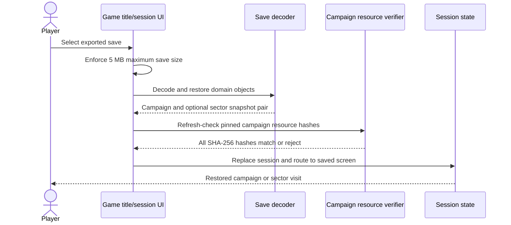
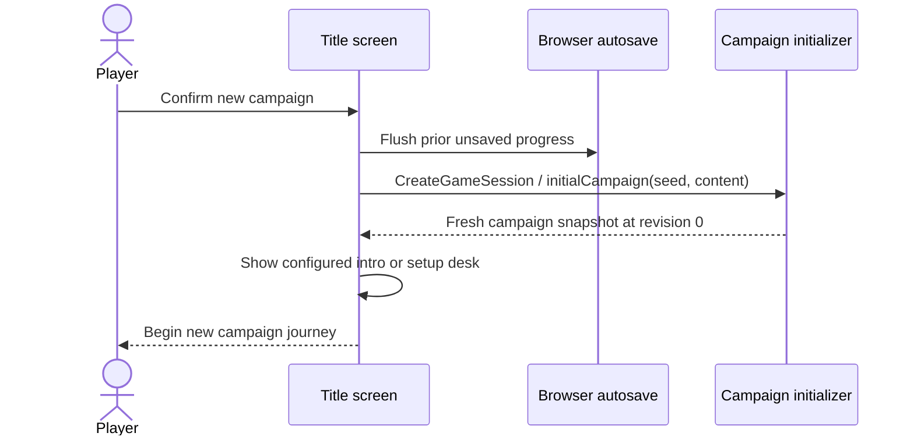

# Session and player use cases

[Architecture guide](../README.md) · [Use-case index](README.md) · [Strategic play](strategic.md) · [Tactical play](tactical.md) · [Authoring](authoring.md) · [Persistence](../persistence.md)

This page catalogues the session-level player intentions in the browser application (`apps/web/app/page.tsx`): selecting an installed campaign, starting or resuming a `GameSession`, exporting or importing portable saves, inspecting save status, launching sample skirmishes or editor handoffs, and using presentation or Model Context controls. It connects the [use-case index](README.md) and [application contracts](application-contracts.md) to the campaign and sector catalogues ([strategic.md](strategic.md) and [tactical.md](tactical.md)) and the storage details in [persistence](../persistence.md).

Every `Exposure` column below uses the canonical six-value vocabulary defined in the [use-case index](README.md#exposure-vocabulary) (`Command`, `Gated`, `Query`, `Supporting`, `No interface route`, and `Refused`). Documentation IDs (`SES-001` through `SES-012`) are stable catalogue identifiers rather than runtime API symbols.

## Summary by intention

The table below lists each session use case by `ID`, its `Intent`, its `Exposure` classification, and `Notes and preconditions`.

| ID | Intent | Exposure | Notes and preconditions |
| --- | --- | --- | --- |
| SES-001 | Choose and check an installed campaign | `Command` | Available in the title campaign selector and via `?campaign=<id>` |
| SES-002 | Start a new campaign (`CreateGameSession`) | `Command` | Initializes a new `GameSession`; may open an introduction, officer creation, or recruitment desk |
| SES-003 | Read, skip, revisit, or replay campaign introduction | `Gated` | Offered only when `presentation.introduction` defines scenes |
| SES-004 | Continue in-browser campaign or sector progress (`RestoreGame`) | `Command` | Restores current in-memory session or decodes the campaign's `localStorage` save |
| SES-005 | Export progress to a portable file (`SaveGame`) | `Command` | Available whenever an active campaign exists |
| SES-006 | Import a previously exported save (`RestoreGame`) | `Command` | Enforces the 5 MB limit, validates invariants, and checks campaign asset SHA-256 hashes |
| SES-007 | Launch a configured sample skirmish | `Gated` | Offered only when `presentation.skirmish` is configured |
| SES-008 | Launch editor content into the player application | `Supporting` | One-time `sessionStorage` handoff from the Story Editor (`content=1&launch=1`) |
| SES-009 | Consult campaign manual and toggle battlefield audio | `Supporting` | Presentation and audio controls that do not mutate `GameSession` state |
| SES-010 | Query player-known state or issue a tactical order via Model Context | `Gated` | Registered only when the browser host provides `document.modelContext.registerTool` |
| SES-011 | Preserve progress in browser storage (`SaveGame`) | `Supporting` | Background autosave queue (`useCampaignAutosave`) under an exclusive Web Lock |
| SES-012 | Inspect current save status (`GetSaveStatus`) | `Query` | Read-only query returning accepted and persisted revisions and storage status |

## Catalogue

### Select and start

#### SES-001 — choose-and-check-installed-campaign

* **Actor / intent:** Player selects a campaign from the installed campaign registry before starting or resuming play.
* **Request:** Choose an entry in the title-screen campaign selector or open the application with a `?campaign=<id>` query parameter.
* **Result / state:** `loadCampaignRegistry` and `loadInstalledCampaign` resolve the registry entry, fetch `manifest.json` and the five referenced JSON documents plus map files, compile the `CampaignDefinition` via `compileCampaignPackage`, check referenced asset SHA-256 digests (`verifyCampaignResources`), update the URL, and apply the campaign's title presentation.
* **Guards / refusal:** Registry fetch errors, manifest identity mismatches, schema or playability errors, or SHA-256 asset mismatches refuse the selection and display an error notice; request-generation tracking discards stale concurrent loads.
* **UI / source:** [`apps/web/app/page.tsx`](../../../apps/web/app/page.tsx) (`loadCampaignRegistry`, `chooseCampaign`, `selectCampaignURL`), [`apps/web/lib/campaign-library.ts`](../../../apps/web/lib/campaign-library.ts), and [content and campaigns](../content-and-campaigns.md).

#### SES-002 — start-new-campaign (`CreateGameSession`)

* **Actor / intent:** Player starts a fresh campaign from the selected `CampaignDefinition`.
* **Request:** Activate “Nueva campaña” (and confirm replacing any existing browser save for that campaign).
* **Result / state:** [`CreateGameSessionUseCase`](../../../packages/game/application/create-game-session/README.md) (via `packages/game/public/game-persistence-api.ts` and `initialCampaign` in `packages/game/campaign.js`) creates a fresh campaign snapshot with a new `GameSession` identity and revision `0`, flushes or replaces the prior autosave key, and routes to the campaign introduction, officer creation, or recruitment desk.
* **Guards / refusal:** Refused if campaign definitions are not loaded or fail initialization.
* **UI / source:** [`apps/web/app/page.tsx`](../../../apps/web/app/page.tsx) (`newCampaign`, `startCampaign`, `completeIntro`), [`packages/game/public/game-persistence-api.ts`](../../../packages/game/public/game-persistence-api.ts), and [`packages/game/campaign.js`](../../../packages/game/campaign.js) (`initialCampaign`).

#### SES-003 — review-campaign-introduction

* **Actor / intent:** Player views, pauses, skips, or replays the campaign's authored introduction scenes.
* **Request:** Start a new campaign that defines `presentation.introduction`, or select the replay control from the title screen.
* **Result / state:** Completing the introduction on a new campaign advances to officer creation or recruitment; replaying from the title screen returns to the prior screen without mutating or resetting `GameSession` progress.
* **Guards / refusal:** Gated; absent when `presentation.introduction` has no scenes.
* **UI / source:** [`apps/web/app/CampaignIntro.tsx`](../../../apps/web/app/CampaignIntro.tsx), [`apps/web/app/page.tsx`](../../../apps/web/app/page.tsx), and [`apps/campaign-editor/web/app/studio/PresentationWorkspace.tsx`](../../../apps/campaign-editor/web/app/studio/PresentationWorkspace.tsx).

#### SES-007 — launch-configured-sample-skirmish

* **Actor / intent:** Player plays a standalone sample battle configured by the campaign without starting a strategic campaign.
* **Request:** Activate the title-screen skirmish button when `presentation.skirmish` is present.
* **Result / state:** Creates a temporary seeded campaign context, builds a sector snapshot via `battleFromRequest` (`packages/game/battle-handoff.js`), and opens `Battlefield` without overwriting the campaign's persistent `localStorage` save.
* **Guards / refusal:** Gated by `presentation.skirmish`; invalid or empty skirmish configuration refuses launch.
* **UI / source:** [`apps/web/app/page.tsx`](../../../apps/web/app/page.tsx) (`skirmish`) and [`packages/game/battle-handoff.js`](../../../packages/game/battle-handoff.js).

### Continue and preserve progress

#### SES-004 — resume-current-session (`RestoreGame`)

* **Actor / intent:** Player continues the active in-memory session or restores the browser's saved progress from `localStorage`.
* **Request:** Activate “Continuar campaña” on the title screen.
* **Result / state:** [`RestoreGameUseCase`](../../../packages/game/application/restore-game/README.md) and [`GameSnapshotMapper`](../../../packages/game/infrastructure/persistence/game-snapshot-mapper.js) decode and restore canonical domain objects (`GameSession`, `Character`, `Health`, `ServiceContract`, `Squad`, `Journey`, `SectorSession`, `CombatSession`, `Inventory`, `WorldTimeline`) without repeating creation effects, `verifyCampaignResources` checks asset SHA-256 digests with `refresh: true`, and the UI opens the restored desk, strategic map, or sector visit.
* **Guards / refusal:** Refuses malformed saves, mismatched campaign origins, clock/participant inconsistencies, or missing/altered campaign assets, leaving the existing session untouched.
* **UI / source:** [`apps/web/app/page.tsx`](../../../apps/web/app/page.tsx) (`resume`), [`packages/game/application/restore-game/restore-game.use-case.ts`](../../../packages/game/application/restore-game/restore-game.use-case.ts), [`packages/game/infrastructure/persistence/game-snapshot-mapper.js`](../../../packages/game/infrastructure/persistence/game-snapshot-mapper.js), and [`apps/web/lib/campaign-library.ts`](../../../apps/web/lib/campaign-library.ts).

#### SES-005 — export-session-save (`SaveGame`)

* **Actor / intent:** Player downloads a portable JSON save file for backup or cross-device transfer.
* **Request:** Activate the export button in the game header while a campaign is active.
* **Result / state:** Calls `encodeSave(campaign, battle)` ([`packages/game/save.ts`](../../../packages/game/save.ts)) and downloads the versioned JSON envelope named after the campaign ID and campaign day.
* **Guards / refusal:** Requires an active campaign snapshot and enforces the 5 MB encoded size limit (`packages/game/save-limits.js`).
* **UI / source:** [`apps/web/app/page.tsx`](../../../apps/web/app/page.tsx) (`exportSave`) and [`packages/game/save.ts`](../../../packages/game/save.ts).

#### SES-006 — import-session-save (`RestoreGame`)

* **Actor / intent:** Player restores progress from an exported JSON save file.
* **Request:** Select a `.json` save file from the title or session controls.
* **Result / state:** Checks the 5 MB file size limit, runs [`RestoreGameUseCase`](../../../packages/game/application/restore-game/README.md) and `GameSnapshotMapper`, refresh-checks campaign asset SHA-256 digests via `verifyCampaignResources`, replaces the active in-memory session and autosave context, increments the battle view key so `Battlefield` remounts cleanly, and routes to the restored screen.
* **Guards / refusal:** Oversized files, invalid JSON or schema versions, invariant failures, or mismatched asset hashes reject the import with an error notice and preserve the current session.
* **UI / source:** [`apps/web/app/page.tsx`](../../../apps/web/app/page.tsx) (`importSave`), [`packages/game/save.ts`](../../../packages/game/save.ts), and [`packages/game/save-limits.js`](../../../packages/game/save-limits.js).

#### SES-011 — retain-progress-in-browser (`SaveGame`)

* **Actor / intent:** Background persistence process that writes accepted campaign and sector state changes to browser `localStorage`.
* **Request:** Triggered when the committed campaign or battle snapshot changes in `apps/web/app/page.tsx`.
* **Result / state:** [`useCampaignAutosave.ts`](../../../apps/web/lib/useCampaignAutosave.ts) queues encoding in [`campaign-save-worker.ts`](../../../apps/web/lib/campaign-save-worker.ts) (with inline fallback) and persists the snapshot through [`SaveGameUseCase`](../../../packages/game/application/save-game/README.md) and [`browser-save-writer.ts`](../../../apps/web/lib/browser-save-writer.ts) under an exclusive per-key Web Lock.
* **Guards / refusal:** Stale worker replies are discarded; if another tab holds the Web Lock or `localStorage` quota fails, accepted in-memory progress remains playable and the UI reports `blocked` or `failed` status so the player can export a file via SES-005.
* **UI / source:** [`apps/web/lib/useCampaignAutosave.ts`](../../../apps/web/lib/useCampaignAutosave.ts), [`apps/web/lib/browser-save-writer.ts`](../../../apps/web/lib/browser-save-writer.ts), and [`packages/game/content-launch.ts`](../../../packages/game/content-launch.ts).

#### SES-012 — inspect-save-status (`GetSaveStatus`)

* **Actor / intent:** Player or UI header inspects whether the current in-memory `gameRevision` has been persisted to `localStorage`.
* **Request:** Read-only query via [`GetSaveStatusUseCase`](../../../packages/game/application/get-save-status/README.md) (`GetSaveStatusRepository`).
* **Result / state:** Returns a `SaveStatus` view record (`{ state, accepted, persisted, message }` with `state`: `'unsaved' | 'saving' | 'saved' | 'blocked' | 'failed'`) rendered by [`apps/web/app/SaveProgress.tsx`](../../../apps/web/app/SaveProgress.tsx). It never returns a mutable domain object or advances game time.
* **Guards / refusal:** `SaveProgress.tsx` displays `status.state` (showing `Guardado` when `status.state === 'saved'`) only when `status.accepted` matches the current `sessionId` and `revision`; otherwise it falls back to `unsaved` (`Sin guardar`).
* **UI / source:** [`packages/game/application/get-save-status/get-save-status.use-case.ts`](../../../packages/game/application/get-save-status/get-save-status.use-case.ts), [`packages/game/infrastructure/persistence/save-status-repository.ts`](../../../packages/game/infrastructure/persistence/save-status-repository.ts), and [`apps/web/app/SaveProgress.tsx`](../../../apps/web/app/SaveProgress.tsx).

### Connect an authoring session and supporting integrations

#### SES-008 — launch-editor-content

* **Actor / intent:** Campaign author launches an authored content draft from the Story Editor into the player application for interactive testing.
* **Request:** Trigger the Story Editor launch action, which writes a one-time initial campaign save to `sessionStorage` (`granaderos.content-launch.v1`) and opens the player app with `?content=1&launch=1`.
* **Result / state:** `apps/web/app/page.tsx` reads and deletes the one-time `sessionStorage` payload, requires valid campaign content with no active battle, checks resource hashes, and opens the headquarters desk under a content-specific `localStorage` key (`granaderos.content-campaign.v2.<id>.<hash>`).
* **Guards / refusal:** Missing or stale `sessionStorage` payloads, included battle snapshots, or resource check failures reject the launch and display a notice.
* **UI / source:** [`apps/campaign-editor/web/app/story/ContentEditor.tsx`](../../../apps/campaign-editor/web/app/story/ContentEditor.tsx), [`packages/game/content-launch.ts`](../../../packages/game/content-launch.ts), and [`apps/web/app/page.tsx`](../../../apps/web/app/page.tsx).

#### SES-009 — consult-manual-and-toggle-audio

* **Actor / intent:** Player reads the campaign manual overlay or toggles battlefield audio.
* **Request:** Click the help or audio controls in the game interface.
* **Result / state:** Displays campaign-specific or fallback manual guidance and toggles [`apps/web/lib/battle-audio.ts`](../../../apps/web/lib/battle-audio.ts) (`BattleAudio`) without mutating `GameSession` state.
* **Guards / refusal:** Browser autoplay policies may block audio activation until user interaction.
* **UI / source:** [`apps/web/app/page.tsx`](../../../apps/web/app/page.tsx) and [`apps/web/lib/battle-audio.ts`](../../../apps/web/lib/battle-audio.ts).

#### SES-010 — query-player-known-state-or-issue-tactical-order

* **Actor / intent:** A browser host supporting `document.modelContext` queries player-known game state or issues an allowlisted tactical command.
* **Request:** Invoke `read_granaderos_state` (`Query`) or `issue_granaderos_tactical_order` (`Gated` command) registered by `apps/web/app/page.tsx`.
* **Result / state:** `read_granaderos_state` returns a player-known view projection via [`packages/game/player-known-state.ts`](../../../packages/game/player-known-state.ts) without exposing hidden units or domain objects. `issue_granaderos_tactical_order` executes an allowlisted tactical action during an active sector visit and commits the resulting state.
* **Guards / refusal:** Not registered when `document.modelContext.registerTool` is absent; tactical orders are refused when no sector visit is active, while animation playback is busy, or when the order fails tactical validation.
* **UI / source:** [`apps/web/app/page.tsx`](../../../apps/web/app/page.tsx), [`apps/web/app/browser-tools.ts`](../../../apps/web/app/browser-tools.ts), and [`packages/game/player-known-state.ts`](../../../packages/game/player-known-state.ts).

## Worked use case: restore a campaign safely

**Actor:** Player with an exported JSON save file. **Precondition:** The target campaign's referenced assets are available. **Request:** Select a JSON save file via SES-006.

The sequence diagram below shows how the `Player`, `Game title/session UI`, `Save decoder` (`RestoreGameUseCase` and `GameSnapshotMapper`), `Campaign resource verifier` (`verifyCampaignResources`), and `Session state` validate and install an imported save.

**Success result:** The restored `GameSession`, campaign snapshot, and optional `SectorSession` become active and the browser URL and storage key update to match. **Refusals:** Oversized files, schema or relationship failures, or asset hash mismatches leave the prior active session intact and surface a notice.

## Worked use case: begin a fresh campaign

**Actor:** Player starting a new campaign run (SES-002). **Precondition:** An installed campaign package is loaded and its asset hashes match. **Request:** Confirm replacement of any existing browser autosave and start.

The sequence diagram below traces how the `Player`, `Title screen`, `Browser autosave`, and `Campaign initializer` (`CreateGameSessionUseCase` and `initialCampaign`) start a new campaign session.

**Success result:** A new `GameSession` replaces the prior autosave context for that campaign key and opens the introduction or headquarters desk. **Refusal:** Missing content or initialization failure leaves the title screen active and displays an error notice.
