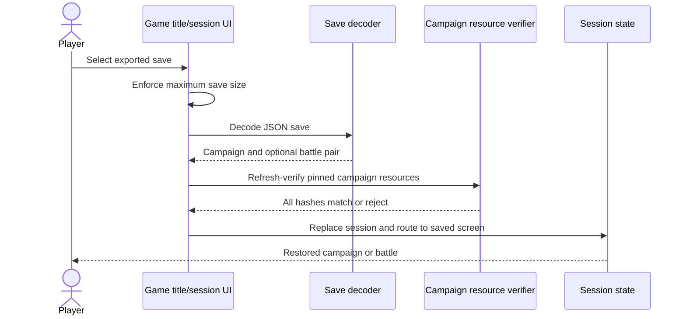
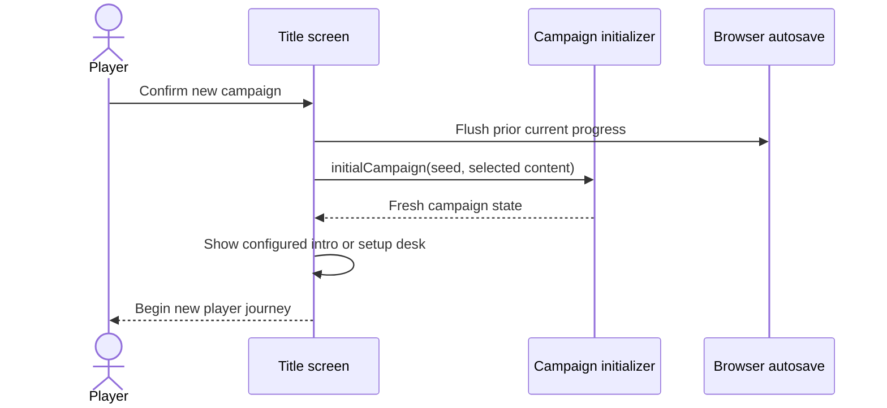

# Session and player use cases

**Architecture:** [Overview](../README.md) · [Strategic engine](../strategic-engine.md) · [Tactical engine](../tactical-engine.md) · [Persistence](../persistence.md) · [Authoring use cases](authoring.md)

This catalogue describes player-facing business intentions in the current browser application: selecting playable content, starting/resuming a session, retaining or moving progress, and reaching supporting controls. It does not restate strategic orders or tactical combat actions; those are covered by the linked engine guides. IDs are stable documentation identifiers, not API routes or code symbols.

## Summary by intention

| ID | Intent | Availability |
| --- | --- | --- |
| SES-001 | Choose and verify an installed campaign | Playable, current |
| SES-002 | Start a new campaign | Playable, current; may branch to character creation or hiring |
| SES-003 | Read, skip, revisit, or replay campaign introduction | Conditional on authored introduction |
| SES-004 | Continue in-browser campaign or battle progress | Playable, current; save may be absent or invalid |
| SES-005 | Export progress for safekeeping or transfer | Playable, current when a campaign exists |
| SES-006 | Import a previously exported save | Playable, current; file and campaign resources must validate |
| SES-007 | Launch a configured sample skirmish | Conditional on campaign presentation configuration |
| SES-008 | Launch editor content into the player application | Supporting authoring handoff; requires valid launch payload |
| SES-009 | Consult help and control audio | Supporting presentation controls, not campaign business transactions |
| SES-010 | Query visible game state or request tactical orders through Model Context | Conditional on browser host integration; not a normal visible menu flow |
| SES-011 | Preserve progress automatically in this browser | Supporting process owned by session persistence |

### Availability vocabulary

* **Playable, current** — an exposed current UI flow with implemented game behavior.
* **Conditional** — implemented, but appears or succeeds only when content or browser/session conditions are met.
* **Query/read-only** — reports player-known state without changing game state.
* **Supporting/internal** — process behavior that enables another business intention, not an independent player objective.
* **Disabled/future** — visible/declared UI may exist, but current code explicitly disables the action or does not implement the behavior. This catalogue does not promote disabled controls into available use cases.

## Catalogue

### Select and start

#### SES-001 — choose-and-verify-installed-campaign

* **Actor / intent:** Player chooses a campaign available in the installed campaign registry before play.
* **Request:** Select an entry from the title-screen campaign selector, or open the game with a campaign query parameter.
* **Result / state:** Registry entry is resolved; manifest and documents are loaded and compiled; resource bytes are checked; selected identity is reflected in the URL and the title presentation comes from that campaign.
* **Guards / refusal:** Registry fetch, manifest identity mismatch, unsupported content, missing asset, or hash mismatch yields an error; campaign load sequencing ignores stale concurrent responses. The chooser contains installed registry campaigns, not arbitrary filesystem packages.
* **UI / implementation:** [`web/app/page.tsx`](../../../web/app/page.tsx) (`loadCampaignRegistry`, `chooseCampaign`, `selectCampaignURL`); [`web/lib/campaign-library.ts`](../../../web/lib/campaign-library.ts); package contract [content and campaigns](../content-and-campaigns.md).
* **Availability:** Playable, current.

#### SES-002 — start-new-campaign

* **Actor / intent:** Player starts a fresh strategic campaign from installed campaign content.
* **Request:** Choose “Nueva campaña”; if a save/session is already available, confirm the replacement warning. On first use, the app takes the player directly to its opening path.
* **Result / state:** `initialCampaign` creates fresh progress from the selected campaign definitions; a campaign launch identity is placed in the URL and the app opens the desk or introduction flow. The previous auto-save is flushed/replaced; export first if it must be retained.
* **Guards / refusal:** Requires installed/loaded campaign content, except the content-editor handoff path. Invalid setup/content is reported as a notice. Intro choice may lead to “hire” or “create” based on campaign presentation.
* **UI / implementation:** [`web/app/page.tsx`](../../../web/app/page.tsx) (`newCampaign`, `startCampaign`, `completeIntro`); [`game/campaign.js`](../../../game/campaign.js) (`initialCampaign`).
* **Availability:** Playable, current.

#### SES-003 — review-campaign-introduction

* **Actor / intent:** Player learns the campaign framing before entering play, or revisits it later.
* **Request:** Start a campaign with configured scenes; move through scenes, select a scene marker, pause/resume automatic progression, skip, or return. Replay is available from the title flow when an introduction is present.
* **Result / state:** A first-run introduction completes into campaign setup (hire/create); replay returns to the prior screen without starting a new campaign. Reduced-motion preference changes progression to manual; hidden document state pauses progression.
* **Guards / refusal:** No configured scenes means this use case is absent; new campaign goes directly to its setup destination. Replay does not start or reset campaign progress.
* **UI / implementation:** [`web/app/CampaignIntro.tsx`](../../../web/app/CampaignIntro.tsx), [`web/app/page.tsx`](../../../web/app/page.tsx), and authored `presentation.introduction` in the Studio [presentation workspace](../../../campaign-editor/web/app/studio/PresentationWorkspace.tsx).
* **Availability:** Conditional on campaign presentation.

#### SES-007 — launch-configured-sample-skirmish

* **Actor / intent:** Player tries the campaign's configured sample battle without starting a durable strategic campaign.
* **Request:** Activate the presentation-provided skirmish action on the title screen.
* **Result / state:** A temporary seeded campaign context supplies selected operatives and squad configuration to `battleFromRequest`; battle becomes active and no strategic campaign is retained as the skirmish's normal progress session.
* **Guards / refusal:** The action is rendered only when `presentation.skirmish` exists. Empty/invalid configuration can prevent meaningful launch; the menu action is not a generic arbitrary-map browser.
* **UI / implementation:** [`web/app/page.tsx`](../../../web/app/page.tsx) (`skirmish`); [`game/battle-handoff.js`](../../../game/battle-handoff.js); configuration authored by [`campaign-editor/web/app/studio/PresentationWorkspace.tsx`](../../../campaign-editor/web/app/studio/PresentationWorkspace.tsx).
* **Availability:** Conditional on authored content.

### Continue and preserve progress

#### SES-004 — resume-current-session

* **Actor / intent:** Player returns to an in-memory campaign/battle or restores the browser's saved progress.
* **Request:** Choose “Continuar campaña” from title; the available source is the current in-memory session when present, otherwise an encoded save discovered under campaign storage candidates.
* **Result / state:** Save decoding and campaign-resource re-verification precede state restoration. Route resumes to battle, campaign map, or desk according to decoded state; a battle save restores the battle as well as campaign.
* **Guards / refusal:** Refuses malformed saves, campaign identity mismatch with selected campaign, or missing/changed package assets. A loading sequence prevents a stale campaign load from overwriting the restore.
* **UI / implementation:** [`web/app/page.tsx`](../../../web/app/page.tsx) (`resume`); [`game/save.js`](../../../game/save.js); [`game/content-launch.js`](../../../game/content-launch.js); [`web/lib/campaign-library.ts`](../../../web/lib/campaign-library.ts) (`verifyCampaignResources`).
* **Availability:** Playable, current when progress exists.

#### SES-005 — export-session-save

* **Actor / intent:** Player creates an independent file copy for backup or moving progress between browsers/devices.
* **Request:** Use the save/export action while a campaign state exists.
* **Result / state:** `encodeSave(campaign,battle)` produces JSON downloaded as a campaign/day-named file. Export is deliberate; browser auto-save remains a separate mechanism.
* **Guards / refusal:** Requires active campaign state. Encoding errors are surfaced; tactical-only sample skirmishes do not have campaign export through this control.
* **UI / implementation:** [`web/app/page.tsx`](../../../web/app/page.tsx) (`exportSave`); [`game/save.js`](../../../game/save.js); save byte limits in [`game/save-limits.js`](../../../game/save-limits.js).
* **Availability:** Playable, current for campaign sessions.

#### SES-006 — import-session-save

* **Actor / intent:** Player restores progress from a previously exported JSON file.
* **Request:** Select a save file from the title/session controls.
* **Result / state:** App enforces the 5 MB limit, decodes the save, verifies campaign resources with refresh, replaces current in-memory campaign/battle and browser save context, then routes to the saved state. Import also advances the battle session key so the battle view is recreated for restored state.
* **Guards / refusal:** Invalid JSON/save, size overflow, missing or changed campaign resource, or failed validation leaves the current session intact and reports an error. Input is reset after handling.
* **UI / implementation:** [`web/app/page.tsx`](../../../web/app/page.tsx) (`importSave`); [`game/save.js`](../../../game/save.js); [`game/save-limits.js`](../../../game/save-limits.js).
* **Availability:** Playable, current.

#### SES-011 — retain-progress-in-browser

* **Actor / intent:** Player expects accepted campaign/battle changes to survive a reload in the same browser.
* **Request:** No explicit command; the autosave hook observes session changes.
* **Result / state:** Encoded progress is written to browser local storage using campaign-aware keys. It supports SES-004, but is not cloud sync, a versioned export, or Studio project storage.
* **Guards / refusal:** Browser storage may be unavailable/quota-limited; failure displays a warning instructing export. Changing campaign/new-game paths flush or replace relevant current storage. Cross-device portability requires SES-005/006.
* **UI / implementation:** [`web/lib/useCampaignAutosave.ts`](../../../web/lib/useCampaignAutosave.ts), key selection in [`game/content-launch.js`](../../../game/content-launch.js), call site [`web/app/page.tsx`](../../../web/app/page.tsx).
* **Availability:** Supporting/internal process.

### Connect an authoring session

#### SES-008 — launch-editor-content

* **Actor / intent:** Author tests story/content in the actual player interface before packaging it.
* **Request:** Use the Story Editor's campaign launch action. It stores an encoded clean initial campaign save in `sessionStorage` and navigates to the game with `content=1&launch=1`.
* **Result / state:** Player page decodes the one-time payload, requires campaign content and no active battle, refresh-verifies resources, installs the state in memory and enters the desk; it removes the launch key after consumption. This does not import editor draft into the installed registry or replace Studio project persistence.
* **Guards / refusal:** Missing/stale payload, battle included, absent content, or asset verification failure displays a notice. The handoff relies on same-tab session storage.
* **UI / implementation:** [`campaign-editor/web/app/story/ContentEditor.tsx`](../../../campaign-editor/web/app/story/ContentEditor.tsx), [`game/content-launch.js`](../../../game/content-launch.js), [`web/app/page.tsx`](../../../web/app/page.tsx). For authoring-side tests and save separation see [authoring use cases](authoring.md).
* **Availability:** Supporting authoring handoff.

### Supporting controls and integrations

#### SES-009 — consult-manual-and-toggle-audio

* **Actor / intent:** Player consults the campaign manual or controls battlefield sound.
* **Request:** Open/close help from game controls or toggle sound.
* **Result / state:** Manual text is campaign-presentation-aware with fallback guidance; audio toggles through `BattleAudio`, and unsupported browser activation reports a notice. These operations do not change strategic/tactical game state.
* **Guards / refusal:** Sound activation may fail due to browser policy; player may retry after interaction. No global settings persistence is claimed by this flow.
* **UI / implementation:** [`web/app/page.tsx`](../../../web/app/page.tsx), [`web/lib/battle-audio.ts`](../../../web/lib/battle-audio.ts).
* **Availability:** Supporting presentation controls.

#### SES-010 — query-player-known-state-or-issue-tactical-order

* **Actor / intent:** An embedding/browser host with Model Context support asks for visible state or requests an order in an active battle.
* **Request:** If `document.modelContext.registerTool` exists, page registers `read_granaderos_state` (read-only) and `issue_granaderos_tactical_order` (allowlisted tactical order schema).
* **Result / state:** Query returns player-known campaign/battle projection; accepted order commits through tactical game functions and returns turn/status/units/deployment data. Refusals return `{ok:false,error}` using player-known error projection and do not commit the order.
* **Guards / refusal:** Not registered in ordinary browsers without the host API; an active battle is required for orders, playback can temporarily block them, and accepted order types are allowlisted. This catalogue does not duplicate their tactical semantics.
* **UI / implementation:** Registration and execution in [`web/app/page.tsx`](../../../web/app/page.tsx); privacy projection in [`game/player-known-state.js`](../../../game/player-known-state.js). See [tactical engine](../tactical-engine.md) for game action boundaries.
* **Availability:** Conditional integration; query is read-only, order tool mutates only through normal game rules.

## Worked use case: restore a campaign safely

**Actor:** Player with an exported save file. **Precondition:** The target campaign's required resources are available from the installed campaign package. **Request:** Import a JSON save from the title screen.

**Success result:** Loaded campaign/battle state is active and URL/storage identity is updated. **Refusals:** oversize, malformed, identity/resource mismatch, or verifier failure leave the previous active session uncommitted and notify the player. The implementation does not promise cloud merge or conflict resolution.

## Worked use case: begin fresh campaign

**Actor:** Player choosing a new run. **Precondition:** A campaign is loaded and its package is verified. **Request:** Confirm replacement of existing browser progress and begin.

**Success result:** A new campaign replaces the prior current autosave context. **Refusal:** missing content or initialization error shows a notice. **Invariant:** the warning explains that an existing auto-save will be replaced; export is the supported way to retain an independent copy. If the campaign has an introduction, its completion starts the new campaign at hiring or character creation; replaying an introduction is not a new run.

## Boundaries and unavailable promises

* The catalog covers application/session goals, not the exhaustive set of strategic and tactical verbs. See [strategic](../strategic-engine.md) and [tactical](../tactical-engine.md) use-case boundaries.
* Autosave is local browser persistence; there is no claim of cloud account sync, cross-browser sync, or automatic multi-save history.
* Installed content is discovered from its registry. A player does not upload an arbitrary campaign folder from the title screen; authoring import/export belongs to [authoring](authoring.md).
* Not every campaign offers an introduction or sample skirmish. These are conditional presentation configuration, not universal menu capabilities.
