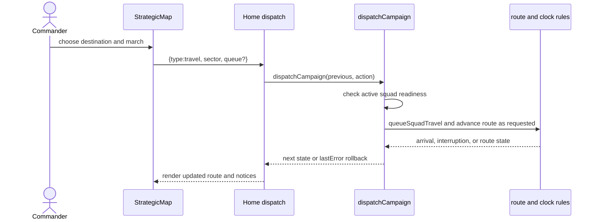
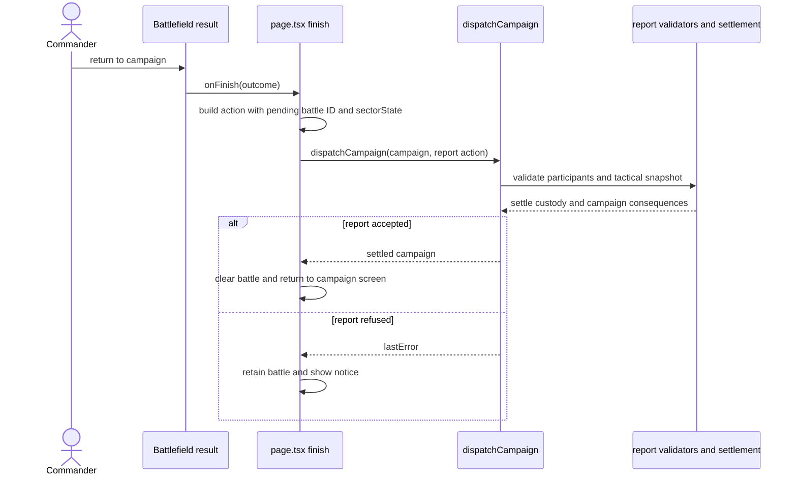

# Strategic player-intent catalogue

[Architecture guide](../README.md) · [Use-case index](README.md) · [Session & runtime](session.md) · [Campaign authoring](authoring.md) · [Application contracts](application-contracts.md)

## Mental model

Strategic play is the player's command of an evolving campaign: build a force, organize people and supplies, move through a contested map, respond to obligations and threats, and decide when and where to commit the force to a tactical scene. The player-facing intention is broader than any one `dispatchCampaign` action: for example, arranging an assault may include route selection, waiting through travel, handling an interruption, and finally deploying. This catalogue groups those steps into use cases instead of pretending every reducer command is a separate user goal. Requests and outcomes below describe the current browser game, not proposed CRUD endpoints or a promise that every scenario exposes every option.

**Status meanings:** *Playable* is a player-facing operation implemented in the browser; *Conditional* depends on campaign content, location, state, or a prior event; *Read-only* is an information projection; *Supporting* is a player-triggered background/coordination operation; *Disabled* is rejected by the current dispatcher guard. These labels indicate code/UI availability, not playtest certification.

## Capability families and case index

| Family | Intent IDs | What the player is trying to do |
|---|---|---|
| Start and command | STR-001–004 | Begin a campaign, create a leader, recruit people, organize squads/contracts |
| Move and enter | STR-005–008 | Route squads, advance time, visit localities, initiate a mission or assault |
| Respond and settle | STR-009–012 | Resolve enemy contact, defend/retreat, return from battle, speak and progress authored obligations |
| Sustain people | STR-013–016 | Assign care/work, rest/train, maintain morale and contract service |
| Equip and supply | STR-017–020 | Issue finite kit/ammunition, maintain/store/transport artillery, acquire mounts where currently available |
| Organize the theater | STR-021–024 | Train militia, improve security/logistics, manage faction/state policy and inspect the campaign |

| ID / intention | Status | Intent |
|---|---|---|
| STR-001 `start-campaign` | Playable | Start or replay authored campaign introduction and establish campaign state |
| STR-002 `create-campaign-officer` | Conditional | Create the player's officer and place them in the force |
| STR-003 `RecruitCombatant` | Conditional | Recruit an eligible character with immediate control at a valid location |
| STR-004 `manage-contract-and-squad` | Playable | Renew/end service, form/select squads, assign a person |
| STR-005 `plan-and-march` | Playable | Queue, start, pause/cancel, or resume a squad journey |
| STR-006 `advance-campaign-time` | Playable | Wait or advance time until a useful boundary, interruption, or arrival |
| STR-007 `visit-locality` | Conditional | Enter a friendly/eligible sector for exploration and local interaction |
| STR-008 `launch-mission-or-assault` | Conditional | Deploy against an authored mission/hostile sector, potentially with supporting squads |
| STR-009 `respond-to-enemy-contact` | Conditional | Choose tactical defense, automatic resolution, or a valid retreat |
| STR-010 `settle-battle-and-return` | Conditional | Submit validated tactical report and settle campaign consequences |
| STR-011 `interact-with-local-actor` | Conditional | Converse, recruit, give an order, negotiate, or resolve a quest with a local actor |
| STR-012 `fulfil-campaign-obligation` | Conditional | Progress authored mission, story, quest, event, or diplomacy consequence |
| STR-013 `assign-care-and-sleep` | Playable | Assign medical attention or change an operative's sleep state |
| STR-014 `assign-work-and-training` | Conditional | Assign strategic work, learning, study, or training where content permits |
| STR-015 `manage-morale-and-recovery` | Supporting | Allow time-based recovery and respond to attention/notice state |
| STR-016 `maintain-contract-service` | Conditional | Renew, dismiss, or otherwise manage contract service guarantees |
| STR-017 `issue-and-reconcile-equipment` | Playable | Equip/reassign existing gear and move finite items between people and local stores |
| STR-018 `manage-ammunition-and-field-supplies` | Playable | Select/load/store/issue/unload physical ammunition and use carried stocks |
| STR-019 `manage-artillery` | Conditional | Configure, store, transport, supply, repair/repurchase field pieces |
| STR-020 `manage-horses` | Conditional | Assign/unassign eligible existing horses to people; acquisition/hiring/feeding/breeding are disabled |
| STR-021 `train-and-redistribute-militia` | Conditional | Start/cancel training and redistribute local militia cohorts |
| STR-022 `improve-theater-capacity` | Conditional | Organize foundry/army/transit and fortify an eligible sector |
| STR-023 `apply-scenario-policy` | Conditional | Choose scenario-provided policy, diplomacy, academy or event action |
| STR-024 `inspect-campaign-options` | Read-only | Inspect available recruits, destinations, objectives, notices and local readiness |

## Use-case contracts

The request fields are intent-level inputs; concrete action type values are in the crosswalk. Strategic requests are dispatched as `{type, ...payload}` and yield a new campaign snapshot. Most rejections leave the caller a previous-state clone with `lastError`; encounter-time and battle-time gates are state-dependent. See [strategic engine](../strategic-engine.md), [runtime flows](../runtime-flows.md), [session/runtime companion](session.md), and [authoring](authoring.md).

| ID | Request information | Outcome / state touched | Key refusals or alternatives | Browser surface and rule source |
|---|---|---|---|---|
| STR-001 | content identity, seed/default start, intro completion | `initialCampaign` state, content package, clock, initialized events; intro replay changes no campaign | no installed/editor content; intro back/replay returns without starting | `page.tsx` title/`CampaignIntro`; `campaign.js:initialCampaign` |
| STR-002 | officer name, creator answers/profile | officer record, contract, operative state, starting kit and squad | officer already exists; HQ occupied; invalid profile/health; treasury requirement when legacy profile costs apply | `CharacterCreator`, `Desk`; `campaign.js:createOfficer` |
| STR-003 | character ID, term, safe recruitment site, or local conversation approach | immediate force membership and placement, service contract, payment/guarantee, local custody transfer | dead/captured/already recruited; local person must be present and eligible; service quote or safe site unavailable | `Recruitment`, `ReceivedCorrespondence`, `JA2Conversation`; `RecruitCombatantUseCase`, `TalkToCharacterUseCase`, `RecruitmentService` |
| STR-004 | contract ID/expected guarantee/date, action (renew/dismiss/redirect/cancel); squad IDs/name/location | contract, pending arrivals, squad memberships/active squad | stale expected contract version; protected officer; transit, squad/location mismatch, unavailable assignment, size limits | `StrategicRoster`, `Squads`, `Desk`; `campaign.js` contract/squad cases |
| STR-005 | squad, destination/route, queue flag, cancel choice | journey, route progress, locations/arrival records, fatigue/energy and committed ammunition | no march-ready members, exhausted/asleep/in-care, invalid/blocked route, pending battle/encounter, open journey | `StrategicMap`, `Campaign`; `campaign.js:travel/cancelTravel/resumeTravel`, `strategic-route.js`, `world.js` |
| STR-006 | duration in hours/seconds or wait choice | campaign clock; timed contracts, events, arrivals, care, logistics, enemy presence and possible interruption | invalid/backward/oversized delta; pause notices/assignment choices; time stops at encountered battle or relevant notice | `Campaign`, `useStrategicClock`; `campaign.js:wait/advanceStrategicTime`, `time.js` |
| STR-007 | current or target sector, active squad | pending exploration deployment with map, local actors, garrison and finite issued supplies | sector must be current, valid, not hostile/occupied, eligible and squad nonempty | `StrategicMap`, `CampaignOffice`; `campaign.js:visitSector`, `battle-handoff.js`, `world.js` |
| STR-008 | target/mission, squad or mission support squad IDs, immediate/queued travel | pending request with battle identity, location/time, squad, ammunition, opposition, conditions and artillery | wrong neighbor/anchor, unsupported attack, no living force/supply route, tired squad, blocked sector, mission-only squad selection | `StrategicMap`, `MissionAssault`, `SectorPreparation`; `campaign.js:attack/beginAssault`, `campaign-scenario.js` |
| STR-009 | enemy group and choice `tactical`/`auto`/`retreat`; retreat destination | pending encounter cleared or pending tactical battle, group status/history, defender relocation/sector ownership | encounter/group no longer pending; unavailable retreat route/defenders; stale choice | `EnemyEncounters`; `campaign.js:respondToEncounter`, `campaign-enemy-groups.js` |
| STR-010 | pending battle ID, outcome, tactical `sectorState`, survivor report | report validation, roster wounds/departures, custody/ammunition/artillery, XP, quests, sectors, pending request removal | stale/missing battle ID; invalid outcome; mismatched/partial/invalid report; completion/deployment invariants | `page.tsx:finish`, `Battlefield`; `campaign.js:battleResult/leaveSector/finishMission`, `battle-outcome.js` helpers |
| STR-011 | NPC ID, approach, local player unit, dialogue choice/quest option, tactical snapshot | conversation history, recruitment/contract, gifts, escort orders, quest/payment/loyalty effects | actor absent/unavailable/not adjacent, combat unresolved, wrong approach, state snapshot invalid, option/quest condition unmet | `JA2Conversation`, `Battlefield`; `campaign.js:talkNPC`, `content-dialogue.js`, `quests.js` |
| STR-012 | mission/quest/event/policy-specific choices | scenario/story flags, objectives, resources, standing, quest state, local tactical snapshot as required | scenario gates, deadlines, missing prerequisites, invalid outcome/content choice | `Campaign`, `StoryQuestJournal`, conversation/event panels; `campaign-scenario.js`, `campaign-events.js`, `content-quests.js` |
| STR-013 | operative ID, care assignment or asleep boolean | assignment, sleep/recovery, rest interruption state | person missing, in transit, invalid assignment, unable to wake due collapse/recovery | `MedicalCare`, `StrategicPersonnelMenu`; `campaign.js:assignCare/setSleep`, `care.js`, `sleep.js` |
| STR-014 | operative/trainer, assignment/activity/skill/course | work/training/study/assignment, fatigue, course state and completion clock | skill/content unavailable, course/trainer eligibility, in transit, busy assignment | `StrategicPersonnelMenu`, `TrainingProgress`, `StudyForecast`, `MilitiaTraining`; campaign assignment + `skill-training.js`, `study-training.js` |
| STR-015 | elapsed time, care/work assignments, attention resolution | recovery, morale, fatigue, warning and attention projections | not an independent order; clock can pause for unresolved attention/assignment prompts | `CampaignPerformance`, attention panels; `time.js`, `assignment-attention.js`, `contract-attention.js`, `logistics-attention.js` |
| STR-016 | operative and expected guarantee/deadline, renewal term or dismissal | paid/patriot contract, departure/guarantee settlement, notice/log | stale contract, protected officer, unavailable funds/term, settlement guarantee condition | `StrategicRoster`, `ContractAttention`; `campaign.js:renewContract/dismiss`, `contract-rules.js` |
| STR-017 | operative, owned equipment instance/item, destination slot or sector | operative inventory, armory/sector custody, serviceability and ownership records | not present/alive/owned, full pockets, unavailable equipment, invalid custody transfer | `StrategicPersonnelMenu`, `SectorInventory`, `RecoveredInventory`; `campaign.js:equip/sectorInventory`, `equipment.js` |
| STR-018 | operative, ammunition family, count and direction (`store`/withdraw/load/unload) | finite carried/sector cartridges, selected load, issued report allocation | incompatible load, capacity/stocks/ownership, unavailable supplies; campaign purchase path disabled | `CampaignAmmunition`, `AmmunitionSupplies`, `AmmunitionLoadChoice`; campaign ammo helpers and `physical-ammunition.js` |
| STR-019 | artillery ID, source/destination, configuration, quantity/repair request | field/depot custody, selection, ammo reserve, transport arrival and service state | route/storage/sector availability, capacity, supply/ownership; purchase/trade commands disabled | `ArtilleryTransport`, `StationedArtillery`, `JA2ArtilleryMenu`; artillery subsystem helpers |
| STR-020 | horse ID and operative assignment/unassignment | horse/rider association and location/mount readiness | missing horse/rider, location/transit mismatch; `acquire`, `hire`, `feed`, `breed` rejected by global trade guard | `Horses`; `horseAction` allowlist in `campaign.js`, `garrison.js`/horse helpers |
| STR-021 | sector, trainer, rank, course cancellation or redistribution manifest | militia cohorts, training course, local defense | sector not owned, trainer absent/low leadership/busy, capacity/course already active, rank ineligible | `MilitiaTraining`, `MilitiaDistribution`; `campaign.js:militia/cancelMilitia/transferMilitia/distributeMilitia` |
| STR-022 | transport mode, fortification sector, foundry/funding confirmation | route unlock, treasury and fort level, army/foundry flags | already organized/funded, invalid sector/cap, scenario prerequisites/funds | `Logistics`, `StrategicMap`; `campaign.js:transport/fortify/foundry/fundArmy` |
| STR-023 | scenario-defined `policy`, `diplomacy`, `academy`, event option | scenario state, flags, resources and campaign progression | no scenario implementation/offer or unmet authored prerequisites | `Campaign` and content panels; scenario `dispatchAction` hooks |
| STR-024 | no mutation request; current campaign snapshot | projection of recruit statuses, destinations and chapter/objectives | may be stale by next action; dispatch remains authoritative | `Campaign`, `StrategicMap`; `availableActions`, `campaignObjectives` |

## Two end-to-end intent contracts

### STR-005 · March a squad to a destination

**Actor:** commander. **Trigger:** choose a destination/route on the strategic map. **Preconditions:** active squad exists, is fit, awake, active and not already journeying; destination/route is reachable under current scenario/world ownership rules.

**Request:** destination sector, optional route/mode and queue intent. **Success:** `dispatchCampaign({type:'travel',sector,...})` queues the active squad route; the immediate path advances up to the next meaningful travel interruption (bounded internal loop), while `queue:true` leaves travel queued for clock advancement. `cancelTravel` and `resumeTravel` alter the journey. The state records arrivals and changes operative/squad/horse location, energy, fatigue and morale as route ticks resolve.

**Alternates/refusals:** empty squad, fatigue, sleep or care assignment, pending route, unknown destination, blocked route/ownership, enemy contact or battle pending. Arrival can be partial; an interruption takes precedence over reaching the requested endpoint. The request is not a promise of instantaneous teleportation.

**Changes/invariants:** campaign owns one journey per squad; carried ammunition is committed when leaving; current `location` follows active squad selection while other squad journeys remain independent. Failed dispatch returns prior campaign plus `lastError`.

### STR-010 · Return from a tactical deployment

**Actor:** commander. **Trigger:** tactical result screen chooses return/finish. **Preconditions:** active campaign pending battle and corresponding tactical snapshot; snapshot has completed/reportable status and current deployment identity.

**Request:** page callback chooses `finishMission`, `leaveSector` for exploration, or `battleResult`; payload contains pending `battleId`, `sectorState`, result/outcome and survivors. **Success:** campaign validates the report, reconciles return roster and finite custody, records progression/ownership/quests and clears pending battle; UI installs returned campaign and leaves battle screen.

**Alternates/refusals:** stale battle ID, invalid/mismatched snapshot, illegal outcome, incomplete state or invariant failure returns `lastError`; page keeps battle open and surfaces notice. Successful tactical victory alone does not settle campaign state until this request is accepted.

**Changes/invariants:** report party identity matches issued squad; campaign outcome and tactical snapshot agree; campaign settlement remains authoritative. `battle-outcome.js` supplies helpers but does not own the whole use case.

## Command crosswalk: campaign dispatcher

Every `case` accepted syntactically by the `dispatchCampaign` switch is accounted for below. The global trade guard runs before the switch: a switch implementation does not necessarily mean the player can currently invoke it. Scenario hooks have content-dependent subcommands. UI availability varies by scenario and current state.

| Exact action `type` | Intent / classification |
|---|---|
| `sectorInventory` | STR-017, sector item custody |
| `respondToEncounter` | STR-009 |
| `setSleep` | STR-013 |
| `assignWork` | STR-014 |
| `purchaseToolkits` | Disabled by trade guard |
| `purchaseAmmunition` | Disabled by trade guard |
| `purchaseGrenades` | Disabled by trade guard |
| `horseAction` | STR-020 only assignment/unassignment; acquire/hire/feed/breed explicitly disabled |
| `unloadAmmunition` | STR-018 |
| `selectAmmunitionLoad` | STR-018 |
| `ammunition` | STR-018 store/withdraw; `direction:'buy'` disabled |
| `syncTacticalTime` | Supporting tactical clock reconciliation, not direct player goal |
| `repurchaseArtillery` | Disabled by trade guard |
| `purchaseUsedArtillery` | Disabled by trade guard |
| `resupplyArtillery` | Disabled by trade guard |
| `advanceStrategicTime` | STR-006 supporting clock step |
| `wait` | STR-006 |
| `assignCare` | STR-013 |
| `purchaseMedicalSupplies` | Disabled by trade guard |
| `academy` | STR-014/023, scenario action (reachability conditional) |
| `purchaseEquipment` | Disabled by trade guard |
| `sellEquipment` | Disabled by trade guard |
| `purchaseUsedEquipment` | Disabled by trade guard |
| `sellArtillery` | Disabled by trade guard |
| `exchangeEquipment` | Disabled by trade guard |
| `storeArtillery` | STR-019 |
| `transportArtillery` | STR-019 |
| `supplyArtillery` | STR-019 |
| `configureArtillery` | STR-019 |
| `equip` | STR-017 |
| `resupply` | Disabled by trade guard |
| `repairWeapon` | Disabled by trade guard |
| `createOfficer` | STR-002 |
| `recruitCombatant` | STR-003 through RecruitCombatantUseCase |
| `recruitCivic` | Compatibility alias for recruitCombatant |
| `redirectHire` | STR-004 |
| `cancelHireArrival` | STR-004 |
| `recruit` | Disabled compatibility rejection: local recruits require personal encounter |
| `renewContract` | STR-016 |
| `dismiss` | STR-016 |
| `createSquad` | STR-004 |
| `squad` | STR-004; reorganization form |
| `assignToSquad` | STR-004 |
| `selectSquad` | STR-004 |
| `talkNPC` | STR-011/012 |
| `visitMission` | STR-008/012, scenario hook |
| `finishMission` | STR-010 |
| `visitSector` | STR-007 |
| `leaveSector` | STR-010, exploration settlement |
| `cancelTravel` | STR-005 |
| `resumeTravel` | STR-005 |
| `travel` | STR-005 |
| `transport` | STR-022, unlock transport network |
| `fundArmy` | STR-022 |
| `foundry` | STR-022 |
| `policy` | STR-023, scenario hook |
| `diplomacy` | STR-023, scenario hook |
| `transferMilitia` | STR-021 |
| `distributeMilitia` | STR-021 |
| `militia` | STR-021 |
| `cancelMilitia` | STR-021 |
| `fortify` | STR-022 |
| `beginAssault` | STR-008 |
| `attack` | STR-008 |
| `battleResult` | STR-010 |

**Guard-only disabled types** (included because the switch's preflight explicitly recognizes/rejects them): `purchaseToolkits`, `purchaseAmmunition`, `purchaseGrenades`, `purchaseMedicalSupplies`, `purchaseEquipment`, `purchaseUsedEquipment`, `sellEquipment`, `exchangeEquipment`, `sellArtillery`, `purchaseUsedArtillery`, `repurchaseArtillery`, `resupplyArtillery`, `supplyArtillery`, `resupply`, `repairWeapon`, plus `ammunition` buy, `sectorInventory` `issueOutfit`, and `horseAction` acquire/hire/feed/breed. The same string may appear above because a case body exists behind the preflight guard.

## Sources and boundaries

UI evidence: [`page.tsx`](../../../apps/web/app/page.tsx), [`Desk.tsx`](../../../apps/web/app/Desk.tsx), [`Campaign.tsx`](../../../apps/web/app/Campaign.tsx), [`StrategicMap.tsx`](../../../apps/web/app/StrategicMap.tsx), [`StrategicRoster.tsx`](../../../apps/web/app/StrategicRoster.tsx), [`Squads.tsx`](../../../apps/web/app/Squads.tsx), [`MedicalCare.tsx`](../../../apps/web/app/MedicalCare.tsx), [`Logistics.tsx`](../../../apps/web/app/Logistics.tsx), [`JA2Conversation.tsx`](../../../apps/web/app/JA2Conversation.tsx), [`EnemyEncounters.tsx`](../../../apps/web/app/EnemyEncounters.tsx). Rule evidence: [`campaign.js`](../../../packages/game/campaign.js), [`time.js`](../../../packages/game/time.js), [`battle-handoff.js`](../../../packages/game/battle-handoff.js), [`contracts.js`](../../../packages/game/contracts.js), [`strategic-route.js`](../../../packages/game/strategic-route.js), [`campaign-scenario.js`](../../../packages/game/campaign-scenario.js). This catalogue describes current browser intent surfaces and rule boundaries; it does not dictate a new application architecture.
