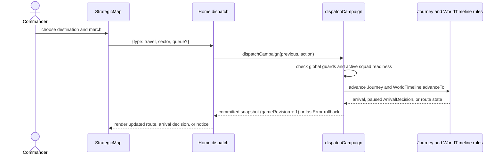
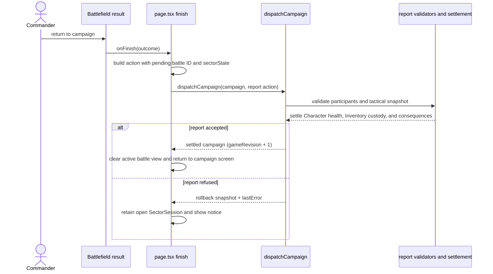

# Strategic player-intent catalogue

[Architecture guide](../README.md) · [Use-case index](README.md) · [Session & runtime](session.md) · [Tactical play](tactical.md) · [Campaign authoring](authoring.md) · [Application contracts](application-contracts.md)

This page catalogues the player's strategic campaign intentions—building a force, organizing squads and service contracts, moving across the world map, resolving hostile arrivals and enemy encounters, managing finite equipment and supplies, and settling sector visits—and maps every `dispatchCampaign` action `type` in `packages/game/campaign.js` to its use case. It connects the [use-case index](README.md) and [application contracts](application-contracts.md) to the engine internals in the [strategic engine](../strategic-engine.md) and the runtime sequences in [runtime flows](../runtime-flows.md).

## Mental model and exposure

Strategic play lets the player command an evolving campaign across one continuing world. One player intention can span several low-level steps—for example, assaulting a sector involves plotting a `Journey`, advancing `WorldTimeline`, resolving a paused `ArrivalDecision` via `FightOnArrival`, and opening a `SectorSession` via `EnterSector`.

Every `Exposure` column below uses the canonical six-value vocabulary defined in the [use-case index](README.md#exposure-vocabulary): `Command`, `Gated`, `Query`, `Supporting`, `No interface route`, and `Refused`.

## Capability families and case index

The first table below groups strategic intentions by `Family`, lists their `Intent IDs`, and summarizes `What the player is trying to do`.

| Family | Intent IDs | What the player is trying to do |
| --- | --- | --- |
| Start and command | STR-001–004 | Begin a campaign, create a leader, recruit combatants, and organize squads and contracts |
| Move and enter | STR-005–008 | Route squads, resolve hostile arrivals or redirect journeys, advance time, visit localities, and launch assaults |
| Respond and settle | STR-009–012 | Respond to enemy groups, resume or settle sector visits, converse with local characters, and progress quests |
| Sustain people | STR-013–016 | Assign medical care, sleep, work, or training, recover morale, and renew or end service contracts |
| Equip and supply | STR-017–020 | Issue finite equipment and physical ammunition, manage artillery, and assign existing mounts |
| Organize the theater | STR-021–024 | Train and distribute militia, improve fortifications and logistics, apply scenario policies, and inspect options |

The second table below lists each strategic use case by `ID / intention`, its `Exposure` classification, and its `Intent`.

| ID / intention | Exposure | Intent |
| --- | --- | --- |
| STR-001 `start-campaign` | `Command` | Initialize campaign progress (`CreateGameSession`) and complete or replay any authored introduction |
| STR-002 `create-campaign-officer` | `Gated` | Create the player's commander profile and admit that character into `ForceRoster` and the active `Squad` |
| STR-003 `RecruitCombatant` | `Gated` | Recruit an eligible `RecruitmentCandidate` (`GetRecruitmentCandidates` is the paired `Query`) with immediate control, valid placement, and `ServiceContract` terms |
| STR-004 `FormSquad` / `manage-squad-and-claims` | `Command` | Form or reorganize a `Squad` at one location (`FormSquad`), select the active squad, or manage legacy prepaid arrival claims |
| STR-005 `plan-and-march` (`RedirectJourney`) | `Command` | Start, queue, cancel, resume, or redirect (`RedirectJourney`) a squad `Journey` while preserving completed travel and costs |
| STR-006 `advance-campaign-time` | `Command` | Wait or advance campaign time (`AdvanceWorldTime` is the `Supporting` background progression step) until a target time or the first paused `ArrivalDecision` / encounter |
| STR-007 `visit-locality` (`EnterSector`) | `Gated` | Build a peaceful `SectorEntryRequest` and open or resume a `SectorSession` for local exploration |
| STR-008 `launch-mission-or-assault` (`FightOnArrival` / `WithdrawOnArrival`) | `Gated` | Resolve a paused `ArrivalDecision` by committing to combat (`FightOnArrival`) or starting a redirectable withdrawal (`WithdrawOnArrival`), or deploy to an authored mission (`ResumeSectorSession` switches among open visits) |
| STR-009 `respond-to-enemy-contact` | `Gated` | Choose tactical defense, automatic resolution, or retreat when an enemy group intercepts a sector or squad |
| STR-010 `settle-battle-and-return` | `Gated` | Submit a validated `SectorSession` report to reconcile `Character` health, `Inventory` custody, ammunition, and territory |
| STR-011 `TalkToCharacter` | `Gated` | Converse with a present character (`TalkToCharacter`), executing local recruitment (`RecruitmentService`), gifts, or quest choices in one transaction |
| STR-012 `fulfil-campaign-obligation` | `Gated` | Progress an authored mission, quest, timed event, or diplomacy milestone |
| STR-013 `assign-care-and-sleep` | `Command` | Assign medical care (`care.js`) or toggle sleep (`sleep.js`) for a combatant |
| STR-014 `assign-work-and-training` | `Gated` | Assign strategic work, attribute training, or study courses where scenario rules permit |
| STR-015 `manage-morale-and-recovery` | `Supporting` | Time-driven recovery, fatigue, and attention-notice processing during clock advancement |
| STR-016 `RenewServiceContract` / `dismiss` | `Gated` | Extend a paid `ServiceContract` from the later of its existing expiry or current `GameTime` (`RenewServiceContract`), or dismiss a combatant |
| STR-017 `issue-and-reconcile-equipment` (`TransferItem`) | `Command` | Equip or transfer finite items between character `Inventory` custody and sector stores (`TransferItem`) |
| STR-018 `manage-ammunition-and-field-supplies` | `Command` | Store, issue, load, or unload finite physical ammunition families across combatants and sector stores |
| STR-019 `manage-artillery` | `Gated` | Configure, store, transport, or supply owned artillery pieces |
| STR-020 `manage-horses` | `Gated` | Assign or unassign eligible existing horses to combatants (horse acquisition, hiring, feeding, and breeding are `Refused`) |
| STR-021 `train-and-redistribute-militia` | `Gated` | Start or cancel militia training and redistribute local militia cohorts across owned sectors |
| STR-022 `improve-theater-capacity` | `Gated` | Unlock transport networks, fund the army or foundry, and fortify eligible sectors |
| STR-023 `apply-scenario-policy` | `Gated` | Execute an allowlisted scenario policy, diplomacy, or academy action |
| STR-024 `inspect-campaign-options` (`GetRecruitmentCandidates`) | `Query` | Read-only inspection of recruitment candidates (`GetRecruitmentCandidates`), reachable destinations, and active objectives |

## Use-case contracts

The table below specifies each strategic use case by `ID`, `Request information`, `Outcome / authoritative owner touched`, `Key refusals or alternatives`, and `Browser surface and rule source`.

| ID | Request information | Outcome / authoritative owner touched | Key refusals or alternatives | Browser surface and rule source |
| --- | --- | --- | --- | --- |
| STR-001 | Content identity, seed, intro completion | Initializes `GameSession` (revision `0`), campaign snapshot, `WorldTimeline`, and initial scenario events | Missing or invalid campaign content; intro replay mutates no state | `page.tsx`, `CampaignIntro.tsx`; `CreateGameSessionUseCase`, `campaign.js:initialCampaign` |
| STR-002 | Officer name and profile answers | Creates officer `Character`, `Health`, `CharacterAbilities`, permanent `ServiceContract`, starting `Inventory`, and `Squad` membership | Officer already created; headquarters occupied; invalid profile or insufficient `Treasury` | `CharacterCreator.tsx`, `Desk.tsx`; `campaign.js:createOfficer` |
| STR-003 | Candidate `characterId`, service term, safe recruitment site or local conversation approach | `RecruitmentService` updates `Character`, `ServiceContract`, `Treasury`, `ForceRoster`, and local `Squad` or reserve placement in one transaction | Candidate dead, captured, or already serving; unsafe site; insufficient `Treasury` | `Recruitment.tsx`, `ReceivedCorrespondence.tsx`, `JA2Conversation.tsx`; `RecruitCombatantUseCase`, `TalkToCharacterUseCase`, `RecruitmentService` |
| STR-004 | Selected `characterIds`, target `Squad` ID/name/location; or legacy prepaid claim ID | `SquadFormationService` updates `Squad` and `ForceRoster` membership at the shared location without changing character location | Combatant in transit or deployed in an open `SectorSession`; location mismatch; squad size over 6 | `StrategicRoster.tsx`, `Desk.tsx`; `FormSquadUseCase`, `SquadFormationService`, `campaign.js` |
| STR-005 | `Squad` ID, destination/route, transport mode, queue or redirection request | Creates, advances, cancels, or redirects (`RedirectJourney`) a `Journey`, preserving actual segment position, elapsed time, paid fares, and fatigue | Squad empty, asleep, in care, or deployed; blocked route; unresolved `ArrivalDecision` or encounter | `StrategicMap.tsx`, `Campaign.tsx`; `RedirectJourneyUseCase`, `Journey`, `campaign.js:travel/cancelTravel/resumeTravel` |
| STR-006 | Target duration or wait command | Player `wait` (`Command`) advances campaign time; `AdvanceWorldTime` and `CollectResidentSupply` run as `Supporting` world-progression steps along `WorldTimeline.advanceTo` and `ResidentRoutine` | Refused while an `ArrivalDecision` or `pendingEncounter` is unresolved; stops at the first paused event boundary | `Campaign.tsx`, `useStrategicClock.ts`; `AdvanceWorldTimeUseCase`, `CollectResidentSupplyUseCase`, `time.js` |
| STR-007 | Target friendly/eligible sector and active `Squad` | Emits `SectorEntryRequest` (`pendingBattle`) with participants, map, retained `Sector` state, and `residentPositions` projection | Sector hostile, invalid, or ineligible; squad empty or busy | `StrategicMap.tsx`; `EnterSectorUseCase`, `campaign.js:visitSector`, `battle-handoff.js` |
| STR-008 | Pending `ArrivalDecision` ID (`FightOnArrival` / `WithdrawOnArrival`), target mission/sector, or suspended `SectorSession` ID (`ResumeSectorSession`) | `FightOnArrival` authorizes `SectorEntryRequest` (or `AdmitSectorReinforcements` if already open); `WithdrawOnArrival` starts a redirectable withdrawal `Journey`; `ResumeSectorSession` switches active visit | Decision ID already resolved or mismatched; no living squad or supply route; tired squad | `StrategicMap.tsx`, `SectorPreparation.tsx`; `FightOnArrivalUseCase`, `WithdrawOnArrivalUseCase`, `ResumeSectorSessionUseCase`, `campaign.js` |
| STR-009 | Enemy group ID, response (`tactical`, `auto`, or `retreat`), optional retreat destination | Clears `pendingEncounter` via auto-resolve/retreat or emits a defensive `SectorEntryRequest` (`pendingBattle`) | Encounter no longer pending; no valid retreat route or defenders | `EnemyEncounters.tsx`; `campaign.js:respondToEncounter`, `enemy-groups.js` |
| STR-010 | Issued `pendingBattle.id`, outcome, final sector snapshot, participant report | Reconciles `Character` (`Health`), `Inventory` and `ItemCustody`, ammunition, `Corpse` history, sector ownership, and closes `SectorSession` in `GameSession` | Stale or mismatched entry ID; incomplete or invalid report leaves `SectorSession` open | `page.tsx:finish`, `Battlefield.tsx`; `campaign.js:battleResult/leaveSector/finishMission`, `battle-outcome.js` |
| STR-011 | Present NPC ID, approach, player speaker, dialogue option, optional sector snapshot | `TalkToCharacterUseCase` applies dialogue effects, local `RecruitmentService` admission, item transfers, escort orders, and quest updates in one transaction | Character absent, dead, or not adjacent; active combat unresolved; dialogue condition unmet | `JA2Conversation.tsx`, `Battlefield.tsx`; `TalkToCharacterUseCase`, `content-dialogue.js`, `quests.js` |
| STR-012 | Quest, mission, or event choice payload | Updates scenario story flags, quest state, `Treasury`, faction standing, and sector ownership | Unmet scenario prerequisites, expired deadlines, or invalid option | `Campaign.tsx`, `StoryQuestJournal.tsx`; `campaign-scenario.js`, `campaign-events.js`, `content-quests.js` |
| STR-013 | Character ID, medical care assignment or sleep flag | Updates character care assignment or sleep state and rest-interruption flags | Character absent, in transit, or unable to wake due to collapse/recovery | `MedicalCare.tsx`, `StrategicPersonnelMenu.tsx`; `campaign.js:assignCare/setSleep`, `medical-care.js`, `sleep.js` |
| STR-014 | Character/trainer ID, work activity, skill, or study course | Updates strategic assignment, fatigue, training/study progress, and completion schedule | Skill or course unavailable; character in transit or busy | `StrategicPersonnelMenu.tsx`, `TrainingProgress.tsx`, `StudyForecast.tsx`; `skill-training.js`, `study-training.js` |
| STR-015 | Elapsed time during clock advancement | Updates morale, fatigue recovery, and attention projections (`assignment-attention.js`, `contract-attention.js`, `logistics-attention.js`) | Supporting process; pauses clock when an attention prompt requires player resolution | `CampaignPerformance.tsx`, `AssignmentAttention.tsx`, `ContractAttention.tsx`, `LogisticsAttention.tsx`; `time.js` |
| STR-016 | Character ID, renewal term or dismissal, expected contract state | `ServiceRenewalService` charges `Treasury` once and replaces `ServiceContract` from the later of existing expiry or current `GameTime`; dismissal ends service | Character dead or not serving; protected commander; insufficient `Treasury`; stale contract state | `StrategicRoster.tsx`, `ContractAttention.tsx`; `RenewServiceContractUseCase`, `ServiceRenewalService`, `campaign.js:dismiss` |
| STR-017 | Source and destination custodian (`Character` or sector store), item selection, quantity/slot | `ItemTransferService` updates `Inventory`, `PocketLayout`, and `ItemCustody` atomically at both ends | Character absent or dead; insufficient quantity; destination `PocketLayout` capacity exceeded | `StrategicPersonnelMenu.tsx`, `SectorInventory.tsx`, `CampaignPockets.tsx`; `TransferItemUseCase`, `ItemTransferService`, `campaign.js:equip/sectorInventory` |
| STR-018 | Character ID, ammunition family, cartridge count, direction (`store`, withdraw, load, unload) | Updates finite character and sector cartridge stocks, weapon load selection, and partial `ReloadWork` | Incompatible weapon load; insufficient stock or pocket capacity (`direction: 'buy'` is `Refused`) | `CampaignAmmunition.tsx`, `AmmunitionLoadChoice.tsx`; `campaign-ammunition.js`, `physical-ammunition.js` |
| STR-019 | Artillery piece ID, source/destination sector, configuration, or ammo supply count | Updates artillery depot/field custody, transport schedule, and ammunition reserve | Invalid route, storage cap, or missing piece (artillery purchase/sale commands are `Refused`) | `ArtilleryTransport.tsx`, `OwnedArtillery.tsx`, `JA2ArtilleryMenu.tsx`; `campaign-artillery.js`, `artillery-transport.js` |
| STR-020 | Horse ID and character assignment or unassignment | Updates rider/mount association at the shared location | Missing horse or rider; location or transit mismatch (`acquire`, `hire`, `feed`, `breed` are `Refused`) | `Horses.tsx`; `campaign.js:horseAction`, `horses.js` |
| STR-021 | Sector ID, trainer ID, militia rank, cancel flag, or redistribution manifest | Updates militia training courses, local militia cohorts, and sector garrison strength | Sector not player-owned; trainer absent or low leadership; capacity full | `MilitiaTraining.tsx`, `MilitiaDistribution.tsx`; `campaign.js:militia/cancelMilitia/transferMilitia/distributeMilitia` |
| STR-022 | Transport mode, fortification sector, foundry, or army funding choice | Updates `Treasury`, route network availability, sector fortification level, and foundry/army flags | Already unlocked or funded; invalid sector; insufficient `Treasury` or scenario gate | `Logistics.tsx`, `StrategicMap.tsx`; `campaign.js:transport/fortify/foundry/fundArmy` |
| STR-023 | Scenario `policy`, `diplomacy`, or `academy` choice | Applies allowlisted scenario rule mutations to standing, resources, and progression | Unmet scenario prerequisites or unsupported action in the active scenario | `Campaign.tsx`; `campaign-scenario.js` |
| STR-024 | Read-only filter request or current campaign snapshot | `GetRecruitmentCandidatesUseCase` returns `{ characterIds }` view; `availableActions` and `campaignObjectives` return UI projections without domain objects | Read-only `Query`; never mutates state or advances `WorldTimeline` | `Recruitment.tsx`, `Campaign.tsx`, `StrategicMap.tsx`; `GetRecruitmentCandidatesUseCase`, `campaign.js` |

## Two end-to-end intent contracts

### STR-005 · March a squad and handle hostile arrival or redirection

**Actor:** Player (commander). **Trigger:** Select a destination route on the strategic map or redirect an active journey. **Preconditions:** The selected `Squad` has living, awake members not deployed in a sector visit, and no unresolved `ArrivalDecision` or `pendingEncounter` blocks time progression.

**Request:** Dispatch `{ type: 'travel', sector, ... }` to start/advance a `Journey`, or invoke `RedirectJourneyUseCase` (`cancelTravel` / `resumeTravel` / redirection) from the squad's current segment position.

**Success:** `Journey` records physical segment progress, elapsed time, paid transport fare, and fatigue. If the squad reaches a hostile sector boundary, `ArrivalDecision` pauses `WorldTimeline` and requires `FightOnArrival` or `WithdrawOnArrival`. Choosing `WithdrawOnArrival` creates a journey with `JourneyPurpose.Withdrawal` at zero elapsed time; invoking `RedirectJourney` preserves exact segment position and costs (re-triggering a fresh `ArrivalDecision` immediately if reversed back into the hostile boundary at zero elapsed time).

The sequence diagram below shows how the `Commander`, `StrategicMap`, `Home dispatch`, `dispatchCampaign`, and `Journey and WorldTimeline rules` process a squad travel request.

### STR-010 · Return from a tactical sector visit

**Actor:** Player (commander). **Trigger:** Finish combat or leave exploration from `Battlefield`. **Preconditions:** An active `SectorEntryRequest` (`pendingBattle`) and matching `SectorSession` snapshot exist.

**Request:** `apps/web/app/page.tsx` (`finish`) dispatches `battleResult`, `leaveSector`, or `finishMission` with the pending `battleId`, final `sectorState`, outcome, and participant report.

**Success:** Campaign settlement validates the entry ID and clocks, reconciles `Character` (`Health`), `Inventory` and `ItemCustody`, spent cartridges, `Corpse` records, quests, and sector ownership, closes the `SectorSession` in `GameSession`, and clears `pendingBattle`. **Refusal:** A stale ID or invalid report aborts the transaction with `lastError` and leaves the `SectorSession` open.

The sequence diagram below traces how the `Commander`, `Battlefield result`, `page.tsx finish`, `dispatchCampaign`, and `report validators and settlement` reconcile a completed sector visit.

## Command crosswalk: campaign dispatcher

The table below accounts for every `Exact action type` recognized by `dispatchCampaign` in [`packages/game/campaign.js`](../../../packages/game/campaign.js), mapping it to its `Use case / intent` and its `Exposure` classification (`Command`, `Gated`, `Query`, `Supporting`, `No interface route`, or `Refused`). The preflight trade guard runs before the `switch`, so trade and horse-purchase cases are classified as `Refused`.

| Exact action `type` | Use case / intent | Exposure |
| --- | --- | --- |
| `sectorInventory` | STR-017 (`TransferItem` between character and sector store; `issueOutfit` sub-mode is `Refused`) | `Command` |
| `respondToEncounter` | STR-009 (resolve pending enemy-group encounter) | `Gated` |
| `setSleep` | STR-013 (toggle combatant sleep state) | `Command` |
| `assignWork` | STR-014 (assign strategic work, training, or study) | `Gated` |
| `purchaseToolkits` | Preflight trade guard rejects merchant purchases | `Refused` |
| `purchaseAmmunition` | Preflight trade guard rejects ammunition purchases | `Refused` |
| `purchaseGrenades` | Preflight trade guard rejects grenade purchases | `Refused` |
| `horseAction` | STR-020 (assign/unassign existing mounts is `Gated`; `acquire`, `hire`, `feed`, and `breed` are `Refused`) | `Gated` |
| `unloadAmmunition` | STR-018 (unload physical firearm ammunition) | `Command` |
| `selectAmmunitionLoad` | STR-018 (select ammunition load family) | `Command` |
| `ammunition` | STR-018 (store/withdraw cartridges is `Command`; `direction: 'buy'` is `Refused`) | `Command` |
| `syncTacticalTime` | Tactical-to-campaign clock synchronization via `syncBattleTime` | `Supporting` |
| `repurchaseArtillery` | Preflight trade guard rejects artillery repurchase | `Refused` |
| `purchaseUsedArtillery` | Preflight trade guard rejects used artillery purchase | `Refused` |
| `resupplyArtillery` | Preflight trade guard rejects paid artillery resupply | `Refused` |
| `advanceStrategicTime` | STR-006 (`AdvanceWorldTime` / `WorldTimeline.advanceTo` clock step) | `Supporting` |
| `wait` | STR-006 (player-initiated wait command) | `Command` |
| `assignCare` | STR-013 (assign medical care) | `Command` |
| `purchaseMedicalSupplies` | Preflight trade guard rejects medical supply purchases | `Refused` |
| `academy` | STR-014 / STR-023 (scenario academy hook) | `Gated` |
| `purchaseEquipment` | Preflight trade guard rejects equipment purchases | `Refused` |
| `sellEquipment` | Preflight trade guard rejects equipment sales | `Refused` |
| `purchaseUsedEquipment` | Preflight trade guard rejects used equipment purchases | `Refused` |
| `sellArtillery` | Preflight trade guard rejects artillery sales | `Refused` |
| `exchangeEquipment` | Preflight trade guard rejects merchant exchanges | `Refused` |
| `storeArtillery` | STR-019 (move artillery between squad and depot) | `Gated` |
| `transportArtillery` | STR-019 (schedule artillery transport between sectors) | `Gated` |
| `supplyArtillery` | STR-019 (allocate owned artillery ammunition; trade guard blocks paid resupply) | `Gated` |
| `configureArtillery` | STR-019 (configure artillery crew and deployment selection) | `Gated` |
| `equip` | STR-017 (equip or move carried items in campaign view) | `Command` |
| `resupply` | Preflight trade guard rejects paid resupply | `Refused` |
| `repairWeapon` | Preflight trade guard rejects paid weapon repair | `Refused` |
| `createOfficer` | STR-002 (create player commander) | `Gated` |
| `recruitCombatant` | STR-003 (`RecruitCombatantUseCase`) | `Gated` |
| `redirectHire` | STR-004 (redirect legacy prepaid arrival claim) | `Gated` |
| `cancelHireArrival` | STR-004 (cancel legacy prepaid arrival claim) | `Gated` |
| `recruit` | Legacy action rejected; local recruitment requires personal conversation (`TalkToCharacter`) | `Refused` |
| `renewContract` | STR-016 (`RenewServiceContractUseCase`) | `Gated` |
| `dismiss` | STR-016 (end combatant service) | `Gated` |
| `createSquad` | STR-004 (`FormSquadUseCase` / create squad at location) | `Command` |
| `squad` | STR-004 (`FormSquadUseCase` squad reorganization) | `Command` |
| `assignToSquad` | STR-004 (`FormSquadUseCase` single-member assignment) | `Command` |
| `selectSquad` | STR-004 (switch active squad) | `Command` |
| `talkNPC` | STR-011 / STR-012 (`TalkToCharacterUseCase`) | `Gated` |
| `visitMission` | STR-008 / STR-012 (enter authored scenario mission) | `Gated` |
| `finishMission` | STR-010 (settle completed scenario mission) | `Gated` |
| `visitSector` | STR-007 (`EnterSector` for friendly/exploration visit) | `Gated` |
| `leaveSector` | STR-010 (settle and close exploration `SectorSession`) | `Gated` |
| `resumeSectorSession` | STR-008 (`ResumeSectorSessionUseCase` to switch active authority to a suspended `SectorSession`) | `Gated` |
| `withdrawOnArrival` | STR-008 (`WithdrawOnArrivalUseCase` to resolve a paused `ArrivalDecision` by starting a withdrawal journey) | `Gated` |
| `redirectJourney` | STR-005 (`RedirectJourneyUseCase` to redirect a journey from its actual segment position) | `Command` |
| `cancelTravel` | STR-005 (`RedirectJourneyUseCase` / halt or redirect journey) | `Command` |
| `resumeTravel` | STR-005 (resume paused journey) | `Command` |
| `travel` | STR-005 (start or queue squad `Journey`) | `Command` |
| `transport` | STR-022 (unlock regional transport network) | `Gated` |
| `fundArmy` | STR-022 (fund scenario army capacity) | `Gated` |
| `foundry` | STR-022 (organize scenario foundry) | `Gated` |
| `policy` | STR-023 (execute scenario policy hook) | `Gated` |
| `diplomacy` | STR-023 (execute scenario diplomacy hook) | `Gated` |
| `transferMilitia` | STR-021 (transfer militia between sectors) | `Gated` |
| `distributeMilitia` | STR-021 (apply militia distribution manifest) | `Gated` |
| `militia` | STR-021 (start militia training course) | `Gated` |
| `cancelMilitia` | STR-021 (cancel active militia training course) | `Gated` |
| `fortify` | STR-022 (fortify eligible sector) | `Gated` |
| `fightOnArrival` | STR-008 (`FightOnArrivalUseCase` to resolve a paused `ArrivalDecision` by committing to sector entry) | `Gated` |
| `beginAssault` | STR-008 (`FightOnArrivalUseCase` compatibility resolution of hostile arrival decision) | `Gated` |
| `attack` | STR-008 (initiate assault or resolve hostile arrival) | `Gated` |
| `battleResult` | STR-010 (settle completed combat `SectorSession`) | `Gated` |

## Rule boundary

Strategic commands enter through [`packages/game/campaign.js`](../../../packages/game/campaign.js) and route migrated intentions to [`packages/game/application`](../../../packages/game/application/), with clock synchronization in [`packages/game/time.js`](../../../packages/game/time.js), sector entry preparation in [`packages/game/battle-handoff.js`](../../../packages/game/battle-handoff.js), contract helpers in [`packages/game/contracts.js`](../../../packages/game/contracts.js), route validation in [`packages/game/strategic-route.js`](../../../packages/game/strategic-route.js), and scenario hooks in [`packages/game/campaign-scenario.js`](../../../packages/game/campaign-scenario.js).
