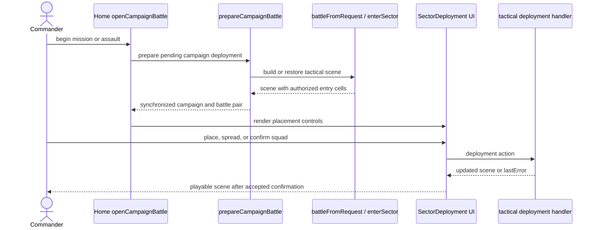
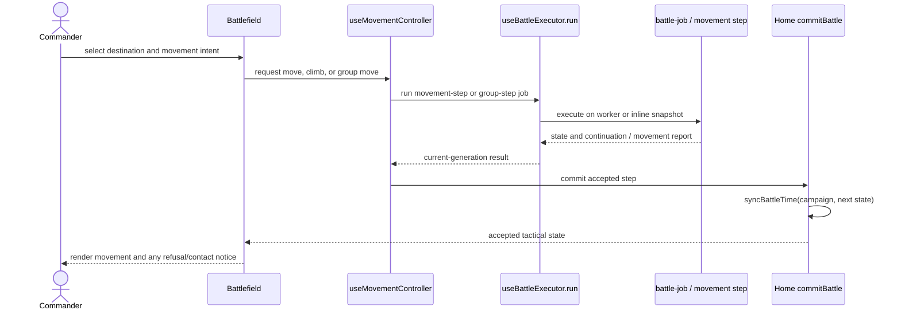

# Tactical player-intent catalogue

[Architecture guide](../README.md) · [Use-case index](README.md) · [Session & runtime](session.md) · [Campaign authoring](authoring.md) · [Application contracts](application-contracts.md)

## Mental model

Sector play lets the player position, protect, equip, treat, negotiate, or fight
with a squad during a visit. One intention can require a preview, an approach,
several movement steps, presentation, and autonomous consequences. `Battlefield`
is the input surface. `EnterSector`, `ExecuteSectorOrder`, `EndSectorTurn`, and
`ResumeSectorOperation` coordinate the visit through their repository contracts.
`SectorSession`, `CombatSession`, participants, combat objects, and inventory
objects own the migrated rules. `packages/game/tactical.js` connects those objects to
geometry and scenario rules in the compatibility engine.

**Status meanings:** *Playable* denotes a browser-exposed intention; *Conditional* depends on phase, actor, carried item, map, mission or campaign context; *Read-only* is a projection; *Supporting* is invoked by another player intent; *Disabled* is not currently available. These are source/UI availability labels, not a claim of user-playtest coverage.

## Capability families and case index

| Family | IDs | Intent |
|---|---|---|
| Deploy and control | TAC-001–004 | Place arrivals, select actors, move/face/group, change stance or stealth |
| Fight and defend | TAC-005–010 | Shoot, aim at a point, strike, charge, throw, operate artillery or prepare a reaction |
| Survive and recover | TAC-011–014 | Heal, use finite supplies, mount, recover during exploration, manage incapacitation/prisoners |
| Carry and configure | TAC-015–019 | Pick up, transfer, equip, drop, loot, reload and maintain physical kit |
| Interact with scene | TAC-020–024 | Operate doors/environment, search containers, talk, escort, free, and exit |
| Finish and observe | TAC-025–027 | End a turn, explore/rest, return a tactical report, inspect known state |

| ID / catalogue label | Status | Intent |
|---|---|---|
| TAC-001 `deploy-the-squad` | Conditional | Place and confirm a newly deployed squad at authorized entry cells |
| TAC-002 `select-and-order-soldier` | Playable | Choose an eligible actor and issue an order in current phase |
| TAC-003 `reposition-and-coordinate-squad` | Playable | Move, climb, charge-route, or move a selected group along legal cells |
| TAC-004 `set-combat-posture` | Playable | Change facing, stance, movement/weapon mode, stealth and visibility posture |
| TAC-005 `fire-at-visible-target` | Conditional | Fire a loaded, serviceable weapon at a visible hostile or selected body region |
| TAC-006 `aim-at-location` | Conditional | Fire/strike at a point without requiring a confirmed occupant |
| TAC-007 `attack-in-melee` | Conditional | Strike with blade/hand or charge a valid hostile |
| TAC-008 `throw-explosive-or-knife` | Conditional | Throw a carried grenade or knife using visible geometry/flight rules |
| TAC-009 `operate-artillery` | Conditional | Aim, move, pivot, load or fire an available field piece |
| TAC-010 `prepare-defensive-reaction` | Conditional | Brace or establish overwatch under current AP/weapon rules |
| TAC-011 `treat-wound` | Conditional | Approach and heal/bandage a valid patient with finite supplies |
| TAC-012 `use-carried-supply` | Conditional | Consume/throw/use a carried item, ration, torch, or specialized supply |
| TAC-013 `mount-or-dismount` | Conditional | Mount/dismount an eligible assigned horse |
| TAC-014 `manage-physical-rest-and-custody` | Conditional | Rest in exploration, free a person/prisoner, or set escort behavior |
| TAC-015 `inspect-local-inventory` | Read-only | Inspect visible actor inventory, ground objects, containers or equipment preview |
| TAC-016 `take-field-equipment` | Playable | Search/approach and pick up eligible ground/container loot |
| TAC-017 `reorganize-carried-equipment` | Playable | Equip, swap, transfer, attach, fit/remove bayonet or reposition carried items |
| TAC-018 `drop-or-transfer-supplies` | Conditional | Drop finite items or transfer equipment/supplies to another actor |
| TAC-019 `reload-and-maintain-weapons` | Conditional | Load chosen cartridges, reprime, repair, or maintain weapon configuration |
| TAC-020 `operate-door-or-environment` | Conditional | Open/close door, breach or interact with authored environment target |
| TAC-021 `speak-with-local-person` | Conditional | Talk to a living, nearby NPC and resolve dialogue/quest actions |
| TAC-022 `manage-civilian-and-prisoner` | Conditional | Give item, treat, free, or direct a detained person |
| TAC-023 `leave-by-tactical-exit` | Conditional | Cross a valid exit with eligible actor(s) |
| TAC-024 `search-scene-and-use-object` | Conditional | Search containers/loot and use a scene object or equipment cursor target |
| TAC-025 `advance-turn-or-interrupt` | Playable | End player's control and advance enemy/allied/reaction turn flow |
| TAC-026 `explore-sector-and-recover` | Conditional | Enter exploration, inspect/loot safely, rest, and signal sector exploration |
| TAC-027 `return-battle-report` | Conditional | Submit final battle snapshot to campaign settlement |

## Intent contracts

Request keys below are intent-level, and accepted low-level `action.type` values are enumerated in the crosswalk. Most actions return a tactical state, optionally with `lastError`; cursor previews and movement previews may instead be UI projections. Battle state remains authoritative for AP, terrain, visibility, weapon rounds, injuries and phase. Read [tactical engine](../tactical-engine.md), [runtime flows](../runtime-flows.md), [session/runtime companion](session.md), and [persistence](../persistence.md).

| ID | Request information | Outcome / state touched | Key refusal / alternatives | Browser surface and rule source |
|---|---|---|---|---|
| TAC-001 | deployment action, unit IDs, authorized cells/coordinates | placement substate and actor coordinates; confirm begins sector | forbidden cell/overlap, invalid phase; only deployment actions accepted while deployment is active | `SectorDeployment`, `Battlefield`; `tactical.js` deployment handler, `sector-deployment.js` |
| TAC-002 | unit ID(s), target/interact intent, selected hand/mode | selected actor/cursor and action state | dead/routed/unconscious, wrong side, allied/militia control, wrong interrupt or AP | `JA2Roster`, `JA2OrdersMenu`, contextual cursor; `ja2-hud.js`, `tactical.js` |
| TAC-003 | unit IDs, target cell/surface or group path, movement intent | position, facing, AP, fatigue, path continuation, contact/interrupt | blocked geometry, invalid climb link/level, occupied cell, AP, range, unavailable actor; group can stop/contact partway | `MovementCursor`, `JA2GroupMovePanel`; `useMovementController.ts`, `battle-job.js`, `movement-step.js`, `group-movement.js` |
| TAC-004 | unit, desired direction/stance/stealth/movement/weapon mode | facing, posture, mode, visibility and costs | knocked down/unsupported state, AP, ineligible actor | `Battlefield`, `JA2OrdersMenu`, `JA2WeaponMode`; `tactical.js`, `action-points.js` |
| TAC-005 | unit, target ID/kind, weapon, aim, hit location | AP, loaded count, condition, target health/morale, smoke/noise and possible jam | not visible/hostile/active, no line, no ammo, jammed/broken, invalid region, insufficient AP | `AimCursor`, `FirearmShotEffect`; `tactical.js:fire`, visibility/combat helpers |
| TAC-006 | shooter/attacker, x/y/tactical level, aim/location | point projectile/action resolution; occupants need not be known | invalid geometry/range, AP, unusable weapon/throwable; point throws have collateral risk | tactical cursor/context action; `firePoint`, `meleePoint`, `grenade-throw.js`, `targeted-combat.js` |
| TAC-007 | actor, hostile target ID/kind or point, blade/attack intent | movement approach where needed, AP, wounds/morale/knockdown | no reachable contact, wrong level, blocked path, no usable blade/weapon, invalid target | `ContextActionCursor`, `AimCursor`; `tactical.js`, `targeted-combat.js`, `movement-step.js` |
| TAC-008 | actor, carried grenade/knife, target point or visible target, aim/level | flight, rounds/supply, blast/impact, structures, injuries and collateral | item not actually held, invalid target/flight, AP, ally risk; grenade requires valid held item | `GrenadeThrowEffect`, knife effect/cursor; `grenade-throw.js`, `item-flight.js`, `structure-blast.js` |
| TAC-009 | unit IDs, artillery ID, coordinates/direction, ammunition | piece position/aim/loading and projectile/impact state | unavailable/occupied piece, insufficient crew/AP/ammunition, invalid arc/geometry | `JA2ArtilleryMenu`, `JA2EnvironmentPanel`; artillery actions in `tactical.js`, artillery rules |
| TAC-010 | unit, front/target and weapon/reaction intent | braced/overwatch state, reserved AP and future enemy response | wrong stance/weapon, insufficient AP, no mounted bayonet for brace | `JA2OrdersMenu`; `tactical.js:brace/overwatch` |
| TAC-011 | medic, patient ID/kind, medical item | approach, finite dressings, HP/bleeding/bandage state | missing patient, invalid side/actor, no supplies, AP, patient already unable/unsupported | `MedicalCare`, `JA2OrdersMenu`; `heal` and care rules in `tactical.js` |
| TAC-012 | unit and carried supply/item with target point/actor | inventory decrement, status/effect, lights, entanglement or world object | supply not in hand/inventory, invalid target or cost, AP; context resolves `useItem` to a specific operation | `JA2Inventory`, `TacticalLight`, `GrenadeSupplies`; tactical supply/inventory helpers |
| TAC-013 | unit and assigned mount | mounted state, mount location/stamina/condition | no horse, wrong level, insufficient AP, mount requires rest/care | `Battlefield`, `Mount` presentation; `tactical.js:mount` |
| TAC-014 | rest/escort/free intent, unit/NPC and optional wait/follow | recovery, entanglement release, prisoner release/escort order | rest only applies in exploration; person not eligible/nearby, insufficient AP, wrong target kind | contextual orders, `PrisonerActions`; `tactical.js:rest/free/prisonerEscort` |
| TAC-015 | selected visible actor/container/item | visible-state projection and previews only | hidden actor/items are not disclosed; preview may become stale | `JA2Inventory`, `JA2LootPicker`, `Battlefield`; `playerKnownState`, perception and preview functions |
| TAC-016 | search target/item/stack/count and actor | ground/container custody, unit inventory, search/approach state | object absent/hidden, item invalid, capacity/stack limits, AP, stale cursor selection | `JA2LootPicker`, `GroundSupplyPicker`, `RecoveredInventory`; `approachLoot`, `loot`, `lootBatch`, `equipLoot` |
| TAC-017 | source/target actor, equipment slot, item, destination hand/attachment | physical equipment and weapon references, condition/ammo carried | target absent, wrong slot, incompatibility, capacity, ownership/rule validation | `JA2Hands`, `JA2Pockets`, `JA2Inventory`, `EquipmentCursor`; tactical inventory action helpers |
| TAC-018 | actor(s), finite item/supply, count and destination | ground drop or target inventory/custody transfer | cannot drop/transfer object, capacity, destination changed, insufficient item amount | `JA2Inventory`, `EquipmentCursor`; `drop`, `transfer`, supply transfer actions |
| TAC-019 | weapon/hand, ammo family, reload/reprime/repair/attachment request | loaded and carried counts, jam, reload progress, condition and fitting | incompatible ammo/fitting, no material, broken weapon, AP, stale inventory | `JA2WeaponMode`, `JA2Hands`, `JA2Bayonet`; tactical ammo, maintenance and fitting rules |
| TAC-020 | unit, door/wall/environment target, verb/open state | door/structure/world changes and visibility/navigation | target absent/hidden, invalid authored target, AP/tool/weapon/geometry unmet | `TacticalSceneControls`, `TacticalWallEdgeControls`; `environment-interactions.js`, tactical rules |
| TAC-021 | nearby NPC, player actor, approach/dialogue node/choice | conversation result, quest/recruitment consequences through campaign callback | combat unresolved, not adjacent/alive/available, dialogue choice invalid | `JA2Conversation`, `Battlefield` callback; `page.tsx:talkNPC`, `campaign.js:talkNPC` |
| TAC-022 | NPC target and use-item/free/prisoner/escort intent | NPC health/inventory/departure/following state; campaign receives validated report/progress | unsupported target kind, not near, wrong carried item, invalid custody/escort order | `PrisonerActions`, `MedicalCare`, conversation; `tactical.js`, prisoner/quest helpers |
| TAC-023 | exit ID/destination and actor IDs | departure/fled/exit ledger and battle end check | invalid/unauthorized exit, route blocked, actor cannot leave, incomplete group | `JA2ExitPanel`, exit cursor; `tactical-exits.js`, `tactical.js` |
| TAC-024 | authored prop/container/action target, unit and item | object/container/ground state, equipment cursor or local effects | inaccessible/empty/stale object, unsupported action, AP/geometry | `TacticalSceneControls`, `JA2LootPicker`, contextual cursor; environment/loot modules |
| TAC-025 | current phase/turn and optional equipment cursor | player AP refresh/round, enemy/allied turn, interrupts, autonomous state | cursor item must be returned/placed; wrong/missing suspended enemy reaction state | `JA2OrdersMenu`, turn control; `Battlefield.nextTurn`, `useEnemyPlayback`, `endTurn` |
| TAC-026 | exploration action, rest amount or explore/sector objective | quiet turns/contact, fatigue recovery, scene discovery/status | active combat/invalid rest state, available actor/AP; exploration does not simply mean each action enters player phase | `Battlefield`, exploration controls; `tactical.js`, `time.js` |
| TAC-027 | campaign pending battle ID, final tactical snapshot, outcome/report | campaign state settlement; tactical scene cleared only on accepted callback | mismatch/stale report or campaign invariant failure; defeat/retreat has different settlement | result panel and `page.tsx:finish`; campaign dispatcher, `battle-outcome.js` helpers |

## End-to-end intent contracts

### TAC-001 · Deploy the arriving squad

**Actor:** commander. **Trigger:** campaign creates a pending battle and Home opens `Battlefield` with deployment enabled. **Preconditions:** pending request is valid; arrival placements are constrained by generated scene entry rules.

**Request:** place selected unit IDs at cells, clear a placement, spread the formation, then confirm. **Success:** tactical deployment state becomes a playable scene; unit positions are installed, entry constraints checked, and perception/contact is resolved after placement. The user action surface includes placement controls, not arbitrary direct construction of a battle map.

**Alternate/refusal paths:** reject unauthorized/blocked/overlapping cells or invalid deployment state; deployment handler accepts only its defined placement/clear/spread/confirm orders while active. User can adjust placement before confirmation.

**Changes/invariants:** the pending campaign request remains the strategic source of squad identity, equipment and mission context. Tactical deployment does not itself settle a campaign report. Persistence must retain a matching request/scene pair.

### TAC-003 · Move a selected soldier or group

**Actor:** commander. **Trigger:** select eligible actor(s), click a destination or climb link, choose movement intent. **Preconditions:** active battle, permitted phase, controllable actors, valid reachable point and enough AP for requested action/path.

**Request:** unit ID(s), destination/surface/level, and optional movement intention. `useMovementController` owns step continuation and requests jobs from `calculation.run`; `packages/game/battle-job.js` calls `movementStep` or `groupMovementStep`, the same deterministic rules execute in worker or inline fallback. `groupMove` is serialized as a sequence, may stop on contact, and is not a single all-or-nothing teleport.

**Success:** each accepted step updates positions, AP, facing, fatigue and possible visibility/contact; callback commits the next battle snapshot through `commitBattle(next, previous)` and `syncBattleTime(current.campaign, next)`. Motion/presentation interpolates accepted simulation steps.

**Alternates/refusals:** path blocked, occupied, unavailable climb link/height, actor not able to act, insufficient AP, phase/control restriction, or state becoming stale while a worker result is pending. Executor rejects to same-snapshot inline fallback when possible; stale-generation results are discarded. Group order can complete partially or report contact.

**Changes/invariants:** the simulation step result, not the rendered interpolation, is authoritative. Every accepted step remains paired with a clock-synchronized campaign snapshot.

## Command crosswalk: tactical dispatcher and UI

This crosswalk accounts for player-facing and support action types in the tactical entrypoints and Home model-context allowlist. “Supporting” means internal/cursor/preview/exploration plumbing rather than a standalone player goal. Some actions are legal only in deployment or only when a supplied item/target exists. `useItem` is context-resolved to a more specific effect. Private enemy-only/internal types are intentionally not advertised as player commands.

| Exact action `type` | Use case / classification |
|---|---|
| `placeDeployment` | TAC-001 |
| `clearDeployment` | TAC-001 |
| `spreadDeployment` | TAC-001 |
| `confirmDeployment` | TAC-001 |
| `move` | TAC-003 |
| `climb` | TAC-003 |
| `groupMove` | TAC-003 |
| `movement` | TAC-003/004, movement mode/control |
| `stance` | TAC-004 |
| `look` | TAC-004, orientation/observe |
| `stealth` | TAC-004 |
| `weaponMode` | TAC-004/019 |
| `fire` | TAC-005 |
| `firePoint` | TAC-006 |
| `melee` | TAC-007 |
| `meleePoint` | TAC-006/007 |
| `charge` | TAC-007, approach-and-attack |
| `throwGrenade` | TAC-008 |
| `throwKnife` | TAC-008 |
| `artillery` | TAC-009 |
| `artilleryReload` | TAC-009 |
| `artilleryMove` | TAC-009 |
| `artilleryPivot` | TAC-009 |
| `brace` | TAC-010 |
| `overwatch` | TAC-010 |
| `heal` | TAC-011 |
| `craftDressings` | TAC-011/017, conditional local crafting support |
| `useItem` | TAC-011/012/022, context-resolved (grenade, medical, supply, environment or attack) |
| `ration` | TAC-012/026 |
| `throwTorch` | TAC-012 |
| `boleadoras` | TAC-012, specialized supply control |
| `mount` | TAC-013 |
| `rest` | TAC-014/026 |
| `free` | TAC-014/022; freeing a restrained actor or releasing NPC |
| `prisonerEscort` | TAC-014/022 |
| `inventoryMap` | TAC-015, read-only positioning/preview support |
| `approachLoot` | TAC-016, supporting approach/search step |
| `loot` | TAC-016 |
| `lootBatch` | TAC-016 |
| `containerLoot` | TAC-016/024 |
| `equipLoot` | TAC-016/017 |
| `weapon` | TAC-017 |
| `swapHands` | TAC-017 |
| `attachment` | TAC-017/019 |
| `fitBayonet` | TAC-017/019 |
| `removeBayonet` | TAC-017/019 |
| `equip` | TAC-017 |
| `pickupEquipment` | TAC-017, equipment cursor support |
| `placeEquipment` | TAC-017, equipment cursor support |
| `returnEquipmentCursor` | TAC-017, cursor cleanup support |
| `dragEquipment` | TAC-017, cursor placement support |
| `moveEquipment` | TAC-017 |
| `movePocket` | TAC-017 |
| `drop` | TAC-018 |
| `transfer` | TAC-018 |
| `dropSupply` | TAC-018 |
| `transferSupply` | TAC-018 |
| `unloadEquipment` | TAC-018/019 |
| `reload` | TAC-019 |
| `reprime` | TAC-019 |
| `selectAmmunitionLoad` | TAC-019 |
| `unloadAmmunition` | TAC-019 |
| `repair` | TAC-019 |
| `fitBayonet` | TAC-017/019 |
| `removeBayonet` | TAC-017/019 |
| `door` | TAC-020 |
| `environment` | TAC-020/024 |
| `breach` | TAC-020 |
| `giveItem` | TAC-022, resolved effect from use-item intent |
| `talkNPC` | TAC-021, Home callback to campaign conversation (not tactical actor order) |
| `prisonerEscort` | TAC-022 |
| `exit` | TAC-023 |
| `steal` | TAC-024, conditional local encounter action |
| `endTurn` | TAC-025 |
| `explore` | TAC-026 |
| `ambient` | Supporting scene noise update, not a player goal |

**Not independent UI goals:** `inventoryMap`, `approachLoot`, `pickupEquipment`, `placeEquipment`, `returnEquipmentCursor`, `dragEquipment`, `moveEquipment`, `movePocket`, `ambient`, `giveItem`, `equipLoot`, and `containerLoot` are useful dispatcher/support forms but are reached through inventory, cursor, search, or contextual interaction surfaces. `talkNPC` is dispatched by Home's conversation callback with a campaign snapshot; do not mistake it for an ordinary `actBattle` action.

**Excluded/non-player internals:** worker-only job kinds (`action`, `turn`, `movement-step`, `group-step`, previews) are not action types. Enemy phase internal orders and synthetic rejection aliases are not advertised commands. The documented allowlist is not a blanket acceptance guarantee: mode, phase, actor, visibility, cursor ownership, and carried inventory still gate execution.

## Sources and boundaries

UI evidence: [`Battlefield.tsx`](../../../apps/web/app/Battlefield.tsx), [`MovementCursor.tsx`](../../../apps/web/app/MovementCursor.tsx), [`JA2GroupMovePanel.tsx`](../../../apps/web/app/JA2GroupMovePanel.tsx), [`AimCursor.tsx`](../../../apps/web/app/AimCursor.tsx), [`JA2OrdersMenu.tsx`](../../../apps/web/app/JA2OrdersMenu.tsx), [`JA2Inventory.tsx`](../../../apps/web/app/JA2Inventory.tsx), [`EquipmentCursor.tsx`](../../../apps/web/lib/EquipmentCursor.tsx), [`JA2LootPicker.tsx`](../../../apps/web/app/JA2LootPicker.tsx), [`JA2Conversation.tsx`](../../../apps/web/app/JA2Conversation.tsx), [`JA2ExitPanel.tsx`](../../../apps/web/app/JA2ExitPanel.tsx), [`MedicalCare.tsx`](../../../apps/web/app/MedicalCare.tsx). Rules/runtime: [`tactical.js`](../../../packages/game/tactical.js), [`battle-job.js`](../../../packages/game/battle-job.js), [`movement-step.js`](../../../packages/game/movement-step.js), [`group-movement.js`](../../../packages/game/group-movement.js), [`battle-handoff.js`](../../../packages/game/battle-handoff.js), [`time.js`](../../../packages/game/time.js), [`page.tsx`](../../../apps/web/app/page.tsx), [`useBattleExecutor.ts`](../../../apps/web/lib/useBattleExecutor.ts), [`useEnemyPlayback.ts`](../../../apps/web/lib/useEnemyPlayback.ts). This is an intent catalogue over current UI and rule entrypoints, not a new code architecture or API contract.
