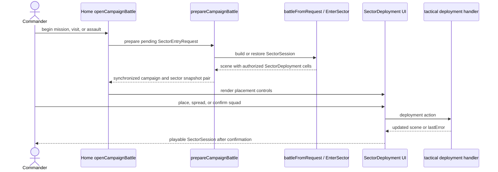
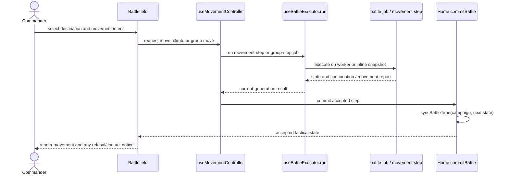

# Tactical player-intent catalogue

[Architecture guide](../README.md) · [Use-case index](README.md) · [Session & runtime](session.md) · [Strategic play](strategic.md) · [Campaign authoring](authoring.md) · [Application contracts](application-contracts.md)

This page catalogues the player's tactical intentions during a sector visit (`SectorSession`)—deploying combatants, moving and positioning a squad, firing and fighting in `CombatSession`, treating wounds, managing physical inventories and cartridges, interacting with doors, containers, and local residents, and exiting or settling the visit—and maps every tactical action `type` in `packages/game/tactical.js` to its use case. It connects the [use-case index](README.md) and [application contracts](application-contracts.md) to the engine internals in the [tactical engine](../tactical-engine.md), the visual projection in [rendering](../rendering.md), and the call sequences in [runtime flows](../runtime-flows.md).

## Mental model and exposure

Sector play lets the player position, protect, equip, treat, converse, or fight with a squad during an open `SectorSession`. `Battlefield.tsx` is the browser input surface. `EnterSectorUseCase`, `AdmitSectorReinforcementsUseCase`, `ExecuteSectorOrderUseCase`, `EndSectorTurnUseCase`, `ResumeSectorOperationUseCase`, `TransferItemUseCase`, and `GetVisibleCharactersUseCase` coordinate the visit through their narrow per-use-case repository interfaces. Domain objects (`SectorSession`, `CombatSession`, `CombatTurn`, `SectorParticipant`, `ActionPoints`, `Firearm`, `ReloadWork`, `ReprimeWork`, `CombatInjury`, `ReactionStack`, `Inventory`, `ItemCustody`, and `VisionObserver`) own the migrated rules, while `packages/game/tactical.js` connects them to spatial geometry and AI collaborators.

Every `Exposure` column below uses the canonical six-value vocabulary defined in the [use-case index](README.md#exposure-vocabulary): `Command`, `Gated`, `Query`, `Supporting`, `No interface route`, and `Refused`.

## Capability families and case index

The first table below groups tactical intentions by `Family`, lists their `IDs`, and summarizes their `Intent`.

| Family | IDs | Intent |
| --- | --- | --- |
| Deploy and control | TAC-001–004 | Place arriving combatants, select actors, move or climb, and change posture or stealth |
| Fight and defend | TAC-005–010 | Shoot visible targets or coordinates, attack in melee, throw weapons, operate artillery, and prepare reactions |
| Survive and recover | TAC-011–014 | Treat wounds, consume carried supplies, mount horses, rest in exploration, and manage prisoners |
| Carry and configure | TAC-015–019 | Inspect visible inventories, pick up loot, reorganize or transfer items, and reload or maintain firearms |
| Interact with scene | TAC-020–024 | Operate doors and environment targets, converse with residents, escort civilians, use exits, and search objects |
| Finish and observe | TAC-025–027 | End a turn or resume an interrupted operation, explore and recover, and return a sector report |

The second table below lists each tactical use case by `ID / catalogue label`, its `Exposure` classification, and its `Intent`.

| ID / catalogue label | Exposure | Intent |
| --- | --- | --- |
| TAC-001 `deploy-the-squad` (`EnterSector` / `AdmitSectorReinforcements`) | `Gated` | Place arriving participants on authorized entry cells (`SectorDeployment`) and confirm deployment |
| TAC-002 `select-and-order-soldier` | `Command` | Select an eligible player participant and prepare an order in the active phase |
| TAC-003 `reposition-and-coordinate-squad` (`ExecuteSectorOrder`) | `Command` | Move, climb, or coordinate group movement along legal cells (`ResumeSectorOperation` is the `Supporting` checkpoint continuation) |
| TAC-004 `set-combat-posture` (`ExecuteSectorOrder`) | `Command` | Change facing, stance, movement gait, weapon mode, or stealth posture |
| TAC-005 `fire-at-visible-target` (`ExecuteSectorOrder`) | `Gated` | Fire a loaded, serviceable `Firearm` at a visible hostile or targeted `BodyRegion` |
| TAC-006 `aim-at-location` (`ExecuteSectorOrder`) | `Gated` | Fire or strike at a grid coordinate and elevation without requiring a visible occupant |
| TAC-007 `attack-in-melee` (`ExecuteSectorOrder`) | `Gated` | Strike with a blade or hand or charge a reachable hostile (`MeleeExchange`) |
| TAC-008 `throw-explosive-or-knife` (`ExecuteSectorOrder`) | `Gated` | Throw a carried grenade or knife along a validated 3D flight trajectory |
| TAC-009 `operate-artillery` (`ExecuteSectorOrder`) | `Gated` | Aim, move, pivot, reload, or fire a crewed field piece |
| TAC-010 `prepare-defensive-reaction` (`ExecuteSectorOrder`) | `Gated` | Brace a bayoneted weapon or establish overwatch for `ReactionPolicy` interrupts |
| TAC-011 `treat-wound` (`ExecuteSectorOrder`) | `Gated` | Approach and bandage or treat a wounded character (`Health`) using finite medical dressings |
| TAC-012 `use-carried-supply` (`ExecuteSectorOrder`) | `Gated` | Consume or apply a carried ration, torch, boleadoras, or specialized supply |
| TAC-013 `mount-or-dismount` (`ExecuteSectorOrder`) | `Gated` | Mount or dismount an assigned horse in the sector |
| TAC-014 `manage-physical-rest-and-custody` (`ExecuteSectorOrder`) | `Gated` | Rest during exploration, release an entangled or detained character, or issue prisoner escort orders |
| TAC-015 `inspect-local-inventory-and-sight` (`GetVisibleCharacters`) | `Query` | Read-only inspection of visible characters (`GetVisibleCharacters`), reachable movement previews, and known containers (`KnownSectorPolicy`) |
| TAC-016 `take-field-equipment` (`ExecuteSectorOrder` / `TransferItem`) | `Command` | Approach and transfer eligible ground or container items into a participant's `Inventory` |
| TAC-017 `reorganize-carried-equipment` (`ExecuteSectorOrder`) | `Command` | Equip, swap hands, fit/remove bayonets or attachments, and rearrange `PocketLayout` slots |
| TAC-018 `drop-or-transfer-supplies` (`TransferItem`) | `Command` | Drop items to sector ground custody or transfer items atomically between two participants (`ItemTransferService`) |
| TAC-019 `reload-and-maintain-weapons` (`ExecuteSectorOrder`) | `Gated` | Advance `ReloadWork` or `ReprimeWork`, select ammunition families, unload, or repair a weapon |
| TAC-020 `operate-door-or-environment` (`ExecuteSectorOrder`) | `Gated` | Open, close, or breach doors and interact with authored environmental objects |
| TAC-021 `speak-with-local-person` (`TalkToCharacter`) | `Gated` | Converse with an adjacent living character and project dialogue, recruitment, or quest effects in one transaction |
| TAC-022 `manage-civilian-and-prisoner` (`ExecuteSectorOrder`) | `Gated` | Give an item to, treat, free, or direct a detained or escorted NPC |
| TAC-023 `leave-by-tactical-exit` (`ExecuteSectorOrder` / `RetreatFromCombat`) | `Gated` | Move eligible participants across an authorized sector exit zone |
| TAC-024 `search-scene-and-use-object` (`ExecuteSectorOrder`) | `Gated` | Search containers or props and resolve context-sensitive object interactions |
| TAC-025 `advance-turn-or-interrupt` (`EndSectorTurn`) | `Command` | Yield the current `CombatTurn` or resolve a `ReactionWindow` on `ReactionStack` (`ResumeSectorOperation` is the `Supporting` checkpoint continuation) |
| TAC-026 `explore-sector-and-recover` (`ExecuteSectorOrder` / `EndSectorTurn`) | `Gated` | Explore a sector outside combat, spend bounded rest intervals, or resume exploration after quiet rounds |
| TAC-027 `return-battle-report` | `Gated` | Submit the final `SectorSession` snapshot and participant report to strategic campaign settlement |

## Intent contracts

The table below specifies each tactical use case by `ID`, `Request information`, `Outcome / authoritative owner touched`, `Key refusal / alternatives`, and `Browser surface and rule source`.

| ID | Request information | Outcome / authoritative owner touched | Key refusal / alternatives | Browser surface and rule source |
| --- | --- | --- | --- | --- |
| TAC-001 | Deployment action (`placeDeployment`, `clearDeployment`, `spreadDeployment`, `confirmDeployment`), unit IDs, entry cell coordinates | `SectorDeployment` validates exclusive legal entry cells; confirmation transitions `SectorSession` out of `deployment` mode | Unauthorized, blocked, or overlapping cell; while in `deployment` mode, non-deployment actions are refused | `SectorDeployment.tsx`, `Battlefield.tsx`; `EnterSectorUseCase`, `AdmitSectorReinforcementsUseCase`, `sector-deployment.js` |
| TAC-002 | Participant `unitId`, selected hand/slot, cursor mode | Updates UI selection and cursor targeting context without mutating domain state | Character dead, unconscious, routed, enemy-controlled, or autonomous militia | `JA2Roster.tsx`, `Battlefield.tsx`, `ContextActionCursor.tsx`; `ja2-hud.ts`, `tactical.js` |
| TAC-003 | Participant `unitId` / `unitIds`, target cell and elevation level, movement gait | `SectorParticipant` spends `ActionPoints`; updates sector grid position, facing, fatigue, sight, and `SectorOperation` checkpoint continuation | Blocked geometry or climb link; insufficient `ActionPoints`; stops at `ReactionWindow` interrupt or `SectorTimeBudget` boundary | `MovementCursor.tsx`, `JA2GroupMovePanel.tsx`; `ExecuteSectorOrderUseCase`, `ResumeSectorOperationUseCase`, `useMovementController.ts`, `movement-step.ts`, `group-movement.ts` |
| TAC-004 | Participant `unitId`, target facing, stance, gait, stealth, or weapon mode | `SectorParticipant` spends `ActionPoints`; updates posture, facing, weapon mode, and `VisionObserver` profile | Insufficient `ActionPoints`; participant knocked down or unable to change stance | `Battlefield.tsx`, `JA2WeaponMode.tsx`; `ExecuteSectorOrderUseCase`, `tactical.js`, `action-points.js` |
| TAC-005 | Shooter `unitId`, target ID/kind, aim level, `BodyRegion` | `SectorParticipant` spends `ActionPoints`; `Firearm` and `IgnitionPolicy` consume charge or misfire; `FirearmAccuracy`, `BodyRegion`, and `CombatInjury` update target `Health` (owned by `Character`) | Target not visible; insufficient `ActionPoints`; `Firearm` unloaded, unprimed, or jammed | `AimCursor.tsx`, `Battlefield.tsx`; `ExecuteSectorOrderUseCase`, `tactical.js:fire`, `targeted-combat.js` |
| TAC-006 | Actor `unitId`, target `(x, y, tacticalLevel)`, aim level | Resolves shot (`firePoint`) or strike (`meleePoint`) along trajectory against the target cell without requiring prior target visibility | Out of range, blocked line of fire, or insufficient `ActionPoints` | `AimCursor.tsx`, `ContextActionCursor.tsx`; `ExecuteSectorOrderUseCase`, `tactical.js:firePoint/meleePoint`, `targeted-combat.js` |
| TAC-007 | Attacker `unitId`, target ID/kind or cell, melee or `charge` action | Optional approach steps, `SectorParticipant` `ActionPoints` spend, `MeleeExchange` parry/counterattack check, and `CombatInjury` impact on target `Health` | Target unreachable or on different elevation; no usable melee weapon; insufficient `ActionPoints` | `ContextActionCursor.tsx`, `AimCursor.tsx`; `ExecuteSectorOrderUseCase`, `tactical.js:melee/charge`, `targeted-combat.js` |
| TAC-008 | Thrower `unitId`, held grenade or knife, target coordinate/actor, aim level | Removes thrown `Item` from `Inventory` custody, resolves 3D flight (`item-flight.js`), blast (`structure-blast.js`), and `CombatInjury` on affected characters' `Health` | Item not held in hand; invalid trajectory; insufficient `ActionPoints` | `GrenadeThrowEffect.tsx`, `KnifeThrowEffect.tsx`; `ExecuteSectorOrderUseCase`, `grenade-throw.js`, `thrown-knife.js`, `item-flight.js` |
| TAC-009 | Crew `unitId`/`unitIds`, artillery ID, target coordinate/direction, ammunition | Updates artillery position, facing, reload progress, ammunition stock, and projectile blast/impact | Piece occupied or damaged; insufficient crew, `ActionPoints`, or artillery rounds | `JA2ArtilleryMenu.tsx`, `JA2EnvironmentPanel.tsx`; `ExecuteSectorOrderUseCase`, `tactical.js` artillery handlers |
| TAC-010 | Participant `unitId`, facing direction, `brace` or `overwatch` | Reserves `ActionPoints` on `SectorParticipant` and sets defensive posture for `ReactionPolicy` checks during enemy movement | Insufficient `ActionPoints`; `brace` requires a bayoneted weapon | `Battlefield.tsx`; `ExecuteSectorOrderUseCase`, `tactical.js:brace/overwatch` |
| TAC-011 | Medic `unitId`, patient ID/kind, medical dressing selection | Optional approach, `SectorParticipant` `ActionPoints` spend, consumes finite dressing in `Inventory`, and updates patient `Health` (bleeding and bandaged wounds) | Patient unreachable or dead; no medical supplies in `Inventory`; insufficient `ActionPoints` | `MedicalCare.tsx`, `Battlefield.tsx`; `ExecuteSectorOrderUseCase`, `first-aid.js`, `tactical.js:heal` |
| TAC-012 | Participant `unitId`, carried supply (`ration`, `throwTorch`, `boleadoras`, `useItem`), optional target | Decrements supply quantity in `Inventory` and applies fatigue recovery, dynamic light, or entanglement effect | Supply absent from `Inventory` or hand; invalid target; insufficient `ActionPoints` | `JA2Inventory.tsx`, `TacticalLight.tsx`, `GrenadeSupplies.tsx`; `ExecuteSectorOrderUseCase`, `tactical.js` |
| TAC-013 | Participant `unitId` and assigned mount | Toggles mounted posture, synchronizes horse position, and spends `ActionPoints` | No assigned horse adjacent or on same level; insufficient `ActionPoints` | `Battlefield.tsx`; `ExecuteSectorOrderUseCase`, `tactical.js:mount` |
| TAC-014 | Participant `unitId`, `rest`, `free`, or `prisonerEscort` with target NPC | Rest recovers fatigue in exploration (`SectorTimeBudget`-bounded); `free` releases restraint/detention; `prisonerEscort` updates escort state | `rest` refused during active `CombatSession`; target not adjacent or eligible; insufficient `ActionPoints` | `PrisonerActions.tsx`, `Battlefield.tsx`; `ExecuteSectorOrderUseCase`, `prisoner-release.js`, `quest-escort.js` |
| TAC-015 | Observer or cursor inspection request | `GetVisibleCharactersUseCase` returns `{ characterIds }` view; preview helpers return legal routes and known loot filtered by `KnownSectorPolicy` | Read-only `Query`; hidden enemies and unrevealed interior objects are excluded and no domain objects are returned | `JA2Inventory.tsx`, `JA2LootPicker.tsx`, `Battlefield.tsx`; `GetVisibleCharactersUseCase`, `player-known-state.ts`, `useBattlePreview.ts` |
| TAC-016 | Participant `unitId`, ground or container target, item selection and quantity | Optional approach (`approachLoot`), spends `ActionPoints`, and transfers `ItemCustody` from `ground` or `container` into participant `Inventory` | Object out of reach or hidden; destination `Inventory` (`PocketLayout`) full; insufficient `ActionPoints` | `JA2LootPicker.tsx`, `JA2Inventory.tsx`; `ExecuteSectorOrderUseCase`, `TransferItemUseCase`, `ItemTransferService` |
| TAC-017 | Participant `unitId`, source/destination slot, hand, attachment, or bayonet | Updates `Inventory`, `PocketLayout`, hand assignments, and weapon fittings (`fitBayonet`, `removeBayonet`, `attachment`) | Incompatible slot or fitting; two-handed occupancy violation; insufficient `ActionPoints` | `JA2Hands.tsx`, `JA2Pockets.tsx`, `JA2AttachmentSlot.tsx`, `JA2Bayonet.tsx`, `EquipmentCursor.tsx`; `ExecuteSectorOrderUseCase`, `tactical-inventory.js` |
| TAC-018 | Source participant `unitId`, optional recipient `unitId`, item selection and quantity | `TransferItemUseCase` and `ItemTransferService` move `ItemCustody` atomically between two character `Inventory` instances or to sector `ground` | Recipient not adjacent or same custodian; insufficient quantity; recipient `PocketLayout` capacity exceeded | `JA2Inventory.tsx`, `EquipmentCursor.tsx`; `TransferItemUseCase`, `ItemTransferService`, `tactical.js:drop/transfer` |
| TAC-019 | Participant `unitId`, firearm slot, ammunition family, `reload`, `reprime`, `unloadAmmunition`, or `repair` | Spends `ActionPoints`, advances `ReloadWork` or `ReprimeWork`, consumes physical cartridges only when a charge completes, or repairs weapon condition | Incompatible ammunition; no reserve cartridges or repair kit in `Inventory`; insufficient `ActionPoints`; stops at `SectorTimeBudget` boundary | `JA2WeaponMode.tsx`, `JA2Hands.tsx`; `ExecuteSectorOrderUseCase`, `weapon-reload.js`, `weapon-reprime.js`, `equipment-repair.js` |
| TAC-020 | Participant `unitId`, door, wall edge, or environment prop ID, verb (`door`, `breach`, `environment`) | Spends `ActionPoints`, mutates door/wall/prop state, and recomputes sight and room readability | Target out of reach or locked/unbreachable with current tool; insufficient `ActionPoints` | `TacticalSceneControls.tsx`, `TacticalWallEdgeControls.tsx`, `JA2EnvironmentPanel.tsx`; `ExecuteSectorOrderUseCase`, `environment-interactions.ts` |
| TAC-021 | Adjacent living NPC ID, player speaker `unitId`, dialogue approach and option | `TalkToCharacterUseCase` resolves dialogue, local recruitment (`RecruitmentService`), item gifts, and quest updates in one campaign/sector transaction | Active combat unresolved; NPC dead or not adjacent; dialogue condition unmet | `JA2Conversation.tsx`, `Battlefield.tsx`; `TalkToCharacterUseCase`, `talk-to-character-repository.ts`, `page.tsx:talkNPC` |
| TAC-022 | Participant `unitId`, target civilian/prisoner ID, `giveItem`, `free`, or `prisonerEscort` | Transfers item custody, updates NPC health/restraint/following state, and records quest escort progress | Target not adjacent or wrong actor kind; required item not held | `PrisonerActions.tsx`, `JA2Conversation.tsx`; `ExecuteSectorOrderUseCase`, `prisoner-custody.js`, `quest-escort.js` |
| TAC-023 | Participant `unitId`/`unitIds` and sector exit ID | Moves participants across exit zone (`tactical-exits.js`), records departure or `RetreatFromCombat`, and concludes `SectorSession` when all active player units depart | Participant not on exit cell, immobilized, or blocked from retreating | `JA2ExitPanel.tsx`, `Battlefield.tsx`; `ExecuteSectorOrderUseCase`, `tactical-exits.js` |
| TAC-024 | Participant `unitId`, container or scene object ID, `containerLoot`, `steal`, or `environment` | Opens or searches container, reveals contents, or applies local interaction effect | Container empty, out of reach, or blocked; insufficient `ActionPoints` | `JA2LootPicker.tsx`, `TacticalSceneControls.tsx`; `ExecuteSectorOrderUseCase`, `environment-interactions.ts` |
| TAC-025 | `endTurn` command or `ResumeSectorOperation` continuation request | `EndSectorTurnUseCase` advances `CombatTurn`, pops `ReactionStack`, or runs enemy/allied phase; `ResumeSectorOperationUseCase` continues paused work from its accepted checkpoint | Refused if an item remains on `equipmentCursor`; stops at `SectorTimeBudget` if a campaign `ArrivalDecision` is reached | `Battlefield.tsx`, `useEnemyPlayback.ts`; `EndSectorTurnUseCase`, `ResumeSectorOperationUseCase`, `tactical.js:endTurn` |
| TAC-026 | Exploration `explore` or `rest` command | Advances exploration time (`REST_SECONDS` or quiet step) within `SectorTimeBudget`, runs `ResidentRoutine` and `CollectResidentSupply`, or transitions to `CombatSession` on hostile contact | Refused during active combat (`CombatSession`); stops at campaign arrival boundary | `Battlefield.tsx`; `ExecuteSectorOrderUseCase`, `EndSectorTurnUseCase`, `time.js` |
| TAC-027 | Pending `battleId`, final sector snapshot, outcome, and participant report | Dispatches strategic settlement (STR-010) to reconcile `Character` health, `Inventory` custody, and sector ownership, then closes `SectorSession` | Mismatched entry ID or invalid report leaves `SectorSession` open in `Battlefield` | `JA2CampaignReturn.tsx`, `page.tsx:finish`; `campaign.js:battleResult/leaveSector/finishMission` |

## End-to-end intent contracts

### TAC-001 · Deploy the arriving squad

**Actor:** Player (commander). **Trigger:** `EnterSectorUseCase` opens a `SectorSession` in `deployment` mode (or `AdmitSectorReinforcementsUseCase` admits arriving reinforcements). **Preconditions:** A valid `SectorEntryRequest` (`pendingBattle`) exists with authorized entry cells.

**Request:** Issue `placeDeployment`, `clearDeployment`, or `spreadDeployment` to position participants on authorized cells, then issue `confirmDeployment`.

**Success:** `SectorDeployment` validates exclusive cell occupancy and `SectorSession.confirmDeployment()` transitions the visit to `exploration` (or starts a `CombatSession` if hostile contact is immediate). **Refusal:** Unauthorized, blocked, or overlapping cells return `lastError`; all non-deployment actions are refused until deployment is confirmed.

The sequence diagram below traces how the `Commander`, `Home openCampaignBattle`, `prepareCampaignBattle`, `battleFromRequest / EnterSector`, `SectorDeployment UI`, and `tactical deployment handler` complete squad deployment.

### TAC-003 · Move a selected soldier or group

**Actor:** Player (commander). **Trigger:** Select one or more controllable participants and click a destination tile or climb link. **Preconditions:** Active `SectorSession`, player control phase, reachable destination, and sufficient `ActionPoints` on `SectorParticipant`.

**Request:** `useMovementController.ts` submits a `movement-step` or `group-step` job through `useBattleExecutor.ts` (`ExecuteSectorOrderUseCase` / `ResumeSectorOperationUseCase` and `packages/game/battle-job.ts`).

**Success:** Each accepted step spends `ActionPoints` on `SectorParticipant`, updates coordinates, facing, fatigue, and `VisionObserver` visibility, and synchronizes elapsed seconds with the campaign via `syncBattleTime`. If enemy contact triggers a `ReactionWindow` or `SectorTimeBudget` reaches a campaign `ArrivalDecision`, the operation stops at the accepted checkpoint and returns the unexecuted continuation without charging for unwalked steps.

The sequence diagram below shows how the `Commander`, `Battlefield`, `useMovementController`, `useBattleExecutor.run`, `battle-job / movement step`, and `Home commitBattle` execute and commit stepped movement.

## Command crosswalk: tactical dispatcher and UI

The table below accounts for every player-facing and supporting `Exact action type` recognized by [`packages/game/tactical.js`](../../../packages/game/tactical.js) and the Model Context allowlist, mapping each discriminant to its `Use case / intent` and its `Exposure` classification (`Command`, `Gated`, `Query`, `Supporting`, `No interface route`, or `Refused`).

| Exact action `type` | Use case / intent | Exposure |
| --- | --- | --- |
| `placeDeployment` | TAC-001 (place participant on an authorized `SectorDeployment` cell) | `Gated` |
| `clearDeployment` | TAC-001 (clear a participant's deployment placement) | `Gated` |
| `spreadDeployment` | TAC-001 (spread participants across authorized deployment cells) | `Gated` |
| `confirmDeployment` | TAC-001 (confirm `SectorDeployment` and begin visit) | `Gated` |
| `move` | TAC-003 (move single participant along path) | `Command` |
| `climb` | TAC-003 (traverse a vertical `climbLink` between elevation levels) | `Gated` |
| `groupMove` | TAC-003 (move selected group along coordinated paths) | `Command` |
| `movement` | TAC-003 / TAC-004 (change participant movement gait mode) | `Command` |
| `stance` | TAC-004 (change standing, crouched, or prone posture) | `Command` |
| `look` | TAC-004 (rotate participant facing and `FieldOfView`) | `Command` |
| `stealth` | TAC-004 (toggle stealth movement posture) | `Command` |
| `weaponMode` | TAC-004 / TAC-019 (select firearm or weapon handling mode) | `Gated` |
| `fire` | TAC-005 (fire `Firearm` at visible hostile target and `BodyRegion`) | `Gated` |
| `firePoint` | TAC-006 (fire `Firearm` at a grid coordinate and level) | `Gated` |
| `melee` | TAC-007 (execute `MeleeExchange` against an adjacent hostile) | `Gated` |
| `meleePoint` | TAC-006 / TAC-007 (strike a grid coordinate in melee) | `Gated` |
| `charge` | TAC-007 (approach and attack a hostile in melee) | `Gated` |
| `throwGrenade` | TAC-008 (throw a held grenade) | `Gated` |
| `throwKnife` | TAC-008 (throw a held blade) | `Gated` |
| `artillery` | TAC-009 (fire a crewed artillery piece) | `Gated` |
| `artilleryReload` | TAC-009 (advance artillery reload step) | `Gated` |
| `artilleryMove` | TAC-009 (reposition a crewed artillery piece) | `Gated` |
| `artilleryPivot` | TAC-009 (rotate artillery firing arc) | `Gated` |
| `brace` | TAC-010 (brace a bayoneted weapon for reaction defense) | `Gated` |
| `overwatch` | TAC-010 (establish firearm overwatch for `ReactionPolicy`) | `Gated` |
| `heal` | TAC-011 (apply medical dressing to a patient's `Health`) | `Gated` |
| `craftDressings` | TAC-011 / TAC-017 (craft field dressings from eligible cloth supplies) | `Gated` |
| `useItem` | TAC-011 / TAC-012 / TAC-022 (context-resolved item use: medical, grenade, supply, or NPC gift) | `Gated` |
| `ration` | TAC-012 / TAC-026 (consume carried ration to recover fatigue) | `Gated` |
| `throwTorch` | TAC-012 (throw a lit torch to alter local illumination) | `Gated` |
| `boleadoras` | TAC-012 (throw boleadoras to entangle a target) | `Gated` |
| `mount` | TAC-013 (mount or dismount an assigned horse) | `Gated` |
| `rest` | TAC-014 / TAC-026 (spend bounded exploration rest interval) | `Gated` |
| `free` | TAC-014 / TAC-022 (release an entangled participant or detained NPC) | `Gated` |
| `prisonerEscort` | TAC-014 / TAC-022 (set prisoner or civilian escort behavior) | `Gated` |
| `inventoryMap` | TAC-015 (position or preview inventory map cursor) | `Supporting` |
| `approachLoot` | TAC-016 (walk to ground/container loot before pickup) | `Supporting` |
| `loot` | TAC-016 (pick up ground item into `Inventory`) | `Command` |
| `lootBatch` | TAC-016 (pick up multiple selected ground items) | `Command` |
| `containerLoot` | TAC-016 / TAC-024 (transfer item from scene container to `Inventory`) | `Gated` |
| `equipLoot` | TAC-016 / TAC-017 (pick up ground item directly into an equipment slot) | `Gated` |
| `weapon` | TAC-017 (select active weapon slot) | `Command` |
| `swapHands` | TAC-017 (swap primary and offhand held items) | `Command` |
| `attachment` | TAC-017 / TAC-019 (attach or detach weapon fitting) | `Gated` |
| `fitBayonet` | TAC-017 / TAC-019 (mount bayonet on compatible firearm) | `Gated` |
| `removeBayonet` | TAC-017 / TAC-019 (remove mounted bayonet) | `Gated` |
| `equip` | TAC-017 (equip or move item across body/hand slots) | `Command` |
| `pickupEquipment` | TAC-017 (lift item onto `equipmentCursor`) | `Supporting` |
| `placeEquipment` | TAC-017 (place `equipmentCursor` item into a slot or pocket) | `Supporting` |
| `returnEquipmentCursor` | TAC-017 (return held cursor item to its origin slot) | `Supporting` |
| `dragEquipment` | TAC-017 (drag-and-drop item placement across slots) | `Supporting` |
| `moveEquipment` | TAC-017 (reposition item between inventory slots) | `Command` |
| `movePocket` | TAC-017 (reorder `PocketLayout` pockets) | `Command` |
| `drop` | TAC-018 (drop carried item to sector ground custody) | `Command` |
| `transfer` | TAC-018 (`TransferItemUseCase` between adjacent participants) | `Command` |
| `dropSupply` | TAC-018 (drop finite supply stack to ground custody) | `Command` |
| `transferSupply` | TAC-018 (`TransferItemUseCase` for finite supply stacks) | `Command` |
| `unloadEquipment` | TAC-018 / TAC-019 (unload ammunition from a stored or carried weapon) | `Gated` |
| `reload` | TAC-019 (advance `ReloadWork` on a `Firearm`) | `Gated` |
| `reprime` | TAC-019 (complete `ReprimeWork` on a flintlock pan) | `Gated` |
| `selectAmmunitionLoad` | TAC-019 (choose cartridge family for next reload) | `Gated` |
| `unloadAmmunition` | TAC-019 (extract loaded charge back to `Inventory`) | `Gated` |
| `repair` | TAC-019 (repair weapon or equipment condition in the field) | `Gated` |
| `door` | TAC-020 (open or close an adjacent door) | `Gated` |
| `environment` | TAC-020 / TAC-024 (interact with an authored prop or structure) | `Gated` |
| `breach` | TAC-020 (force or breach a door or barrier) | `Gated` |
| `giveItem` | TAC-022 (resolved effect of handing a held item to an NPC) | `Supporting` |
| `talkNPC` | TAC-021 (`TalkToCharacterUseCase` callback to campaign/sector conversation) | `Gated` |
| `exit` | TAC-023 (depart sector through an authorized exit zone) | `Gated` |
| `steal` | TAC-024 (attempt conditional item taking from an encounter actor) | `Gated` |
| `endTurn` | TAC-025 (`EndSectorTurnUseCase` phase/turn yield) | `Command` |
| `explore` | TAC-026 (advance exploration discovery or transition) | `Gated` |
| `ambient` | Internal scene noise/ambience update | `Supporting` |

## Rule boundary

Sector commands enter through [`packages/game/tactical.js`](../../../packages/game/tactical.js) and route through [`packages/game/application/sector-sessions`](../../../packages/game/application/sector-sessions/) and [`packages/game/application/inventory/transfer-item`](../../../packages/game/application/inventory/transfer-item/), with worker execution in [`packages/game/battle-job.ts`](../../../packages/game/battle-job.ts), stepped movement in [`packages/game/movement-step.ts`](../../../packages/game/movement-step.ts) and [`packages/game/group-movement.ts`](../../../packages/game/group-movement.ts), sector handoff in [`packages/game/battle-handoff.js`](../../../packages/game/battle-handoff.js), and clock synchronization in [`packages/game/time.js`](../../../packages/game/time.js). [`apps/web/app/Battlefield.tsx`](../../../apps/web/app/Battlefield.tsx) issues orders, [`apps/web/lib/useBattleExecutor.ts`](../../../apps/web/lib/useBattleExecutor.ts) admits current-revision worker replies, and [`apps/web/app/page.tsx`](../../../apps/web/app/page.tsx) commits accepted progress.
