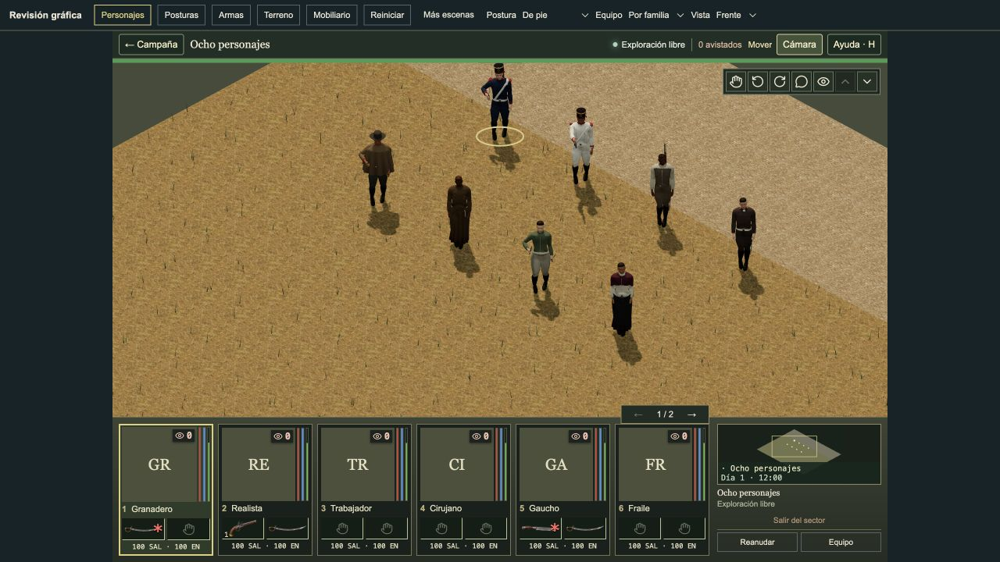
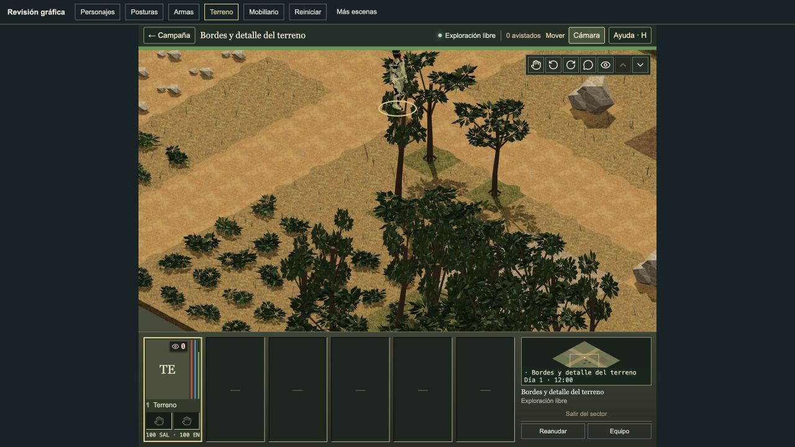
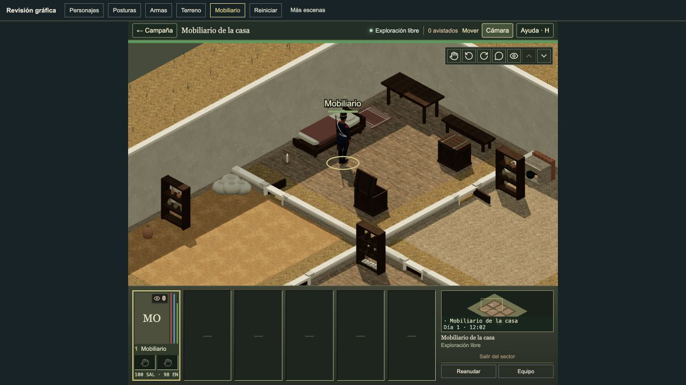
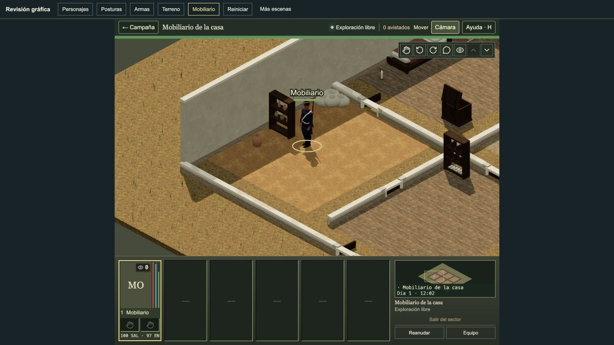
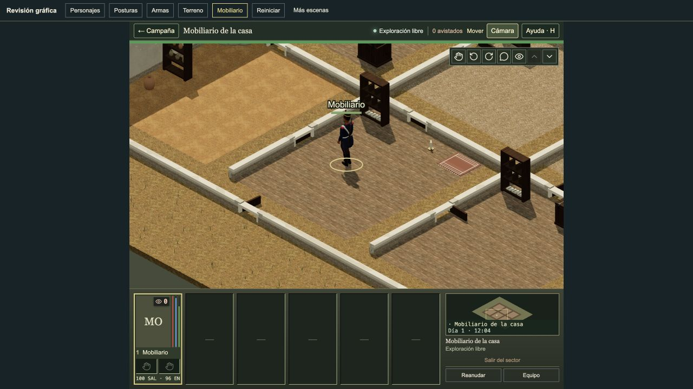

# Tactical graphics reference gallery

[Art records](README.md) · [Plan](../plans/tactical-reference-graphics.md)

Open a picture to inspect it on a phone. These are saved views at nominal
88-pixel character scale; this page can scale them. Each view records its own
stage. The supplied
[house](../references/tactical-graphics-2026-10-08/house-interior.jpg)
and [clearing](../references/tactical-graphics-2026-10-08/clearing-characters.jpg)
guided these small changes. Full JA2 graphics parity is not claimed.

## Approved player view

The approved player view shows the reviewed clothing and relaxed free left arm
in blade, knife and pistol standing rest.

[Before, 88](tactical-reference-2026-10-08/relaxed-arm-before-front-88.jpg) ·
[After, 88](tactical-reference-2026-10-08/relaxed-arm-after-final-front-88.jpg) ·
[After, 44](tactical-reference-2026-10-08/relaxed-arm-after-final-front-44.jpg)

## Ground and plants

The ground view includes irregular soil edges, sparse chips, thin weeds, uneven
rocks and leaf sprays with gaps. The before link compares the leaf pass in the
same expanded terrain scene.

[Before, 88](tactical-reference-2026-10-08/leaf-sprays-before-88.jpg) ·
[After, 88](tactical-reference-2026-10-08/leaf-sprays-after-88.jpg) ·
[After, 44](tactical-reference-2026-10-08/leaf-sprays-after-44.jpg)

## Interior and floor

The interior view shows timber construction, soft bedding and ground-floor
joints and wear. The upper deck and hatch appearance stay preserved.

[Before, 88](tactical-reference-2026-10-08/room-floors-before-house-88.jpg) ·
[After, 88](tactical-reference-2026-10-08/room-floors-after-house-88.jpg) ·
[After, 44](tactical-reference-2026-10-08/room-floors-after-house-44.jpg)

## Gathered sacks

Gathered mouths and broad creases give the sacks a softer outline. Lower bags
meet the floor; the raised bag meets its supports.

[Before, 88](tactical-reference-2026-10-08/storage-cloth-before-store-88.jpg) ·
[After, 88](tactical-reference-2026-10-08/storage-cloth-after-store-88.jpg) ·
[After, 44](tactical-reference-2026-10-08/storage-cloth-after-store-44.jpg)

## Rug bands and fringe

Woven bands and uneven fringe are clearer close up and quiet at normal scale.
The authored footprint and room admission remain exact.

[Before, 88](tactical-reference-2026-10-08/storage-cloth-before-office-88.jpg) ·
[After, 88](tactical-reference-2026-10-08/storage-cloth-after-office-88.jpg) ·
[After, 44](tactical-reference-2026-10-08/storage-cloth-after-office-44.jpg)

The rejected garment-fit record
keeps the worker vest and both shawl LODs unchanged.
[Upper deck preservation](tactical-reference-2026-10-08/room-floors-after-upper-88.jpg),
[open descent aperture](tactical-reference-2026-10-08/room-floors-after-descent-playback.jpg)
and [completed descent](tactical-reference-2026-10-08/room-floors-after-descent-complete.jpg)
are saved separately. Short FPS readings do not prove sustained performance.
