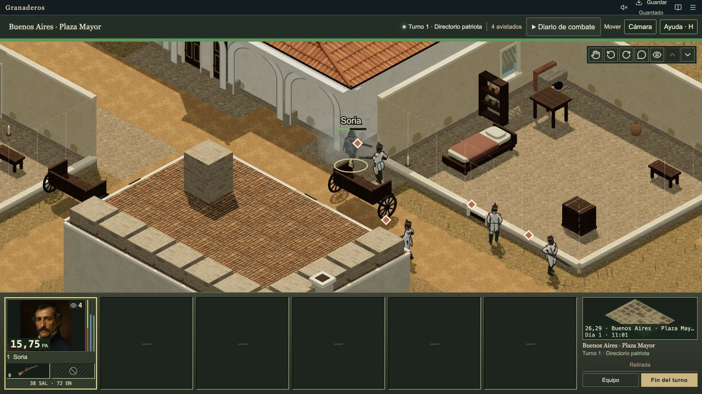

# Domain architecture verification

Date: 28 October 2026.

[Accepted plan](../plans/accepted/domain-architecture.md) ·
[Architecture guide](../architecture/README.md) ·
[C4 levels 1–3](../architecture/c4.md)

## Scope

The implementation covers the eight stages of the accepted domain architecture
plan. The game has domain, application, and infrastructure layers. The campaign
editor is a separate package and application. `campaign-format` supplies their
shared published-file contract.

The domain owns character health and abilities, recruitment, service terms, squad membership, journey and arrival
state, sector and combat lifecycles, AP, selected combat rules, perception,
inventory transfers, resident behavior, corpse removal, and session identity.
Use cases have narrow repository contracts over shared mapping and transaction
infrastructure. Compatibility modules still supply geometry, scenario rules,
and the documented saved-field and command aliases.

## Acceptance map

| Accepted stage | Implementation and verification |
| --- | --- |
| Domain contracts | The glossary defines identity, lifecycle, translation, and naming. Each migrated use case has a request/result contract, repository, class, and README. The progressive guide and C4 diagrams trace the live source. |
| Boundaries and persistence | Import checks enforce inward layer dependencies and independent packages. Tests cover canonical object identity, one accepted revision, revision overflow, restoration, storage ownership, stale worker results, and invalid saves. |
| Recruitment | Real domain objects coordinate service, payment, roster, and placement. Tests cover immediate control, full-squad reserve placement, refusals, legacy prepaid claims, custom equipment, catalogue eligibility, and save/load without a second payment or equipment issue. |
| Journey and arrival | Tests cover required arrival decisions, exact time cutoffs, zero-time and one-minute reversal, unchanged physical costs, new decision identities, simultaneous arrivals, and later reinforcements. |
| World lifecycle | Tests compare visible, retained, and suspended sectors and split versus combined time steps. They cover movement, condition changes, finite item collection, death order, 72-hour corpse removal, ground equipment, and persistent death history. |
| Sector and combat | Tests cover entry, deployment, turn authority, AP, attacks, reactions, visibility limits, partial movement/reload/rest, continuation, and worker/direct execution. Open visits preserve participant state and reject duplicate persistent participation. |
| Editor integration | Independent build and boundary checks cover project, world, and map models; edits, validation, undo/redo, and typed refusals; project persistence; isolated playtests; public preview interfaces; and package export. |
| Compatibility retirement | Runtime callers use migrated entry points. Editor implementation and map-authoring code are removed from the game runtime. Save migrations retain supported wire formats. Route fixtures use immediate recruitment and explicit per-squad arrival decisions. |

## Representative executable evidence

- [Recruitment domain](../../packages/game/domain/personnel/recruitment-service.test.ts),
  [character abilities](../../packages/game/domain/personnel/character-abilities.test.ts),
  [ability mapping](../../tests/character-abilities-mapping.test.mjs),
  [immediate recruitment](../../tests/immediate-recruitment.test.mjs),
  [authored equipment](../../tests/recruitment-equipment.test.mjs), and
  [prepaid migration](../../tests/recruitment-save-migration.test.mjs).
- [Journey domain](../../tests/journey-domain.test.mjs),
  [campaign arrival behavior](../../tests/journey-campaign.test.mjs), and
  [route fixture contracts](../../tests/route-contracts.test.mjs).
- [Residents](../../tests/resident-world.test.mjs),
  [corpse lifecycle](../../tests/world-lifecycle.test.mjs),
  [suspended conditions](../../tests/suspended-sector-health.test.mjs), and
  [inventory mapping](../../tests/inventory-domain-mapping.test.mjs).
- [Sector runtime](../../tests/sector-session-runtime.test.mjs),
  [visit coordination](../../tests/sector-session-coordination.test.mjs),
  [persistent participation](../../tests/game-session-registration.test.mjs),
  [combat](../../tests/combat-domain.test.mjs), and
  [worker admission](../../tests/battle-worker.test.mjs).
- [Canonical persistence](../../tests/game-persistence.test.mjs),
  [retained-sector ownership](../../tests/retained-sector-ownership.test.mjs),
  [transaction rules](../../packages/game/infrastructure/persistence/game-unit-of-work.test.ts),
  [browser writer ownership](../../tests/browser-save-writer.test.mjs),
  [autosave identity](../../tests/campaign-autosave-identity.test.mjs), and
  [visible save status](../../tests/save-progress.test.mjs).
- [Editor policy](../../apps/campaign-editor/tests/editor-policy.test.mjs),
  [editor project](../../apps/campaign-editor/tests/campaign-project.test.mjs), and
  [public integration](../../apps/campaign-editor/tests/public-integration.test.mjs).

## Browser checks

The final production artifact has source identity `e1a4cfbade87` and package
version `0.1.49`. This source identity includes the local architecture changes.
The final restore check displayed `Guardado` and retained the combat values below.
The game and editor browser consoles reported no warnings or errors during these
final checks.

The production export was served locally and exercised through the visible game
UI and its public browser tools. The fresh campaign check performed these steps:

1. Recruit Santiago Soria for one week. Funds changed from 3,200 to 2,192 pesos.
   The roster immediately showed one serving combatant and no pending recruit.
2. Enter Retiro, move the combatant, export progress, and return to the campaign.
3. Prepare the Buenos Aires approach and advance time. Arrival stopped the clock
   at 11:00 and exposed fight and withdrawal; the time-start control was disabled.
4. Withdraw and immediately redirect toward the same sector. Time stayed at
   11:00 and a fresh required arrival decision appeared.
5. Choose fight, distribute the arriving combatant, confirm deployment, and move
   until enemy contact started combat.
6. Fire a shot. The result consumed ammunition and AP and retained the actual
   reaction wounds. Export, browser reload, Continue, and file import preserved
   the same combat position, 38 health, 15.75 displayed AP, empty firearm, and
   nine reserve cartridges.

The editor browser checks covered project editing and undo/redo, map editing
and undo/redo, draft recovery, and a refused reserved project identifier. The
refusal displayed Spanish text and left the accepted project revision unchanged.
The final built editor also created a new project, accepted a name edit, restored
both versions through undo/redo, saved the draft, and validated its two maps and
resource bytes for campaign export.

[Editor refusal screenshot](evidence/2026-10-28-domain-architecture/editor-refusal.png) ·
[Recovered map screenshot](evidence/2026-10-28-domain-architecture/editor-map.png) ·
[Final package validation](evidence/2026-10-28-domain-architecture/editor-validation.png)

## Final automated checks

These checks ran against the completed source on Node `25.9.0`. The CI workflows
use Node 22; local setup requires Node 22.18 or newer.

| Check | Result |
| --- | --- |
| `npm test` | 347 tests in 67 files passed; zero failed, skipped, or cancelled. |
| `npm run typecheck` | Game, web UI, and independent editor passed. |
| `npm run build` | Game and independent editor built; 2,751 staged files and 1,019 asset references verified. |
| `npm run check:architecture` | Dependency boundaries passed for 967 source files. |
| `npm run check:format` | Formatting passed for 285 architecture files. |
| `npm run audit:docs` | 275 requirements, 50 original rows, 87 parity rows, and 150 evidence records passed the documentation audit. |
| `npm run audit:baseline` | 39 baseline checks passed; zero failed. |
| `git diff --check` | Passed. |

The reviewed plan and architecture documents have valid local file links. A
separate read-only review checked the accepted completion gates against source
and tests. The original checkout and its unrelated changes remain intact.

## Verification limits

This record verifies the architecture contracts, regression suite, builds, and
the listed browser flows. It does not certify a complete historical campaign
playthrough, every optional long-route scenario, sustained performance, or all
visual assets. The production build reports the existing large-bundle warning.
This is local implementation evidence; it does not establish a published release.
