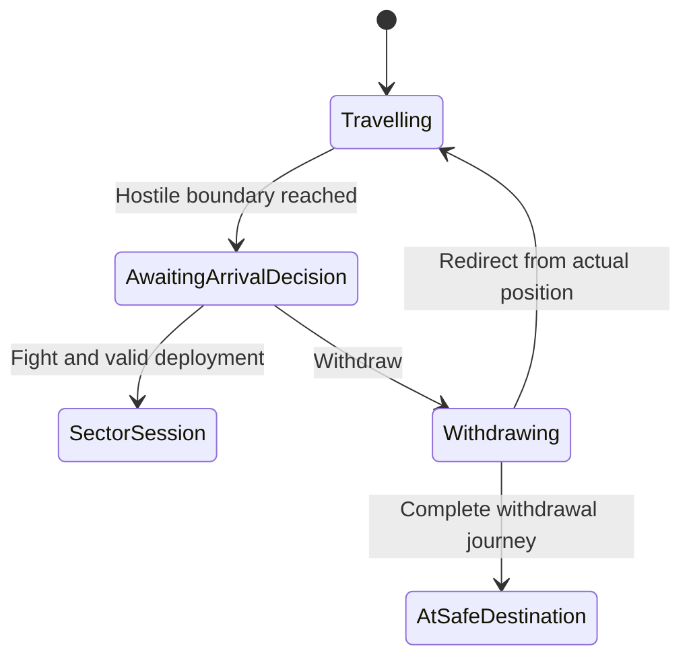

# Domain architecture and implementation plan

Status: implemented and locally verified on 28 October 2026.

[Implementation evidence](../../docs/verification/domain-architecture-2026-10-28.md)
records the completed stages, checks, browser flows, and verification limits.

Decision date: 27 October 2026.

[Ubiquitous language](ubiquitous-language.md) · [Plan index](../README.md)

## Objective

Make Granaderos understandable through a strong, class-based domain model and
explicit application use cases. Domain objects own behavior and protect
invariants. Each use case owns a narrow repository contract over the same game
model. The campaign editor is a separate package.

The architecture must support strategic and sector play as connected views of
one continuing world. Every domain rule must be independently unit-testable.
Names, formatting, types, and object responsibilities must make the code readable.

This document specifies the implementation target. Source documentation and
verification records establish the behavior currently delivered. Implementation includes all stages below, supported save conversions, replacement
tests for changed behavior, and C4 context, container, and component diagrams.

## Accepted decisions

- Use `game/domain`, `game/application`, and `game/infrastructure` within one game
  package. Browser composition connects these layers to the UI.
- Use rich entities, value objects, state machines, policies, factories, and
  focused domain services. Domain behavior belongs to named objects.
- Use one specialized repository interface per use case. Shared infrastructure
  handles identity, transactions, mapping, and persistence.
- Use read-only application use cases over the same logical game model.
- Follow the [canonical glossary](ubiquitous-language.md) across code, tests,
  documentation, and player-facing translations.
- Use `SectorEntryRequest` for entry input, `SectorSession` for the active sector
  visit, and `CombatSession` for a combat episode within that visit.
- At hostile arrival, require fight or withdraw and pause campaign time while
  the player decides. Inspection remains available.
- A withdrawal journey can be redirected immediately or after travel has begun.
  Preserve actual position, elapsed time, and costs.
- Successful recruitment makes the character immediately controllable with
  valid placement and applicable service terms.
- World state evolves in visible and inactive sectors. People can move and take
  eligible items. Corpses have a removal lifecycle on the order of two to three
  game days.
- Package the editing subsystem independently as `campaign-editor`.

## How the target system works

Granaderos has one continuing world. The campaign map and the sector view let
the player control that world at different scales.

1. The player makes a request, such as recruiting a combatant or entering a
   sector. The UI passes that request to the named application use case.
2. The use case obtains the required domain objects through its own repository
   contract. Those objects share the same character identities, item custody,
   and accepted game time as the rest of the game.
3. Domain objects decide whether the request is valid and apply its rules.
   For example, `Journey` preserves physical route progress, and
   `ServiceContract` controls the person's service terms.
4. The use case commits the accepted changes together. Its response tells the
   UI what changed, why a request was refused, or where progress stopped.
5. Read-only use cases supply the information the player can inspect. Storage,
   workers, and rendering use adapters around the same application contracts.

A `SectorSession` lasts for the visit. It can contain exploration, deployment,
and combat. Each `CombatSession` lasts for one combat episode. The character and
item identities continue when either session ends. `WorldTimeline` also applies
world changes to sectors outside the current view.

## Layout and dependencies

The following is a target layout. Files move as their use cases are migrated.

```text
game/
  domain/
  application/
  infrastructure/
  public/
  package.json
campaign-editor/
  domain/
  application/
  infrastructure/
  public/
  web/
  package.json
campaign-format/
  package.json
campaigns/
web/
plans/
  accepted/
```

`game/domain` contains entities, value objects, policies, domain services, and
typed domain events. `game/application` contains use-case classes, requests,
responses, and repository/port interfaces. `game/infrastructure` implements those
interfaces and maps domain objects to external representations. `game/public`
and `campaign-editor/public` contain declared composition entry points. They wire
use cases to infrastructure without weakening the application dependency rule.
`web` contains
the game UI and browser composition.

Domain and application code are independent of React, DOM APIs, browser storage,
worker transport, and UI libraries. Infrastructure depends on application
contracts and the domain. Browser composition supplies concrete implementations.

### The shared campaign-file contract

`campaign-format` defines the published data that both the game and editor need
to understand. A campaign package includes character and equipment definitions,
world and sector maps, dialogue, objectives, presentation, asset references, and
supported ruleset identifiers. For example, an authored map and a dialogue file
use these contracts before either program can consume them.

The shared package owns versioned file schemas, stable content IDs, structural
and cross-reference validation, and conversion into immutable campaign
definitions. Runtime playability and game invariants remain in the game domain.
Editor publication can invoke the public game validation API when needed.

The package imports neither the game application nor the editor. It contains
published definitions and their file contract; mutable game progress and editor
drafts belong to their own models. `campaigns/` stores actual campaign packages.
Imported campaign data selects supported rules; executable scenario behavior is
trusted game code registered by composition.

### Campaign-editor boundary

`campaign-editor` owns projects, editing operations, undo/redo, project storage,
validation reports, and export. Projects can be saved while incomplete.
Publication produces a validated campaign package.

The game does not import the editor. The editor uses the shared campaign format.
A playtest adapter calls the game's public application API with a temporary
package and an isolated game session. It returns an explicit report and keeps
game progress separate from project state. Preview integrations use declared
public APIs; direct imports of internal game modules are prohibited.

Package exports, separate builds, dependency checks, and tests enforce these
boundaries. Game layers remain directories within the game package. Editor
separation is enforced as a package boundary.

## Domain model and ownership

| Object or collaboration | Responsibility and invariant |
| --- | --- |
| `Character` with health and ability value objects | One persistent person; valid condition; death remains recorded across sector visits |
| `ServiceContract` | Valid service terms, start, renewal, and termination |
| `Squad` and `Journey` | Valid membership, location, route progress, and redirection |
| `ArrivalDecision` | Fight and withdraw are mutually exclusive resolutions of one decision |
| `SectorSession` | Valid sector participation, deployment, exploration, and combat-session lifecycle |
| `CombatSession` | Turn authority, AP, reactions, and combat outcome |
| `SectorParticipant` | Character reference and local session state; health and inventory use canonical owners |
| `Item`, `Inventory`, and `ItemTransferService` | Valid quantities and capacity; exactly one custodian per item |
| `Sector` | Persistent environment and current references to residents, objects, and corpses |
| `Corpse` and removal policy | Physical presence and removal time; equipment follows a separate custody rule |
| `WorldTimeline` | Monotonic game time; deterministic ordering; each scheduled event applies once |
| `Treasury` | Valid funds and financial operations |
| `RecruitmentService` | Consistent recruitment across character, contract, treasury, roster, and placement |

Each fact has one owner. Sector indexes, saved projections, and session
participants refer to canonical identities. Moving or recruiting a character
does not create a second authoritative health or inventory record. Item pickup
changes custody atomically.

Strategic position and local coordinates have distinct scopes. A journey owns
progress along its route. A sector session owns local participant coordinates.
Entry and exit synchronize these scopes within one transaction. The model must
define the authoritative position for every lifecycle state.

`GameSession` is a consistency boundary over these objects. It must not become a
class containing every game rule. Cross-object rules use focused domain services.

## Hostile arrival and redirectable withdrawal

A journey that reaches a hostile entry boundary creates an `ArrivalDecision`.
Campaign time pauses, and the game requires `FightOnArrival` or
`WithdrawOnArrival`. Read-only inspection remains available. Commands that would
bypass the unresolved decision or advance world time are refused.

Choosing fight authorizes sector entry and deployment. Physical contact and
initiative rules determine combat-session progression inside the sector visit.
Choosing withdraw creates a journey with withdrawal purpose along a valid route.
Time progression becomes available again; choosing withdraw alone advances no
time and grants no free displacement.

Withdrawal uses the ordinary journey model and its redirection capability:

1. `RedirectJourney` plans from the actual current position, including progress
   within a route segment. It does not reset the squad to a sector center.
2. At zero elapsed time, redirection back toward the hostile sector preserves
   position, resources, and elapsed time. If the squad is still at the hostile
   entry boundary, the new approach immediately creates a fresh arrival decision.
3. After time has passed, redirection preserves completed distance, elapsed time,
   fatigue, and other costs. The squad must cover the remaining distance back
   to the hostile entry boundary before a fresh decision is required.
4. The fresh decision again pauses campaign time. A resolved decision identifier
   cannot be reused to fight, withdraw, or settle twice.
5. Redirection to another legal destination uses the same route validation and
   travel rules. The operation does not imply a free refund or a fixed homeward
   destination.



`Withdrawing` in this diagram is a journey purpose. It has the normal travel and
redirection capabilities. A zero-time redirection at the boundary passes through
`Travelling` and reaches `AwaitingArrivalDecision` in the same accepted command.

`RetreatFromCombat` has its own exit, cost, and participant rules because it
occurs inside an active combat session. Its resulting strategic journey uses
the ordinary journey capabilities when those rules permit departure.

## Immediate recruitment

`RecruitCombatant` evaluates the candidate and current terms, charges any payment
once, starts service, admits the character into the player's force, and establishes
valid placement and immediate player control in one transaction. A refusal leaves
funds, service, and membership unchanged.

Recruitment through different input routes uses the same domain language and
rules. A dialogue workflow can use `RecruitmentService` inside its transaction;
it must not run a second independent commit for the same recruitment.

Placement and squad-capacity rules must be explicit in the use-case contract.
The detailed placement policy is listed in the implementation decisions below.
An accepted request must not leave the recruit unavailable to the player.

## World evolution and item custody

The world advances through `WorldTimeline` using game time. Resident movement,
eligible item taking, ongoing conditions, and corpse removal use domain rules
whether a sector is visible or inactive.

Movement keeps character identity, health, and inventory. Eligible item taking
uses `ItemTransferService` and changes custody at both ends atomically. A removal
of a corpse preserves the character's death history and explicitly settles any
remaining item custody.

A corpse records its death reference and removal schedule. Its removal lifetime
is a named ruleset policy, with the product expectation of approximately two to
three game days. Any randomized lifetime is chosen once from the deterministic
random source and then saved.

Events have stable identity and chronological ordering, including a deterministic
tie-break for simultaneous events. The save records enough scheduling and
completion information to prevent repetition. An interruption stops time at the
actual event boundary. Processing resumes from that point after the decision.

Every time-advancing path obeys the first unresolved arrival timestamp, including
strategic controls, sector actions, worker results, and catch-up processing. A
long operation must not commit effects beyond that boundary. Return accepted
partial progress and any unexecuted continuation explicitly. Resuming must not
repeat spent resources or random draws. An active sector session retains its
state while a campaign arrival decision requires attention.

Advance time through explicit application operations. Read-only use cases do
not secretly advance the world. Restoration and sector entry must expose the
world at the accepted game time without replaying completed events. Real time
spent outside the game does not itself grant elapsed campaign time.

Start with one authoritative timeline. Optimize processing only after measuring
it, and preserve the equivalence of small-step and large-step progression up to
the same decision boundary. Domain events support coordination; versioned
snapshots remain the persistence contract.

## Use cases, repositories, and transactions

Every use case owns one narrow repository interface with a matching name. For
example, `RecruitCombatantUseCase` depends on `RecruitCombatantRepository`.
The repository exposes the domain context and commit operations this intention
requires. Read-only use cases expose only permitted reads.

```text
RecruitCombatantUseCase
  -> RecruitCombatantRepository
     -> shared GameUnitOfWork and identity map
        -> canonical domain objects
        -> GameSnapshotMapper
        -> storage adapter
```

Repository adapters share identity, transaction, mapping, and storage mechanisms.
They do not maintain separate authoritative copies of the same person or item.
Application use cases coordinate domain operations. Domain objects and services
own game decisions. Repositories load and commit those objects.

An accepted transaction reads a session and revision, executes domain behavior,
validates the resulting invariants, and publishes its affected objects together.
It advances the revision once. A refusal publishes no gameplay changes. A
revision conflict cannot overwrite newer state.

Worker jobs carry session ID, revision, request ID, and a serializable context.
They reconstruct domain objects and execute the same rules as direct execution.
Their results pass through the same admission and commit boundary. Workers do
not independently persist the game.

Mapping distinguishes new-object creation from restoration. Restoring a
character must not repeat initial equipment, payments, or recruitment effects.
Validate relationships as well as individual fields. Class behavior is restored
explicitly after JSON or worker transport.

Accepted in-memory progress and persisted progress are distinct statuses.
Autosave follows accepted commits; storage errors identify unsaved progress.
Choose an explicit single-writer or coordinated-writer policy for the storage
adapter rather than assuming an in-memory revision check spans browser tabs.

Use read-only application use cases over the same logical model. Public results
apply the player's information limits. Separate command/query stores and a CQRS
migration are outside this plan.

## Readability and local design patterns

Use classes with private state and intention-revealing methods. Avoid public
setters that allow callers to bypass health, AP, membership, custody, or money
rules. Domain services handle rules that span objects; they remain focused.

Use value objects for money, time, duration, AP, quantities, identifiers, and
locations where they protect meaning and validity. Use explicit state machines
for journey, arrival, sector-session, and combat-session lifecycles. Use policy
classes for rules that vary, and factories for valid creation. Patterns must
have an identified domain responsibility.

Each migrated use case has a readable request, response, repository interface,
class, tests, and short README. Use the canonical stem or a glossary-declared
naming pair, and direct imports between owned modules. Introduce explicit types
for migrated boundaries; select the TypeScript/test integration before the first
code slice.

Source formatting is enforced. Domain constants and serialized states have named
meaning. Expected refusals use typed codes translated by the UI. Names, types,
and structure explain behavior. Comments may record a necessary rationale or
external rule source; they must not compensate for unclear implementation.

## Implementation sequence

| Stage | Deliverable | Completion gate |
| --- | --- | --- |
| 1. Domain contracts | Glossary-backed ownership, state diagrams, request/result contracts, and the detailed product rules for the first slice | A first-time reader can trace the operation, owners, and refusal paths |
| 2. Boundaries and persistence | Game layer restrictions, editor package boundary, versioned snapshot mapping, identity map, transaction contract, and test/type tooling | Boundary and restoration tests pass; runtime cannot import editor internals |
| 3. Recruitment reference slice | Rich recruitment objects/service, use case, specialized repository, adapters, and immediate-availability behavior | Successful and refused recruitment, identity, placement, finances, and save/load are verified |
| 4. Journey and arrival slice | Journey redirection, required arrival decision, pause behavior, fight, and withdrawal | Zero-time reversal, reversal after one minute, physical travel costs, and repeat-decision tests pass |
| 5. World lifecycle slice | Character movement, item custody, corpse removal, and deterministic timeline | Visible/inactive sector and step-size equivalence tests pass |
| 6. Sector and combat slices | SectorSession, CombatSession, deployment, exploration, attacks, interruptions, and completion | Rules, information limits, worker/direct execution, and presentation timing remain correct |
| 7. Editor integration | Public campaign-format boundary, independent editor build, isolated playtests, and preview APIs | Editor can validate/test/export without internal runtime imports; game build excludes editor |
| 8. Compatibility retirement | Migrated callers, explicit save conversions, and removal of obsolete entry points in owned scope | Supported saves and all migrated input routes pass their contract checks |

Implement one reviewable slice at a time. Preserve unrelated workspace changes.
Retain existing entry points behind explicit compatibility adapters until their
callers move. Run affected tests and required repository checks for each slice.

Use characterization tests for behavior the target retains and acceptance tests
for the specified target behavior. Compare deterministic outcomes where parity
is required. A source refactor and a gameplay change must both be visible in the
slice's review scope and tests.

## Acceptance criteria

- All domain rules run in unit tests without UI, browser APIs, or real storage.
  Tests use real domain objects and deterministic time/random inputs; external
  ports can use test implementations.
- Successful recruitment gives immediate control and valid placement, starts
  service, and charges once. Refused recruitment preserves the accepted model.
- Hostile arrival pauses campaign time and exposes fight or withdraw. A decision
  can resolve once and cannot be bypassed by another mutating command.
- Withdrawing can redirect toward the hostile sector at zero elapsed time or
  after one minute. Position and costs remain exact; no time or resources are
  manufactured or refunded by redirection alone.
- A return to the hostile boundary produces a new paused arrival decision.
  Saving/loading withdrawal progress or either decision preserves this behavior.
- Characters have one identity and valid position and retain condition and
  inventory while moving between sectors.
- Every item has one custodian. Transfers and corpse removal settle custody once.
- Corpses persist before their configured removal time and disappear at the
  boundary. Character death remains recorded, and equipment follows its policy.
- World effects are equivalent for visible and inactive sectors. Split and
  combined time steps agree through the same decision boundary. Reopening a
  sector does not repeat events.
- Strategic, sector, worker, and catch-up time advances all stop at the first
  unresolved arrival timestamp, preserving unexecuted work for continuation.
- Save/load and worker transport restore valid classes and relationships without
  repeating creation effects. Stale results cannot replace newer progress.
- Combat completion can return to sector exploration without recreating people,
  items, or the sector session. Sector exit preserves lasting consequences.
- Presentation and queries expose permitted information. Animation timing does
  not become game-rule authority or erase paid partial progress.
- Editor dependencies are absent from the game runtime. Project drafts,
  published campaign packages, and game saves remain distinct contracts.
- Names match the glossary across code, UI translations, tests, and documentation.

## Implementation policies

The following policies define the behavior and verification of each slice:

| Policy | Required decision |
| --- | --- |
| Recruitment placement | Desk recruitment uses the selected safe recruitment site, with the current site preferred. Local recruitment keeps the person at the current sector and preserves carried equipment and condition. A local squad with a free place admits the person; otherwise the person joins the controllable reserve at that location. |
| Corpse lifetime | Remove physical remains 72 game hours after the recorded death. Preserve the death record. A legacy body without a death timestamp starts this lifetime at the saved world timestamp. |
| Corpse equipment | Transfer the remaining recoverable equipment to the ground at the corpse location exactly once. Ground equipment has its own lifetime and custody; body removal does not remove it. |
| Offscreen item taking | Once per game hour, a living, free resident outside player service may collect one unit of an unattended adjacent supply if personal stock of that supply is zero. Resolve candidates and items in stable identifier order. Exclude money, weapons, containers, corpses, quest gifts, and held items. Visible and inactive sectors use the same rule. |
| Simultaneous arrivals | Each arriving squad receives its own required decision. Present decisions in arrival-time order, then stable decision-identifier order. Time stays paused until every pending decision is resolved. Fighting at an already open sector admits that squad into the same visit through legal, unoccupied entry cells; it does not refresh existing AP or turn state. |
| Active sector coordination | Choosing a fight for another squad suspends the current visit and activates the arriving squad. Each visit retains combat round, AP, equipment, and unfinished orders. World conditions continue through the common timeline. The player can resume an open visit after resolving arrival decisions. A sector and a person can belong to only one open visit; arrivals at an open sector join that visit through reinforcement admission. |
| Journey redirection costs | Preserve transport mode, paid segment fare, physical segment position, elapsed work, and fatigue. Redirection advances no time, refunds no payment, and charges no duplicate segment fare. New segments use the normal fare and route rules. Only marching and riding can cross rural world cells; flotilla routes remain restricted to navigable sectors. Returning toward a hostile boundary requires a fresh fight-or-withdraw decision. |
| Save migration | Validated prepaid recruitment becomes immediate service at the saved game instant, using the planned safe destination or another available safe recruitment site. Preserve the payment and guarantee receipt; issue equipment once. If every site is unsafe, preserve the refundable prepaid claim until a legal site becomes available. Restore arrival authority deterministically, keep open visits distinct from retained sector caches, and start a missing legacy corpse timestamp at the saved game instant. |

## Review procedure

Read this plan and the glossary before each domain or application slice. Record
new vocabulary and the reason for distinctions in the glossary. Update affected
use-case READMEs, translations, mappings, and tests together. Keep source guides
accurate about delivered behavior and link them to these target contracts.

Review every deliverable as a first-time reader. State the current requirements
directly. Include only context needed to understand the artifact. Approval of a
plan, a successful build, or a passing unit suite does not establish complete
campaign acceptance.
